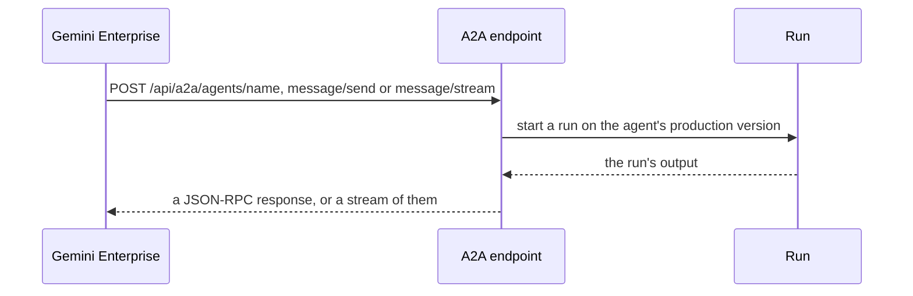

<Info>
**Chapter 7 · Run it on other platforms — step 6 of 9** · [the chapter map](/path/platforms)

- **You will:** export `assistant` as an A2A Agent Card and a request that registers it in a Gemini Enterprise app.
- **You will learn:** that this platform calls your agent instead of hosting it, which four options are required, and how publish plans the registration before it sends it.
- **You need:** [step 1](/platforms/overview), an Agent Workspace deployment reachable over `https` ([Chapter 5](/path/ship)); to publish, the Google Cloud CLI `gcloud`.
</Info>

## What you can do

Gemini Enterprise does not run your agent. It calls it over the Agent2Agent protocol (A2A v0.3,
JSON-RPC), and the agent keeps running on your deployment with its own engine, model, tools and
skills. So almost everything is `mapped` with the note "stays on the deployment": nothing is lost,
and the instructions are never sent to Google.

## Before you start

Four options are required; each is checked, and the export is refused with
`platform_options_invalid` when one is missing or wrong.

```yaml title="agent-workspace.yaml (illustrative)" claim="illustrative"
platforms:
  gemini-enterprise:
    enabled: true
    options:
      projectId: acme-agents
      location: global
      engineId: acme-support-app
      publicBaseUrl: https://agents.example.com
```

| Option               | What it does                                                                         |
| -------------------- | ------------------------------------------------------------------------------------ |
| `projectId`          | Required. The Google Cloud project that owns the Gemini Enterprise app               |
| `location`           | Required. `global`, `us` or `eu`                                                     |
| `engineId`           | Required. The app id                                                                 |
| `publicBaseUrl`      | Required. The `https` origin of your deployment, with no path                        |
| `displayName`        | The name shown in Gemini Enterprise; default the agent's name                        |
| `agentVersion`       | The card's version, default `1.0.0`                                                  |
| `authorizationId`    | An existing Gemini Enterprise authorization resource, if you use OAuth               |
| `examples`           | Up to 10 example prompts shown on the card                                           |

To publish you need the Google Cloud CLI `gcloud`. Install it from
https://cloud.google.com/sdk/docs/install (this install line is unverified against a live tenant),
and sign in with `gcloud auth login`.

## Export

```sh title="Export to Gemini Enterprise (illustrative)" claim="illustrative"
npx aw platforms export --platform gemini-enterprise
```

| File                         | What it is                                                                          |
| ---------------------------- | ----------------------------------------------------------------------------------- |
| `agent-card.json`            | The A2A Agent Card: the agent's name, description and where to call it              |
| `register-agent.request.json`| The REST request that registers the card in your Gemini Enterprise app             |

The card's address is `<publicBaseUrl>/api/a2a/agents/<name>`. Only the root agent is registered;
its subagents run behind it.

## What maps and what is dropped

These are the verdicts the Gemini Enterprise compiler writes to the export report, with the reason for
each. The [platform compatibility matrix](/platforms/matrix) shows what the platform supports, so
a cell there can differ from the verdict a field gets here:

| Your agent has…                    | On Gemini Enterprise                                                                    |
| ---------------------------------- | --------------------------------------------------------------------------------------- |
| Description                        | `native`                                                                                |
| Instructions, model, permissions   | `mapped`: they stay on your deployment, and your runtime enforces them                  |
| Tools, skills, knowledge           | `mapped`: they run on your deployment, so no MCP endpoint is needed                     |
| Subagents, limits                  | `mapped`: they run behind the root agent                                                |
| Local (stdio) MCP servers          | dropped, `stdio_mcp_unsupported`                                                        |

## Publish

```sh title="Plan, then apply (illustrative)" claim="illustrative"
npx aw platforms publish --platform gemini-enterprise
npx aw platforms publish --platform gemini-enterprise --yes
```

Publishing sends `register-agent.request.json` to your Gemini Enterprise app. Before it calls
Google, it checks the Agent Card in the request: a card that declares another A2A version, or one
that your deployment does not serve without credentials, is refused. It then takes a token from
`gcloud auth print-access-token`, which is never printed, and lists the agents already registered.

Without `--yes` it only prints the plan: `POST` for a new registration, `PATCH` for an agent with
the same display name whose description or card changed, or nothing when the registration is
already current. Re-run with `--yes` to send it.

Three things in this path are unverified against a live tenant: the shape of the list response and
its paging (the test fixtures are inferred from the vendor's page, not captured), whether the
`PATCH` needs an `updateMask`, and the `gcloud` install line.

## Your tools

Your tools do not move. Gemini Enterprise calls your agent, and the agent runs its tools on your
deployment as in any other run, so `publicBaseUrl` here is the address of the A2A endpoint, not of
a tool endpoint:



Your deployment serves two routes for each agent: `POST /api/a2a/agents/{agentName}` for the
JSON-RPC calls (`message/send`, `message/stream`, `tasks/get`, `tasks/cancel`) and
`GET /api/a2a/agents/{agentName}/.well-known/agent-card.json` for the card. Every message is an
ordinary run, and a conversation is a session.

The card route needs no credential: it is discovery metadata, served for your deployment's
workspace and limited per client address, to 60 a minute. The reachability check of
`aw platforms publish` and Gemini Enterprise both fetch the card from this route.

Before Gemini can call it:

- The agent must have a `production` version: an agent without one answers `404`.
- Your deployment needs its public address set (`AW_PUBLIC_URL`), or the card route answers `503`.
- A JSON-RPC call needs a credential: a key made for this agent's endpoint client, a workspace API key
  whose role may run the agent, or an OAuth access token issued for this endpoint. A browser
  session is refused, and so is any request with an `Origin` header. A key made for another agent
  answers `404`, as an unknown name does.
- JSON-RPC calls are limited per credential, to 120 a minute, of which 30 may start a run.

## What is not there yet

- The list response and its paging, the `PATCH` without an `updateMask`, and the `gcloud` install
  line are unverified against a live tenant.
- Local (stdio) MCP servers are dropped.

<Card title="Next: AWS AgentCore" icon="arrow-right" href="/platforms/aws-agentcore">
  Export to Amazon Bedrock AgentCore.
</Card>
