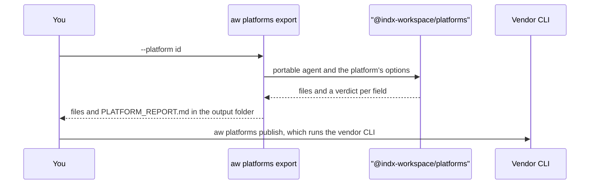

<Info>
**Chapter 7 · Run it on other platforms — step 1 of 9** · [the chapter map](/path/platforms)

- **You will:** export the support agent `assistant` to a platform's own files and read the report that comes with them.
- **You will learn:** the portable agent definition, the three verdicts (`native`, `mapped`, `dropped`), the exit codes, and how your code tools reach a hosted platform.
- **You need:** a project with an agent, from [Chapter 1](/path/first-agent); nothing else for the export itself.
</Info>

`aw platforms` turns the agent in your project into the files another platform expects, and says
for every field whether that platform carries it. Nothing leaves your machine until you run the
vendor's own tool.

**What you can do**

- [List the platforms](#list-the-platforms) an agent can go to
- [Export an agent](#export-an-agent) and [read the report](#read-the-report)
- [Fail the export when anything is dropped](#fail-when-a-field-is-dropped) with `--strict`
- [Check a project](#check-a-project) with `aw platforms doctor`
- [Import an agent from a platform](#import-an-agent-from-a-platform)
- [Set the platform's options](#set-the-platform’s-options) in `agent-workspace.yaml`
- [Take your code tools along](#your-code-tools-on-another-platform)



## The portable definition

Every export starts from one portable definition of the agent. You do not write it: `aw` reads your
`agents/<name>.ts`, with its skills and tools, and builds it. You can also keep the definition in a
file, `agents/<name>.agent.md`, which `aw platforms import` writes and `aw platforms export` reads
next to your TypeScript agents. The front matter holds every field except the instructions, and
the Markdown body is the instructions.

```markdown title="agents/assistant.agent.md (illustrative)" claim="illustrative"
---
apiVersion: agentworkspace.dev/v1
kind: Agent
name: assistant
description: Answers customer questions about orders and refunds.
model:
  id: claude-sonnet-4-6
permissions:
  readFiles: false
  writeFiles: false
  runCommands: false
  unrestrictedNetwork: false
---

You are a customer support assistant. Follow the refund policy skill.
```

## List the platforms

`aw platforms list` prints every platform id with its display name and documentation link. The ids
are the values of `--platform` everywhere below. Runtime drivers, which are where a run executes,
are a separate list (`aw runtimes profiles list`).

## Export an agent

`aw platforms export --platform <id>` compiles the agent and writes the platform's files and a
`PLATFORM_REPORT.md` into `platforms/<id>/`; `--out <dir>` chooses another folder. With several
agents, `--agent <name>` picks the root. A second export into the same folder overwrites what it
produces, deletes nothing, and names files it did not produce as `stale`.

The block below creates a fresh project and exports its agent to the Microsoft 365 declarative
agent format. That platform needs no options, so it exports a fresh project as it is. Every other
hosted platform needs at least one setting first; its guide says which. The eject targets need none.

```sh title="Export a fresh project's agent" claim="run"
npm create @indx-workspace@latest my-agent -- --yes
cd my-agent && npx aw platforms list && npx aw platforms export --platform m365-declarative-agent --out platform-out
```

## Read the report

The export prints a table with one row per field and writes the same table to `PLATFORM_REPORT.md`:

```markdown title="PLATFORM_REPORT.md (illustrative)" claim="illustrative"
# Platform report: Microsoft 365 Copilot declarative agent

Agent `assistant` exported to `m365-declarative-agent`.

| Field | Verdict | Code | Why |
| --- | --- | --- | --- |
| instructions | native |  | … |
| model | dropped | field_unsupported | Microsoft 365 Copilot selects the model |

1 native · 0 mapped · 1 dropped
```

A report that spans several agents groups the rows under one heading per agent, after a `Project`
heading for project-level fields.

Each row has one of three verdicts:

| Verdict   | Meaning                                                                          |
| --------- | -------------------------------------------------------------------------------- |
| `native`  | The platform has the capability and the field is carried as it is.               |
| `mapped`  | The field is translated; the row says how.                                       |
| `dropped` | The platform cannot carry it. The row carries a code that says why.              |

A dropped row names one of these codes:

| Code                         | The platform cannot carry…                                                       |
| ---------------------------- | -------------------------------------------------------------------------------- |
| `code_tool_needs_public_mcp` | a code tool, because no public tool endpoint is configured                       |
| `stdio_mcp_unsupported`      | a local (stdio) MCP server                                                       |
| `subagents_unsupported`      | a subagent, or what a subagent would carry                                       |
| `skills_unsupported`         | a skill                                                                          |
| `knowledge_unsupported`      | a knowledge source                                                               |
| `builtin_unsupported`        | a built-in tool                                                                  |
| `limits_unsupported`         | a turn or budget limit                                                           |
| `permissions_unsupported`    | a permission, or a rule that narrows a tool                                      |
| `field_unsupported`          | any other field, including `engine` on every hosted platform except Gemini Enterprise |

The [platform compatibility matrix](/platforms/matrix) gives the same answer for every platform at
once.

## Fail when a field is dropped

A dropped field is a report row, not an error: the export still succeeds and exits 0. Add
`--strict` to turn it into a failure, for example in CI. The files and the report are written
first, then the command exits 5 and prints `N fields dropped for <id>; see <dir>/PLATFORM_REPORT.md`.

A platform can also refuse an agent outright, and then nothing is written. A refusal prints
`<code>: <message>` and exits 1:

| Code                         | Meaning                                                                          |
| ---------------------------- | -------------------------------------------------------------------------------- |
| `platform_model_unsupported` | the platform does not run the agent's model                                      |
| `platform_limit_exceeded`    | a size or count limit of the platform is exceeded, such as an instruction limit  |
| `platform_options_invalid`   | the platform's options are missing or wrong                                      |
| `platform_agent_not_found`   | the root agent, or one of its subagents, is not in the project                   |

| Exit code | When                                                                                   |
| --------- | -------------------------------------------------------------------------------------- |
| 0         | the export was written, whatever the report says                                       |
| 1         | a refusal, no project in the directory, a platform with `enabled: false`, a failed `doctor` check |
| 2         | a usage error, such as an unknown platform id or a missing `--platform`                |
| 3         | `aw platforms publish` has a plan with changes and was not given `--yes`               |
| 5         | `--strict` and at least one field was dropped                                          |

## Check a project

`aw platforms doctor` checks every platform enabled in `agent-workspace.yaml` (or the one named by
`--platform`) without writing anything. It prints one row per check:

- `compile` passes, warns with the number of fields dropped, or fails with the refusal.
- `tool-endpoint` warns when the agent has code tools and no public tool endpoint is configured.
- `prerequisite` warns when the vendor tool that `aw platforms publish` runs is missing or too old.

It exits 1 when a check fails; a warning does not fail it.

## Import an agent from a platform

`aw platforms import --from <id> <path>` reads a platform's own files, from a file or a folder, and
writes `agents/<name>.agent.md` and the skills it finds. It refuses to overwrite a file unless you
pass `--yes`, and it never replaces an `agents/<name>.ts`.

```sh title="Import an agent (illustrative)" claim="illustrative"
npx aw platforms import --from claude-managed-agents ./agents-from-console
```

Five platforms can be read back: Claude Managed Agents, Copilot Studio, the Microsoft 365
declarative agent, Microsoft Foundry and AWS AgentCore. Gemini Enterprise has nothing to import,
because the agent stays on your deployment. The eject targets generate code, and code is not
importable: an ejected Mastra or OpenAI Agents project cannot be read back, and neither can any
other eject target.

## Set the platform's options

The `platforms:` block of `agent-workspace.yaml` names the platforms you export to and holds each
one's options. `enabled` is required. `aw platforms doctor` with no `--platform` checks the entries
that say `enabled: true`, and an export to a platform marked `enabled: false` is refused. The
options are the platform's own and are checked strictly: an unknown key is a
`platform_options_invalid` refusal. A key that holds a credential must name a secret, never carry
its value.

```yaml title="agent-workspace.yaml (illustrative)" claim="illustrative"
platforms:
  claude-managed-agents:
    enabled: true
    options:
      model:
        id: claude-sonnet-4-6
```

`--env local` or `--env production` merges `platforms.<id>.environments.<name>` over the options
for one export. If you chose a platform when you ran `npm create`, the block was written for you with
`enabled: true` and no options; the default answer is none. Each platform guide lists the options
it needs.

## Your code tools on another platform

A hosted platform cannot run your `tools/` code. `aw` reaches it another way: the control plane you
deployed serves the project's code tools as one public MCP endpoint, `POST /mcp/projects/{projectName}`,
and the export points the platform at it. Setting that up takes two options under
`platforms.<id>.options`:

```yaml title="agent-workspace.yaml (illustrative)" claim="illustrative"
platforms:
  copilot-studio:
    enabled: true
    options:
      publisherPrefix: acme
      publicBaseUrl: https://agents.example.com
      toolAuth:
        scheme: bearer
        secretRef: TOOL_ENDPOINT_KEY
```

- `publicBaseUrl` is the `https:` address of your deployment. The endpoint is that address plus
  `/mcp/projects/<project name>`.
- `toolAuth` names the scheme, `bearer` or `oauth2`, and `secretRef`, the name of the secret that
  holds the credential. `aw` carries the name, never the value.

The endpoint accepts a static bearer key or OAuth 2 (client credentials, or authorization code with
PKCE), serves only `tools/list` and `tools/call` (plus the MCP `initialize` and `ping`
handshake), and refuses a browser origin. A platform may
carry only some of these: for example, AWS AgentCore drops `oauth2`.

Without these options, Claude Managed Agents, Copilot Studio, Microsoft 365, Microsoft Foundry and
AWS AgentCore drop every code tool with `code_tool_needs_public_mcp`, and `aw platforms doctor`
warns. AWS AgentCore also drops them when `toolAuth` is `oauth2`. Gemini Enterprise never drops a
code tool: it calls your deployment, which runs the code tool in its own tool host, so it needs no
tool endpoint. Local (stdio) MCP servers are dropped with `stdio_mcp_unsupported` on
every hosted platform, because the platform cannot start a process on your machine. The eject
targets keep both, because the ejected project runs them locally.

## Publish

`aw platforms publish --platform <id>` exports, then runs the vendor's own tool to show what it
would change. A plan with changes exits 3; `--yes` applies it. Each platform guide says which
command is run, and which steps are unverified against a live tenant. Gemini Enterprise and
Microsoft Foundry send their calls over REST with a token from `gcloud` / `az` instead of a vendor
deploy tool.

<Card title="Next: Claude Managed Agents" icon="arrow-right" href="/platforms/claude-managed-agents">
  Export to Anthropic's hosted agents.
</Card>
