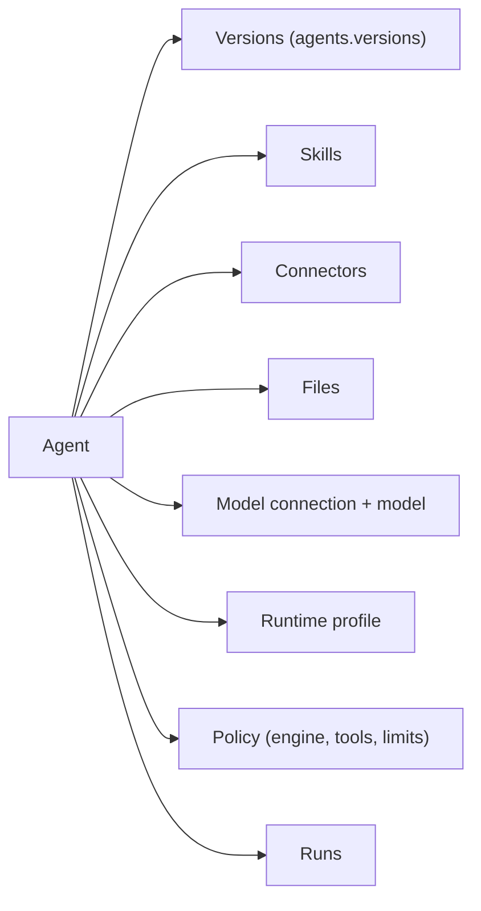

<Info>

- **Read this when:** you create, change or delete an agent through the SDK or `aw agents`, or need the exact fields, errors and assignment rules of the agent record.
- **You will learn:** what an agent record holds, how skills, connectors and files are assigned to it, and how its tool and limit policy is read and replaced.
- **Used in:** [Chapter 2 · Build your agent](/path/build) and [Chapter 1 · Run your first agent](/path/first-agent).

</Info>

An **agent** is a named, reusable configuration: instructions for the model, a model connection
and model, a runtime profile, and a set of permissions. It carries no conversation state of its
own — every execution is a [run](/resources/runs), and a run always executes against exactly one
agent, optionally continuing a [session](/resources/sessions).

What you can do with an agent:

- [Create](#create) one, with its skills, connectors and files assigned in the same call, and [list](#list), [get](#get), [update](#update) or [remove](#remove) it.
- Choose its [model connection and model](/resources/models) and its [runtime profile](/resources/runtimes), or leave each `null` for the workspace default.
- Set its four [permissions](#permissions) and [replace its resource assignments](#replaceresourceassignments).
- Read and narrow its tool, skill and limit [policy](#getpolicy), including which [engine](/resources/engines) runs it.
- Start [runs](/resources/runs) against it.



Skills, connectors and files reach an agent through its [resource assignments](#getresourceassignments);
model and runtime are fields on the record. Versions are immutable, numbered snapshots of the
agent's definition, saved through `aw.agents.versions` and promoted per environment — see
[Agents as code](/guides/agents-as-code) and the
[agent-versions contract](/reference/contracts/agent-versions).

```ts title="create-and-run.ts" claim="compile"
import { createClient } from '@indx-workspace/sdk';

const baseUrl = process.env.AGENT_WORKSPACE_URL;
const apiKey = process.env.AGENT_WORKSPACE_API_KEY;
if (baseUrl === undefined || apiKey === undefined) {
  throw new Error('Set AGENT_WORKSPACE_URL and AGENT_WORKSPACE_API_KEY');
}
const aw = createClient({
  baseUrl,
  auth: { kind: 'api-key', apiKey },
});

const agent = await aw.agents.create({
  name: 'Release notes writer',
  instructions: 'Summarise a diff into three user-facing release-note bullets.',
  modelConnectionId: null, // null = the workspace's default model connection
  model: null, //              null = the workspace's default model
  runtimeProfileId: null, //   null = the workspace's default runtime profile
  permissions: {
    readFiles: true,
    writeFiles: false,
    runCommands: false,
    unrestrictedNetwork: false,
  },
});

const started = await aw.runs.start(agent.id, {
  prompt: 'Summarise the attached diff in three bullet points.',
});

console.log(started.run.id, started.run.status); // "queued"

const finished = await aw.runs.waitForOutcome(started.run.id);
console.log(finished.status, finished.usage.totalTokens);
```

Starting and streaming a run is covered in full on [Runs](/resources/runs); this page
covers the agent record itself.

## The agent record

`AgentResource` (schema: [`AgentResourceSchema`](/reference/contracts/agents#agentresourceschema))
is the shape returned by every method below. Dates are ISO-8601 strings.

<ResponseField name="id" type="string">
  The agent's id.
</ResponseField>
<ResponseField name="workspaceId" type="string">
  The workspace the agent belongs to.
</ResponseField>
<ResponseField name="name" type="string">
  Trimmed, non-blank, unique within the workspace. See [Input bounds](#input-bounds).
</ResponseField>
<ResponseField name="instructions" type="string">
  Free text, not trimmed. An empty string is valid and means "no extra instructions."
</ResponseField>
<ResponseField name="modelConnectionId" type="string | null">
  A model connection id, or `null` for the workspace's default. See [Models](/resources/models).
</ResponseField>
<ResponseField name="model" type="string | null">
  A provider-side model id, or `null` for the workspace's default.
</ResponseField>
<ResponseField name="runtimeProfileId" type="string | null">
  A runtime profile id, or `null` for the workspace's default. See [Runtimes](/resources/runtimes).
</ResponseField>
<ResponseField name="permissions" type="AgentPermissions">
  See [Permissions](#permissions).
</ResponseField>
<ResponseField name="createdBy" type="string | null">
  Legacy human creator attribution, or `null` when an API-key principal created the row.
</ResponseField>
<ResponseField name="ownerPrincipalId" type="string">
  The principal that owns the row for ownership-scoped permission checks.
</ResponseField>
<ResponseField name="createdAt" type="string">
  ISO-8601.
</ResponseField>
<ResponseField name="updatedAt" type="string">
  ISO-8601.
</ResponseField>

<Note>
  `modelConnectionId` and `model` are independent fields on an agent — nothing in the contracts or
  the server requires them to be set together (`apps/web/server/agents/contract.ts`'s
  `parseAgentModel` says so explicitly: "the pairing of `model` with `modelConnectionId` is
  deliberately not constrained here"). This is different from a run's `modelOverride`, which *is*
  all-or-nothing — see [start](/resources/runs#start).
</Note>

### Input bounds

Enforced by the server on `create` and `update` (the contracts package's agent bounds), measured in JavaScript string code units:

| Constant                        | Value     | Applies to                                |
| ------------------------------- | --------- | ----------------------------------------- |
| `AGENT_NAME_MAX_LENGTH`         | `200`     | `name`, after trimming                    |
| `AGENT_INSTRUCTIONS_MAX_LENGTH` | `100_000` | `instructions`, untrimmed                 |
| `AGENT_MODEL_MAX_LENGTH`        | `200`     | `model`, after trimming (when not `null`) |

`name` must be non-blank after trimming, and is stored trimmed — the table has a unique index on
`(workspaceId, name)`, so a trailing space would otherwise let `"Support"` and `"Support "` exist
as two indistinguishable rows. `instructions` is not trimmed. `model` must not be blank when it is
a string; send `null` for "the workspace default model," not `""`.

### Permissions

`AgentPermissions` (schema: [`AgentPermissionsSchema`](/reference/contracts/agents#agentpermissionsschema))
is a required, exact object — every request and response carries all four keys, in this order
(`AGENT_PERMISSION_KEYS`):

<ParamField path="readFiles" type="boolean" required>
  Whether the agent may read files assigned to it.
</ParamField>
<ParamField path="writeFiles" type="boolean" required>
  Whether the agent may write to files assigned to it with `read-write` access. This is also the
  ceiling `replaceResourceAssignments` applies to a `'read-write'` file grant — see
  [`replaceResourceAssignments`](#replaceresourceassignments).
</ParamField>
<ParamField path="runCommands" type="boolean" required>
  Whether the agent may run commands.
</ParamField>
<ParamField path="unrestrictedNetwork" type="boolean" required>
  Whether the agent has unrestricted network access.
</ParamField>

The contracts package defines only the four keys above and their names; how each one is enforced
at runtime is outside `packages/contracts` and `packages/sdk` (the runtime policy layer,
`AgentPolicy`, is server-compiled only — see the note under [`remove`](#remove) and §5.9 of the API
specification). This page does not describe enforcement beyond what the schema and the server
routes above state.

## list

Every agent in the caller's workspace.

<CodeGroup>

```ts title="sdk (illustrative)" claim="illustrative"
const agents = await aw.agents.list();
```

```sh title="aw (illustrative)" claim="illustrative"
aw agents list
```

</CodeGroup>

**Route:** `GET /api/agents` · **SDK:** [`agents.list`](/reference/sdk/agents#list)

Returns `readonly AgentResource[]` (the client unwraps the `{ agents }` envelope of
[`AgentListResponseSchema`](/reference/contracts/agents#agentlistresponseschema)). Every agents
route requires an authenticated caller and answers `401 unauthenticated` or `403 forbidden` before
running its own checks; `list` raises nothing beyond that.

## get

One agent by id.

<CodeGroup>

```ts title="sdk (illustrative)" claim="illustrative"
const agent = await aw.agents.get(agentId);
```

```sh title="aw (illustrative)" claim="illustrative"
aw agents get <id>
```

</CodeGroup>

**Route:** `GET /api/agents/:id` · **SDK:** [`agents.get`](/reference/sdk/agents#get)

| Status | Code               | When                                                                                                                                                                                |
| ------ | ------------------ | ----------------------------------------------------------------------------------------------------------------------------------------------------------------------------------- |
| `400`  | `invalid_agent_id` | The id in the path is not a UUID.                                                                                                                                                   |
| `404`  | `agent_not_found`  | No agent with that id in this workspace — also the answer for an id that belongs to another workspace; the server deliberately does not distinguish the two (§25 tenant isolation). |

## create

Create an agent in the caller's workspace, optionally with its resource assignments in one call.

<CodeGroup>

```ts title="sdk (illustrative)" claim="illustrative"
const agent = await aw.agents.create({
  name: 'Support triage',
  instructions: 'Read the incoming ticket and route it to the right team.',
  modelConnectionId: null,
  model: null,
  runtimeProfileId: null,
  permissions: {
    readFiles: true,
    writeFiles: false,
    runCommands: false,
    unrestrictedNetwork: false,
  },
});

// K-2: assignments composed into the same request — one call, not two.
const { agent: withAssignments, assignments } = await aw.agents.create(input, {
  assignments: { files: [], skillIds: [releaseNotes.id], connectorIds: [github.id] },
});
```

```sh title="aw (illustrative)" claim="illustrative"
aw agents create --file agent.json
# or, for the name only:
aw agents create --name "Support triage" --file agent.json
# with resource assignments in the same call:
aw agents create --file agent.json --skill <skillId> --connector <connectorId> --grant-file <fileId>:read
```

</CodeGroup>

**Route:** `POST /api/agents` (`201`) · **SDK:** [`agents.create`](/reference/sdk/agents#create)
· **Input:** [`CreateAgentInput`](/reference/contracts/agents#createagentinput), optionally with
`{ assignments }`

| Status | Code                       | When                                                                                        |
| ------ | -------------------------- | ------------------------------------------------------------------------------------------- |
| `400`  | `invalid_body`             | The body does not parse into a `CreateAgentInput` — `details` carries one string per field. |
| `409`  | `agent_name_conflict`      | Another agent in this workspace already has that (trimmed) name.                            |
| `400`  | `unknown_model_connection` | `modelConnectionId` does not name a model connection in this workspace.                     |
| `400`  | `unknown_runtime_profile`  | `runtimeProfileId` does not name a runtime profile in this workspace.                       |
| `400`  | `invalid_assignments`      | A compound body's `assignments` is not valid assignment arrays.                             |
| `400`  | `unknown_file`             | An assigned file is not in this workspace — `details` is `[fileId]`.                        |
| `400`  | `unknown_skill`            | An assigned skill is not in this workspace — `details` is `[skillId]`.                      |
| `400`  | `unknown_skill_revision`   | A pinned skill revision is not published — `details` is `["<skillId>@<revision>"]`.         |
| `400`  | `unknown_connector`        | An assigned connector is not in this workspace — `details` is `[connectorId]`.              |

<Note>
  K-2 (issue #234): the HTTP route accepts a **compound** body, `{ agent, assignments }`, that
  creates the agent and its [resource assignments](#getresourceassignments) atomically in one
  request: the agent row and its assignments commit in one database transaction, so a refused
  assignment (one of the `unknown_*` codes above) leaves no agent behind. `AgentsClient.create`
  exposes this as its second parameter, `create(input, { assignments? })` — without it, the body and the response are exactly what they
  were before; with it, the request and the response both carry `{ agent, assignments }`.
  [`replaceResourceAssignments`](#replaceresourceassignments) still exists for changing an
  existing agent's assignments after creation.
</Note>

## update

Apply a partial update. Every field is optional; an omitted field is left unchanged.

<CodeGroup>

```ts title="sdk (illustrative)" claim="illustrative"
const updated = await aw.agents.update(agentId, {
  instructions: 'Read the incoming ticket, route it, and cc the on-call lead.',
});
```

```sh title="aw (illustrative)" claim="illustrative"
aw agents update <id> --file patch.json
```

</CodeGroup>

**Route:** `PATCH /api/agents/:id` (`200`) · **SDK:** [`agents.update`](/reference/sdk/agents#update)
· **Input:** [`UpdateAgentPatch`](/reference/contracts/agents#updateagentpatch)

| Status | Code                                  | When                                                                                                                                                                                              |
| ------ | ------------------------------------- | ------------------------------------------------------------------------------------------------------------------------------------------------------------------------------------------------- |
| `400`  | `invalid_body`                        | The body does not parse into an `UpdateAgentPatch`.                                                                                                                                               |
| `404`  | `agent_not_found`                     | No agent with that id in this workspace.                                                                                                                                                          |
| `409`  | `agent_name_conflict`                 | Another agent already has the (trimmed) name being set.                                                                                                                                           |
| `400`  | `unknown_model_connection`            | `modelConnectionId` does not name a model connection in this workspace.                                                                                                                           |
| `400`  | `unknown_runtime_profile`             | `runtimeProfileId` does not name a runtime profile in this workspace.                                                                                                                             |
| `503`  | `runtime_switch_audit_not_configured` | The patch carries a `runtimeProfileId` key that actually changes the value (a "runtime switch"), and the workspace has no audit sink configured for it (`apps/web/app/api/agents/[id]/route.ts`). |

## restore

Bring back an archived agent. Agents an agent made are archived automatically after 30 days unused;
`restore` clears the archive mark so the agent can run again. An agent that is not archived is
returned unchanged. A restored agent is skipped by the auto-archive sweep for the next 30 days.

<CodeGroup>

```ts title="sdk (illustrative)" claim="illustrative"
const agent = await aw.agents.restore(agentId);
```

```sh title="aw (illustrative)" claim="illustrative"
aw agents restore <id>
```

</CodeGroup>

**Route:** `POST /api/agents/:id/restore` (`200`, no request body) · **SDK:** `agents.restore` · **Who:** the workspace Owner, an Admin, or the agent's owner.

| Status | Code              | When                                                              |
| ------ | ----------------- | ----------------------------------------------------------------- |
| `400`  | `malformed_body`  | The request carries a body; this route takes none.                |
| `404`  | `agent_not_found` | No agent with that id in this workspace, or the id is not a UUID. |
| `403`  | `forbidden`       | The caller is a Viewer, or a Builder who does not own the agent.  |

## remove

Delete an agent.

<Warning>
  **Today:** `remove` cascades through the agent's sessions, runs, events, transcripts and usage
  records — history is deleted with the definition. **Target:** `archive` and `restore`, with
  history references that never cascade; `remove` reserved for a retention workflow. Tracked as
  [RF-201](/concepts/roadmap#rf-201-agent-archive-instead-of-delete). Until then, prefer disabling
  the agent's use (unassign it from projects, stop starting runs) over deleting it.
</Warning>

<CodeGroup>

```ts title="sdk (illustrative)" claim="illustrative"
await aw.agents.remove(agentId);
```

```sh title="aw (illustrative)" claim="illustrative"
aw agents remove <id>
```

</CodeGroup>

**Route:** `DELETE /api/agents/:id` (`204`, no body) · **SDK:** [`agents.remove`](/reference/sdk/agents#remove)

| Status | Code               | When                                                                                                                        |
| ------ | ------------------ | --------------------------------------------------------------------------------------------------------------------------- |
| `400`  | `invalid_agent_id` | The id in the path is not a UUID.                                                                                           |
| `404`  | `agent_not_found`  | No agent with that id in this workspace — including deleting the same id twice; a repeated delete answers `404`, not `204`. |

`delete` today cascades through the agent's sessions and runs — there is no soft-archive yet
(tracked as [RF-201](/concepts/roadmap#rf-201-agent-archive-instead-of-delete)). The SDK's TSDoc on `remove` says to prefer archiving once it exists. Use
`getGrants` and `replaceGrants` to manage the membership principals allowed to run an agent.

## getResourceAssignments

The files, skills, and connectors the agent may reach.

<CodeGroup>

```ts title="sdk (illustrative)" claim="illustrative"
const assignments = await aw.agents.getResourceAssignments(agentId);
// { files: [{ fileId, access: 'read' | 'read-write' }], skillIds: [...], connectorIds: [...] }
```

```sh title="aw (illustrative)" claim="illustrative"
aw agents assignments get <id>
```

</CodeGroup>

**Route:** `GET /api/agents/:id/resources` · **SDK:** [`agents.getResourceAssignments`](/reference/sdk/agents#getresourceassignments)
· **Schema:** [`AgentResourceAssignments`](/reference/contracts/agents#agentresourceassignmentsschema)

| Status | Code                             | When                                                              |
| ------ | -------------------------------- | ----------------------------------------------------------------- |
| `400`  | `invalid_agent_id`               | The id in the path is not a UUID, or missing.                     |
| `503`  | `agent_resources_not_configured` | Agent resource assignments are not configured on this deployment. |
| `404`  | `agent_not_found`                | No agent with that id in this workspace.                          |

## replaceResourceAssignments

Replace every assignment at once — there is no partial-patch form.

<CodeGroup>

```ts title="sdk (illustrative)" claim="illustrative"
const assignments = await aw.agents.replaceResourceAssignments(agentId, {
  files: [{ fileId: fileId, access: 'read-write' }],
  skillIds: [skillId],
  connectorIds: [],
});
```

```sh title="aw (illustrative)" claim="illustrative"
aw agents assignments set <id> --file assignments.json
```

</CodeGroup>

**Route:** `PUT /api/agents/:id/resources` (`200`) · **SDK:** [`agents.replaceResourceAssignments`](/reference/sdk/agents#replaceresourceassignments)
· **Input/output:** [`AgentResourceAssignments`](/reference/contracts/agents#agentresourceassignmentsschema)

| Status | Code                             | When                                                                               |
| ------ | -------------------------------- | ---------------------------------------------------------------------------------- |
| `400`  | `invalid_agent_id`               | The id in the path is not a UUID, or missing.                                      |
| `503`  | `agent_resources_not_configured` | Agent resource assignments are not configured on this deployment.                  |
| `400`  | `invalid_assignments`            | The body is not `{ files, skillIds, connectorIds }` arrays of the right shape.     |
| `404`  | `agent_not_found`                | No agent with that id in this workspace.                                           |
| `400`  | `unknown-file`                   | A `files[].fileId` does not name a file in this workspace. `message` names the id. |
| `400`  | `unknown-skill`                  | A `skillIds[]` entry does not name a skill in this workspace.                      |
| `400`  | `unknown-connector`              | A `connectorIds[]` entry does not name a connector in this workspace.              |

The agent's own `writeFiles` permission (see [Permissions](#permissions)) is a ceiling on a
`'read-write'` file grant here: the server applies it server-side and the response reflects what
was actually stored, which may be a narrower access level than what was requested.

## getPolicy

S-13 (issue #234): the agent's tool, skill and limit policy — the stored one if
[`replacePolicy`](#replacepolicy) has ever run, otherwise the one compiled from
[Permissions](#permissions) and the agent's resource assignments.

<CodeGroup>

```ts title="sdk (illustrative)" claim="illustrative"
const policy = await aw.agents.getPolicy(agentId);
// { provider: 'claude-agent-sdk', tools: { base, autoApprove, deny, permissionMode,
//   allowDangerouslySkipPermissions }, skills: { mode: 'all' } | { mode: 'allowlist', names },
//   limits: { maxTurns, maxBudgetUsd } }
```

```sh title="aw (illustrative)" claim="illustrative"
aw agents policy get <id>
```

</CodeGroup>

**Route:** `GET /api/agents/:id/policy` · **SDK:** [`agents.getPolicy`](/reference/sdk/agents#getpolicy)
· **Schema:** [`AgentPolicy`](/reference/contracts/agents#agentpolicyschema)

| Status | Code                          | When                                               |
| ------ | ----------------------------- | -------------------------------------------------- |
| `400`  | `invalid_agent_id`            | The id in the path is not a UUID, or missing.      |
| `503`  | `agent_policy_not_configured` | Agent policy is not configured on this deployment. |
| `404`  | `agent_not_found`             | No agent with that id in this workspace.           |

## replacePolicy

Replace the agent's policy as one operation. The stored policy is strictly narrowing: the server
unions the agent's own permission-derived tool denials and read-only file grant denials into
whatever `tools.deny` is stored, so a replaced policy can restrict an agent past its permission
checkboxes but never widen it past them.

<CodeGroup>

```ts title="sdk (illustrative)" claim="illustrative"
const policy = await aw.agents.replacePolicy(agentId, {
  engine: 'claude-agent-sdk',
  tools: {
    base: 'claude_code_preset',
    autoApprove: [],
    deny: [],
    permissionMode: 'default',
    allowDangerouslySkipPermissions: false,
  },
  skills: { mode: 'allowlist', names: ['release-notes'] },
  limits: { maxTurns: 20, maxBudgetUsd: null },
});
```

```sh title="aw (illustrative)" claim="illustrative"
aw agents policy set <id> --file policy.json
aw agents update <id> --engine claude-agent-sdk    # the discriminant alone
```

</CodeGroup>

`engine` is the discriminant: the harness that runs the agent loop, never the model provider
(`Run.provider`). Which values it may take is a property of the deployment — read them with
[`engines.list()`](/resources/engines), because a value this deployment does not register is
`400 unsupported_engine`, and the earlier spelling `provider` is `400 invalid_body` rather
than silently accepted.

**Route:** `PUT /api/agents/:id/policy` (`200`) · **SDK:** [`agents.replacePolicy`](/reference/sdk/agents#replacepolicy)
· **Input/output:** [`AgentPolicy`](/reference/contracts/agents#agentpolicyschema)

| Status | Code                                | When                                                                                               |
| ------ | ----------------------------------- | -------------------------------------------------------------------------------------------------- |
| `400`  | `invalid_agent_id`                  | The id in the path is not a UUID, or missing.                                                      |
| `503`  | `agent_policy_not_configured`       | Agent policy is not configured on this deployment.                                                 |
| `400`  | `invalid_policy`                    | The body does not parse into an `AgentPolicy` — the `bypassPermissions` cross-field rule included. |
| `400`  | `unsupported_engine`                | `engine` is not one this deployment registers.                                                     |
| `400`  | `invalid_body`                      | The body carries the earlier `provider` discriminant.                                              |
| `400`  | `dangerous_permission_mode_refused` | A parseable `permissionMode: 'bypassPermissions'` — refused regardless of role.                    |
| `409`  | `skill_not_assigned`                | `skills.mode === 'allowlist'` names a skill this agent has no resource assignment for.             |
| `404`  | `agent_not_found`                   | No agent with that id in this workspace.                                                           |

## See also

<CardGroup cols={2}>
  <Card title="Runs" href="/resources/runs">
    Start, stream, and read the outcome of a run against an agent.
  </Card>
  <Card title="Sessions" href="/resources/sessions">
    Continue a conversation across runs.
  </Card>
  <Card title="Models" href="/resources/models">
    Model connections and the models available through them.
  </Card>
  <Card title="Runtimes" href="/resources/runtimes">
    Runtime profiles, connections, and drivers.
  </Card>
  <Card title="Engines" href="/resources/engines">
    The harnesses this deployment can run an agent on — the policy's `engine` discriminant.
  </Card>
</CardGroup>

Errors every method above can also raise at the transport and contract layers — a dropped
connection, a timeout, or a `2xx` body that fails validation — are the same for every resource; see
[Errors](/guides/errors).
