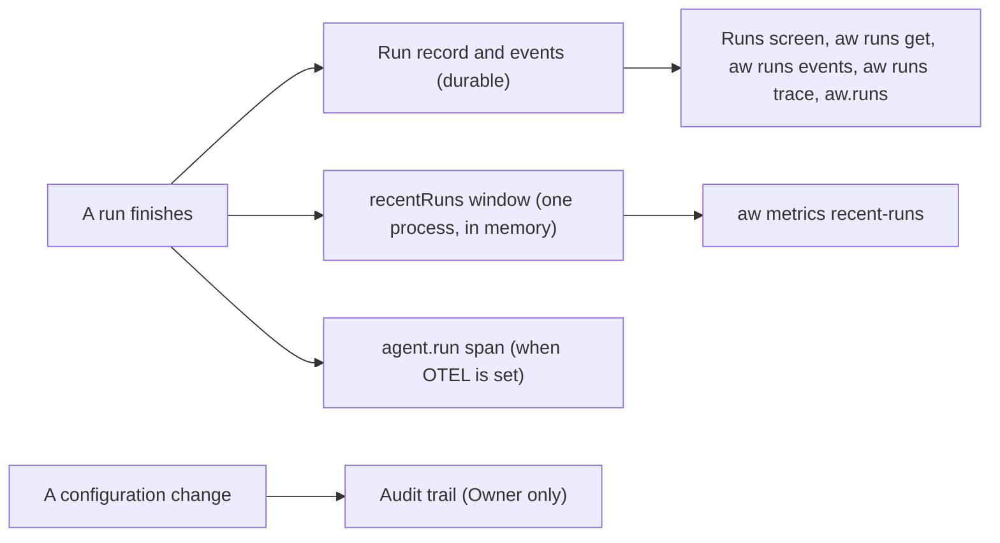

<Info>
**Chapter 3 · Test and improve it — step 1 of 3** · [the chapter map](/path/test)

- **You will:** inspect what your agent's runs did and what they cost, and read who changed what.
- **You will learn:** which view of a run is durable, what the recent-runs window and the audit trail hold, and where the OpenTelemetry span fits.
- **You need:** an agent that has run at least once ([Chapter 2](/path/build)).

</Info>

**What you can do**

| To…                                                                  | Use                                                                                                                            |
| -------------------------------------------------------------------- | ------------------------------------------------------------------------------------------------------------------------------ |
| See one run: status, duration, tokens, cost                          | The **Runs** screen, `aw runs get <run-id>`, or [`aw.runs.get`](/resources/runs#get)                                           |
| Replay what a run did, each tool call with its input and output      | `aw runs events <run-id>`, or [`aw.runs.events`](/resources/runs#events)                                                       |
| Read a run's steps and tool calls as a tree, with tokens and cost    | `aw runs trace <run-id>`                                                                                                       |
| Find the runs that failed                                            | `aw runs list --status failed`, or [`aw.runs.list`](/resources/runs#list)                                                      |
| Glance at what this web process just finished                        | [`aw metrics recent-runs`](#metrics-recentruns)                                                                                |
| Read who changed agents, keys, members and policies (Owner only)     | [`aw audit list`](#audit-list)                                                                                                 |
| Send one span per finished run to your collector                     | `OTEL_EXPORTER_OTLP_ENDPOINT`; see [Export runs to OpenTelemetry](/features/run-observe-evaluate#export-runs-to-opentelemetry) |



`aw runs trace <run-id>` reads the same event stream as `aw runs events` once, to its end, and prints
the run as a tree: the run (status, duration, metered tokens and cost), then each assistant step with
its tool calls, each with its input and output (one line, cut at 200 characters), and the engine's
stop reason. The engine tokens and cost on the last line are what the engine reported for the run,
an estimate; the tokens and cost on the first line are the metered figures, with the accounting state
named when it is not `complete`. Each step, tool call and the result line shows a `+Ns` offset from
the run's start (or, for a run with no start time, from its first stamped event), and a tool call
that got a result shows the time from call to result in ms. These times are when the control plane
recorded each event, not when the engine produced it. `--json` prints the whole tree with the full
inputs and outputs, and carries the raw ISO times as `at` on each step, `calledAt` and `answeredAt`
on each tool call, and `result.at`. A
case in an [evaluation](/guides/evaluations) is an ordinary run, so the `runId` that
`aw eval --json` prints for a case traces the same way. To call one code tool without a run, use
`aw tool call <name> --input '<json>'` in the project directory.

`aw.observability` is the client family for `GET /api/metrics` and `GET /api/audit-events`
(`packages/sdk/src/resources/observability.ts`, contract `@indx-workspace/contracts/observability`).
It has two nested clients: `metrics` and `audit`.

<Note>
  `metrics.recentRuns()` is explicitly **not** the product runs surface. It is the control plane's
  own bounded, in-memory projection of recently finished runs on one web process — an operator's
  glance, not durable and not complete across instances. For the durable, queryable record of a run,
  use [`aw.runs.list`](/resources/runs#list) / [`aw.runs.get`](/resources/runs#get) instead.
</Note>

```ts title="observability.ts" claim="compile"
import { createClient } from '@indx-workspace/sdk';

const baseUrl = process.env.AGENT_WORKSPACE_URL;
const apiKey = process.env.AGENT_WORKSPACE_API_KEY;
if (baseUrl === undefined || apiKey === undefined) {
  throw new Error('Set AGENT_WORKSPACE_URL and AGENT_WORKSPACE_API_KEY');
}
const aw = createClient({
  baseUrl,
  auth: { kind: 'api-key', apiKey },
});

// This process's own recent runs — a window, not a query.
const recent = await aw.observability.metrics.recentRuns();
for (const run of recent) {
  console.log(run.runId, run.status, run.durationMs, run.costUsd);
}

// The most recent 50 audit rows (Owner only), and the cursor of the next 50.
const { events, nextCursor } = await aw.observability.audit.list({ limit: 50 });
for (const event of events) {
  console.log(event.createdAt, event.actorLabel, event.action, event.subjectLabel);
}
```

<CodeGroup>

```sh title="aw (illustrative)" claim="illustrative"
aw metrics recent-runs
aw audit list --limit 50
```

</CodeGroup>

## metrics.recentRuns

`GET /api/metrics`

The web process's own bounded projection of recently finished runs, scoped to the caller's
workspace by the server. Unwraps to the bare array of `RunTelemetry`:

```ts title="illustrative" claim="illustrative"
export interface RunTelemetry {
  runId: string;
  workspaceId: string;
  agentId: string;
  status: RunStatus; // 'queued' | 'running' | 'completed' | 'failed' | 'cancelled'
  durationMs: number | null;
  costUsd: number | null; // the one money field rendered as a JSON number, not a decimal string
}
```

This is a single process's in-memory record of the last runs it personally observed finish — it
does not survive a restart and is not complete across instances. `status` is the terminal status
the launcher wrote; `costUsd` is the settled cost at the moment the run ended, or `null` when the
store held none.

```ts title="illustrative" claim="illustrative"
const recent = await aw.observability.metrics.recentRuns();
const failed = recent.filter((r) => r.status === 'failed');
```

| Code              | Status | Meaning                                       |
| ----------------- | ------ | --------------------------------------------- |
| `unauthenticated` | 401    | The request carried no usable session or key. |

<CodeGroup>

```sh title="aw (illustrative)" claim="illustrative"
aw metrics recent-runs
```

</CodeGroup>

Reference: [`observability.metrics.recentRuns`](/reference/sdk/observability#metrics-recentruns), [`RunTelemetryListResponseSchema`](/reference/contracts/observability#runtelemetrylistresponseschema).

## audit.list

`GET /api/audit-events?limit=&cursor=`

Owner only. One page of the trail, newest rows first, at most `limit` of them, and `nextCursor`
for the next page (`null` on the last). Pass `nextCursor` back unchanged as `cursor`; a cursor
minted for another workspace or another list, or altered, is `400 invalid_cursor`. Pages are keyed
on each row's immutable `(createdAt, id)`, so rows written while you walk never shift a page
([Pagination](/guides/pagination)).

```ts title="illustrative" claim="illustrative"
export const AUDIT_LIST_DEFAULT_LIMIT = 100;
export const AUDIT_LIST_MAX_LIMIT = 500;

export interface AuditListQuery {
  readonly limit?: number;
  readonly cursor?: string;
}
```

```ts title="illustrative" claim="illustrative"
import type { AuditListQuery } from '@indx-workspace/contracts/observability';

const query: AuditListQuery = { limit: 500 }; // omit for the server's default of 100
const { events, nextCursor } = await aw.observability.audit.list(query);

// Or every row, one page request at a time:
for await (const event of aw.observability.audit.listAll({ limit: 500 })) {
  console.log(event.action);
}
```

Each row (`AuditEvent`) is who, what, to which thing, when — labels are snapshots taken when the
row was written, so a line still reads after the actor or subject is renamed or deleted:

```ts title="illustrative" claim="illustrative"
export interface AuditEvent {
  id: string;
  workspaceId: string;
  actorUserId: string | null; // legacy human attribution; null once the user is deleted
  actorPrincipalId: string | null; // null only for a non-workspace service/system actor
  actorLabel: string;
  action: AuditAction;
  subjectId: string | null; // null for an action with no one subject
  subjectLabel: string;
  createdAt: string;
}
```

`action` is one of `AUDIT_ACTIONS`:

```ts title="illustrative" claim="illustrative"
export const AUDIT_ACTIONS = [
  'user-created',
  'user-deleted',
  'agent-changed',
  'provider-credential-changed',
  'api-key-created',
  'api-key-revoked',
  'connector-changed',
  'permission-changed',
  'runtime-profile-changed',
  'project-created',
  'project-deleted',
  'project-archived',
  'project-restored',
  'session-published',
  'public-link-revoked',
  'runnable-link-stopped',
  'public-sharing-policy-changed',
  'invitation-created',
  'invitation-resent',
  'invitation-revoked',
  'invitation-accepted',
] as const;
```

An action name is a name, not a live reference: a value naming an object this deployment does not
hold is still a valid `action`, and a row's `subjectId` may point at something already deleted.

| Code                           | Status | Meaning                                                                     |
| ------------------------------ | ------ | --------------------------------------------------------------------------- |
| `audit_runtime_not_configured` | 503    | This deployment has no audit trail configured.                              |
| `unauthenticated`              | 401    | The request carried no usable session or key.                               |
| `forbidden`                    | 403    | The caller's role is not Owner; only an Owner reads the audit trail.        |
| `invalid_limit`                | 400    | `limit` is present and is not an integer from 1 to 500.                     |
| `invalid_cursor`               | 400    | `cursor` is not a `nextCursor` this list minted for the caller's workspace. |

<CodeGroup>
```sh title="aw (illustrative)" claim="illustrative"
aw audit list
aw audit list --limit 500 --cursor <next-cursor>
aw audit list --all
```
</CodeGroup>

Reference: [`observability.audit.list`](/reference/sdk/observability#audit-list), [`AuditEventListResponseSchema`](/reference/contracts/observability#auditeventlistresponseschema).

## Open questions

- Only an Owner may read the audit trail: the `audit-events` permission has no override for Admin,
  Builder or Viewer. Whether Admin should hold read access is tracked as a follow-up to the
  authorisation model.
