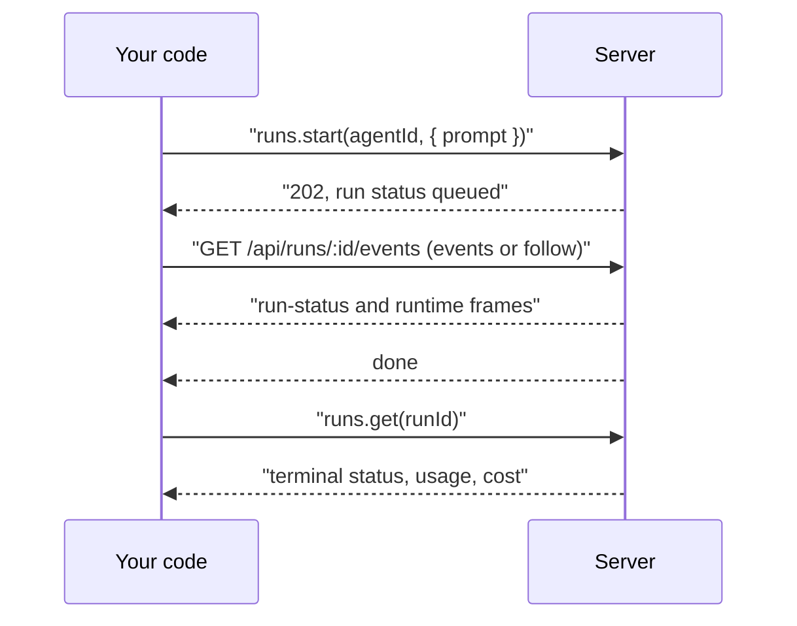

<Info>

- **Read this when:** you start a run from code or `aw runs`, render its event stream, or need its status, usage, cost and error codes.
- **You will learn:** how a queued run becomes a stream of frames and then a settled record, how to resume a dropped stream, and how to interrupt or rate a run.
- **Used in:** [Chapter 1 · Run your first agent](/path/first-agent), [Chapter 3 · Test and improve it](/path/test) and [Chapter 4 · Put it in your product](/path/embed).

</Info>

A **run** is one execution of an [agent](/resources/agents) against a prompt. Starting a run is
asynchronous: the server answers as soon as the run is queued, and the interesting part — what the
agent actually does — arrives on a separate event stream you read from `events`, `follow`, or
`waitForOutcome`.

What you can do with a run:

- [Start](#start) one against an agent, in a new or an existing session, optionally on a numbered version or another model.
- Stream what it does with [`events`](#events) or [`follow`](#follow) (which resumes after a drop), read it as [neutral agent events](#the-neutral-view), or just [`waitForOutcome`](#waitforoutcome).
- [Get](#get) one run or [list](#list) the run history with filters and a cursor.
- [Interrupt](#interrupt) a live run, [revoke its gateway tokens](#revoketokens), or [rate](#rate) its answer for the evaluation loop.



```ts title="stream-a-run.ts (illustrative)" claim="illustrative"
import { createClient } from '@indx-workspace/sdk';

const baseUrl = process.env.AGENT_WORKSPACE_URL;
const apiKey = process.env.AGENT_WORKSPACE_API_KEY;
if (baseUrl === undefined || apiKey === undefined) {
  throw new Error('Set AGENT_WORKSPACE_URL and AGENT_WORKSPACE_API_KEY');
}
const aw = createClient({
  baseUrl,
  auth: { kind: 'api-key', apiKey },
});

const started = await aw.runs.start(agentId, {
  prompt: 'Summarise the attached diff in three bullet points.',
});
console.log(started.run.id, started.run.status); // "queued"

for await (const frame of aw.runs.follow(started.run.id)) {
  switch (frame.kind) {
    case 'run-status':
      console.log('status ->', frame.data.status);
      break;
    case 'runtime':
      console.log('runtime event', frame.name, frame.data);
      break;
    case 'run-failed':
      console.error('this connection could not deliver a successful run:', frame.data.message);
      break;
    case 'stream-reset':
      console.warn('resumed with a gap — discard any rendered transcript:', frame.data.reason);
      break;
    case 'done':
      console.log('stream over'); // says nothing about success — read the run to know that
      break;
  }
}

const run = await aw.runs.get(started.run.id);
console.log(run.status, run.usage.totalTokens, run.cost.amount);
```

## The run record

`RunResource` (schema: [`RunResourceSchema`](/reference/contracts/runs#runresourceschema))
is what `get`, `list`, and the `202` of `start` all render. Dates are ISO-8601 strings.

<ResponseField name="id" type="string" />
<ResponseField name="workspaceId" type="string" />
<ResponseField name="agentId" type="string" />
<ResponseField name="projectId" type="string | null" />
<ResponseField name="initiatingUserId" type="string | null">
  Legacy human attribution; `null` for a run started with an API key.
</ResponseField>
<ResponseField name="sessionId" type="string" />
<ResponseField name="status" type="RunStatus">
  One of `RUN_STATUSES`: `'queued' | 'running' | 'completed' | 'failed' | 'cancelled'`. `queued`
  and `running` are live; the other three are terminal (`TERMINAL_RUN_STATUSES`) — see
  [`isTerminalRunStatus`](/reference/contracts/runs#isterminalrunstatus). A terminal run's event
  stream replays what happened and ends, rather than following anything live.
</ResponseField>
<ResponseField name="createdAt" type="string" />
<ResponseField name="startedAt" type="string | null" />
<ResponseField name="endedAt" type="string | null" />
<ResponseField name="durationMs" type="number | null">
  `null` until both `startedAt` and `endedAt` exist.
</ResponseField>
<ResponseField name="model" type="string | null" />
<ResponseField name="provider" type="ModelProvider | null">
  The **model** provider — who served the model. One of `MODEL_PROVIDERS`:
  `'anthropic' | 'anthropic-compatible' | 'openai' | 'azure-openai' | 'openai-compatible'`. Not
  the engine; see `engine` below.
</ResponseField>
<ResponseField name="engine" type="EngineId | null">
  The **engine** that executed the run — the harness that turned the agent definition and the
  prompt into model calls. The engine the agent's policy named when the run started: one of
  `'claude-agent-sdk' | 'openai-agents' | 'pi' | 'mastra'`, and `null` only on a historic row
  written before the column existed, which is an absence rather than a backfilled guess. See
  [Engines](/resources/engines) for the catalogue one deployment offers.
</ResponseField>
<ResponseField name="engineVersion" type="string | null">
  The adapter and third-party SDK version that ran it, opaque to the platform and reported for
  support. `null` today: the runner does not yet report it.
</ResponseField>
<ResponseField name="modelConnectionId" type="string | null" />
<ResponseField name="usage" type="RunUsage">
  `{ inputTokens, outputTokens, cacheReadInputTokens, cacheCreationInputTokens, totalTokens, toolCalls }`.
  `totalTokens` is derived server-side as the sum of the four token counters.
</ResponseField>
<ResponseField name="cost" type="RunCost">
  `{ amount, currency, priceTableVersion }`. `amount` is a decimal **string**, never a float —
  `"0.000000"` until accounting settles. `priceTableVersion` is `null` until it does too; a settled
  run whose `priceTableVersion` is still `null` used a model the price table has no price for, so
  its `"0.000000"` is not a real zero and `aw runs get` shows it as `unpriced`. The
  `engine-cost=$… (estimate)` that `aw runs events` and `aw runs trace` print is the engine's own
  estimate, not this accounted cost.
</ResponseField>
<ResponseField name="error" type="string | null">
  The safe public failure text, or `null` while the run is live or ended well.
</ResponseField>
<ResponseField name="output" type="{ text: string; structured: unknown } | null">
  The run's answer once it `completed` (ADR-0143): the final `text`, and the `structured` value
  when the run was started with an `outputSchema` (`null` otherwise). `null` while the run is live
  and for a run that failed or was cancelled. Read it typed with [`result`](#result).
</ResponseField>
<ResponseField name="accountingState" type="AccountingState">
  How far usage accounting has progressed: one of `ACCOUNTING_STATES` —
  `'pending' | 'complete' | 'partial' | 'failed' | 'unavailable'`. `complete` is the only settled
  answer; treat `usage`/`cost` as provisional otherwise.
</ResponseField>
<ResponseField name="accountingError" type="string | null" />

## start

Queue a run. The `202` response means the run exists and is `queued` — nothing has necessarily
executed yet.

<CodeGroup>

```ts title="sdk (illustrative)" claim="illustrative"
const started = await aw.runs.start(agentId, {
  prompt: 'Summarise the attached diff in three bullet points.',
  sessionId: null, // omit or null to start a new session
  modelOverride: null, // or { connectionId, model }, always together
});
// started.run.status === 'queued'
// started.events === `/api/runs/${started.run.id}/events`
```

```sh title="aw (illustrative)" claim="illustrative"
aw runs start <agent> --prompt "Summarise the attached diff" \
  [--session <id>] [--model <connection-id>:<model>] [--output-schema <path>] [--file-scope <path>]... [--attach <file-id|path>]... [--idempotency-key <key>] [--wait | --follow]
```

</CodeGroup>

**Route:** `POST /api/agents/:id/runs` (`202`) · **SDK:** [`runs.start`](/reference/sdk/runs#start)
· **Input:** [`StartRunRequest`](/reference/contracts/runs#startrunrequestschema) (the SDK's
`StartRunInput` is the ergonomic shape it derives that wire body from)

<ParamField path="prompt" type="string" required>
  Non-blank after trimming, at most `MAX_PROMPT_CHARS` (`100_000`) code units.
</ParamField>
<ParamField path="sessionId" type="string | null">
  Continue an existing session, or omit/`null` to start one.
</ParamField>
<ParamField path="modelOverride" type="{ connectionId: string; model: string } | null">
  Override the agent's model for this run only. A connection and a model always travel together —
  the contract refuses a body that sets one without the other (`StartRunRequestSchema`'s
  `.refine`). This is stricter than an agent's own `modelConnectionId`/`model`, which are
  independent — see [The agent record](/resources/agents#the-agent-record).
</ParamField>
<ParamField path="version" type="number">
  Run a new session on this numbered version of the agent instead of the one the `local` pointer
  names. A session keeps the version it started on, so `version` together with `sessionId` is
  refused (`400 invalid_body`). `aw chat --agent-version <n>` sends it.
</ParamField>
<ParamField path="outputSchema" type="ZodType | JSON Schema object">
  Ask for an answer of this shape (ADR-0143). The SDK sends a Zod schema as JSON Schema 2020-12 and
  a plain object as is. The root must be `type: "object"`, and the schema is refused
  `400 invalid_body` when it is over a limit (`root_type`, `size`, `dialect`, `ref`, `depth`); the
  message names the limit. Only engines that can produce structured output accept it, otherwise
  the request is refused `422 engine_capability_unsupported` with `details: ["structuredOutput"]`.
  Neither refusal creates a run. A run whose answer does not satisfy the schema fails with
  `output_schema_unsatisfied`. Read the answer with [`result`](#result). From the CLI, `--output-schema <path>` reads the
  schema from a JSON file and checks the same limits before it sends anything.
</ParamField>
<ParamField path="fileScope" type="string[]">
  Narrow the run to part of the agent's file grants (ADR-0147): one to 100 canonical
  workspace-relative paths, each a file or a folder inside what the agent is granted, with no
  repeats. Built-in `search_files` and the files the sandbox receives cover only these paths, so one
  agent can serve many callers without one caller's search reaching another's documents. Omit it to
  keep all of the agent's grants. A scope is never wider than the grants: a path the agent is not
  granted, a parent of a granted file, or any path when the agent has no files fails the run with
  `run_file_scope_not_granted`. That is judged when the run launches, so the start answers `202` and
  the run fails with the code, read through `runFailure`. The continuation after an approval keeps
  the scope of the run it continues. From the CLI, repeat `--file-scope <path>`.
</ParamField>
<ParamField path="attachments" type="{ fileId: string }[]">
  Workspace files the run receives read-only (ADR-0146): one to `MAX_RUN_ATTACHMENTS` (`10`) per
  request, and with a session's earlier uploads at most 20 files, 10 MiB each and 50 MiB in all
  (`422 run_attachments_too_large`). A file the caller may not read, or that does not exist, is
  `404 file_not_found`, and no run is created. From the CLI, repeat `--attach <file>`, where
  `<file>` is a file id or a workspace path.
</ParamField>
<ParamField path="idempotencyKey" type="string">
  Sent as the `Idempotency-Key` header, never in the body (ADR-0151). A start sent again with the
  same key and the same input answers `202` with the run the first one started, whatever its status
  now, so a retry after a lost response does not start a second run. The same key with a different
  input is `409 run_idempotency_conflict`; a blank key or one over 255 characters is
  `400 invalid_idempotency_key`. A key is scoped to the caller and never freed. From the CLI,
  `--idempotency-key <key>`; the CLI refuses a blank key before it sends anything. See
  [Retries and idempotency](/guides/retries-and-idempotency#make-runs-start-idempotent-with-a-key).
</ParamField>

| Status | Code                            | When                                                                                      |
| ------ | ------------------------------- | ----------------------------------------------------------------------------------------- |
| `503`  | `run_api_not_configured`        | The runs API is not configured on this deployment.                                        |
| `401`  | `unauthenticated`               | No valid session or API key.                                                              |
| `403`  | `forbidden`                     | The caller's role does not permit starting this run.                                      |
| `500`  | `authorisation_undecidable`     | The authorisation decision could not be made (a server defect, not a caller error).       |
| `400`  | `invalid_agent_id`              | The agent id in the path is not a UUID.                                                   |
| `400`  | `invalid_body`                  | The body does not parse into a `StartRunRequest`.                                         |
| `400`  | `invalid_idempotency_key`       | `Idempotency-Key` is blank after trimming, or over 255 characters.                        |
| `409`  | `run_idempotency_conflict`      | The `Idempotency-Key` already started a run with a different input — send a new key.      |
| `404`  | `agent_not_found`               | No agent with that id in this workspace.                                                  |
| `404`  | `file_not_found`                | An attachment names a file the caller may not read, or none.                              |
| `404`  | `agent_version_not_found`       | `version` names no version of this agent in this workspace.                               |
| `409`  | `session_not_usable`            | The requested `sessionId` cannot run this agent — omit it to start a new session instead. |
| `409`  | `session_busy`                  | The session already has a `queued` or `running` run — wait for it to end or interrupt it. |
| `422`  | `engine_capability_unsupported` | `outputSchema` was sent but the agent's engine cannot produce structured output.          |

## get

Read one run.

<CodeGroup>

```ts title="sdk (illustrative)" claim="illustrative"
const run = await aw.runs.get(runId);
```

```sh title="aw (illustrative)" claim="illustrative"
aw runs get <id>
```

</CodeGroup>

**Route:** `GET /api/runs/:id` · **SDK:** [`runs.get`](/reference/sdk/runs#get)

| Status | Code                     | When                                                |
| ------ | ------------------------ | --------------------------------------------------- |
| `503`  | `run_api_not_configured` | The runs API is not configured on this deployment.  |
| `401`  | `unauthenticated`        | No valid session or API key.                        |
| `400`  | `invalid_run_id`         | The run id in the path is not a UUID.               |
| `404`  | `run_not_found`          | No run with that id in this workspace.              |
| `403`  | `forbidden`              | The caller's role does not permit reading this run. |

## list

One page of the workspace's run history, newest first. This is the only cursor-paginated resource
in the SDK today — every other `list` returns the whole array. See
[Pagination](/guides/pagination) for the general pattern.

<CodeGroup>

```ts title="sdk (illustrative)" claim="illustrative"
const page = await aw.runs.list({ status: 'completed', agent: agentId, limit: 50 });
console.log(page.runs.length, page.nextCursor);
```

```sh title="aw (illustrative)" claim="illustrative"
aw runs list [--status <status>] [--agent <id>] [--project <id>] [--limit <n>] [--cursor <cursor>]
```

</CodeGroup>

**Route:** `GET /api/runs` · **SDK:** [`runs.list`](/reference/sdk/runs#list)
· **Query:** [`RunListQuery`](/reference/contracts/runs#runlistquery) · **Response:**
[`RunListResponse`](/reference/contracts/runs#runlistresponseschema)

<ParamField path="status" type="RunStatus" />
<ParamField path="agent" type="string">
  UUID.
</ParamField>
<ParamField path="project" type="string">
  UUID.
</ParamField>
<ParamField path="provider" type="ModelProvider" />
<ParamField path="model" type="string" />
<ParamField path="from" type="string">
  ISO-8601 instant.
</ParamField>
<ParamField path="to" type="string">
  ISO-8601 instant; must not be before `from`.
</ParamField>
<ParamField path="user" type="string">
  UUID. Only honoured for a caller whose grant covers the whole workspace (Owner or Admin) — a
  narrower caller gets their own runs regardless of what this filter asks for, and setting it
  explicitly is a `403`.
</ParamField>
<ParamField path="limit" type="number">
  Default `RUN_LIST_DEFAULT_LIMIT` (`20`), maximum `RUN_LIST_MAX_LIMIT` (`200`).
</ParamField>
<ParamField path="cursor" type="string">
  Exactly the `nextCursor` of a previous page.
</ParamField>

Walking every page:

```ts title="list-all-runs.ts (illustrative)" claim="illustrative"
// `cursor` is optional in RunListQuery, so under exactOptionalPropertyTypes it is
// either present with a string or absent — never `undefined`.
let cursor: string | null = null;
const runs = [];
do {
  const page = await aw.runs.list({
    status: 'failed',
    limit: 200,
    ...(cursor === null ? {} : { cursor }),
  });
  runs.push(...page.runs);
  cursor = page.nextCursor;
} while (cursor !== null);
```

| Status | Code                     | When                                                               |
| ------ | ------------------------ | ------------------------------------------------------------------ |
| `503`  | `run_api_not_configured` | The runs API is not configured on this deployment.                 |
| `401`  | `unauthenticated`        | No valid session or API key.                                       |
| `400`  | `invalid_limit`          | `limit` is not a positive integer, or exceeds `200`.               |
| `400`  | `invalid_cursor`         | `cursor` does not decode to a valid pagination boundary.           |
| `400`  | `invalid_status`         | `status` is not one of `RUN_STATUSES`.                             |
| `400`  | `invalid_agent`          | `agent` is not a UUID.                                             |
| `400`  | `invalid_project`        | `project` is not a UUID.                                           |
| `400`  | `invalid_provider`       | `provider` is not one of `MODEL_PROVIDERS`.                        |
| `400`  | `invalid_model`          | `model` is empty.                                                  |
| `400`  | `invalid_from`           | `from` is not a well-formed ISO-8601 instant.                      |
| `400`  | `invalid_to`             | `to` is not a well-formed ISO-8601 instant.                        |
| `400`  | `invalid_date_range`     | `to` is before `from`.                                             |
| `403`  | `user_filter_forbidden`  | `user` was supplied by a caller whose grant is not workspace-wide. |
| `400`  | `invalid_user`           | `user` is not a UUID.                                              |

## events

Open one connection to `GET /api/runs/:id/events` and yield classified frames until the server's
`done` frame. See [Streaming](/guides/streaming) for the general SSE model this follows.

<CodeGroup>

```ts title="sdk (illustrative)" claim="illustrative"
for await (const frame of aw.runs.events(runId)) {
  // frame.kind: 'run-status' | 'runtime' | 'run-failed' | 'stream-reset' | 'done'
}
```

```sh title="aw (illustrative)" claim="illustrative"
aw runs events <id> [--after <event-id>]
```

</CodeGroup>

**Route:** `GET /api/runs/:id/events` · **SDK:** [`runs.events`](/reference/sdk/runs#events)
· **Frames:** [`RunEventFrame`](/reference/sdk/events#runeventframe) (SDK), built from the wire
vocabulary in [run-events](/reference/contracts/run-events)

`RunEventFrame` (`packages/sdk/src/events/run-events.ts`) has five kinds:

<ResponseField name="run-status" type="{ kind, id, data: { status, error } }">
  The platform's durable lifecycle event, appended on every run status change. `id` is a resume
  cursor.
</ResponseField>
<ResponseField name="runtime" type="{ kind, id, name, data }">
  A relayed runtime (Claude Agent SDK) event; `id` is a resume cursor and `data` is the runner's
  classification envelope, passed through unvalidated. See [The neutral view](#the-neutral-view)
  below for a typed reading of it.
</ResponseField>
<ResponseField name="run-failed" type="{ kind, data: { status, message } }">
  This *connection* could not deliver a successful run. `status` is the run's own terminal status,
  or `"unknown"` when the outcome is indeterminate. A thrown stream producer closes without `done`,
  so `follow` can reconnect. An indeterminate final lookup currently sends `done`, which makes
  `follow` stop; see [Run lifecycle](/concepts/run-lifecycle) for that pending D1 decision.
</ResponseField>
<ResponseField name="stream-reset" type="{ kind, data: { reason, resumedAfter } }">
  What follows is not contiguous with what the client already has. `resumedAfter` is the oldest id
  the stream can actually resume from, or `null` when nothing is retained.
</ResponseField>
<ResponseField name="done" type="{ kind }">
  The stream is over. This says nothing about whether the run succeeded — read `run-failed`, or call
  [`get`](#get)/[`waitForOutcome`](#waitforoutcome), for that.
</ResponseField>

`run-status` and `runtime` are the only kinds that carry a resume cursor (`id`). Pass that id back
as `after` (or send it yourself as the `Last-Event-ID` request header) to resume after a drop:

```ts title="illustrative" claim="illustrative"
for await (const frame of aw.runs.events(runId, { after: lastEventId })) {
  /* … */
}
```

Omit `after` to replay the stream from the beginning. `events` itself does not reconnect — it
throws a `TransportError` if the connection ends or breaks before `done` arrives (a clean close, a
reset, an abort); use [`follow`](#follow) for automatic resume. A `200` response that is not an
event stream is a `ContractViolationError` — the server broke its own contract, and retrying will
not fix it. See [Errors](/guides/errors).

| Status | Code                     | When                                                                        |
| ------ | ------------------------ | --------------------------------------------------------------------------- |
| `503`  | `run_api_not_configured` | The runs API is not configured on this deployment.                          |
| `401`  | `unauthenticated`        | No valid session or API key.                                                |
| `400`  | `invalid_run_id`         | The run id in the path is not a UUID.                                       |
| `400`  | `invalid_resume_cursor`  | `Last-Event-ID`/`after` is present but not a cursor this stream can honour. |
| `404`  | `run_not_found`          | No run with that id in this workspace.                                      |
| `403`  | `forbidden`              | The caller's role does not permit reading this run's events.                |

## follow

`events`, resuming with the last resume cursor whenever a connection drops before `done`.

<CodeGroup>

```ts title="sdk (illustrative)" claim="illustrative"
for await (const frame of aw.runs.follow(runId, {
  maxReconnects: 5, //            default 5
  reconnectDelayMs: 3000, //      default 3000; the stream's own `retry:` replaces it once sent
  maxReconnectDelayMs: 30_000, // default 30000, the backoff's ceiling
})) {
  if (frame.kind === 'stream-reset') {
    // discard any transcript you've rendered so far — what follows is not contiguous with it
  }
}
```

```sh title="aw (illustrative)" claim="illustrative"
aw runs follow <id> [--after <event-id>]
```

</CodeGroup>

**SDK:** [`runs.follow`](/reference/sdk/runs#follow)

`follow` reconnects on a dropped connection (any `TransportError` not caused by the caller's own
`signal`) up to `maxReconnects` times, resuming from the last `run-status`/`runtime` id it saw. It
backs off while reconnects keep failing (issue #250): the base is the stream's last `retry:`, or
`reconnectDelayMs` before one arrives; the _n_-th reconnect in a row waits a random time between half
and all of `min(maxReconnectDelayMs, base × 2^(n−1))`; a connection that delivers a new event starts
the count again; and a `429` or `5xx` with `Retry-After` is waited exactly that long. Bounds that are
negative, not finite, or with `reconnectDelayMs` above `maxReconnectDelayMs` throw a `TypeError`
before the first request. [Streaming](/guides/streaming#reconnection) has the details. It throws once reconnection is exhausted, or immediately
for any error that is not a dropped connection (a `ContractViolationError`, for instance, is never
retried). A `stream-reset` frame is yielded as-is, not swallowed: it means the server could not
serve the requested cursor, and a consumer rendering a transcript must discard what it has and
start over from this frame.

Aborting the `signal` you pass in ends the stream with a `TransportError` whose `aborted` is
`true` — the same as every other operation. That is the _only_ thing that ends a `follow` early
from the outside; a `timeoutMs` deadline (no response headers in time) is treated like any other
dropped connection and triggers a reconnect, not a stop. Stopping iteration yourself — an early
`return` or `break` out of the `for await` loop — also closes the underlying connection; you do
not need to call anything else.

Problem codes: the same as [`events`](#events) — `follow` classifies and retries the same
underlying failures, it does not introduce its own.

## waitForOutcome

Follow the stream to its end, then read the run's settled record. The convenience for a caller
that does not render events and only wants the final result.

<CodeGroup>

```ts title="sdk (illustrative)" claim="illustrative"
const run = await aw.runs.waitForOutcome(runId);
console.log(run.status, run.usage.totalTokens, run.cost.amount);
```

```sh title="aw (illustrative)" claim="illustrative"
aw runs wait <id>
```

</CodeGroup>

**SDK:** [`runs.waitForOutcome`](/reference/sdk/runs#waitforoutcome)

`waitForOutcome` drains [`follow`](#follow) (so it inherits `follow`'s reconnect options and
problem codes) and then calls [`get`](#get). If the stream ends but the run's own record still
reports a live status (`queued` or `running`), it raises a `ContractViolationError` — the store is
expected to write the terminal status before the stream's `done` frame, so a live status after
`done` means the platform contradicted its own contract, not a network condition worth retrying.

## result

Wait for the run to end, then read its answer: the text, and the structured value typed by a Zod
schema when you pass one.

<CodeGroup>

```ts title="sdk (illustrative)" claim="illustrative"
const Invoice = z.object({ total: z.number(), currency: z.string() });
const { run } = await aw.runs.start(agentId, {
  prompt: 'Read the invoice.',
  outputSchema: Invoice,
});
const { text, output } = await aw.runs.result(run.id, { schema: Invoice });
// output: { total: number; currency: string } | null
```

```sh title="aw (illustrative)" claim="illustrative"
aw runs start <agent> --prompt "Read the invoice." --output-schema invoice.schema.json --wait --json
aw runs get <id> --json   # .output.structured is the value; .output.text the final text
```

</CodeGroup>

**SDK:** [`runs.result`](/reference/sdk/runs#result) · **Guide:**
[Get typed data back from a run](/guides/structured-output)

`result` drains [`waitForOutcome`](#waitforoutcome) and reads `run.output`. A run that did not
`completed` has no answer, so `text` and `output` are `null` and the reason is in `run.error`. With
`schema`, a structured value that does not parse raises a `ContractViolationError`: the run asked
for this shape and the platform handed back another.

## The neutral view

`runtime` frames carry the Claude Agent SDK's own messages, classified by the runner. Reading them
directly means branching on that provider's shape. `@indx-workspace/sdk/events` also exports
`toAgentEvent`, a pure mapping from a `runtime` frame onto a small, provider-neutral vocabulary —
useful for a chat UI, a CLI, or code written to run against a future second runtime provider. It
returns `null` for the platform's own frames (`run-status`, `run-failed`, `stream-reset`, `done`,
which are already typed on `RunEventFrame`) and never throws.

```ts title="neutral-view.ts (illustrative)" claim="illustrative"
import { createClient } from '@indx-workspace/sdk';
import { toAgentEvent } from '@indx-workspace/sdk/events';

const baseUrl = process.env.AGENT_WORKSPACE_URL;
const apiKey = process.env.AGENT_WORKSPACE_API_KEY;
if (baseUrl === undefined || apiKey === undefined) {
  throw new Error('Set AGENT_WORKSPACE_URL and AGENT_WORKSPACE_API_KEY');
}
const aw = createClient({
  baseUrl,
  auth: { kind: 'api-key', apiKey },
});

for await (const frame of aw.runs.follow(runId)) {
  const event = toAgentEvent(frame);
  if (event === null) continue; // a platform frame — nothing to map

  switch (event.frame) {
    case 'agent.session':
      console.log('engine session', event.engineSessionId, event.model);
      break;
    case 'agent.message':
      console.log(event.role, event.blocks.map((block) => block.text).join('\n'));
      break;
    case 'agent.tool.call':
      console.log('tool call', event.name, event.kind, event.input);
      break;
    case 'agent.tool.result':
      console.log('tool result', event.toolCallId, event.isError ? 'error' : 'ok', event.output);
      break;
    case 'agent.usage':
      console.log('engine tokens', event.inputTokens, event.outputTokens);
      break;
    case 'agent.result':
      console.log('result', event.stopReason, event.turns, event.engineCostUsd);
      break;
    case 'agent.message.delta':
      console.log('delta', event.block, event.text);
      break;
    case 'agent.native':
      console.log('engine event with no neutral meaning', event.type, event.payload);
      break;
    case 'agent.malformed':
      console.log('the engine sent something its adapter could not parse', event.reason);
      break;
  }
}
```

Every `AgentEvent` carries `engine` (which engine produced it) and `raw` (the engine-native message,
capped), so nothing is lost by reading the neutral view first. A payload that does not satisfy its
frame schema is a `ContractViolationError`, not a partially-read object. Full type reference:
[Events](/reference/sdk/events).

## interrupt

Stop a run this caller may run — a consumer-visible cancellation, distinct from merely closing
your own connection (stopping `follow`, or aborting its `signal`, ends _your_ view of the run; it
does not stop the run itself). `interrupt` makes the run terminal: it writes `cancelled` and
revokes the run's gateway tokens even when the runtime itself cannot be reached, so a follower
observes the transition as a `run-status` frame either way.

<CodeGroup>

```ts title="sdk (illustrative)" claim="illustrative"
const run = await aw.runs.interrupt(runId);
console.log(run.status); // "cancelled"
```

```sh title="aw (illustrative)" claim="illustrative"
aw runs interrupt <id>
```

</CodeGroup>

**Route:** `POST /api/runs/:id/interrupt` · **SDK:** [`runs.interrupt`](/reference/sdk/runs#interrupt)

Authorised as the `run` verb (§3.3 of the API specification): Admin any run in the workspace,
Builder and Viewer their own. `aw runs follow --interrupt-on-cancel <id>` calls this on SIGINT,
after the stream itself has been cancelled, so the exit code stays `130`.

| Status | Code                     | When                                                     |
| ------ | ------------------------ | -------------------------------------------------------- |
| `503`  | `run_api_not_configured` | The runs API is not configured on this deployment.       |
| `401`  | `unauthenticated`        | No valid session or API key.                             |
| `400`  | `invalid_run_id`         | The run id in the path is not a UUID.                    |
| `404`  | `run_not_found`          | No run with that id in this workspace.                   |
| `403`  | `forbidden`              | The caller's role, or ownership, does not permit this.   |
| `409`  | `run_not_interruptible`  | The run is already `completed`, `failed` or `cancelled`. |

## revokeTokens

Revoke one, or every active, gateway token issued for a run — Owner and Admin only. Named
`POST /api/runs/:id/revoke-tokens`; the old, unnamed `POST /api/runs/:id` answers identically and
is kept until the next major release.

<CodeGroup>

```ts title="sdk (illustrative)" claim="illustrative"
await aw.runs.revokeTokens(runId); // every active token
await aw.runs.revokeTokens(runId, { tokenId }); // one
```

</CodeGroup>

**Route:** `POST /api/runs/:id/revoke-tokens` · **SDK:** [`runs.revokeTokens`](/reference/sdk/runs#revoketokens)
· **Response:** [`RevokeRunTokensResponse`](/reference/contracts/runs#revokeruntokensresponseschema)

| Status | Code                         | When                                               |
| ------ | ---------------------------- | -------------------------------------------------- |
| `503`  | `run_api_not_configured`     | The runs API is not configured on this deployment. |
| `401`  | `unauthenticated`            | No valid session or API key.                       |
| `403`  | `run_token_revoke_forbidden` | The caller is neither Owner nor Admin.             |
| `400`  | `invalid_run_id`             | The run id in the path is not a UUID.              |
| `404`  | `run_not_found`              | No run with that id in this workspace.             |
| `400`  | `invalid_token_id`           | `tokenId` is present and is not a UUID.            |

## rate

Rate a run's answer with a thumbs-up or thumbs-down and an optional comment (at most 1,000
characters). The rating feeds the [evaluation loop](/guides/evaluations#from-a-rated-run-to-an-eval-case):
a thumbs-down can become a test case.

<CodeGroup>

```ts title="sdk (illustrative)" claim="illustrative"
await aw.runs.rate(runId, { rating: 'down', comment: 'Must not promise a refund' });
```

```sh title="aw (illustrative)" claim="illustrative"
aw runs rate <run-id> --down --comment "Must not promise a refund"   # or --up
```

</CodeGroup>

**Route:** `POST /api/runs/:id/feedback` · **SDK:** [`runs.rate`](/reference/sdk/runs#rate)
· **Input:** [`RunFeedbackRequest`](/reference/contracts/feedback)

The widget's feedback buttons call the same route (`parts: { feedback: true }` on a surface).
`aw feedback` lists the ratings that were given.

## Files a run writes

An agent with `writeFiles` on that ends `completed` leaves what it wrote to its `outputs/`
directory with the run: the files appear in the workspace file browser under
`runs/<run-id>/outputs/`. A run that did not complete, or an agent without `writeFiles`, has none,
and the call answers an empty list. The archive the runtime hands back is capped at 128 MiB by
default; a larger one leaves no outputs.

`runs.outputs` lists them, folders walked, and each entry carries its `name` under `outputs/` and
the `path` that [`files.download`](/resources/files) takes. You never spell the storage prefix.

<CodeGroup>

```ts title="sdk (illustrative)" claim="illustrative"
for (const file of await aw.runs.outputs(runId)) {
  const { bytes } = await aw.files.download(file.path);
  console.log(file.name, bytes.byteLength);
}
```

```sh title="aw (illustrative)" claim="illustrative"
aw runs outputs <run-id>                      # list
aw runs outputs <run-id> --download ./out     # save them, nested folders included
```

</CodeGroup>

**Route:** `GET /api/files?path=runs/:id/outputs` (no route of its own) ·
**SDK:** [`runs.outputs`](/reference/sdk/runs#outputs)

## See also

<CardGroup cols={2}>
  <Card title="Agents" href="/resources/agents">
    The agent definition a run executes against.
  </Card>
  <Card title="Sessions" href="/resources/sessions">
    What `sessionId` continues, and how to read a transcript.
  </Card>
  <Card title="Run lifecycle" href="/concepts/run-lifecycle">
    Statuses, the event stream, and how the two relate.
  </Card>
  <Card title="Streaming" href="/guides/streaming">
    The general SSE and reconnect model this resource follows.
  </Card>
  <Card title="Get typed data back from a run" href="/guides/structured-output">
    Ask for a value of your own shape and read it typed, from code or the CLI.
  </Card>
</CardGroup>

See also [Pagination](/guides/pagination) for the cursor pattern `list` uses and
[Errors](/guides/errors) for `ApiProblemError`, `ContractViolationError`, and
`TransportError` in general.
