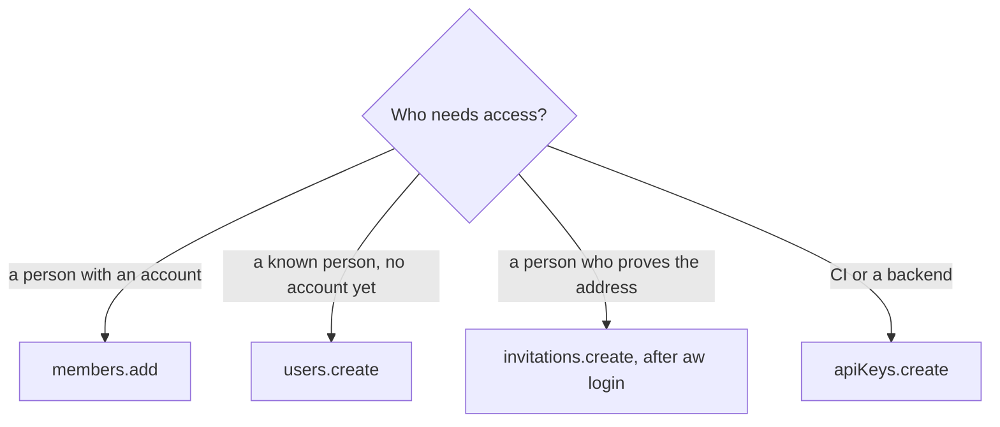

<Info>
**Chapter 6 · Run it for your team — step 1 of 4** · [the chapter map](/path/operate)

- **You will:** add teammates with a role, invite people, and mint and revoke API keys.
- **You will learn:** the four roles, which routes need a person rather than a key, and that a key's secret is shown exactly once.
- **You need:** an Owner or Admin credential on your deployment ([Chapter 5](/path/ship)).

</Info>

**What you can do**

- [List members](#members-list), [add one](#members-add), [change a role](#members-setrole) or [remove one](#members-remove)
- [Create a user and a membership in one call](#users-create)
- [Invite someone by email](#invitations-create), [resend](#invitations-resend) or [revoke](#invitations-revoke) the invitation (after `aw login`)
- [Mint an API key](#apikeys-create) for CI or a backend, [list keys](#apikeys-list) and [revoke one](#apikeys-revoke)



`aw.team` is the client family for `/api/memberships`, `/api/users`, `/api/invitations` and
`/api/api-keys` (`packages/sdk/src/resources/team.ts`). It has four nested clients:

- `aw.team.members` — who belongs to the workspace, and their role.
- `aw.team.users` — the global user accounts behind those memberships.
- `aw.team.invitations` — the human onboarding path: invite, resend, revoke, accept.
- `aw.team.apiKeys` — mint and revoke workspace API keys.

Every role is one of `MEMBERSHIP_ROLES` (contract `@indx-workspace/contracts/team`):

```ts title="illustrative" claim="illustrative"
export const MEMBERSHIP_ROLES = ['owner', 'admin', 'builder', 'viewer'] as const;
export type MembershipRoleName = (typeof MEMBERSHIP_ROLES)[number];
```

```ts title="team.ts" claim="compile"
import { createClient } from '@indx-workspace/sdk';

const baseUrl = process.env.AGENT_WORKSPACE_URL;
const apiKey = process.env.AGENT_WORKSPACE_API_KEY;
if (baseUrl === undefined || apiKey === undefined) {
  throw new Error('Set AGENT_WORKSPACE_URL and AGENT_WORKSPACE_API_KEY');
}
const aw = createClient({
  baseUrl,
  auth: { kind: 'api-key', apiKey },
});

// Who's here.
const members = await aw.team.members.list();
console.log(members.map((m) => `${m.email} (${m.role})`));

// Attach an existing global user as a member.
const membership = await aw.team.members.add({ email: 'new.hire@example.com', role: 'builder' });

// Change their role.
await aw.team.members.setRole(membership.id, 'admin');

// Mint an API key. The secret is shown exactly once, in this response.
const minted = await aw.team.apiKeys.create({ name: 'ci-deploys', role: 'builder' });
console.log('store this now, it will never be shown again:', minted.key);
console.log(minted.warning);

// List keys later — never the secret again, only the display prefix.
const keys = await aw.team.apiKeys.list();
console.log(keys.map((k) => k.keyPrefix));
```

<CodeGroup>
```sh title="aw (illustrative)" claim="illustrative"
aw team members list
aw team members add --email new.hire@example.com --role builder
aw team members set-role <membership-id> admin
aw team api-keys create --name ci-deploys --role builder
aw team api-keys list
```
</CodeGroup>

<Warning>
  `aw.team.invitations.*` refuses an API-key principal with `403 api_key_not_permitted`
  — an invitation is sent to, and redeemed by, a person, and a key represents no
  person. Every `invitations` method below needs `auth: { kind: 'session' }`. In the CLI, `aw
  team invitations` works only after `aw login`, because an API key cannot reach these routes.
</Warning>

<Note>
  Every membership includes its stable `principalId`. Removing a member whose rows are still
  referenced still surfaces a raw failure, and the invitee's accept page does not exist in the
  control plane. Those remaining gaps are tracked as a preflight-and-transfer offboarding flow with
  stable `membership_in_use` responses ([RF-202](/concepts/roadmap#rf-202-member-offboarding)) and
  the complete invitation state machine ([RF-203](/concepts/roadmap#rf-203-invitation-acceptance)).
</Note>

## members.list

`GET /api/memberships`

Every membership in the workspace: who belongs, and with which role. Owner and Admin only —
every other role gets `403 forbidden`.

```ts title="illustrative" claim="illustrative"
const members = await aw.team.members.list();
```

| Code              | Status | Meaning                                       |
| ----------------- | ------ | --------------------------------------------- |
| `unauthenticated` | 401    | The request carried no usable session or key. |
| `forbidden`       | 403    | The caller's role may not list memberships.   |

<CodeGroup>

```sh title="aw (illustrative)" claim="illustrative"
aw team members list
```

</CodeGroup>

Reference: [`team.members.list`](/reference/sdk/team#members-list), [`MembershipListResponseSchema`](/reference/contracts/team#membershiplistresponseschema).

## members.add

`POST /api/memberships`

Attach a user that already exists to the workspace. Does not create a user — use `users.create` or
an invitation for someone who has no account yet.

```ts title="illustrative" claim="illustrative"
import type { AddMemberInput } from '@indx-workspace/contracts/team';

const input: AddMemberInput = { email: 'existing.user@example.com', role: 'viewer' };
const membership = await aw.team.members.add(input);
```

`email` is lower-cased and at most `USER_EMAIL_MAX_LENGTH` (320) characters.

| Code                       | Status | Meaning                                                                                     |
| -------------------------- | ------ | ------------------------------------------------------------------------------------------- |
| `unauthenticated`          | 401    | The request carried no usable session or key.                                               |
| `forbidden`                | 403    | The caller's role may not add members.                                                      |
| `forbidden_role_conferral` | 403    | The caller may not confer the requested role (a role above its own).                        |
| `invalid_field`            | 400    | `email` is missing, blank, or not shaped like an address; or `role` is not one of the four. |
| `no_such_user`             | 404    | No global user exists with that address — create the user first.                            |
| `already_a_member`         | 409    | That address already belongs to this workspace; change its role instead.                    |

<CodeGroup>

```sh title="aw (illustrative)" claim="illustrative"
aw team members add --email existing.user@example.com --role viewer
aw team members add --file member.json
```

</CodeGroup>

Reference: [`team.members.add`](/reference/sdk/team#members-add), [`AddMemberInput`](/reference/contracts/team#addmemberinput).

## members.setRole

`PATCH /api/memberships/:id`

Move a member to another of the four roles.

```ts title="illustrative" claim="illustrative"
const updated = await aw.team.members.setRole(membership.id, 'admin');
```

| Code                       | Status | Meaning                                                                                              |
| -------------------------- | ------ | ---------------------------------------------------------------------------------------------------- |
| `unauthenticated`          | 401    | The request carried no usable session or key.                                                        |
| `forbidden`                | 403    | Ownership is unresolved before the row is read, so an insufficient role is denied outright.          |
| `invalid_field`            | 400    | The membership id in the path is missing/blank, or `role` is not one of the four.                    |
| `forbidden_role_conferral` | 403    | The caller may not confer the requested role.                                                        |
| `no_such_membership`       | 404    | No membership with that id in this workspace (also for a non-UUID id).                               |
| `last_owner`               | 409    | This is the workspace's last Owner; demoting it would leave nobody able to administer the workspace. |

<CodeGroup>
```sh title="aw (illustrative)" claim="illustrative"
aw team members set-role <id> admin
```
</CodeGroup>

Reference: [`team.members.setRole`](/reference/sdk/team#members-setrole), [`MembershipResourceSchema`](/reference/contracts/team#membershipresourceschema).

## members.remove

`DELETE /api/memberships/:id`

Remove a member. `204`, no body.

```ts title="illustrative" claim="illustrative"
await aw.team.members.remove(membership.id);
```

| Code                 | Status | Meaning                                                                                                                                |
| -------------------- | ------ | -------------------------------------------------------------------------------------------------------------------------------------- |
| `unauthenticated`    | 401    | The request carried no usable session or key.                                                                                          |
| `forbidden`          | 403    | Ownership is unresolved before the row is read, so an insufficient role is denied outright.                                            |
| `invalid_field`      | 400    | The membership id in the path is missing or blank.                                                                                     |
| `no_such_membership` | 404    | No membership with that id in this workspace (also for a non-UUID id).                                                                 |
| `last_owner`         | 409    | This is the workspace's last Owner; removing it would leave nobody able to administer the workspace.                                   |
| `membership_in_use`  | 409    | This member still owns projects in this workspace (reassign or delete those first), or a local runtime key from `aw dev` acted for it. |

<CodeGroup>
```sh title="aw (illustrative)" claim="illustrative"
aw team members remove <id>
```
</CodeGroup>

Reference: [`team.members.remove`](/reference/sdk/team#members-remove).

## users.list

`GET /api/users`

The users who are members of the caller's workspace, and no other workspace's.

```ts title="illustrative" claim="illustrative"
const users = await aw.team.users.list();
```

| Code              | Status | Meaning                                       |
| ----------------- | ------ | --------------------------------------------- |
| `unauthenticated` | 401    | The request carried no usable session or key. |
| `forbidden`       | 403    | The caller's role may not list users.         |

<CodeGroup>

```sh title="aw (illustrative)" claim="illustrative"
aw team users list
```

</CodeGroup>

Reference: [`team.users.list`](/reference/sdk/team#users-list), [`UserListResponseSchema`](/reference/contracts/team#userlistresponseschema).

## users.create

`POST /api/users`

Create the global user (or reuse an existing one) and make it a member of the caller's workspace in
one transaction. This is controlled internal provisioning of a _known_ person; the default human
onboarding path — proving control of the address — is `invitations`, below.

```ts title="illustrative" claim="illustrative"
import type { CreateUserInput } from '@indx-workspace/contracts/team';

const input: CreateUserInput = { email: 'jane@example.com', name: 'Jane Smith', role: 'builder' };
const { user, membership } = await aw.team.users.create(input);
```

`name` is trimmed and at most `USER_NAME_MAX_LENGTH` (200) characters; `email` at most 320.

| Code                       | Status | Meaning                                                     |
| -------------------------- | ------ | ----------------------------------------------------------- |
| `unauthenticated`          | 401    | The request carried no usable session or key.               |
| `forbidden`                | 403    | The caller's role may not create users.                     |
| `invalid_field`            | 400    | `email`/`name` malformed, or `role` is not one of the four. |
| `forbidden_role_conferral` | 403    | The caller may not confer the requested role.               |
| `email_taken`              | 409    | That address already belongs to this workspace.             |

<CodeGroup>

```sh title="aw (illustrative)" claim="illustrative"
aw team users create --email jane@example.com --name "Jane Smith" --role builder
```

</CodeGroup>

Reference: [`team.users.create`](/reference/sdk/team#users-create), [`CreatedUserResponseSchema`](/reference/contracts/team#createduserresponseschema).

## invitations.list

`GET /api/invitations` — **session auth only.**

Every invitation this workspace has ever sent, newest first. There is no `state` field on the wire
— pending, expired, accepted and revoked are derived by a consumer from the row's timestamps
(`expiresAt`, `acceptedAt`, `revokedAt`), with a fixed precedence.

```ts title="illustrative" claim="illustrative"
const sessionClient = createClient({ baseUrl: window.location.origin, auth: { kind: 'session' } });
const invitations = await sessionClient.team.invitations.list();
```

| Code                    | Status | Meaning                                     |
| ----------------------- | ------ | ------------------------------------------- |
| `api_key_not_permitted` | 403    | The caller authenticated with an API key.   |
| `unauthenticated`       | 401    | The request carried no usable session.      |
| `forbidden`             | 403    | The caller's role may not list invitations. |

<CodeGroup>

```sh title="aw (illustrative)" claim="illustrative"
aw team invitations list # after aw login
```

</CodeGroup>

Reference: [`team.invitations.list`](/reference/sdk/team#invitations-list), [`InvitationListResponseSchema`](/reference/contracts/invitations#invitationlistresponseschema).

## invitations.create

`POST /api/invitations` — **session auth only.**

Invite an address to one of the four roles the caller may confer. The `token` and `link` in the
response are shown exactly once.

```ts title="illustrative" claim="illustrative"
import type { CreateInvitationInput } from '@indx-workspace/contracts/invitations';

const input: CreateInvitationInput = { email: 'invitee@example.com', role: 'builder' };
const issued = await sessionClient.team.invitations.create(input);
console.log(issued.link); // /accept-invitation?id=...&token=... — send this to the invitee
console.log(issued.warning);
```

| Code                                 | Status | Meaning                                                                                             |
| ------------------------------------ | ------ | --------------------------------------------------------------------------------------------------- |
| `api_key_not_permitted`              | 403    | The caller authenticated with an API key.                                                           |
| `unauthenticated`                    | 401    | The request carried no usable session.                                                              |
| `forbidden`                          | 403    | The caller's role may not send invitations.                                                         |
| `invalid_field`                      | 400    | A field outside `{ email, role }` was sent, `email` is malformed, or `role` is not one of the four. |
| `forbidden_role_conferral`           | 403    | The caller may not confer the requested role.                                                       |
| `already_invited`                    | 409    | A pending invitation to that address already exists — resend or revoke it first.                    |
| `invitations_runtime_not_configured` | 503    | This deployment has no invitation send/audit seam wired in.                                         |
| `authorisation_undecidable`          | 500    | The caller's session no longer resolves to a current member; no invitation was written.             |

<CodeGroup>

```sh title="aw (illustrative)" claim="illustrative"
aw team invitations create --email invitee@example.com --role builder # after aw login
```

</CodeGroup>

Reference: [`team.invitations.create`](/reference/sdk/team#invitations-create), [`IssuedInvitationResponseSchema`](/reference/contracts/invitations#issuedinvitationresponseschema).

## invitations.resend

`POST /api/invitations/:id/resend` — **session auth only.**

Rotate the token and extend the expiry for the same row; the previous token stops working.

```ts title="illustrative" claim="illustrative"
const reissued = await sessionClient.team.invitations.resend(invitationId);
```

| Code                                 | Status | Meaning                                                           |
| ------------------------------------ | ------ | ----------------------------------------------------------------- |
| `api_key_not_permitted`              | 403    | The caller authenticated with an API key.                         |
| `unauthenticated`                    | 401    | The request carried no usable session.                            |
| `forbidden`                          | 403    | The caller's role may not resend invitations.                     |
| `no_such_invitation`                 | 404    | No invitation exists in this workspace with that id.              |
| `already_accepted`                   | 409    | This invitation was already accepted; there is nothing to resend. |
| `invitation_revoked`                 | 409    | This invitation was revoked; create a new one instead.            |
| `invitations_runtime_not_configured` | 503    | This deployment has no invitation send/audit seam wired in.       |

<CodeGroup>
```sh title="aw (illustrative)" claim="illustrative"
aw team invitations resend <id>   # after aw login
```
</CodeGroup>

Reference: [`team.invitations.resend`](/reference/sdk/team#invitations-resend), [`IssuedInvitationResponseSchema`](/reference/contracts/invitations#issuedinvitationresponseschema).

## invitations.revoke

`DELETE /api/invitations/:id` — **session auth only.**

Revoke an invitation. A second revoke answers the same `200` rather than erroring.

```ts title="illustrative" claim="illustrative"
const revoked = await sessionClient.team.invitations.revoke(invitationId);
```

| Code                                 | Status | Meaning                                                           |
| ------------------------------------ | ------ | ----------------------------------------------------------------- |
| `api_key_not_permitted`              | 403    | The caller authenticated with an API key.                         |
| `unauthenticated`                    | 401    | The request carried no usable session.                            |
| `forbidden`                          | 403    | The caller's role may not revoke invitations.                     |
| `no_such_invitation`                 | 404    | No invitation exists in this workspace with that id.              |
| `already_accepted`                   | 409    | This invitation was already accepted; there is nothing to revoke. |
| `invitations_runtime_not_configured` | 503    | This deployment has no invitation audit sink wired in.            |

<CodeGroup>
```sh title="aw (illustrative)" claim="illustrative"
aw team invitations revoke <id>   # after aw login
```
</CodeGroup>

Reference: [`team.invitations.revoke`](/reference/sdk/team#invitations-revoke), [`InvitationResponseSchema`](/reference/contracts/invitations#invitationresponseschema).

## invitations.accept

`POST /api/invitations/:id/accept` — **browser session only, and not a Node caller at all.**

Redeem an invitation as the invitee. The route proves identity through a dedicated OIDC
invitation-identity cookie set by the sign-in flow — never a bearer key and never a regular
workspace session cookie — so this call only ever succeeds from the same browser that just
completed that sign-in. Call it with `auth: { kind: 'session' }` from a page on the control plane's
own origin, right after the OIDC redirect.

```ts title="illustrative" claim="illustrative"
import type { AcceptInvitationInput } from '@indx-workspace/contracts/invitations';

const input: AcceptInvitationInput = { token }; // from the accept-invitation link's ?token=
const accepted = await sessionClient.team.invitations.accept(invitationId, input.token);
console.log(accepted.workspaceId, accepted.membership.role);
```

A wrong id, wrong token, or wrong email are all answered identically, so a caller cannot use the
response to probe which invitations exist:

| Code                                 | Status | Meaning                                                                                                                                                                           |
| ------------------------------------ | ------ | --------------------------------------------------------------------------------------------------------------------------------------------------------------------------------- |
| `cross_origin`                       | 403    | The request did not come from the application's own origin.                                                                                                                       |
| `server_not_configured`              | 503    | Invitation identity verification is unavailable in this deployment.                                                                                                               |
| `invitation_identity_required`       | 401    | The OIDC sign-in that proves the invitee's identity was not completed first.                                                                                                      |
| `invitation_not_valid`               | 404    | The id/token/email combination does not match a pending invitation — also returned when an active _tenant_ session cookie is present, since that is not proof of this invitation. |
| `invitations_runtime_not_configured` | 503    | This deployment has no invitation directory/audit sink wired in.                                                                                                                  |
| `invitation_expired`                 | 410    | The invitation's `expiresAt` has passed.                                                                                                                                          |
| `invitation_revoked`                 | 410    | The invitation was revoked.                                                                                                                                                       |
| `invitation_already_used`            | 409    | The invitation was already accepted by someone.                                                                                                                                   |
| `already_a_member`                   | 409    | The invitee already belongs to this workspace; the invitation is consumed regardless.                                                                                             |

<CodeGroup>

```sh title="aw (illustrative)" claim="illustrative"
# not reachable from the CLI — browser-only, proven by a sign-in cookie
```

</CodeGroup>

Reference: [`team.invitations.accept`](/reference/sdk/team#invitations-accept), [`AcceptedInvitationResponseSchema`](/reference/contracts/invitations#acceptedinvitationresponseschema).

## apiKeys.list

`GET /api/api-keys`

Every API key of the workspace, revoked ones included. Prefixes and timestamps only — never a
secret; there is deliberately no single-key `GET`.

```ts title="illustrative" claim="illustrative"
const keys = await aw.team.apiKeys.list();
```

| Code              | Status | Meaning                                       |
| ----------------- | ------ | --------------------------------------------- |
| `unauthenticated` | 401    | The request carried no usable session or key. |
| `forbidden`       | 403    | The caller's role may not list API keys.      |

<CodeGroup>

```sh title="aw (illustrative)" claim="illustrative"
aw team api-keys list
```

</CodeGroup>

Reference: [`team.apiKeys.list`](/reference/sdk/team#apikeys-list), [`ApiKeyListResponseSchema`](/reference/contracts/api-keys#apikeylistresponseschema).

## apiKeys.create

`POST /api/api-keys`

Mint a key. `key` in the response is the whole credential, shown exactly once — this is the only
response body in the platform that carries it (`MintedApiKeyResponse`). Every whole key matches
`API_KEY_PATTERN` from `@indx-workspace/contracts/api-keys`:

```ts title="illustrative" claim="illustrative"
export const API_KEY_PREFIX = 'ak_live_';
export const API_KEY_ID_LENGTH = 22;
export const API_KEY_SECRET_LENGTH = 43;
// ak_live_<22 base64url chars>_<43 base64url chars>
```

A row read back later shows only the _display prefix_, `ak_live_<key id>`
(`API_KEY_DISPLAY_PREFIX_PATTERN`) — not enough to authenticate.

```ts title="illustrative" claim="illustrative"
import type { CreateApiKeyInput } from '@indx-workspace/contracts/api-keys';

const input: CreateApiKeyInput = {
  name: 'ci-deploys',
  role: 'builder',
  expiresAt: null, // or an ISO-8601 instant later than now
};
const minted = await aw.team.apiKeys.create(input);
console.log(minted.key); // store this now — it is never shown again
```

| Code                       | Status | Meaning                                                                                                                                                   |
| -------------------------- | ------ | --------------------------------------------------------------------------------------------------------------------------------------------------------- |
| `unauthenticated`          | 401    | The request carried no usable session or key.                                                                                                             |
| `forbidden`                | 403    | The caller's role may not create API keys.                                                                                                                |
| `forbidden_role_conferral` | 403    | The caller may not confer the requested role on the key.                                                                                                  |
| `name_taken`               | 409    | This workspace already has an API key with that name.                                                                                                     |
| `invalid_field`            | 400    | `name` is blank/too long (over `API_KEY_NAME_MAX_LENGTH`, 120), `role` is not one of the four, or `expiresAt` is not a later-than-now ISO-8601 timestamp. |

<CodeGroup>

```sh title="aw (illustrative)" claim="illustrative"
aw team api-keys create --name ci-deploys --role builder
aw team api-keys create --file key.json
```

</CodeGroup>

Reference: [`team.apiKeys.create`](/reference/sdk/team#apikeys-create), [`MintedApiKeyResponseSchema`](/reference/contracts/api-keys#mintedapikeyresponseschema).

## apiKeys.revoke

`DELETE /api/api-keys/:id`

Revoke a key: `revokedAt` is written (the row stays, for audit), and the next request with the key
is a `401`. Idempotent — a second revoke returns the same row rather than erroring.

```ts title="illustrative" claim="illustrative"
const revoked = await aw.team.apiKeys.revoke(apiKeyId);
console.log(revoked.revokedAt);
```

| Code              | Status | Meaning                                                                                     |
| ----------------- | ------ | ------------------------------------------------------------------------------------------- |
| `unauthenticated` | 401    | The request carried no usable session or key.                                               |
| `forbidden`       | 403    | Ownership is unresolved before the row is read, so an insufficient role is denied outright. |
| `invalid_field`   | 400    | The API key id in the path is missing or blank.                                             |
| `no_such_api_key` | 404    | No API key with that id in this workspace.                                                  |

<CodeGroup>
```sh title="aw (illustrative)" claim="illustrative"
aw team api-keys revoke <id>
```
</CodeGroup>

Reference: [`team.apiKeys.revoke`](/reference/sdk/team#apikeys-revoke), [`ApiKeyResponseSchema`](/reference/contracts/api-keys#apikeyresponseschema).

## Open questions

- `MembershipResource.principalId` is optional in the contract and, per its TSDoc, is rendered
  only on the `membership` inside `invitations.accept`'s response — `members.list`/`.add`/etc.
  strip it on purpose (`publicMembership`). Every `members.*` example above therefore should not be
  read as having a `principalId`; not a discrepancy, just worth restating since it is easy to miss.
