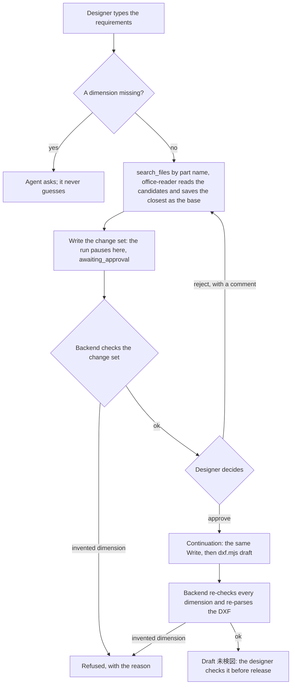
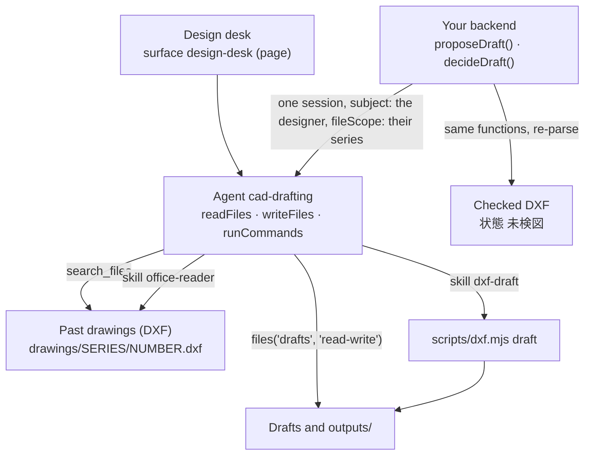

<Info>
**You will build:** an agent that finds the past drawing closest to a new part, pauses on the change set it proposes, and once the designer approves it drafts a DXF marked 未検図 that your backend checks dimension by dimension, using only the drawing series that designer may use.

**You will learn:** a skill that runs a Node script ([Skills](/building/skills)), read and read-write file grants with `runCommands` and `writeFiles` ([Design an agent](/building/agents)), the built-in `search_files` over the drawings narrowed per designer with `fileScope` ([Caller identity](/guides/caller-identity)), a full-page surface ([Embed an agent](/building/embedding)), a run that pauses on the change set's `Write` until the designer approves or rejects it ([Integrate a backend](/building/backend)), the `engine.autoApprove` an unattended run needs for `run_skill_script` and `search_files` and the `engine.requireApproval` that holds `Write` (stored by `aw push` as `tools.autoApprove` and `requireApproval`), and evals ([Evaluations](/guides/evaluations)).

**Time and prerequisites:** about 45 minutes to read; the tests behind it run offline with no API key. To run it on your own workspace, finish [chapter 1](/path/first-agent) first (a project answering under `aw dev`) and have a model key; there is no server to start. Then allow time to upload drawings, run `aw push` and run `aw eval`. Advanced: read [use case 1](/tutorials/manual-search) first.

</Info>

## The result

<Frame caption="The designer types 「ブラケット 140×90、SUS304 t2.0、φ9 の取付穴4か所、新図番 BRK-1101」 and the agent works from the closest past drawing.">
  
</Frame>

**CAD図面エージェント.** A designer types the requirements for a new part into the design desk:
「ブラケット 140×90、SUS304 t2.0、φ9 の取付穴4か所、新図番 BRK-1101」. The agent searches the
past drawings by part name, reads the candidates' outlines, picks the closest and writes the change
set: only what the requirements change in that drawing. That `Write` is held for the designer, who
approves it or rejects it with a comment such as 「BRK-1004 を元に」, which sends the agent back to
revise. Once it is approved the agent writes a new DXF derived from the base drawing and marks it
未検図 (not yet checked) for the designer. It never invents a dimension: what the requirements do
not say is copied from the base drawing, and what neither says it asks for.

## Why it is worth building

Most new parts in a Japanese machine shop are variants of old ones, and the old drawings are the
company's design knowledge. The practice that works today is _finding and reusing_ them: Suzuki
uses CADDi Drawer to search past drawings by similarity and reuse their prices and processes
([MONOist, 2023](https://monoist.itmedia.co.jp/mn/articles/2310/31/news023.html)), Hitachi
reads drawings with AI to extract their information
([クラウド Watch](https://cloud.watch.impress.co.jp/docs/news/2052277.html)), and Toyota runs
agents that bring its engineers' accumulated knowledge to new designs
([Microsoft Source Asia](https://news.microsoft.com/source/asia/features/toyota-is-deploying-ai-agents-to-harness-the-collective-wisdom-of-engineers-and-innovate-faster/)).
Generating a production-ready new drawing is still at proof-of-concept stage across the industry.
So this use case's scope is deliberately narrow: **find, reuse, and draft for checking.** The
output is a starting point a designer checks (検図) before it is issued (出図), never a released
drawing.

## How it works

From the request to the person who decides, with the tools, skills and checks in between:



The pieces you will write, and the SDK feature behind each:



| Piece                    | File                                                              | SDK                                                        |
| ------------------------ | ----------------------------------------------------------------- | ---------------------------------------------------------- |
| The agent                | `agents/cad-drafting.ts`, `agents/cad-drafting.md`                | `defineAgent`, `skill`, `files`                            |
| Derive and write a DXF   | `skills/dxf-draft/SKILL.md`, `scripts/dxf.mjs`                    | `aw.skills.import`, `runCommands`                          |
| Past drawings            | `data/drawings/<SERIES>/*.dxf` (six R12 drawings in three series) | `aw files upload`, searched by the built-in `search_files` |
| Who may use which series | `data/access.json`                                                | read by your backend, which turns it into `fileScope`      |
| The design desk          | `surfaces/design-desk.ts`                                         | `defineSurface` with `layout: 'page'`                      |
| What "good" means        | `evals/cad-drafting.yaml`                                         | `aw eval`, `policy.promotion.minEvalScore`                 |
| The desk's backend       | `backend/draft.ts`                                                | `runs.start` with `fileScope`, `runs.approve`, `runs.reject` |

## Before you start

Before you read on, check that:

- you finished [chapter 1](/path/first-agent), so a project answers under `aw dev`
- you have a model key
- you read [use case 1](/tutorials/manual-search), because this tutorial builds on it
- optionally, you read [how the gallery tests a use case](/tutorials)

**Getting the code.** The files below are the use case's project folder, `tests/gallery/cad-drafting/`, in the Agent Workspace repository. Paths in the tables and code titles are relative to that folder, and a code block that names a file there is an exact copy of it. You can follow the tutorial by reading alone, or by running its offline tests; to run the agent yourself, copy the folder's files into the project you created in chapter 1.

Every test behind this page runs offline, with no API key. How the gallery tests a
use case, and what each tier proves, is on the [gallery overview](/tutorials).

## Build it

<Steps>
<Step title="1. Read DXF with office-reader, derive a draft with a skill script">

Agent Workspace stores uploaded files as bytes and parses nothing it is not asked to. ASCII DXF is
text, so a dependency-free Node script can read it; the runtime image has Node but not Python. The
built-in `office-reader` skill reads the base drawing, and the use case's own `dxf-draft` script
only derives and writes the new one. The drawings follow the company's CAD layer convention:
`OUTLINE` lines, `HOLE` circles, and a title block of `TITLE` texts such as `図番 BRK-1003`,
`材質 SUS304`, `板厚 t2.0`.

The agent runs both scripts through the `run_skill_script` tool (no shell). First it reads the base,
giving `office-reader` an output file so the JSON lands in `drafts/` without a `Write`:

```json title="skills/dxf-draft/SKILL.md (excerpt)" file="tests/gallery/cad-drafting/skills/dxf-draft/SKILL.md#excerpt"
{
  "skill": "office-reader",
  "script": "dxf.mjs",
  "args": ["drawings/BRK/BRK-1003.dxf", "drafts/BRK-1003.base.json"]
}
```

`office-reader` writes the drawing as JSON to that file and prints only `{"written": …}`. Keeping the
base out of `Write` matters: the change set's `Write` is the one call a designer approves, and a run
holds one gated call (ADR-0145). Without the output file the script prints the same JSON, as before:

```json title="office-reader output (excerpt) (illustrative)" claim="illustrative"
{
  "version": "AC1027",
  "blocks": [],
  "counts": { "LINE": 4, "CIRCLE": 4, "TEXT": … },
  "texts": [ …, "図番 BRK-1003", "品名 ブラケット", "材質 SUS304", "板厚 t2.0", … ],
  "lines": [ … ],
  "circles": [ … ]
}
```

The `draft` command takes that JSON and a change set and writes a new DXF. Hole positions are
measured from the outline's lower-left corner, so a drawing drawn at (50, 50) reads the same as
one drawn at the origin:

```js title="skills/dxf-draft/scripts/dxf.mjs (excerpt)" file="tests/gallery/cad-drafting/skills/dxf-draft/scripts/dxf.mjs#excerpt"
export function draft(baseDrawing, changes) {
  const { entities: baseEntities, unread } = entitiesOf(baseDrawing);
  const base = summarise(baseDrawing);
  const problems = [];
  …
  if (unread.length > 0) {
  …
  if (!base.rectangular) {
    problems.push(
      `${String(base.drawingNo)} の外形は矩形ではありません。伸縮すると指示のない寸法が変わるため、手で作図してください`,
    );
  }
  const holes = changes.holes ?? base.holes;
  if (problems.length === 0) problems.push(...holeProblems(changes.width, changes.height, holes));
  if (problems.length > 0) throw new DraftRefused(problems);
```

`draft` also prints `changes` (`高さ 80 → 90`, `穴 (15,65)φ9 → (15,75)φ9`), `kept` (`幅 140（元図のまま）`)
and `changeSet` (the change set without the values that equal the base), computed from the base and
the written drawing. The agent copies those as its list of changes instead of diffing two drawings
in its head, so a value the request only repeats (the material, the thickness, the width) is
reported as kept, never as a change.

Three refusals carry the "never invent" rule. A drawing holding anything `office-reader` gives no
coordinates for (an arc, a polyline, a block) is refused by name, because a draft would drop it
without a word. A notched or L-shaped outline is refused, because stretching it would change the
notch, a dimension nobody asked to change. A hole that would cut the edge or overlap another hole
is refused. In every case no file is written.

The agent needs `runCommands` to run these scripts and `writeFiles` to save the draft. The backend
imports the same `summarise` and `holeProblems` from the script, and `readDxf` from
`office-reader`, to check what the agent wrote.

**Check:** `draft` refuses an L-shaped base (BRK-1004) and writes no file; on BRK-1003 it writes a DXF whose outline re-parses to the requested size.

</Step>
<Step title="2. Find similar drawings with search_files">

Past drawings live in the file store at `drawings/<series>/<number>.dxf`, where the series is the
drawing number's prefix:

```text title="data/drawings (layout) (illustrative)" claim="illustrative"
data/drawings/BRK/BRK-1001.dxf … BRK-1004.dxf
data/drawings/PLT/PLT-2001.dxf
data/drawings/CVR/CVR-3002.dxf
```

You build no index. The platform's built-in `search_files` reads each DXF's title block (part
name, material, thickness, notes) and finds drawings by those words, so a search for the part
name lists the candidates, each with its `path` and the title-block text that matched:

```json title="search_files result (illustrative)" claim="illustrative"
[
  { "path": "drawings/BRK/BRK-1003.dxf", "snippet": "図番 BRK-1003 品名 ブラケット 材質 SUS304 板厚 t2.0 …" },
  …
]
```

Adding the material (`ブラケット SUS304`) ranks BRK-1003 first, and a part name no drawing holds
returns nothing rather than the least-bad drawing. The agent then reads each candidate with
`office-reader`, compares its outline and material with the request, and picks the closest. For
the request above that is BRK-1003 (`高さ 80 → 90`); BRK-1002 differs in width, height and material,
and BRK-1004 is an L-shaped bracket that `draft` would refuse to stretch. Which drawing is closest
is the model's reading, which is why the change set it writes is checked by your backend before the
designer is asked, and the designer can send it back with 「BRK-1004 を元に」.

That list is for one designer. The backend maps the signed-in designer to the drawing-number
series they may use in `data/access.json`, and starts each run with `fileScope` set to those
folders:

```json title="data/access.json" file="tests/gallery/cad-drafting/data/access.json"
{
  "高橋": { "series": ["BRK", "PLT", "CVR"] },
  "中村": { "series": ["PLT"] }
}
```

For `中村` the scope is `drawings/PLT`. `search_files` and the run's files cover only that, so a
bracket drawing is never ranked, and a number copied from someone else's list opens nothing. The
person is the run's `subject`, taken from your own session, never from the prompt. A designer with
no series is refused before any run starts. See [Caller identity](/guides/caller-identity).

DWG is a closed binary format and a scanned drawing is an image. Neither can be searched or read
without a converter, and the platform has none. The agent tells the designer to export such a file
as DXF from the CAD system.

**Check:** a search for `ブラケット` returns the four BRK drawings; with `fileScope: ['drawings/PLT']` it returns nothing, and a search for the plate returns PLT-2001 only.

</Step>
<Step title="3. Define the agent">

```ts title="agents/cad-drafting.ts" file="tests/gallery/cad-drafting/agents/cad-drafting.ts"
import { builtinSkill, defineAgent, files, skill } from '@indx-workspace/sdk/define';

export default defineAgent({
  name: 'cad-drafting',
  instructions: { file: './cad-drafting.md' },
  model: 'default',
  // A run is unattended: without autoApprove the SDK stops the skill script's call on an approval prompt.
  // The one thing a designer decides is the change set: the agent saves it with `Write`, and the run
  // waits there for an approval (ADR-0145) before it drafts. The base drawing is saved by the
  // office-reader script (`dxf.mjs <file> <out.json>`), so that `Write` is the run's only gated call.
  engine: {
    id: 'claude-agent-sdk',
    autoApprove: ['mcp__agent-workspace__run_skill_script', 'mcp__agent-workspace__search_files'],
    requireApproval: ['Write'],
  },
  // Similar drawings are found with the platform's `search_files`, which the backend narrows to the
  // designer's drawing series with `runs.start({ fileScope })`: no index server of ours.
  // It runs the skill's script to write a draft, so it needs commands and file writes; the grants
  // below keep the writes to `drafts` (and `outputs/`, which a `writeFiles` agent may write): past drawings
  // are read-only.
  permissions: { readFiles: true, writeFiles: true, runCommands: true },
  // office-reader reads the base drawing; dxf-draft only derives and writes the draft.
  skills: [builtinSkill('office-reader'), skill('dxf-draft')],
  files: [files('drawings', 'read'), files('drafts', 'read-write')],
  limits: { maxTurns: 20, maxBudgetUsd: 1 },
});
```

The instructions (`agents/cad-drafting.md`) set the order: ask for any missing dimension before
searching, search by part name, read the candidates with `office-reader` and pick the closest, read
it again into `drafts/<base>.base.json`, `Write` a change set holding _only_ what the requirements
change (the one call that waits for the designer), and after the approval run `draft` and answer
with the script's `changes`, `kept` and `changeSet` (the last in one json block) and
「未検図です。出図前に検図してください。」. A rejection's comment is what to revise.

**Check:** the agent grants `readFiles`, `writeFiles` and `runCommands`, reads `drawings` and writes only `drafts`, names no connector, and holds `Write` with `requireApproval`.

</Step>
<Step title="4. Put it on the design desk">

```ts title="surfaces/design-desk.ts (excerpt)" file="tests/gallery/cad-drafting/surfaces/design-desk.ts#excerpt"
export default defineSurface({
  name: 'design-desk',
  agent: 'cad-drafting',
  title: '図面流用デスク',
  layout: 'page',
  parts: {
    suggestedPrompts: [
      'ブラケット 140×90、SUS304 t2.0、φ9 の取付穴4か所、新図番 BRK-1101',
      …
    ],
    disclaimer: '作図結果は未検図の下書きです。出図前に必ず設計者が検図してください。',
    toolTrace: 'collapsed',
    attachments: true,
    history: true,
    feedback: true,
  },
});
```

<Note>
  This surface sets no `toolResults`; tool output shows in the tool trace. A `toolResults` key is
  the tool's bare name (here `search_files`): the widget matches it against the tool's exact name in
  the run, or against the part after the last `__`, so it also matches
  `mcp__agent-workspace__search_files`.
</Note>

A full page suits a desk a designer works at. `parts.attachments` lets the designer drop a
reference drawing (a DXF) on it; your app passes that file's id to `proposeDraft`, which sends it
with the run as an attachment, and the agent reads the attached file with `Read`. The
past drawings stay in the file store, uploaded with `aw files upload`.

**Check:** the page carries the 未検図 disclaimer, and the surface sets no `toolResults`.

</Step>
<Step title="5. Check the draft in your backend">

The change set is the content of the `Write` the run pauses on, so `proposeDraft` answers the pause
instead of a drawing: the validated change set and the call a person approves. Nothing is drafted
yet. The run starts with `subject: requirements.drafter`, the signed-in designer, and `fileScope`
from `data/access.json`, and a designer with no series is refused before a run starts. What the
agent wrote is untrusted JSON until the backend has parsed it as a change set, found its base in
the designer's series and the drawing store, and compared it with the requirements. A change set
that fails is refused with the reason, and the designer is never asked to approve it:

```ts title="backend/draft.ts (excerpt)" file="tests/gallery/cad-drafting/backend/draft.ts#excerpt"
export function fileScopeOf(access: AccessList, designer: string): string[] {
  const series = Object.hasOwn(access, designer) ? (access[designer]?.series ?? []) : [];
  if (series.length === 0) {
    throw new NoDrawingAccess(`${designer} は使える図面の系列がありません`);
  }
  return series.map((name) => `drawings/${name}`);
}
…
  const { name, input } = pendingCall(paused.call);
  const content = input['content'];
  if (name !== 'Write' || input['file_path'] !== file || typeof content !== 'string') {
…
  const parsed = ChangeSetSchema.safeParse(json);
…
  if (!scope.includes(`drawings/${seriesOf(changeSet.base)}`)) {
…
    base = summarise(readDxf(await desk.readDrawing(changeSet.base)));
…
    ...dimensionProblems(requirements, base, {
…
    ...holeProblems(changeSet.width, changeSet.height, holes),
…
  return { ...paused, changeSet, base, desk };
```

The designer then decides with `decideDraft`. `runs.reject` with a comment (「BRK-1004 を元に」)
starts a continuation in the same session that revises the change set, and the revision pauses
again, checked the same way. `runs.approve` starts the continuation that makes the same `Write`,
runs `draft` and leaves the DXF in `outputs/`. The continuation keeps the paused run's `subject` and
`fileScope`, and the approval admits exactly the call that was shown; any other `Write` is denied.

```ts title="backend/draft.ts (excerpt)" file="tests/gallery/cad-drafting/backend/draft.ts#excerpt"
  const { run } = decision.approve
    ? await aw.runs.approve(awaiting.runId, input)
    : await aw.runs.reject(awaiting.runId, input);
  if (!decision.approve) return untilProposal(readRun(aw, run.id), awaiting.desk);
…
  const written = (await aw.runs.outputs(reading.run.id)).find(
    (file) => file.name === `${requirements.drawingNo}.dxf`,
  );
…
  const downloaded = await aw.files.download(written.path);
…
    summary = summarise(readDxf(Buffer.from(downloaded.bytes)));
```

The rule behind `dimensionProblems`: every value in the draft must equal the requirement, or,
where the requirements are silent, the base drawing. A width of 145 where 140 was asked, or a
hole moved by 5 mm, is an invented dimension and the draft is refused with the reason
(`幅: 要件は 140、作図は 145`).

The DXF is the agent's own: it writes it to `outputs/` and the backend lists the run's output files
with `aw.runs.outputs(runId)` and downloads it with `aw.files.download`. The backend checks that
file as written, parsing it with `office-reader`'s `readDxf` the way CAD will open it, and
produces no drawing itself.

**Check:** the run pauses on the change set and draws nothing before it is approved; a rejection with 「BRK-1004 を元に」 pauses again on the revised change set; a change set with a width of 145 where 140 was asked is refused with the reason; a designer with no series is refused before any run starts.

</Step>
<Step title="6. Say what good means with evals">

```yaml title="evals/cad-drafting.yaml (excerpt)" file="tests/gallery/cad-drafting/evals/cad-drafting.yaml#excerpt"
cases:
  - name: 似た過去図面を差分つきで3件示す
    input: ブラケット 140×90、SUS304 t2.0、φ9 の取付穴4か所（…）、新図番 BRK-1101。似た図面を探して。
    expect:
      contains: ['BRK-1003', '高さ 80 → 90']
  - name: 寸法が足りなければ推測せず確認する
    input: ブラケットを新しく作図して。材質は SS400。
    expect:
      notContains: ['"drawingNo"']
      judge: >
        回答が外形の幅・高さや取付穴などの不足している寸法を推測で補わず、設計者に確認していること。
```

The file has five cases, including refusing to stretch the L-shaped BRK-1004 and one that checks
the change set as structured output (`expect.output`: base, drawing number, width 140, height 90).
`aw eval` judges text and that change set; whether the drawn outline is exactly 140 × 90 is not
something it can express. That is checked by the gallery's own tests, which write the DXF, parse
it back and compare every coordinate.

**Check:** `aw eval cad-drafting` runs five cases; the exact geometry is checked by the gallery's own tests, not by `aw eval`.

</Step>
</Steps>

## Run it

<Steps>
  <Step title="Offline, in the test suite">
    Loads the project through the contract `aw check` applies, reads all six drawings with
    `office-reader`, runs the script's `draft` command as a run would, runs the platform's
    `search_files` over the `drawings/<series>` layout, and runs both backend calls against a
    scripted workspace, including designers whose series differ or are empty, a run that pauses on
    the change set, and one that is rejected and revised. Twenty-one tests, no API key.
  </Step>
  <Step title="On your workspace">
    ```sh title="illustrative" claim="illustrative"
    aw files mkdir drafts
    find data/drawings -name '*.dxf' | sort | while read -r f; do aw files upload "${f#data/}" "$f"; done
    aw push --yes
    ```
    The grant on `drawings` resolves once a file is uploaded into it, so the folder needs no `aw files mkdir`, and an upload to `drawings/BRK/BRK-1003.dxf` creates the series folder. `drafts` receives output and nothing is uploaded into it, so it is created with `aw files mkdir`, which does nothing when the folder already exists. If `aw dev` refused the agent with `agent_definition_references_missing [file:drawings]` before the upload, `aw push --yes` syncs it, and so does saving the agent file again.
  </Step>
  <Step title="Check that the run may run the script and search, and that Write waits">
    `runCommands: true` offers `run_skill_script`, which runs a skill's Node script with no shell:
    it reads the run's working directory and cannot write the read-only grant on `drawings`; with
    `writeFiles: true` it writes only into the read-write grant on `drafts` and into `outputs/`. A
    run is unattended, so the agent declares
    `autoApprove: ['mcp__agent-workspace__run_skill_script', 'mcp__agent-workspace__search_files']`
    in its `engine` setting for the script calls and the search, and `requireApproval: ['Write']`
    for the change set, which holds the run at `awaiting_approval` until a person decides. `aw push`
    stores them in the policy (`tools.autoApprove`, `requireApproval`). `Bash` stays denied under the
    read-only grant.
  </Step>
  <Step title="Evaluate">
    ```sh title="illustrative" claim="illustrative"
    aw eval cad-drafting        # the five cases, on a real model
    ```
  </Step>
</Steps>

<Frame caption="The cad-drafting agent in the console after aw push, with its skills and its two file grants.">
  
</Frame>

## Where the SDK stands

This table is generated from the use case's benchmark and checked by the gallery's tests. `contract` means an offline test in the gallery's suite proves
it; `probe` means a test asserts the capability is still missing and fails the day it arrives;
`source` cites the platform's code.

{/* benchmark:start */}

Score: **100 / 100** (✅ = 1, 🟡 = 0.5, ❌ = 0, over the capabilities this use case needs).

| Capability | Today | Evidence | What it means for you |
| --- | --- | --- | --- |
| Agent as code | ✅ | contract | defineAgent with a read-only drawing grant, a read-write drafts grant, a skill with a script and a page surface pass the server contract offline. |
| Grounded search | ✅ | contract | Similar drawings are found with the built-in `search_files`, narrowed per designer with `runs.start({ fileScope })`; no index server or connector is needed. The platform reads each DXF’s title block (part name, material, thickness, notes) itself, so a search for the part name lists the candidates, and the agent reads the closest with `office-reader` to work out the differences in outline and material. DWG and scanned drawings cannot be searched. |
| Document parsing | ✅ | contract | The agent reads the base drawing with the built-in `office-reader` skill (`dxf.mjs`: layers, lines, circles, text) through `run_skill_script`, and the use case’s own script only derives and writes the new DXF from that JSON; it has no DXF reader of its own. The agent pre-approves `mcp__agent-workspace__run_skill_script` in `autoApprove`; it saves the base JSON with the script itself, not with `Write`, so the change set’s `Write` is the one call a designer approves. An entity office-reader reads no coordinates for (an arc, a polyline, a block) is refused by name, never dropped; DWG and scanned drawings cannot be read at all without a converter. |
| Structured output | ✅ | contract | The change set is the content of the paused `Write`, untrusted JSON until your backend parses it with a Zod schema; it then checks it against the requirements, the base drawing and, after approval, the DXF the agent wrote. |
| Human approval | ✅ | contract | The change set’s `Write` is gated (`requireApproval`), so the run pauses on it and nothing is drafted. Approving continues the same session and drafts; rejecting with a comment such as “BRK-1004 を元に” sends it back and the revised change set pauses again. The final check (検図) still happens outside the platform. |
| Write to systems | ✅ | contract | The agent’s DXF comes back with the run (`runs.outputs`); the backend checks it and writes nothing itself. |
| Per-user scope | ✅ | contract | Drawings live at `drawings/<series>/<number>.dxf`. The design desk starts each run with `subject: <signed-in designer>` and `fileScope` = the `drawings/<series>` folders `access.json` gives that designer, so `search_files` and the run’s files cover only those paths; a designer with no series is refused before any run starts. The agent’s own grants (the drawings folder it reads, the drafts it writes) are still granted per agent. |
| Embedded UI | ✅ | contract | defineSurface publishes the page-layout design desk with `parts.attachments` on, so a designer attaches a reference drawing; your app passes its file id to `proposeDraft`, which sends it with the run. |
| Evals | ✅ | contract | `aw eval` checks the answer text and, with `expect.output`, the change set's outline as structured output. |
| Audit and cost | ✅ | source | Every run records tokens and cost; the audit log records who changed the agent and its policy. |

{/* benchmark:end */}

**Verdict: buildable as a find-and-draft assistant, with real code of your own.** The agent, the
skill and the desk are defined in a few lines, and search and the per-designer scope are built in;
the DXF script (about 490 lines) and the backend's checks and access list (about 390) are yours.
The designer's decision on the change set is a run that pauses for approval, so there is no
approval queue of your own. None of that changes the industry's limit: the output is a draft for
検図, not a released drawing.

<Card title="Next: 3. Quotation agent" icon="arrow-right" href="/tutorials/quotation">
  The agent that drafts a sheet-metal quote with a cost-model script.
</Card>
