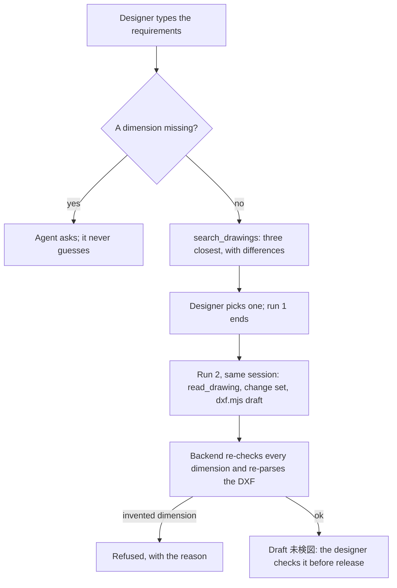
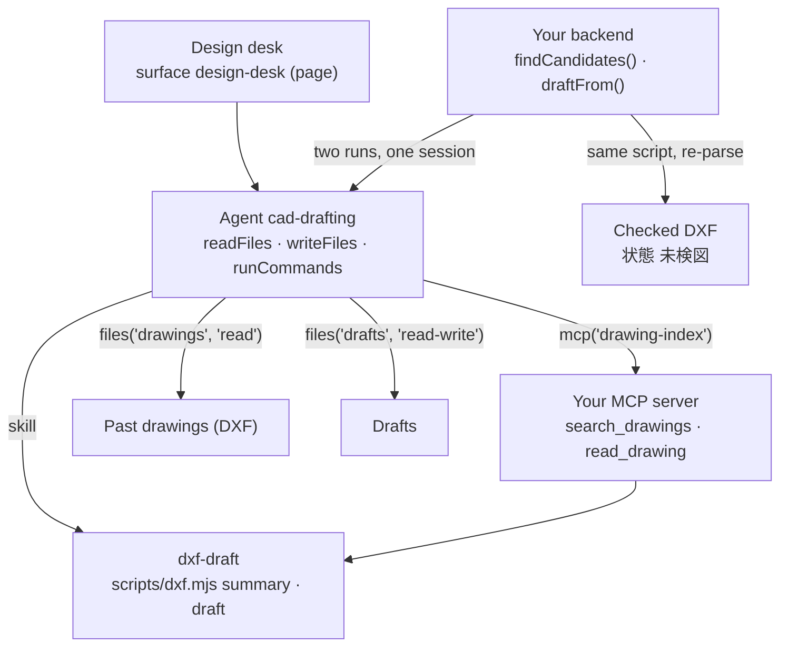

<Info>
**You will build:** an agent that finds the three past drawings closest to a new part and, once the designer picks one, drafts a DXF marked 未検図 that your backend checks dimension by dimension.

**You will learn:** a skill that runs a Node script ([Skills](/building/skills)), read and read-write file grants with `runCommands` and `writeFiles` ([Design an agent](/building/agents)), a drawing index as your own MCP server ([MCP servers](/building/mcp-servers)), a full-page surface ([Embed an agent](/building/embedding)), two runs in one session around a person's choice ([Integrate a backend](/building/backend)), the stored policy an unattended run needs for Bash and Write, and evals ([Evaluations](/guides/evaluations)).

**Time and prerequisites:** about 45 minutes to read; the tests behind it run offline with no API key. To run it on your own workspace, finish [chapter 1](/path/first-agent) first (a project answering under `aw dev`), and have a model key and Node to start the drawing index. Advanced: read [use case 1](/tutorials/manual-search) first.

</Info>

**CAD図面エージェント.** A designer types the requirements for a new part into the design desk:
「ブラケット 140×90、SUS304 t2.0、φ9 の取付穴4か所、新図番 BRK-1101」. The agent searches the
past drawings by title block and outline size, shows the three closest with what differs from the
request, and waits for the designer to pick one. It then writes a new DXF derived from that
drawing, changing only what the requirements change, and marks it 未検図 (not yet checked) for the
designer. It never invents a dimension: what the requirements do not say is copied from the base
drawing, and what neither says it asks for.

Most new parts in a Japanese machine shop are variants of old ones, and the old drawings are the
company's design knowledge. The practice that works today is *finding and reusing* them: Suzuki
uses CADDi Drawer to search past drawings by similarity and reuse their prices and processes
([MONOist, 2023](https://monoist.itmedia.co.jp/mn/articles/2310/31/news023.html)), Hitachi
reads drawings with AI to extract their information
([クラウド Watch](https://cloud.watch.impress.co.jp/docs/news/2052277.html)), and Toyota runs
agents that bring its engineers' accumulated knowledge to new designs
([Microsoft Source Asia](https://news.microsoft.com/source/asia/features/toyota-is-deploying-ai-agents-to-harness-the-collective-wisdom-of-engineers-and-innovate-faster/)).
Generating a production-ready new drawing is still at proof-of-concept stage across the industry.
So this use case's scope is deliberately narrow: **find, reuse, and draft for checking.** The
output is a starting point a designer checks (検図) before it is issued (出図), never a released
drawing.

Every test behind this page runs offline, with no API key. How the gallery tests a
use case, and what each tier proves, is on the [gallery overview](/tutorials).

## How the agent works

From the request to the person who decides, with the tools, skills and checks in between:



## What you build



| Piece | File | SDK |
| --- | --- | --- |
| The agent | `agents/cad-drafting.ts`, `agents/cad-drafting.md` | `defineAgent`, `mcp`, `skill`, `files` |
| Read and write DXF | `skills/dxf-draft/SKILL.md`, `scripts/dxf.mjs` | `aw.skills.import`, `runCommands` |
| Past drawings | `data/drawings/*.dxf` (six R12 drawings) | `aw files upload` |
| The drawing index | `mcp/drawing-index.mjs` | an `http` connector in `agent-workspace.yaml` |
| The design desk | `surfaces/design-desk.ts` | `defineSurface` with `layout: 'page'` |
| What "good" means | `evals/cad-drafting.yaml` | `aw eval`, `policy.promotion.minEvalScore` |
| The desk's backend | `backend/draft.ts` | `runs.start`, `runs.follow`, `sessionId` |

## 1. Read DXF with a skill script

Agent Workspace stores uploaded files as bytes and parses nothing. ASCII DXF is text, so a
dependency-free Node script can read it; the runtime image has Node but not Python. The
script reads the company's CAD layer convention: `OUTLINE` lines, `HOLE` circles, and a title
block of `TITLE` texts such as `図番 BRK-1003`, `材質 SUS304`, `板厚 t2.0`.

The agent runs it through the `run_skill_script` tool (no shell):

```json title="illustrative" claim="illustrative"
{ "skill": "dxf-draft", "script": "dxf.mjs", "args": ["summary", "drawings/BRK-1003.dxf"] }
```

```json title="output (excerpt) (illustrative)" claim="illustrative"
{
  "drawingNo": "BRK-1003", "partName": "ブラケット", "material": "SUS304", "thickness": "t2.0",
  "origin": { "x": 50, "y": 50 }, "width": 140, "height": 80, "rectangular": true,
  "holes": [{ "x": 15, "y": 15, "diameter": 9 }, { "x": 125, "y": 15, "diameter": 9 }, …],
  "unreadEntities": []
}
```

Hole positions are measured from the outline's lower-left corner, so a drawing drawn at (50, 50)
reads the same as one drawn at the origin. Anything the script does not understand is listed in
`unreadEntities`, never dropped.

The `draft` command takes a base drawing and a change set and writes a new DXF:

```js title="skills/dxf-draft/scripts/dxf.mjs (excerpt) (illustrative)" claim="illustrative"
export function draft(baseText, changes) {
  const base = summarise(baseText);
  const problems = [];
  // … drawingNo must be new, width and height positive …
  if (!base.rectangular) {
    problems.push(`${base.drawingNo} の外形は矩形ではありません。伸縮すると指示のない寸法が変わるため、手で作図してください`);
  }
  const holes = changes.holes ?? base.holes;
  if (problems.length === 0) problems.push(...holeProblems(changes.width, changes.height, holes));
  if (problems.length > 0) throw new DraftRefused(problems);
  // Redraw the outline at the new size from the same corner, place the holes, keep every other
  // entity, and rewrite the title block: 図番, 作成, 検図 未, 状態 未検図, 派生元 <base>.
}
```

`draft` also prints `changes` (`高さ 80 → 90`, `穴 (15,65)φ9 → (15,75)φ9`) and `kept` (`幅 140（元図のまま）`),
computed from the base and the written drawing. The agent copies those lines as its list of
changes instead of diffing two drawings in its head, so a value the request only repeats (the
material, the thickness, the width) is reported as kept, never as a change.

Two refusals carry the "never invent" rule. A notched or L-shaped outline is refused, because
stretching it would change the notch, a dimension nobody asked to change. A hole that would cut
the edge or overlap another hole is refused. In both cases no file is written.

The agent needs `runCommands` to run this script and `writeFiles` to save the draft. The script's
`.d.mts` lets the backend and the tests import the very same functions.

## 2. Index the past drawings as an MCP server

Search across the drawing store is a tool you provide (the platform deliberately has no
retrieval). The index parses every DXF with the skill's own `summarise`, so the index and the
agent agree on what a drawing says, and ranks by three things: the title-block text (品名, 材質,
注記, through the shared Japanese bigram index), how close the outline is to the requested size,
and whether the material matches.

```js title="mcp/drawing-index.mjs (excerpt) (illustrative)" claim="illustrative"
// When the designer names the part, the title block must match it: a plate is not a bracket.
const textHits = query === undefined ? null : new Map(index.search(query, { limit: drawings.length }).map((hit) => [hit.id, hit.score]));
for (const drawing of drawings) {
  if (textHits !== null && !textHits.has(drawing.drawingNo)) continue;
  // 0.4 × text + 0.4 × size closeness + 0.2 × material, over the criteria given
  ranked.push({ drawingNo: drawing.drawingNo, …, score, differences: differences(drawing, wanted) });
}
return { candidates: ranked.slice(0, limit(args, 'limit', 3, 10)), unreadable };
```

For the request above it returns BRK-1003 (`高さ 80 → 90 (+10)`), BRK-1004 (an L-shaped bracket,
flagged `外形が矩形でない`), and BRK-1002 (`幅 150 → 140 (-10)`, `高さ 75 → 90 (+15)`,
`材質 SS400 → SUS304`). The differences are computed by the server, not the model.

DWG is a closed binary format and a scanned drawing is an image. Neither can be read without a
converter, and the platform has none. The index lists such files under `unreadable`, so the
designer knows they exist and were not searched, and `read_drawing` on one says to export it as
DXF from the CAD system.

```sh title="illustrative" claim="illustrative"
MCP_TRANSPORT=http PORT=8788 node mcp/drawing-index.mjs
```

## 3. Define the agent

```ts title="agents/cad-drafting.ts" file="tests/gallery/cad-drafting/agents/cad-drafting.ts"
import { defineAgent, files, mcp, skill } from '@indx-workspace/sdk/define';

export default defineAgent({
  name: 'cad-drafting',
  instructions: { file: './cad-drafting.md' },
  model: 'default',
  // A run is unattended: without autoApprove the SDK stops the skill script's call on an approval prompt.
  engine: {
    id: 'claude-agent-sdk',
    autoApprove: ['mcp__agent-workspace__run_skill_script', 'Write'],
  },
  // It runs the skill's script to write a draft, so it needs commands and file writes; the grants
  // below keep the writes to `drafts`: past drawings are read-only.
  permissions: { readFiles: true, writeFiles: true, runCommands: true },
  tools: [mcp('drawing-index')],
  skills: [skill('dxf-draft')],
  files: [files('drawings', 'read'), files('drafts', 'read-write')],
  limits: { maxTurns: 20, maxBudgetUsd: 1 },
});
```

The instructions (`agents/cad-drafting.md`) set the order: ask for any missing dimension before
searching, show three candidates as a table with their differences, read the chosen drawing,
write a change set holding *only* what the requirements change, run `draft`, and answer with the
change set in one json block and 「未検図です。出図前に検図してください。」.

## 4. Put it on the design desk

```ts title="surfaces/design-desk.ts (excerpt) (illustrative)" claim="illustrative"
export default defineSurface({
  name: 'design-desk',
  agent: 'cad-drafting',
  title: '図面流用デスク',
  layout: 'page',
  parts: {
    suggestedPrompts: ['ブラケット 140×90、SUS304 t2.0、φ9 の取付穴4か所、新図番 BRK-1101', …],
    disclaimer: '作図結果は未検図の下書きです。出図前に必ず設計者が検図してください。',
    toolTrace: 'collapsed',
    history: true,
    feedback: true,
  },
});
```

<Note>
  This surface sets no `toolResults`. The widget matches a `toolResults` key against the tool's
  name in the run exactly, and a Claude run names an MCP tool `mcp__<connector-name>__<tool>`, or
  `mcp__connector-<uuid>__<tool>` when the name is not a usable slug: the UUID form differs in every
  workspace and passes the 64 characters a key may have once the tool's own name passes 11 (probe
  `surface-mcp-tool-results`). Tool output shows in the tool trace instead.
</Note>

A full page suits a desk a designer works at. What it cannot do is take a drawing: a surface
accepts no attachments, so a customer's reference drawing goes into the file store with
`aw files upload` before the designer asks about it.

## 5. Check the draft in your backend

A run cannot pause for the designer to choose, so the desk runs the agent twice in one session:
`findCandidates` shows the candidates (taken from the index's own result, not the model's
prose), the designer picks, and `draftFrom` continues the same `sessionId`:

```ts title="backend/draft.ts (excerpt) (illustrative)" claim="illustrative"
const changeSet = parseChangeSet(reading.answer);           // the last ```json block, validated
if (typeof changeSet === 'string') return refused([changeSet], null);
const base = summarise(await options.readDrawing(chosen));   // your drawing store, not the run
problems.push(
  ...dimensionProblems(requirements, base, { …changeSet, holes }),  // 幅: 要件は 140、作図は 145
  ...holeProblems(changeSet.width, changeSet.height, holes),
);
if (problems.length > 0) return refused(problems, changeSet);
produced = draft(baseText, { ...changeSet, drafter: requirements.drafter, date: requirements.date });
const summary = summarise(produced.dxf);                     // re-parse: check what CAD will open
```

The rule behind `dimensionProblems`: every value in the draft must equal the requirement, or,
where the requirements are silent, the base drawing. A width of 145 where 140 was asked, or a
hole moved by 5 mm, is an invented dimension and the draft is refused with the reason.

The backend writes the DXF itself, with the same script the agent ran. It has to: a file the agent
writes inside a run does not come back to the workspace file store today (see the table below).
Because `draft` is deterministic, the backend's file is the one the agent made.

## 6. Say what "good" means

```yaml title="evals/cad-drafting.yaml (excerpt)" file="tests/gallery/cad-drafting/evals/cad-drafting.yaml#excerpt"
cases:
  - name: 似た過去図面を差分つきで3件示す
    input: ブラケット 140×90、SUS304 t2.0、φ9 の取付穴4か所（…）、新図番 BRK-1101。似た図面を探して。
    expect:
      contains: ['BRK-1003', '高さ 80 → 90']
  - name: 寸法が足りなければ推測せず確認する
    input: ブラケットを新しく作図して。材質は SS400。
    expect:
      notContains: ['"drawingNo"']
      judge: >
        回答が外形の幅・高さや取付穴などの不足している寸法を推測で補わず、設計者に確認していること。
```

The file has four cases, including refusing to stretch the L-shaped BRK-1004. `aw eval` judges
text; whether the drawn outline is exactly 140 × 90 is not something it can express. That is
checked by the gallery's own tests, which write the DXF, parse it back and compare every
coordinate.

## 7. Run it

<Steps>
  <Step title="Offline, in the test suite">
    Loads the project through the contract `aw check` applies, reads all six drawings, runs the
    script's `draft` and `summary` commands as a run would, drives the real index server
    (including a store with a DWG it cannot read), and runs both backend calls against a scripted
    workspace. Eight tests, no API key.
  </Step>
  <Step title="On your workspace">
    ```sh title="illustrative" claim="illustrative"
    MCP_TRANSPORT=http PORT=8788 node mcp/drawing-index.mjs &
    aw dev                      # keeps the connector and the skill in step
    aw files mkdir drafts
    aw files upload drawings/BRK-1003.dxf
    aw push --yes
    ```
    The grant on `drawings` resolves once a file is uploaded into it, so the folder needs no `aw files mkdir`. `drafts` receives output and nothing is uploaded into it, so it is created with `aw files mkdir`, which does nothing when the folder already exists. If `aw dev` refused the agent with `agent_definition_references_missing [file:drawings]` before the upload, `aw push --yes` syncs it, and so does saving the agent file again.
  </Step>
  <Step title="Check that the run may run the script and Write">
    `runCommands: true` offers `run_skill_script`, which runs the skill's Node script with no shell:
    it reads the run's working directory and cannot write the read-only grant on `drawings`; with
    `writeFiles: true` it writes only into the read-write grant on `drafts`. A run is unattended, so
    the agent declares `autoApprove: ['mcp__agent-workspace__run_skill_script', 'Write']` in its
    `engine` setting for the script call and the change-set file write. `aw push` stores it in the
    policy (`tools.autoApprove`). `Bash` stays denied under the read-only grant.
  </Step>
  <Step title="Evaluate">
    ```sh title="illustrative" claim="illustrative"
    aw eval cad-drafting        # the four cases, on a real model
    ```
  </Step>
</Steps>

## Where the SDK stands

This table is generated from the use case's benchmark and checked by the gallery's tests. `contract` means an offline test in the gallery's suite proves
it; `probe` means a test asserts the capability is still missing and fails the day it arrives;
`source` cites the platform's code.

{/* benchmark:start */}

Score: **45 / 100** (✅ = 1, 🟡 = 0.5, ❌ = 0, over the capabilities this use case needs).

| Capability | Today | Evidence | What it means for you |
| --- | --- | --- | --- |
| Agent as code | ✅ | contract | defineAgent with a read-only drawing grant, a read-write drafts grant, a skill with a script and a page surface pass the server contract offline. |
| Grounded search | 🟡 | contract | Similar-drawing search is your MCP server: title-block text plus outline-size closeness, with the differences from the request on each candidate. |
| Document parsing | 🟡 | contract | ASCII DXF is read and written by the skill’s Node script, which the agent calls through `run_skill_script`: no shell, read-only on the `drawings` grant, writing only where the agent may write. The agent pre-approves `mcp__agent-workspace__run_skill_script` and `Write` in `autoApprove`; DWG and scanned drawings cannot be read at all without a converter. |
| Structured output | ❌ | probe | The change set comes back as a json block inside the answer; the backend parses and validates every field itself. |
| Human approval | ❌ | probe | A run cannot stop for the designer to pick a candidate, so the desk runs twice in one session; the final check (検図) happens outside the platform. |
| Write to systems | ❌ | source | A file the agent writes is not returned to the file store (no runtime profile sets `persistPaths` by default, and when one does it is collected from the runtime root `/workspace`, not the run directory), so the backend regenerates the DXF from the returned change set with the same script. |
| Per-user scope | 🟡 | source | Grants are per agent, not per designer: customer-confidential drawings need a separate agent or a filter inside the index server. |
| Embedded UI | 🟡 | probe | defineSurface publishes the page-layout design desk, but a designer cannot attach a reference drawing there; it goes through `aw files upload` first. |
| Evals | 🟡 | contract | `aw eval` checks the answer text; that the geometry is exactly the requested size is not expressible there, so your own tests check the written DXF. |
| Audit and cost | ✅ | source | Every run records tokens and cost; the audit log records who changed the agent and its policy. |

{/* benchmark:end */}

**Verdict: buildable as a find-and-draft assistant, with real code of your own.** The agent, the
skill and the desk are defined in a few lines; the index (about 190 lines), the DXF script (about
400) and the backend's checks (about 340) are yours. Three things do not work as you would
expect: a run cannot pause for the designer's choice, the draft the agent writes does not come
back to the file store, and the script does not run until you store a policy by hand. None of
that changes the industry's limit either: the output is a draft for 検図, not a released drawing.
What would remove code from this page:

- **Files a run writes returned to the file store** would let the designer open the agent's
  draft directly, instead of the backend writing it again.
- **A run that pauses for approval** (probe `run-approval`) would turn the two runs into one, with
  the designer's choice inside it.
- **Structured output** (probe `run-output-schema`) would return the change set typed, instead of
  parsed out of a json block in the answer.
- **Attachments on a surface** (probe `surface-attachments`) would let a designer drop a reference
  drawing on the desk.
