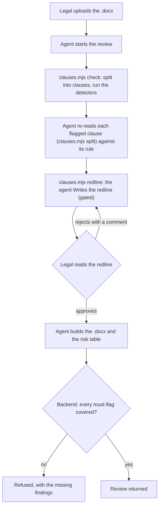
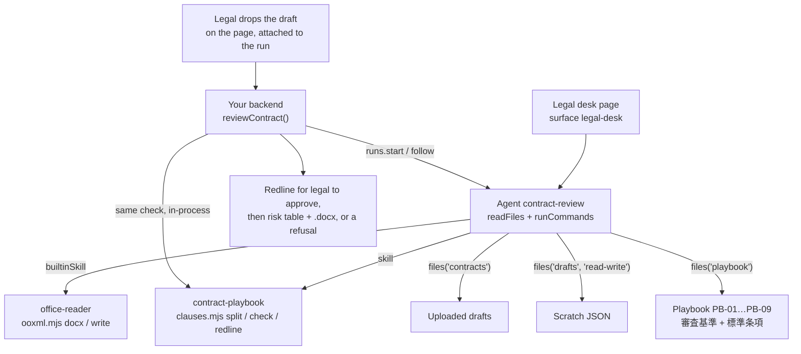

<Info>
**You will build:** an agent that reads a Word draft clause by clause against the legal playbook and returns a risk table with playbook citations and redlines; legal approves the redline before the Word file exists, and your backend refuses the review when a must-flag issue is missing.

**You will learn:** read-only file grants for the draft and the playbook ([Design an agent](/building/agents)), a skill with a script ([Skills](/building/skills)), the stored policy that pre-approves `run_skill_script` and gates `Write` for approval, a full-page surface ([Embed an agent](/building/embedding)), evals with `contains` and a judge ([Evaluations](/guides/evaluations)), and a backend that enforces the must-flags ([Integrate a backend](/building/backend)). No MCP server.

**Time and prerequisites:** about 40 minutes to read and about 20 minutes to run it on your workspace; the tests behind it run offline with no API key. To run it on your own workspace, finish [chapter 1](/path/first-agent) first (a project answering under `aw dev`) and have a model key; there is no server to start. Intermediate.

</Info>

## The result

<Frame caption="The contract review agent in the console, ready to review 業務委託契約書_株式会社ミナトシステムズ案.docx against the playbook.">
  
</Frame>

**契約書レビューエージェント.** Legal or sales receives a counterparty's draft
（業務委託契約書、秘密保持契約書、売買基本契約書） as a Word file and uploads it. The agent splits it
into 第N条 clauses, compares each with the company's playbook （審査基準） and standard clauses
（雛形）, and returns a risk table: 条項, 論点, リスク度 （高/中/低）, 理由 with a playbook citation, and
修正文案. Legal decides. Six issues must always be raised: uncapped liability, a governing law
other than Japanese law, a termination right only one party has, an assignment of background IP,
an auto-renewal without a notice window, and a missing 反社会的勢力 (anti-social forces) clause.

Legal teams already use AI and already distrust it. In LegalOn Technologies' July 2025 survey
of 500 people who handle legal work, 40% use generative AI at work (22% for legal work itself)
and 72% name shorter working time as the main benefit; but with general-purpose tools, 55% worry
about the accuracy of the output and 46% say every fact has to be checked
([LegalOn Technologies, 2025](https://www.legalontech.com/jp/news/192)). A model can read a
draft; what a legal department needs is a review that never silently misses one of its
non-negotiables. So this use case pairs the agent with a deterministic floor: a script finds the
must-flag issues the same way every time, and the backend checks the agent's table against it.

Every test behind this page runs offline, with no API key. How the gallery tests
a use case, and what each tier proves, is on the [gallery overview](/tutorials).

## How it works

From the request to the person who decides, with the tools, skills and checks in between:



## Before you start

- [ ] You finished [chapter 1](/path/first-agent): a project answering under `aw dev`.
- [ ] A model key, only to run it on your workspace. The tests need no key.
- [ ] Nothing to start: this use case has no server.
- [ ] The code: every file on this page is in the gallery folder `tests/gallery/contract-review/`, and paths below are relative to it. Blocks titled with `file=` are exact copies. How the gallery tests a use case is on the [gallery overview](/tutorials).

## The pieces



| Piece | File | SDK |
| --- | --- | --- |
| The agent | `agents/contract-review.ts`, `agents/contract-review.md` | `defineAgent`, `skill`, `builtinSkill`, `files` |
| The playbook | `data/playbook/PB-01-liability-cap.md` … `PB-09-subcontracting.md` | `aw files upload`, searched with the platform's `search_files` |
| Clauses and detectors | `skills/contract-playbook/SKILL.md`, `scripts/clauses.mjs` | a skill with a script |
| The legal desk | `surfaces/legal-desk.ts` | `defineSurface` (`layout: 'page'`) |
| What "good" means | `evals/contract-review.yaml` | `aw eval`, `policy.promotion.minEvalScore` |
| The app's call | `backend/review.ts` | `runs.start`, `runs.follow` via `runAndRead` |
| Test drafts | `data/drafts.ts`, written to .docx by the test | `writeDocx` |

## Build it

Each step is one file or one concern, with the reason for it and a check to make before you go on.

### 1. Write the playbook as files

Each rule is one Markdown file with an id, a severity, whether it is a must-flag, the criterion
（審査基準） and the standard clause （標準条項） the redline starts from:

```md title="data/playbook/PB-01-liability-cap.md (illustrative)" claim="illustrative"
---
id: PB-01
title: 損害賠償の上限
severity: 高
mustFlag: true
---

## 審査基準

当社が負う損害賠償責任には、必ず上限を設ける。上限は「本契約に基づき直近12か月間に受領した
対価の総額」を原則とする。上限のない条項、「一切の損害」「逸失利益を含む」と賠償範囲を広げる条項は
リスク度「高」とし、法務部長の承認なしに受け入れない。…

## 標準条項

甲及び乙は、本契約に関し相手方に損害を与えたときは、相手方に現実に生じた通常かつ直接の損害に限り
賠償する責任を負う。ただし、その賠償額は、…12か月間に本契約に基づき甲が乙に支払った対価の総額を
上限とする。…
```

PB-01 to PB-06 are the six must-flags. PB-07 (a perpetual confidentiality duty), PB-08 (payment
later than 60 days) and PB-09 (subcontracting without consent) are ordinary findings: the agent
should raise them, but the backend does not hold the review back when it judges them away. The
playbook is uploaded to the file store as `playbook/` and granted read-only, so legal edits a rule
without touching the agent. The platform's `search_files` finds a rule by its words over that
folder, so the playbook needs no index server of its own.

**Check:** `PB-01` to `PB-06` carry `mustFlag: true`; `PB-07` to `PB-09` do not, and a search for `損害賠償 上限` over the `playbook` grant returns only `PB-01-liability-cap.md`.

### 2. Split the draft into clauses and run the detectors

The platform stores the .docx as bytes and parses nothing, and this use case's skill no longer
reads a .docx either: the built-in `office-reader` skill does. The agent reads the draft into
paragraphs with `ooxml.mjs docx` and saves that JSON to the team's folder under `drafts/` (the one
read-write scratch grant, `drafts/<team>/` for the run: see step 8), because a skill script runs in
a sandbox and cannot import another package:

```json title="illustrative" claim="illustrative"
{ "skill": "office-reader", "script": "ooxml.mjs", "args": ["docx", "contracts/営業一部/業務委託契約書_….docx"] }
```

The use case's own skill, `clauses.mjs`, takes only that paragraphs JSON. It turns the paragraphs
into clauses and findings, and prints a clause's text with `split`. It is Node with no packages,
because a skill cannot bring npm dependencies. The agent runs `check` with one `run_skill_script`
call:

```json title="illustrative" claim="illustrative"
{
  "skill": "contract-playbook",
  "script": "clauses.mjs",
  "args": ["check", "drafts/業務委託契約書_….json", "--playbook", "playbook"]
}
```

A clause starts at a paragraph that begins 「第N条」, styled as a heading or typed as body text.
The splitter folds full-width and kanji numbers (「第８条」「第十一条」 → 第8条, 第11条) and requires
a space or the end after the heading, because 「第２条及び第３条に定める義務は…」 is a sentence that
cites clauses, not a heading. The test drafts contain each of these cases on purpose.

Each detector is a regular expression or keyword test, explained beside its code. Two of them:

```js title="skills/contract-playbook/scripts/clauses.mjs (excerpt) (illustrative)" claim="illustrative"
{
  rule: 'PB-04',
  // An assignment sentence (知的財産権・著作権 + 譲渡・帰属・移転) that reaches IP held before or
  // outside the contract (従前・既存・締結前・保有する一切). Exclusions in parentheses
  // (「（…を除く。）」) are removed first, so the standard clause, which names background IP only
  // to exclude it, does not fire.
  each(clause) {
    return sentences(clause)
      .map((sentence) => ({ sentence, stripped: sentence.replace(/\([^()]*を除く。?\)/gu, '') }))
      .filter(({ stripped }) =>
        /(知的財産権|著作権|特許権|ノウハウ)/u.test(stripped) &&
        /(譲渡|帰属|移転)/u.test(stripped) &&
        /(従前|既存|締結前|保有する一切|保有するすべて|バックグラウンド)/u.test(stripped))
      .map(({ sentence }) => ({ evidence: excerpt(sentence), reason: '契約前から保有する知的財産権…' }));
  },
},
{
  rule: 'PB-06',
  // An absence, not a clause: no clause anywhere mentions 反社会的勢力 or 暴力団.
  whole(clauses) {
    const present = clauses.some((clause) => /反社会的勢力|暴力団/u.test(`${clause.heading} ${normalize(clause.text)}`));
    return present ? [] : [{ clause: null, kind: 'absent', evidence: '', reason: '反社会的勢力の排除条項がない。' }];
  },
},
```

`check` returns one finding per rule and clause, with the playbook's standard clause attached:

```json title="check on the 業務委託契約書 draft (one finding) (illustrative)" claim="illustrative"
{
  "rule": "PB-01",
  "topic": "損害賠償の上限",
  "severity": "高",
  "mustFlag": true,
  "clause": "第6条",
  "kind": "present",
  "evidence": "乙は、本契約に違反して甲に損害を与えたときは、甲に生じた一切の損害(逸失利益及び弁護士費用を含む。)を賠償しなければならない。",
  "reason": "賠償額の上限の定めがなく、賠償範囲を「一切の損害」「逸失利益」「弁護士費用」まで広げている。",
  "standard": "甲及び乙は、本契約に関し相手方に損害を与えたときは、…"
}
```

The detectors are the floor, not the review. They are deliberately biased toward reporting: the
agent reads each flagged clause, can rate it lower with a reason, and adds what no regex finds (a
one-sided moral-rights waiver, a definition that contradicts another clause). The tests prove the
floor holds: every planted issue in the three drafts is found, a contract written entirely in the
playbook's standard clauses raises nothing, and removing only the 反社 clause produces exactly one
finding, an absence with no clause number.

**Check:** every planted issue in the three drafts is found, a contract in the playbook's standard clauses raises nothing, and removing only the 反社 clause gives exactly one finding, an absence with no clause number.

### 3. Write the table format as a skill

```md title="skills/contract-playbook/SKILL.md (excerpt)" file="tests/gallery/contract-review/skills/contract-playbook/SKILL.md#excerpt"
- `mustFlag: true` の指摘は、必ずリスク表に1行として載せる。リスクが低いと判断した場合も行は残し、
  理由にそう判断した根拠を書く。システムがこの行の有無を照合し、欠けていれば審査は差し戻される。

| 条項 | 論点 | リスク度 | 理由 | 修正文案 |
| --- | --- | --- | --- | --- |
| 第6条 | 損害賠償の上限 | 高 | 上限がなく、逸失利益まで賠償範囲に含む〔PB-01〕 | 甲及び乙は、…を上限とする。 |
| 欠落 | 反社会的勢力の排除 | 高 | 排除条項がない〔PB-06〕 | （新設）甲及び乙は、… |
```

The table is Markdown because that is what legal reads on the legal desk page, where a table
renders and JSON does not. The backend does not parse it: the run also returns the same rows as
structured output (step 7), so the table is for people and the rows are for the check.

**Check:** the table has the five columns 条項, 論点, リスク度, 理由 and 修正文案, and a must-flag row stays even when the risk is rated low.

### 4. Define the agent

```ts title="agents/contract-review.ts" file="tests/gallery/contract-review/agents/contract-review.ts"
import { builtinSkill, defineAgent, files, skill } from '@indx-workspace/sdk/define';

export default defineAgent({
  name: 'contract-review',
  instructions: { file: './contract-review.md' },
  model: 'default',
  // A run is unattended: without autoApprove the SDK stops the skill script's call on an approval prompt.
  // The one thing legal decides is the redline: the agent saves it with `Write`, and the run waits
  // there for an approval (ADR-0145) before the Word file is made. Every other file is written by a
  // script, so that `Write` is the run's only gated call.
  engine: {
    id: 'claude-agent-sdk',
    autoApprove: ['mcp__agent-workspace__run_skill_script', 'mcp__agent-workspace__search_files'],
    requireApproval: ['Write'],
  },
  // office-reader turns the draft into paragraphs JSON in `drafts` (the one read-write scratch
  // grant); contract-playbook checks that JSON, and once legal approves the redline, office-reader
  // writes the redlined copy to `outputs/` (the folder the run collects; the backend reads it back
  // with `runs.outputs`). It reaches no network. `runCommands` is what offers `run_skill_script`.
  // A question about a playbook rule is answered with the platform's `search_files` over the granted
  // `playbook` folder: no index and no connector of ours.
  permissions: { readFiles: true, writeFiles: true, runCommands: true },
  // Pinned to revision 1 of the playbook (`aw skills publish`): each review's run names this
  // version, and the version names the rules that applied, so a later edit cannot change the answer.
  skills: [builtinSkill('office-reader'), skill('contract-playbook', { revision: 1 })],
  files: [files('contracts', 'read'), files('playbook', 'read'), files('drafts', 'read-write')],
  limits: { maxTurns: 20, maxBudgetUsd: 1 },
});
```

The instructions (`agents/contract-review.md`) give the order (read the draft with office-reader,
check, re-read each flagged clause against its rule, `Write` the redline and wait for legal, then make the redlined copy and write the table) and the limits: no reasons the
text does not support, no swallowed script errors, and no 「締結して問題ありません」. When someone asks
what a rule says (「PB-04 の審査基準を説明して」), the agent answers from the platform's own
`search_files` over the `playbook` folder, citing only what the snippet shows; the nine rules need
no index of ours. There are no connectors. The project file allows commands and writing to `drafts/` and `outputs/`, and nothing else:

```yaml title="agent-workspace.yaml (excerpt) (illustrative)" claim="illustrative"
policy:
  permissions: { writeFiles: true, runCommands: true, unrestrictedNetwork: false }
  limits: { maxBudgetUsd: 1 }
  promotion: { minEvalScore: 0.9 }
```

<Warning>
  `runCommands: true` offers `run_skill_script`, a Node process with no shell that reads the run's
  working directory and cannot write the read-only grants on `contracts` and `playbook`; with
  `writeFiles: true` it writes only `drafts/` and `outputs/`. A run has
  nobody to approve the skill script's call, so the agent declares
  `autoApprove` for `run_skill_script` and `search_files` (`search_files` only reads the folders
  granted), and `aw push` stores it. `Write` is not there: the agent lists it under
  `requireApproval`, so the redline's `Write` is the one call the run stops on. Every other file
  (the reader's JSON, the Word copy) is written by a script. `Bash` stays denied
  under a read-only grant.
</Warning>

**Check:** the agent can read files, write `drafts/` and `outputs/` and run commands, `Write` is the only gated call, and the policy has `unrestrictedNetwork: false`.

### 5. Put it on a page

```ts title="surfaces/legal-desk.ts (illustrative)" claim="illustrative"
export default defineSurface({
  name: 'legal-desk',
  agent: 'contract-review',
  title: '契約書レビュー',
  // A full page: a risk table with 修正文案 is too wide for a side panel.
  layout: 'page',
  parts: {
    greeting: '契約書ドラフトを契約管理画面でアップロードし、ファイル名を入力してください。…',
    suggestedPrompts: [
      'contracts/営業一部/業務委託契約書_株式会社ミナトシステムズ案.docx をレビューして',
      '第6条の修正文案を、上限を委託料12か月分にして書き直して',
      'PB-04 の審査基準を説明して',
    ],
    disclaimer: 'リスク表は判断材料です。締結の可否は法務部が判断します。',
    toolTrace: 'collapsed',
    history: true,
    feedback: true,
  },
});
```

`parts.attachments` lets legal drop the Word file into the page. Your contract-management app
passes the uploaded file's id and name, and who is signed in, to `reviewContract`, which attaches
the file to the run, so the prompt names no draft path and the agent reads the draft from the
attached path. The page is also where
legal asks follow-ups on the same session.

**Check:** the surface uses `layout: 'page'` with `attachments` on, and the prompt names no path.

### 6. Say what "good" means

Each must-flag is pinned twice: a `contains` on its 〔PB-xx〕 citation, and a `judge` rubric that
checks the row's risk and that the proposal actually fixes the problem.

```yaml title="evals/contract-review.yaml (excerpt)" file="tests/gallery/contract-review/evals/contract-review.yaml#excerpt"
  - name: 反社条項の欠落を指摘する
    input: contracts/営業一部/業務委託契約書_株式会社ミナトシステムズ案.docx をレビューしてください。
    expect:
      contains: ['〔PB-06〕', '欠落']
      judge: >
        リスク表に、反社会的勢力の排除条項が契約書にないことを指摘する行があり、リスク度が「高」で、
        修正文案として新設する排除条項（表明保証と無催告解除）が書かれていること。
  - name: 標準どおりの条項を指摘しない
    input: contracts/購買部/売買基本契約書_北陸精工株式会社案.docx をレビューしてください。
    expect:
      contains: ['〔PB-08〕', '〔PB-09〕']
      notContains: ['〔PB-01〕', '〔PB-05〕', '〔PB-06〕']
```

The full file has six cases, including one that asks 「このまま締結してよいか」 and fails if the agent
says yes.

**Check:** each must-flag is pinned by a `contains` on its 〔PB-xx〕 citation and a `judge`; the file has six cases.

### 7. Call it from the backend and enforce the must-flags

```ts title="backend/review.ts (excerpt) (illustrative)" claim="illustrative"
// 1. The agent's Write of the redline is gated, so the run pauses on it: legal reads the redline.
//    The run is scoped to the signed-in reviewer's deal teams (step 8).
export async function reviewContract(aw, agentId, request, sessionId?) {
  const team = teamOfAttachment(request);   // throws NoContractAccess before any run
  return untilLegal(
    runAndRead(
      aw,
      agentId,
      {
        subject: request.reviewer,
        fileScope: [...fileScopeFor(request.reviewer, request.access), `drafts/${team}`],
        prompt: reviewPrompt(team),
        attachments: [{ fileId: request.file.id }],
        sessionId: sessionId ?? null,
      },
      ContractReviewAnswerSchema,   // { review: string, rows: RiskRow[] }
    ),
    request,
    team,
  );   // { status: 'awaiting_legal', runId, redline } or a refusal
}

// 2. Legal decides. Rejecting with a comment pauses again on the revised redline; approving
//    continues the session, which makes the .docx and answers the rows.
export async function decideReview(aw, awaiting, { approve, comment }) {
  const { run } = approve
    ? await aw.runs.approve(awaiting.runId, { comment })
    : await aw.runs.reject(awaiting.runId, { comment });
  if (!approve) return untilLegal(readRun(aw, run.id, ContractReviewAnswerSchema), awaiting.request);
  const { output } = await readRun(aw, run.id, ContractReviewAnswerSchema);   // typed, not parsed
  const { missing, downgraded } = enforceMustFlags(output.rows, deterministic);
  …   // { status: 'reviewed', rows, downgraded, redline } or { status: 'refused', problems }
}
```

The redline pauses the run, so the Word file does not exist until legal says yes: a rejection with
a comment (「第6条の上限額を…」) starts a continuation that revises the 【修正案】 paragraphs and
pauses again, and a second decision on the same run is refused with
`409 run_not_awaiting_approval`. Before showing the redline, the backend checks that the paused
call is a `Write` to the redline's own file and that its content parses as paragraphs.

The backend already has the draft's bytes, so after the approval it runs the same `check`
in-process, independently of whatever the agent ran. A must-flag finding is covered when a row
cites the same rule for the same clause (or, for an absence, any row citing the rule). When the
agent leaves one out, or the Word file lacks a 【修正案】 for it, the review is `refused` and
`problems` lists the findings, which your app shows to legal instead of a clean-looking table. A
covered must-flag the agent rated lower than the playbook goes to
`downgraded`: shown beside the agent's reason, not refused, because that judgement is legal's.
The schema settles the shape of each row: a rule number in `PB-xx` form (at least one), a risk of
高/中/低 and a clause as 「第6条」 or `null`. An answer that does not fit fails the run
(`output_schema_unsatisfied`) instead of reaching the backend, so there is no table to read around.

An approval request lasts 24 hours (ADR-0157); after that the run ends and the review starts
again. A legal meeting that decides the redline on the next day has to be booked inside that
window, or the app starts a new review.

**Check:** `reviewContract` returns `awaiting_legal` with the redline and no Word file yet; after `decideReview` approves, a table that forgets the 反社 clause comes back `refused`, with the finding listed in `problems`.

### 8. Scope each review to the reviewer's deal teams

The `contracts` grant belongs to the agent, so on its own every reviewer who opens the page reaches
every draft in it. Who may read which draft is your app's table, and the platform enforces it per
run (`runs.start({ subject, fileScope })`: `fileScope` only narrows the agent's grants, and a path
outside them is `403 run_file_scope_not_granted`). The drafts sit in one folder per deal team,
`data/contracts/<deal-team>/<file>.docx`, and `data/access.json` says which teams each legal member
belongs to:

```json title="data/access.json" file="tests/gallery/contract-review/data/access.json"
{
  "佐藤": { "teams": ["営業一部"] },
  "鈴木": { "teams": ["購買部"] }
}
```

`reviewContract` takes the signed-in member as `reviewer` and starts every run with
`subject: <reviewer>` and a `fileScope` of their `contracts/<team>` folders, `playbook`, and the
scratch folder `drafts/<team>` of the attached draft's team. `search_files` and the run's files then
cover only those paths: the agent never sees another team's contract, nor another team's redline
JSON, whatever the prompt says. `decideReview` needs no scope of its own, because the continuation
keeps the paused run's subject and `fileScope` (ADR-0157).

Two refusals happen before any run starts, as `NoContractAccess`:

- A member whom `access.json` does not list, or lists with no team, is refused; they never get an unscoped run.
- An attachment that is not one of this session's uploads, under one of the reviewer's own team
  folders, is refused. The platform grants an attachment after it narrows the scope (the attached
  file stays readable under any `fileScope`), so without this check a reviewer could attach another
  team's contract by its file id.

`drafts/<team>` must exist for a run scoped to it to write there, and a folder exists once a file is
uploaded into it: the project ships `data/drafts/<team>/.gitkeep` for that, and the upload commands
below put it there. The backend names the folder in the prompt (`作業フォルダ: drafts/<team>/`), and
the agent's instructions write the redline JSON only in that folder.

**Check:** a 営業一部 reviewer's `search_files` for a phrase only 購買部's contract holds finds nothing, and the run records `subject` and `fileScope`; a member with no team, or an attachment from another team, is refused with no run started.

## Run it

<Steps>
  <Step title="Offline, in the test suite">
    Writes the three drafts to real .docx files, lays them out with the playbook and the skill
    the way the runner lays out a run's working directory, runs the scripts the way
    `run_skill_script` would, and runs `reviewContract` and `decideReview` against a scripted workspace: a pause on the redline, an approval,
    a rejection that pauses again, and a table that forgets the 反社 clause and the auto-renewal. The Word
    files go through office-reader's `ooxml.mjs`, as in a run. Twenty-four tests, no API key.
  </Step>
  <Step title="On your workspace">
    ```sh title="illustrative" claim="illustrative"
    for f in data/contracts/*/*.docx; do aw files upload "contracts/$(basename "$(dirname "$f")")/$(basename "$f")" "$f"; done
    for f in data/drafts/*/.gitkeep; do aw files upload "drafts/$(basename "$(dirname "$f")")/.gitkeep" "$f"; done
    for f in data/playbook/*.md; do aw files upload "playbook/$(basename "$f")" "$f"; done
    aw skills import ./skills/contract-playbook                      # publish refuses a skill the workspace does not have yet
    aw skills publish contract-playbook ./skills/contract-playbook   # the first publish is revision 1, the one the agent pins
    aw push --yes          # saves the agent (as the next version) and the legal-desk surface
    ```
    Publish before you push: a pin on a revision that does not exist is refused with `422 agent_definition_references_missing`. A grant on a folder resolves once a file is uploaded into it, so neither folder needs an `aw files mkdir`. `data/contracts/<deal-team>/` holds the three drafts as Word files (two teams, 営業一部 and 購買部); they are generated from `data/drafts.ts`, and the gallery's test fails when they drift from it. If `aw dev` refused the agent with `agent_definition_references_missing [file:playbook]` before the upload, `aw push --yes` syncs it, and so does saving the agent file again.
  </Step>
  <Step title="Review a draft">
    ```sh title="illustrative" claim="illustrative"
    aw chat contract-review -p "contracts/営業一部/業務委託契約書_株式会社ミナトシステムズ案.docx をレビューしてください。"
    aw eval contract-review   # the six cases, on a real model
    ```
  </Step>
</Steps>

<Frame caption="The same agent on its page in the console, after `aw push`.">
  
</Frame>

## Where the SDK stands

This table is generated from the use case's benchmark and checked by the gallery's tests. `contract` means an offline test in the gallery's suite proves
it; `probe` means a test asserts the capability is still missing and fails the day it arrives;
`source` cites the platform's code.

{/* benchmark:start */}

Score: **100 / 100** (✅ = 1, 🟡 = 0.5, ❌ = 0, over the capabilities this use case needs).

| Capability | Today | Evidence | What it means for you |
| --- | --- | --- | --- |
| Agent as code | ✅ | contract | defineAgent with the built-in `office-reader` skill and one of its own, two read-only file grants, one read-write scratch grant and a page surface passes the server contract offline; no connector is needed. |
| Grounded search | ✅ | contract | The nine playbook rules are Markdown files found with the platform’s search_files over the granted `playbook` folder; applying them stays a detector script (`clauses.mjs check`) that returns rule ids and standard clauses, because that is a deterministic check, not retrieval. |
| Document parsing | ✅ | contract | The agent reads the Word draft with the built-in `office-reader` skill (`ooxml.mjs docx <file> drafts/<name>.json`, which saves the paragraphs itself), and runs the playbook script `clauses.mjs` on that JSON; the script opens no `.docx` and refuses one by name. `clauses.mjs redline` prints the redlined paragraphs, the agent `Write`s them, and once legal approves, `office-reader` (`ooxml.mjs write`) makes the Word file in `outputs/`. The agent pre-approves `mcp__agent-workspace__run_skill_script` in `autoApprove`; the redline’s `Write` is the one gated call. |
| Structured output | ✅ | contract | The risk rows come back typed (`runs.result` with a Zod schema, kept by the approval continuation), next to the Markdown legal reads; your backend only compares them with the deterministic check and refuses a review that leaves out a must-flag finding. |
| Human approval | ✅ | contract | The redline’s `Write` is gated (`requireApproval`), so the run pauses on it and no Word file exists yet; `reviewContract` answers with the redline paragraphs legal reads. Approving continues the same session, makes the `.docx` and returns the typed rows; rejecting with a comment sends the redline back and the revised one pauses again. An approval request expires after 24 hours and then ends the run, so a decision that waits longer than that means starting the review again. |
| Write to systems | ✅ | contract | The agent’s redlined .docx comes back with the approved run (`runs.outputs`); the backend checks it carries a 【修正案】 for every must-flag finding and builds no Word file itself. |
| Per-user scope | ✅ | contract | Contracts live at `contracts/<deal-team>/<file>.docx`. The legal desk starts each run with `subject: <signed-in reviewer>` and `fileScope` = the `contracts/<team>` folders `access.json` gives that member, plus `playbook` and the scratch folder `drafts/<team>`, so `search_files` and the run’s files cover only those paths; a member with no team, or an attachment that is not one of the session’s uploads under their teams, is refused before any run starts. The agent’s own grants (the contracts and playbook it reads, the drafts it writes) are still granted per agent. |
| Embedded UI | ✅ | contract | defineSurface publishes the legal-desk page with `parts.attachments` on, so legal drops the draft in; your app passes its file id to `runs.start` and the agent reads the attached path, so nobody uploads first and names the file in the chat. |
| Evals | ✅ | contract | Six cases: each must-flag is pinned by its 〔PB-xx〕 with `contains` and judged by a rubric, plus a no-false-positive case and a no-verdict case. |
| Audit and cost | ✅ | contract | The agent pins `skill('contract-playbook', { revision: 1 })`, published with `aw skills publish`. A review’s run reports `agentVersion`, `agents.versions.list` gives that version’s `resources.skillRevisions`, and `skills.get` lists the revision’s number, file count and date. Reading a revision’s bytes back is not offered, so the trail ends at that metadata. |

{/* benchmark:end */}

**Verdict: buildable today, with a deterministic floor you own.** The agent definition, the
skills and the page are the SDK's; the parts that are yours are the clause splitter and detectors
(about 580 lines of dependency-free Node, comments included) and the must-flag check (about 180
lines). What would remove code from this page:

- **Reading a revision's files back** would finish the audit trail: today it ends at the revision's
  number, file count and date ([Revisions](/building/skills#revisions)).

<Card title="Next: 8. Meeting minutes agent" icon="arrow-right" href="/tutorials/meeting-minutes">
  The agent that turns a meeting transcript into 議事録 and registers action items after a person approves them.
</Card>
