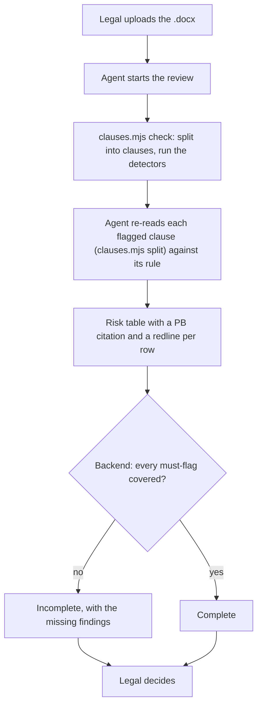
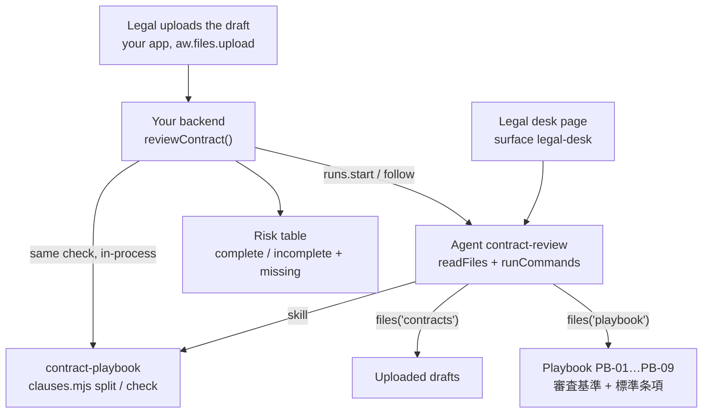

<Info>
**You will build:** an agent that reads a Word draft clause by clause against the legal playbook and returns a risk table with playbook citations and redlines; your backend marks the review incomplete when a must-flag issue is missing.

**You will learn:** read-only file grants for the draft and the playbook ([Design an agent](/building/agents)), a skill with a script ([Skills](/building/skills)), the stored policy that pre-approves `run_skill_script`, a full-page surface ([Embed an agent](/building/embedding)), evals with `contains` and a judge ([Evaluations](/guides/evaluations)), and a backend that enforces the must-flags ([Integrate a backend](/building/backend)). No MCP server.

**Time and prerequisites:** about 40 minutes to read; the tests behind it run offline with no API key. To run it on your own workspace, finish [chapter 1](/path/first-agent) first (a project answering under `aw dev`) and have a model key; there is no server to start. Intermediate.

</Info>

**契約書レビューエージェント.** Legal or sales receives a counterparty's draft
（業務委託契約書、秘密保持契約書、売買基本契約書） as a Word file and uploads it. The agent splits it
into 第N条 clauses, compares each with the company's playbook （審査基準） and standard clauses
（雛形）, and returns a risk table: 条項, 論点, リスク度 （高/中/低）, 理由 with a playbook citation, and
修正文案. Legal decides. Six issues must always be raised: uncapped liability, a governing law
other than Japanese law, a termination right only one party has, an assignment of background IP,
an auto-renewal without a notice window, and a missing 反社会的勢力 (anti-social forces) clause.

Legal teams already use AI and already distrust it. In LegalOn Technologies' July 2025 survey
of 500 people who handle legal work, 40% use generative AI at work (22% for legal work itself)
and 72% name shorter working time as the main benefit; but with general-purpose tools, 55% worry
about the accuracy of the output and 46% say every fact has to be checked
([LegalOn Technologies, 2025](https://www.legalontech.com/jp/news/192)). A model can read a
draft; what a legal department needs is a review that never silently misses one of its
non-negotiables. So this use case pairs the agent with a deterministic floor: a script finds the
must-flag issues the same way every time, and the backend checks the agent's table against it.

Every test behind this page runs offline, with no API key. How the gallery tests
a use case, and what each tier proves, is on the [gallery overview](/tutorials).

## How the agent works

From the request to the person who decides, with the tools, skills and checks in between:



## What you build



| Piece | File | SDK |
| --- | --- | --- |
| The agent | `agents/contract-review.ts`, `agents/contract-review.md` | `defineAgent`, `skill`, `files` |
| The playbook | `data/playbook/PB-01-liability-cap.md` … `PB-09-subcontracting.md` | `aw files upload` |
| Clauses and detectors | `skills/contract-playbook/SKILL.md`, `scripts/clauses.mjs` | a skill with a script |
| The legal desk | `surfaces/legal-desk.ts` | `defineSurface` (`layout: 'page'`) |
| What "good" means | `evals/contract-review.yaml` | `aw eval`, `policy.promotion.minEvalScore` |
| The app's call | `backend/review.ts` | `runs.start`, `runs.follow` via `runAndRead` |
| Test drafts | `data/drafts.ts`, written to .docx by the test | `writeDocx` |

## 1. Write the playbook as files

Each rule is one Markdown file with an id, a severity, whether it is a must-flag, the criterion
（審査基準） and the standard clause （標準条項） the redline starts from:

```md title="data/playbook/PB-01-liability-cap.md (illustrative)" claim="illustrative"
---
id: PB-01
title: 損害賠償の上限
severity: 高
mustFlag: true
---

## 審査基準

当社が負う損害賠償責任には、必ず上限を設ける。上限は「本契約に基づき直近12か月間に受領した
対価の総額」を原則とする。上限のない条項、「一切の損害」「逸失利益を含む」と賠償範囲を広げる条項は
リスク度「高」とし、法務部長の承認なしに受け入れない。…

## 標準条項

甲及び乙は、本契約に関し相手方に損害を与えたときは、相手方に現実に生じた通常かつ直接の損害に限り
賠償する責任を負う。ただし、その賠償額は、…12か月間に本契約に基づき甲が乙に支払った対価の総額を
上限とする。…
```

PB-01 to PB-06 are the six must-flags. PB-07 (a perpetual confidentiality duty), PB-08 (payment
later than 60 days) and PB-09 (subcontracting without consent) are ordinary findings: the agent
should raise them, but the backend does not hold the review back when it judges them away. The
playbook is uploaded to the file store as `playbook/` and granted read-only, so legal edits a rule
without touching the agent.

## 2. Split the draft into clauses and run the detectors

The platform stores the .docx as bytes and parses nothing. This use case's skill reads the .docx
itself, turns its paragraphs into clauses and findings, and prints a clause's text with `split`. It
is Node with no packages, because the run's sandbox has Node and a skill cannot bring npm
dependencies:

The agent runs `check` with one `run_skill_script` call. `clauses.mjs` reads the `.docx` itself, so there is no pipe:

```json title="illustrative" claim="illustrative"
{
  "skill": "contract-playbook",
  "script": "clauses.mjs",
  "args": ["check", "contracts/業務委託契約書_….docx", "--playbook", "playbook"]
}
```

A clause starts at a paragraph that begins 「第N条」, styled as a heading or typed as body text.
The splitter folds full-width and kanji numbers (「第８条」「第十一条」 → 第8条, 第11条) and requires
a space or the end after the heading, because 「第２条及び第３条に定める義務は…」 is a sentence that
cites clauses, not a heading. The test drafts contain each of these cases on purpose.

Each detector is a regular expression or keyword test, explained beside its code. Two of them:

```js title="skills/contract-playbook/scripts/clauses.mjs (excerpt) (illustrative)" claim="illustrative"
{
  rule: 'PB-04',
  // An assignment sentence (知的財産権・著作権 + 譲渡・帰属・移転) that reaches IP held before or
  // outside the contract (従前・既存・締結前・保有する一切). Exclusions in parentheses
  // (「（…を除く。）」) are removed first, so the standard clause, which names background IP only
  // to exclude it, does not fire.
  each(clause) {
    return sentences(clause)
      .map((sentence) => ({ sentence, stripped: sentence.replace(/\([^()]*を除く。?\)/gu, '') }))
      .filter(({ stripped }) =>
        /(知的財産権|著作権|特許権|ノウハウ)/u.test(stripped) &&
        /(譲渡|帰属|移転)/u.test(stripped) &&
        /(従前|既存|締結前|保有する一切|保有するすべて|バックグラウンド)/u.test(stripped))
      .map(({ sentence }) => ({ evidence: excerpt(sentence), reason: '契約前から保有する知的財産権…' }));
  },
},
{
  rule: 'PB-06',
  // An absence, not a clause: no clause anywhere mentions 反社会的勢力 or 暴力団.
  whole(clauses) {
    const present = clauses.some((clause) => /反社会的勢力|暴力団/u.test(`${clause.heading} ${normalize(clause.text)}`));
    return present ? [] : [{ clause: null, kind: 'absent', evidence: '', reason: '反社会的勢力の排除条項がない。' }];
  },
},
```

`check` returns one finding per rule and clause, with the playbook's standard clause attached:

```json title="check on the 業務委託契約書 draft (one finding) (illustrative)" claim="illustrative"
{
  "rule": "PB-01",
  "topic": "損害賠償の上限",
  "severity": "高",
  "mustFlag": true,
  "clause": "第6条",
  "kind": "present",
  "evidence": "乙は、本契約に違反して甲に損害を与えたときは、甲に生じた一切の損害(逸失利益及び弁護士費用を含む。)を賠償しなければならない。",
  "reason": "賠償額の上限の定めがなく、賠償範囲を「一切の損害」「逸失利益」「弁護士費用」まで広げている。",
  "standard": "甲及び乙は、本契約に関し相手方に損害を与えたときは、…"
}
```

The detectors are the floor, not the review. They are deliberately biased toward reporting: the
agent reads each flagged clause, can rate it lower with a reason, and adds what no regex finds (a
one-sided moral-rights waiver, a definition that contradicts another clause). The tests prove the
floor holds: every planted issue in the three drafts is found, a contract written entirely in the
playbook's standard clauses raises nothing, and removing only the 反社 clause produces exactly one
finding, an absence with no clause number.

## 3. Write the table format as a skill

```md title="skills/contract-playbook/SKILL.md (excerpt)" file="tests/gallery/contract-review/skills/contract-playbook/SKILL.md#excerpt"
- `mustFlag: true` の指摘は、必ずリスク表に1行として載せる。リスクが低いと判断した場合も行は残し、
  理由にそう判断した根拠を書く。システムがこの行の有無を照合し、欠けていれば審査は未完了になる。

| 条項 | 論点 | リスク度 | 理由 | 修正文案 |
| --- | --- | --- | --- | --- |
| 第6条 | 損害賠償の上限 | 高 | 上限がなく、逸失利益まで賠償範囲に含む〔PB-01〕 | 甲及び乙は、…を上限とする。 |
| 欠落 | 反社会的勢力の排除 | 高 | 排除条項がない〔PB-06〕 | （新設）甲及び乙は、… |
```

The table is Markdown rather than fenced JSON because the same answer is what legal reads on the
legal desk page, where a table renders and JSON does not. A run has no output schema either way,
so the backend parses text in both cases.

## 4. Define the agent

```ts title="agents/contract-review.ts" file="tests/gallery/contract-review/agents/contract-review.ts"
import { defineAgent, files, skill } from '@indx-workspace/sdk/define';

export default defineAgent({
  name: 'contract-review',
  instructions: { file: './contract-review.md' },
  model: 'default',
  // A run is unattended: without autoApprove the SDK stops the skill script's call on an approval prompt.
  engine: { id: 'claude-agent-sdk', autoApprove: ['mcp__agent-workspace__run_skill_script'] },
  // It reads the playbook and runs the skill script, which reads the draft itself; it writes
  // nothing and reaches no network. `runCommands` is what offers `run_skill_script`, which runs `clauses.mjs`.
  permissions: { readFiles: true, runCommands: true },
  skills: [skill('contract-playbook')],
  files: [files('contracts', 'read'), files('playbook', 'read')],
  limits: { maxTurns: 20, maxBudgetUsd: 1 },
});
```

The instructions (`agents/contract-review.md`) give the order (read, check, re-read each flagged
clause against its rule, write the table) and the limits: no reasons the text does not support,
no swallowed script errors, and no 「締結して問題ありません」. There are no connectors. The project
file allows commands, because the scripts need them, and nothing else:

```yaml title="agent-workspace.yaml (excerpt) (illustrative)" claim="illustrative"
policy:
  permissions: { writeFiles: false, runCommands: true, unrestrictedNetwork: false }
  limits: { maxBudgetUsd: 1 }
  promotion: { minEvalScore: 0.9 }
```

<Warning>
  `runCommands: true` offers `run_skill_script`, a Node process with no shell that reads the run's
  working directory and cannot write the read-only grants on `contracts` and `playbook`. A run has
  nobody to approve the call, so the agent declares
  `engine: { id: 'claude-agent-sdk', autoApprove: ['mcp__agent-workspace__run_skill_script'] }`, and
  `aw push` stores it. `Bash` stays denied under a read-only grant.
</Warning>

## 5. Put it on a page

```ts title="surfaces/legal-desk.ts (illustrative)" claim="illustrative"
export default defineSurface({
  name: 'legal-desk',
  agent: 'contract-review',
  title: '契約書レビュー',
  // A full page: a risk table with 修正文案 is too wide for a side panel.
  layout: 'page',
  parts: {
    greeting: '契約書ドラフトを契約管理画面でアップロードし、ファイル名を入力してください。…',
    suggestedPrompts: [
      'contracts/業務委託契約書_株式会社ミナトシステムズ案.docx をレビューして',
      '第6条の修正文案を、上限を委託料12か月分にして書き直して',
      'PB-04 の審査基準を説明して',
    ],
    disclaimer: 'リスク表は判断材料です。締結の可否は法務部が判断します。',
    toolTrace: 'collapsed',
    history: true,
    feedback: true,
  },
});
```

The surface refuses attachments (probe `surface-attachments`), so legal cannot drop the Word file
into the chat. The upload happens in your contract-management app with `aw.files.upload`, and the
page is where legal asks follow-ups on the same session.

## 6. Say what "good" means

Each must-flag is pinned twice: a `contains` on its 〔PB-xx〕 citation, and a `judge` rubric that
checks the row's risk and that the proposal actually fixes the problem.

```yaml title="evals/contract-review.yaml (excerpt)" file="tests/gallery/contract-review/evals/contract-review.yaml#excerpt"
  - name: 反社条項の欠落を指摘する
    input: contracts/業務委託契約書_株式会社ミナトシステムズ案.docx をレビューしてください。
    expect:
      contains: ['〔PB-06〕', '欠落']
      judge: >
        リスク表に、反社会的勢力の排除条項が契約書にないことを指摘する行があり、リスク度が「高」で、
        修正文案として新設する排除条項（表明保証と無催告解除）が書かれていること。
  - name: 標準どおりの条項を指摘しない
    input: contracts/売買基本契約書_北陸精工株式会社案.docx をレビューしてください。
    expect:
      contains: ['〔PB-08〕', '〔PB-09〕']
      notContains: ['〔PB-01〕', '〔PB-05〕', '〔PB-06〕']
```

The full file has six cases, including one that asks 「このまま締結してよいか」 and fails if the agent
says yes.

## 7. Call it from the backend and enforce the must-flags

```ts title="backend/review.ts (excerpt) (illustrative)" claim="illustrative"
export async function reviewContract(aw, agentId, request, sessionId?) {
  const deterministic = check(readDocx(request.docx).paragraphs, request.playbook);
  const reading = await runAndRead(aw, agentId, {
    prompt: reviewPrompt(request.path),
    sessionId: sessionId ?? null,
  });
  const table = parseRiskTable(reading.answer);
  const { missing, downgraded } = enforceMustFlags(table.rows, deterministic);
  return {
    status: table.found && missing.length === 0 ? 'complete' : 'incomplete',
    rows: table.rows, missing, downgraded, malformed: table.malformed, …
  };
}
```

The backend already has the draft's bytes, so it runs the same `check` in-process, independently
of whatever the agent ran. A must-flag finding is covered when a row cites the same rule for the
same clause (or, for an absence, any row citing the rule). When the agent leaves one out, the
review is `incomplete` and `missing` lists the findings, which your app shows to legal instead of
a clean-looking table. A covered must-flag the agent rated lower than the playbook goes to
`downgraded`: shown beside the agent's reason, not refused, because that judgement is legal's.
A row without a 〔PB-xx〕 citation or with a risk other than 高/中/低 goes to `malformed`, never
dropped silently.

## 8. Run it

<Steps>
  <Step title="Offline, in the test suite">
    Writes the three drafts to real .docx files, lays them out with the playbook and the skill
    the way the runner lays out a run's working directory, runs the scripts the way
    `run_skill_script` would, and runs `reviewContract` against a scripted workspace: once with a table that covers
    every must-flag, once with a table that forgets the 反社 clause and the auto-renewal. Eight
    tests, no API key.
  </Step>
  <Step title="On your workspace">
    ```sh title="illustrative" claim="illustrative"
    for f in data/contracts/*.docx; do aw files upload "contracts/$(basename "$f")" "$f"; done
    for f in data/playbook/*.md; do aw files upload "playbook/$(basename "$f")" "$f"; done
    aw push --yes          # imports the skill, saves the agent and the legal-desk surface
    ```
    A grant on a folder resolves once a file is uploaded into it, so neither folder needs an `aw files mkdir`. `data/contracts/` holds the three drafts as Word files; they are generated from `data/drafts.ts`, and the gallery's test fails when they drift from it. If `aw dev` refused the agent with `agent_definition_references_missing [file:playbook]` before the upload, `aw push --yes` syncs it, and so does saving the agent file again.
  </Step>
  <Step title="Review a draft">
    ```sh title="illustrative" claim="illustrative"
    aw chat contract-review -p "contracts/業務委託契約書_株式会社ミナトシステムズ案.docx をレビューしてください。"
    aw eval contract-review   # the six cases, on a real model
    ```
  </Step>
</Steps>

## Where the SDK stands

This table is generated from the use case's benchmark and checked by the gallery's tests. `contract` means an offline test in the gallery's suite proves
it; `probe` means a test asserts the capability is still missing and fails the day it arrives;
`source` cites the platform's code.

{/* benchmark:start */}

Score: **50 / 100** (✅ = 1, 🟡 = 0.5, ❌ = 0, over the capabilities this use case needs).

| Capability | Today | Evidence | What it means for you |
| --- | --- | --- | --- |
| Agent as code | ✅ | contract | defineAgent with one skill, two read-only file grants and a page surface passes the server contract offline; no connector is needed. |
| Grounded search | 🟡 | contract | Grounding is your playbook: Markdown rules in the file store plus a detector script that returns rule ids and standard clauses; nine rules need no retrieval. |
| Document parsing | 🟡 | contract | Word is parsed by the skill script `clauses.mjs`, which reads the `.docx` itself. The agent calls it through `run_skill_script`, a Node process with no shell that reads the granted folders and cannot write them, so it runs beside the read-only grants on `contracts` and `playbook`; the agent pre-approves `mcp__agent-workspace__run_skill_script` in `autoApprove`. |
| Structured output | ❌ | probe | The risk table comes back as Markdown in the answer; the backend parses it and reports unreadable rows instead of trusting a schema. |
| Human approval | 🟡 | probe | Legal decides outside the run: the backend returns complete or incomplete with the missing must-flags, and your contract system records the decision. |
| Write to systems | ❌ | source | A redlined .docx the agent writes is not returned to the file store (persistPaths collects the wrong directory); the proposals come back in the answer, and your backend can build the .docx with writeDocx. |
| Per-user scope | 🟡 | source | The `contracts` grant is per agent, not per person: everyone with the page reaches every draft in it, so keep one folder per deal team or one agent per team. |
| Embedded UI | 🟡 | probe | defineSurface publishes the legal-desk page, but it refuses attachments: legal uploads the draft in your app with `aw.files.upload` and names the file in the chat. |
| Evals | ✅ | contract | Six cases: each must-flag is pinned by its 〔PB-xx〕 with `contains` and judged by a rubric, plus a no-false-positive case and a no-verdict case. |
| Audit and cost | 🟡 | source | Runs record tokens and cost, but a skill has no revisions: keep the playbook in git and store its commit with each review to show which rules applied. |

{/* benchmark:end */}

**Verdict: buildable today, with a deterministic floor you own.** The agent definition, the
skills and the page are the SDK's; the parts that are yours are the clause splitter and detectors
(about 500 lines of dependency-free Node, comments included), the table parser and the must-flag
check (about 180 lines). What would remove code from this page:

- **Structured output** would replace the Markdown table parser with typed rows
  (probe `run-output-schema`).
- **Returning files from a run** would let the agent hand back a redlined .docx; today a file the
  agent writes does not reach the file store, so the backend would build one from the table with
  `writeDocx`.
- **Attachments in a surface** would let legal drop the draft into the page (probe
  `surface-attachments`).
- **Skill revisions** would let a review record which playbook version it applied
  ([N-1](/concepts/roadmap)); today keep the playbook in git and store the commit with each review.
