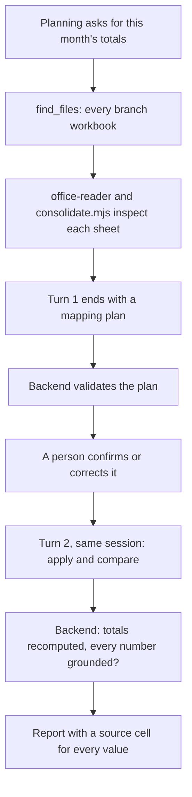
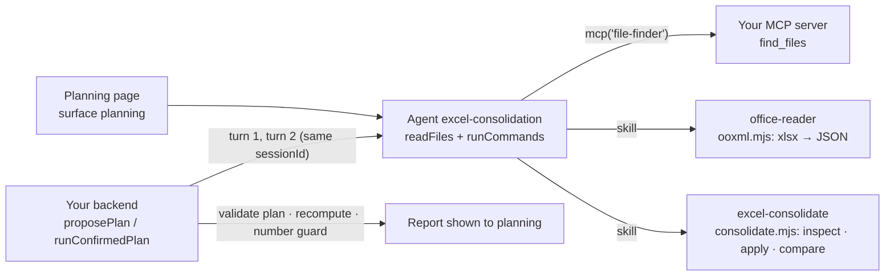

<Info>
**You will build:** an agent that finds every branch's sales workbook, proposes a column mapping a person confirms, consolidates with a script that keeps each value's source cell, and explains the month-over-month change.

**You will learn:** file search as your own MCP server ([MCP servers](/building/mcp-servers)), two skills with scripts, one shared with other use cases ([Skills](/building/skills)), the stored policy that lets a run use Bash ([Design an agent](/building/agents)), a person's confirmation between two turns of one session ([Integrate a backend](/building/backend)), a full-page surface ([Embed an agent](/building/embedding)), and evals for the planning turn ([Evaluations](/guides/evaluations)).

**Time and prerequisites:** about 45 minutes to read; the tests behind it run offline with no API key. To run it on your own workspace, finish [chapter 1](/path/first-agent) first (a project answering under `aw dev`), and have a model key and Node to start the file-finder server. Advanced.

</Info>

**Excel集約・分析エージェント.** Corporate planning asks 「今月の拠点別売上を集計して、前月からの増減を説明して」.
Five branches send five workbooks, each laid out by whoever built it years ago: a merged title
row, a two-row header, 千円 in one branch and 円 in the next, dates written 令和7年5月8日, `R7.5.2`
or as Excel serial numbers, 小計 and 合計 rows in the middle of the data, a sheet renamed every
month. The agent finds the files, reads every sheet, and proposes how to read each one. A person
confirms the plan. A script then does the arithmetic, every value keeps its source cell, and the
agent explains the change in Japanese using only the numbers the script printed.

The need is well documented. In a survey of 372 DX leaders by アイアットOEC (April 2026), 88.7% say
their company still runs on Excel, 44.6% name data entry and aggregation as a major time sink,
and 43.6% say scattered copies of files leave the numbers inconsistent ([PR TIMES,
2026](https://prtimes.jp/main/html/rd/p/000000031.000085668.html)). What we could not find is a
named company that runs this end to end with an agent in production. The demand is clear;
public evidence of deployments is not. This page shows what it takes to build one today.

Every test behind this page runs offline, with no API key. How the gallery
tests a use case is on the [gallery overview](/tutorials).

## How the agent works

From the request to the person who decides, with the tools, skills and checks in between:



## What you build



| Piece | File | SDK |
| --- | --- | --- |
| The agent | `agents/excel-consolidation.ts`, `agents/excel-consolidation.md` | `defineAgent`, `mcp`, `skill` |
| File search | `mcp/file-finder.mjs` | an `http` connector in `agent-workspace.yaml` |
| Reading xlsx | `../shared/skills/office-reader/` | `skill('office-reader')`, shared with other use cases |
| Mapping and arithmetic | `skills/excel-consolidate/SKILL.md`, `scripts/consolidate.mjs` | `skill('excel-consolidate')`, `runCommands` |
| The workbooks | `data/branch-workbooks.ts`, `data/mapping-plan.json` | the layouts, and the `.xlsx` files written from them with the shared xlsx writer |
| The page | `surfaces/planning.ts` | `defineSurface` |
| The two turns and the guards | `backend/consolidate.ts` | `runs.start` with `sessionId`, `runs.follow` |

## 1. The workbooks, as they arrive

`data/` holds ten workbooks (five branches, April and May 2025) plus a blank template and an
expense sheet that a careless search would pick up. They are written from
`data/branch-workbooks.ts`, where the layouts are, and a test checks that they still match it:

| Branch | Sheet | Header | Date | Unit | Trap |
| --- | --- | --- | --- | --- | --- |
| 東京 | 売上明細 | rows 3–4, merged | 令和7年4月3日 | 千円, in the header | 小計 row, ※ note row |
| 大阪 | Sheet1 | row 1 | 2025/04/08 | 円 | 合計 row |
| 名古屋 | 名古屋営業所 | row 2 | Excel serial | 千円 | category before date; a ※ remark on a real sale |
| 福岡 | R7.4, R7.5 | row 3 | 令和7年4月7日 | 円, on a 単位 row above the header | sheet renamed every month, （参考） row |
| 札幌 | 実績, after a 表紙 sheet | row 4 | R7.4.4 | 千円, on a 単位 row above the header | 合計 row |

Two of the five state their unit outside the header. That is why the plan must state every unit
explicitly, and why the backend refuses a plan that does not.

## 2. Find the files with your own MCP server

The files live on SharePoint, Box or a file server, not in the workspace. Agent Workspace has no
search, so `find_files` is your server, standing in for the search your company already has:

```js title="mcp/file-finder.mjs (excerpt)" file="tests/gallery/excel-consolidation/mcp/file-finder.mjs#excerpt"
function insideRoot(folder) {
  const candidate = path.resolve(ROOT, folder);
  let real;
  try {
    real = realpathSync(candidate);
  } catch {
    refuse(`no folder named ${folder}`);
  }
  const relative = path.relative(ROOT, real);
  if (relative === '..' || relative.startsWith(`..${path.sep}`) || path.isAbsolute(relative))
    refuse('folder must be inside the file root');
  return real;
}
```

It returns `path`, `localPath`, `size` and `modified` for every file whose path holds all the query's terms
(NFKC-normalised, so full-width input works). The test checks that `..`, an absolute path and a
symbolic link out of the root are all refused. 札幌 calls its file 月次報告, not 売上, so the
instructions tell the agent to search more than once.

`path` is relative to the root and is what the mapping plan names; the backend checks every plan
file against what `find_files` returned. `localPath` is the same file's absolute path on the
machine running the server, which the agent's shell opens. That works only where the server and the
run share a filesystem, as they do under `aw dev`. Under a deployed runtime, the run cannot see it.

In production, a sync job copies the found workbooks into the folder the run reads; how the bytes
reach the run is your connector's business. Each file the workspace stores is opaque bytes, up to
64 MiB (`MAX_UPLOAD_BYTES` in the contracts package).

## 3. Parse and consolidate with skill scripts

The platform parses nothing, so the agent runs two dependency-free Node scripts. The shared
`office-reader` skill turns an xlsx into JSON (merged cells filled, addresses kept). This use
case's own skill applies the plan. A skill is uploaded as its own directory, so
`consolidate.mjs` imports nothing from `office-reader`; it reads that script's JSON output:

```sh title="illustrative" claim="illustrative"
for f in "<localPath of each xlsx>"…; do node ooxml.mjs xlsx "$f" > "/tmp/$(basename "$f").json"; done
node consolidate.mjs inspect /tmp/*.xlsx.json   # per file and sheet: first rows, lettered, and its unit
node consolidate.mjs apply plan.json /tmp/*.xlsx.json > /tmp/applied.json
node consolidate.mjs compare /tmp/applied.json 2025-04 2025-05 > /tmp/report.json
```

`inspect` takes every workbook in one call, so the first turn is a handful of tool calls rather than
one pair per file. For each sheet it also reports the unit it states (`unit`, with the cell it came
from in `unitFrom`): a header label such as `金額（千円）` (東京) or a `単位：` row above the header
(福岡 円, 札幌 千円). The plan's `unit` is copied from it, so the proposal always names 千円 for 東京, 名古屋
and 札幌.

Units and dates are converted by rule, never by the model: 千円 × 1,000, 令和/平成/昭和 (also
`R7.5.2` and 元年) to ISO dates with era bounds checked, Excel serials to dates. Every row keeps
its sources:

```json title="one row of report.json (illustrative)" claim="illustrative"
{
  "branch": "東京", "date": "2025-05-08", "month": "2025-05", "category": "機器",
  "amount": 1500000, "raw": { "amount": 1500, "unit": "千円" },
  "@src": {
    "date": "東京支店/東京_売上報告_2025年5月.xlsx!売上明細!A5",
    "category": "東京支店/東京_売上報告_2025年5月.xlsx!売上明細!B5",
    "amount": "東京支店/東京_売上報告_2025年5月.xlsx!売上明細!D5"
  }
}
```

The script also refuses to guess when a header contradicts the plan, which catches the classic
thousand-fold error:

```js title="skills/excel-consolidate/scripts/consolidate.mjs (excerpt) (illustrative)" claim="illustrative"
const label = [...new Set(layout.headerRows.map((row) => valueAt('amount', row)))]
  .filter((value) => value !== null)
  .join(' / ');
const stated = unitInLabel(label);
if (stated !== null && stated !== layout.unit)
  fail(`${at('amount', lastHeader)} says ${stated} (${label}) but the plan says ${layout.unit}`);
```

Subtotal and note markers (`skip`) are matched in the date and category columns only, so
名古屋's `※値引後` remark in its notes column does not drop a real sale. The unit tests pin the
exact result: April 7,410,500円, May 7,920,000円, +509,500円 (+6.9%), 22 rows, 10 rows skipped
with their reasons.

## 4. Define the agent

```ts title="agents/excel-consolidation.ts" file="tests/gallery/excel-consolidation/agents/excel-consolidation.ts#excerpt"
export default defineAgent({
  name: 'excel-consolidation',
  instructions: { file: './excel-consolidation.md' },
  model: 'default',
  // A run is unattended: without autoApprove the SDK refuses the skill script's Bash call.
  engine: { id: 'claude-agent-sdk', autoApprove: ['Bash'] },
  permissions: { readFiles: true, runCommands: true },
  tools: [mcp('file-finder')],
  skills: [skill('office-reader'), skill('excel-consolidate')],
  limits: { maxTurns: 30, maxBudgetUsd: 1 },
});
```

The instructions split the work into two turns: the first ends with a plan and a question, and
the second runs only the plan it was sent. `writeFiles` is off, which removes the Write and Edit
tools but not shell redirection; the scripts print JSON, and the report travels back in the
answer.

## 5. The two-turn flow in the backend

A run cannot pause for a person's approval, so the confirmation is two runs in one session.

```ts title="backend/consolidate.ts (excerpt) (illustrative)" claim="illustrative"
// Turn 1: ask for a plan, and validate it before anyone is asked to confirm it.
const reading = await runAndRead(aw, agentId, { prompt: request });
const found = /* every .xlsx path find_files returned in this run */;
const { text, json } = splitJsonBlock(reading.answer);
const { plan, problems } = validatePlan(json, found);

// Turn 2: same session, the confirmed plan as the prompt.
const reading2 = await runAndRead(aw, agentId, { prompt, sessionId: proposal.sessionId });
const mismatches = recompute(report, plan);
const ungrounded = ungroundedNumbers(text, report);
```

`validatePlan` refuses a plan in which any workbook the agent found is neither mapped nor
excluded with a reason, any mapped file was never found, a required field (`date`, `category`,
`amount`) has no column, or a unit or date format is missing. The person sees `lines`, one row per
file with its sheet, header rows, columns and unit, and confirms or corrects it.

After turn 2 the backend checks the agent's work rather than trusting it:

- **`recompute`** adds up the report's own rows by month and branch, recomputes every difference
  and percentage, and checks each row's `@src` points into a planned file and sheet. A report
  whose stated total its rows do not add up to is refused.
- **`ungroundedNumbers`** pulls every number out of the explanation (reading 万 and 億 as
  multipliers, ignoring cell addresses) and refuses any that the script did not print. A
  percentage must be one of the script's rates: 「+25.0%」 is not grounded by a sale dated the 25th.

```ts title="excel-consolidation.test.ts (excerpt) (illustrative)" claim="illustrative"
expect(result.status).toBe('refused');
expect(result.ungrounded).toStrictEqual(['25.0%', '290万']);
```

## 6. The page

```ts title="surfaces/planning.ts (excerpt) (illustrative)" claim="illustrative"
export default defineSurface({
  name: 'planning',
  agent: 'excel-consolidation',
  title: '拠点別売上の集計',
  layout: 'page',
  parts: { toolTrace: 'collapsed', history: true, feedback: true /* … */ },
});
```

<Warning>
  The surface sets no `toolResults`. The widget matches a key against the tool name exactly,
  and a Claude run names an MCP tool `mcp__file-finder__find_files`, or
  `mcp__connector-<uuid>__find_files` when the connector's name is not a usable slug. A bare
  `find_files` key passes the contract and never renders; the UUID form is different in every
  workspace, so it cannot be committed (probe `surface-mcp-tool-results`).
</Warning>

## 7. Evals

```yaml title="evals/excel-consolidation.yaml (excerpt)" file="tests/gallery/excel-consolidation/evals/excel-consolidation.yaml#excerpt"
cases:
  - name: 1回目は集計せずにマッピング計画を出す
    input: 今月（2025年5月）の拠点別売上を集計して、前月からの増減を説明して
    expect:
      contains: ['```json', '"layouts"', '"unit"']
      notContains: ['"comparison"']
```

Three cases pin the plan: units stated, the template excluded, no totals before confirmation. An
eval case is one prompt in a fresh session, so turn 2 cannot be an eval; the backend's guards
cover it.

## 8. Run it

<Steps>
  <Step title="Offline, in the test suite">
    Checks the shipped workbooks, drives the real file-finder server, runs both skill scripts as the
    agent's shell would, and runs both turns of the backend against a scripted workspace. Ten
    tests, no API key.
  </Step>
  <Step title="On your workspace">
    ```sh title="illustrative" claim="illustrative"
    cp -r ../shared/skills/office-reader skills/   # a skill is imported from this project's skills/
    FILE_ROOT=/srv/branch-reports MCP_TRANSPORT=http PORT=8788 node mcp/file-finder.mjs &
    aw dev          # keeps the connector and both skills in step
    aw push --yes
    ```
    A run is unattended, so the skill scripts' shell commands need the `autoApprove: ['Bash']`
    that the agent declares in its `engine` setting; `aw push` stores it in the policy.
    Then `aw eval excel-consolidation`, and call `proposePlan` / `runConfirmedPlan` from your
    backend. Start the monthly run from your own scheduler: nothing in the platform does.
  </Step>
</Steps>

## Where the SDK stands

This table is generated from the use case's benchmark and checked by the gallery's tests.

{/* benchmark:start */}

Score: **50 / 100** (✅ = 1, 🟡 = 0.5, ❌ = 0, over the capabilities this use case needs).

| Capability | Today | Evidence | What it means for you |
| --- | --- | --- | --- |
| Agent as code | ✅ | contract | defineAgent with two skills (one shared), an MCP tool and a surface passes the server contract offline; the policy ceiling allows commands but not the Write tool. |
| Grounded search | 🟡 | contract | Finding workbooks on SharePoint, Box or a file server is your MCP server (about 80 lines here, with the path-traversal check); the platform searches nothing. |
| Document parsing | 🟡 | contract | Files are bytes (up to 64 MiB each); the skill scripts parse xlsx and apply the plan, and the agent declares `autoApprove: ['Bash']` in `defineAgent` so an unattended run can call them. |
| Structured output | ❌ | probe | The plan and the report come back as a fenced JSON block inside the answer text; the backend parses and validates both. |
| Human approval | 🟡 | contract | A run cannot pause for approval (probe `run-approval`), so the confirmation is two runs in one session: plan, then the confirmed plan as the next prompt. |
| Write to systems | ❌ | source | A consolidated workbook the agent writes is not returned to the file store (persistPaths collects the wrong directory); the report travels in the answer instead. |
| Triggers | ❌ | probe | Nothing starts the monthly run on a schedule or when the last branch uploads; your own cron calls the backend. |
| Per-user scope | 🟡 | source | Grants are per agent, not per person: a branch manager using this agent sees every branch, unless your file server filters by caller. |
| Embedded UI | 🟡 | probe | defineSurface publishes the planning page, but the file list cannot render as a table: `toolResults` must name the run’s tool exactly, and that name carries a per-workspace connector id. |
| Evals | ✅ | contract | Three cases pin the plan (units, the excluded template, no premature totals); an eval is one prompt, so turn 2 is checked by the backend, not by evals. |
| Audit and cost | ✅ | source | Every run records tokens and cost; every consolidated value also carries its `file!sheet!cell`. |

{/* benchmark:end */}

**Verdict: buildable, with real work around the gaps.** The agent part is small: instructions,
two skills and a search tool. Most of the code is the work around it: about 320 lines of script
for the mapping and arithmetic (yours in any design), and about 400 lines of backend to carry a
plan and a report through answer text, check them, and stage a human confirmation as two runs.
What would remove code from this page:

- **Structured run output** would replace the fenced-JSON parsing and shape checks for the plan
  and the report (probe `run-output-schema`).
- **A run that pauses for approval** would make the confirmation one run instead of two, with the
  plan kept by the platform (probe `run-approval`).
- **Files written in a run returned to the file store** would let the agent hand back a
  consolidated workbook instead of a JSON report in its answer.
- **Triggers** would start the monthly run when the last branch uploads (probe `inbound-trigger`).
