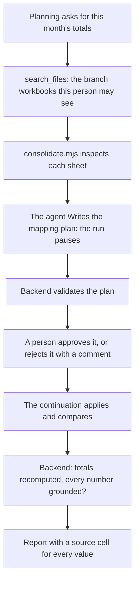
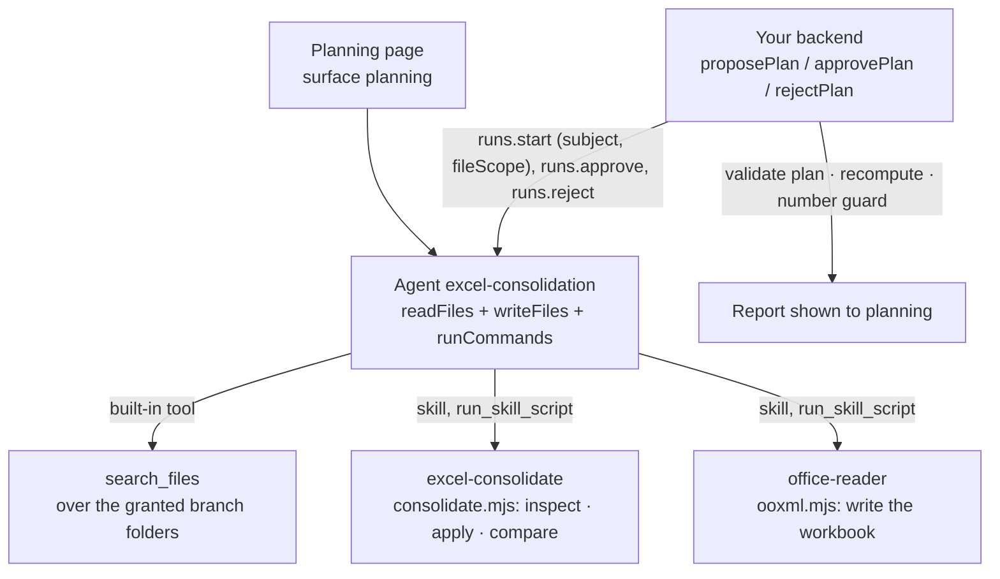

<Info>
**You will build:** an agent that finds every branch's sales workbook, proposes a column mapping a person confirms, consolidates with a script that keeps each value's source cell, and explains the month-over-month change.

**You will learn:** the platform's `search_files`, narrowed per caller with `fileScope` ([Integrate a backend](/building/backend)), two skills with scripts, one shared with other use cases ([Skills](/building/skills)), the stored policy that lets a run use `run_skill_script` ([Design an agent](/building/agents)), a person's approval of the plan before the run goes on ([Integrate a backend](/building/backend)), a full-page surface ([Embed an agent](/building/embedding)), and evals for the planning turn ([Evaluations](/guides/evaluations)).

**Time and prerequisites:** about 45 minutes to read; the tests behind it run offline with no API key. To run it on your own workspace, finish [chapter 1](/path/first-agent) first (a project answering under `aw dev`), and have a model key; then allow time to upload the workbooks, run `aw push` and run `aw eval`. Advanced.

</Info>

## The result

<Frame caption="Planning asks 「今月の拠点別売上を集計して、前月からの増減を説明して」 and the agent answers with a mapping plan for a person to confirm.">
  
</Frame>

**Excel集約・分析エージェント.** Corporate planning asks 「今月の拠点別売上を集計して、前月からの増減を説明して」.
Five branches send five workbooks, each laid out by whoever built it years ago: a merged title
row, a two-row header, 千円 in one branch and 円 in the next, dates written 令和7年5月8日, `R7.5.2`
or as Excel serial numbers, 小計 and 合計 rows in the middle of the data, a sheet renamed every
month. The agent finds the files, reads every sheet, and proposes how to read each one. A person
confirms the plan. A script then does the arithmetic, every value keeps its source cell, and the
agent explains the change in Japanese using only the numbers the script printed.

## Why it is worth building

The need is well documented. In a survey of 372 DX leaders by アイアットOEC (April 2026), 88.7% say
their company still runs on Excel, 44.6% name data entry and aggregation as a major time sink,
and 43.6% say scattered copies of files leave the numbers inconsistent ([PR TIMES,
2026](https://prtimes.jp/main/html/rd/p/000000031.000085668.html)). What we could not find is a
named company that runs this end to end with an agent in production. The demand is clear;
public evidence of deployments is not. This page shows what it takes to build one today.

## How it works

From the request to the person who decides, with the tools, skills and checks in between:



The pieces you will write, and the SDK feature behind each:



| Piece                                | File                                                                               | SDK                                                                                     |
| ------------------------------------ | ---------------------------------------------------------------------------------- | --------------------------------------------------------------------------------------- |
| The agent                            | `agents/excel-consolidation.ts`, `agents/excel-consolidation.md`                   | `defineAgent`, `files`, `skill`                                                         |
| File search                          | the branch folders under `data/`, `data/access.json`                               | `aw files upload`, the built-in `search_files`, `runs.start({ fileScope })`             |
| Writing the workbook                 | the built-in `office-reader` skill (`packages/skills-office/`)                     | `builtinSkill('office-reader')`; the platform installs it on first use                  |
| Reading xlsx, mapping and arithmetic | `skills/excel-consolidate/SKILL.md`, `scripts/consolidate.mjs`, `scripts/xlsx.mjs` | `skill('excel-consolidate')`, `runCommands`, `run_skill_script`                         |
| The workbooks                        | `data/branch-workbooks.ts`, `data/mapping-plan.json`                               | the layouts, and the `.xlsx` files written from them with the office-reader xlsx writer |
| The page                             | `surfaces/planning.ts`                                                             | `defineSurface`                                                                         |
| The approval and the guards          | `backend/consolidate.ts`                                                           | `runs.start`, `runs.approve`, `runs.reject`, `runs.follow`                              |

## Before you start

Before you read on, check that:

- you finished [chapter 1](/path/first-agent), so a project answers under `aw dev`
- you have a model key, to run the agent
- optionally, you read [how the gallery tests a use case](/tutorials)

**Getting the code.** The files below are the use case's project folder, `tests/gallery/excel-consolidation/`, in the Agent Workspace repository. Paths in the tables and code titles are relative to that folder, and a code block that names a file there is an exact copy of it. You can follow the tutorial by reading alone, or by running its offline tests; to run the agent yourself, copy the folder's files into the project you created in chapter 1.

Every test behind this page runs offline, with no API key. How the gallery
tests a use case is on the [gallery overview](/tutorials).

## Build it

<Steps>
<Step title="1. Look at the workbooks as they arrive">

`data/` holds ten workbooks (five branches, April and May 2025) plus a blank template and an
expense sheet that a careless search would pick up. They are written from
`data/branch-workbooks.ts`, where the layouts are, and a test checks that they still match it:

| Branch | Sheet                    | Header           | Date          | Unit                                 | Trap                                            |
| ------ | ------------------------ | ---------------- | ------------- | ------------------------------------ | ----------------------------------------------- |
| 東京   | 売上明細                 | rows 3–4, merged | 令和7年4月3日 | 千円, in the header                  | 小計 row, ※ note row                            |
| 大阪   | Sheet1                   | row 1            | 2025/04/08    | 円                                   | 合計 row                                        |
| 名古屋 | 名古屋営業所             | row 2            | Excel serial  | 千円                                 | category before date; a ※ remark on a real sale |
| 福岡   | R7.4, R7.5               | row 3            | 令和7年4月7日 | 円, on a 単位 row above the header   | sheet renamed every month, （参考） row         |
| 札幌   | 実績, after a 表紙 sheet | row 4            | R7.4.4        | 千円, on a 単位 row above the header | 合計 row                                        |

Two of the five state their unit outside the header. That is why the plan must state every unit
explicitly, and why the backend refuses a plan that does not.

**Check:** you can say, for each branch, its sheet, header rows, unit and date format, and which two branches (福岡, 札幌) state the unit outside the header.

</Step>
<Step title="2. Find the files with search_files, narrowed per person">

The workbooks are uploaded once into one folder per branch (`aw files upload`, the command is in
`agent-workspace.yaml`), and the agent holds a read grant on each folder. The platform's
`search_files` finds a workbook by the text inside it (sheet names, headers, categories), not by its
name, and returns `[{path, page, snippet}]` for the files that hold every term of the query. 札幌
calls its file 月次報告, not 売上, so the instructions start with two searches on what a sales sheet
holds (`機器 保守` and `日付 区分`), in the same turn, and add others for a branch that is missing.
The `path` it returns is relative to the working directory, and it is what the mapping plan names
and what the scripts open. There is no connector and no server of ours.

Search covers every folder the agent is granted, which is all five branches and the shared one. A
branch manager should see only their own branch, so the backend narrows each run with
`runs.start({ fileScope })`: a subset of the agent's file grants. `data/access.json` maps the
signed-in person to the top-level folders they may see:

```json title="data/access.json" file="tests/gallery/excel-consolidation/data/access.json"
{
  "田村 恵": {
    "folders": ["共通", "東京支店", "大阪支店", "名古屋営業所", "札幌営業所", "福岡支店"]
  },
  "佐々木 誠": { "folders": ["共通", "札幌営業所"] }
}
```

```ts title="backend/consolidate.ts (excerpt)" file="tests/gallery/excel-consolidation/backend/consolidate.ts#excerpt"
export function fileScopeFor(subject: string, access: AccessList): string[] {
  const folders = access[subject]?.folders ?? [];
  if (folders.length === 0) throw new NoAccessibleFiles(subject);
  return [...folders];
}
```

`search_files` and the files the run opens then cover those folders only: 佐々木 誠's run does not
find the 東京 workbooks, and a plan cannot name them. A scope wider than the agent's grants fails the
run with 403 `run_file_scope_not_granted`, and an empty scope is invalid, which is why a person with
no folder gets no run at all. The person comes from the backend's own session, never from the
prompt. What the agent writes is still granted per agent (P2-4).

**Check:** the two opening searches (`機器 保守`, `日付 区分`) return the ten branch workbooks and the shared template, not the expense sheet or the note, and a person with no folder is refused before any run starts.

</Step>
<Step title="3. Parse and consolidate with skill scripts">

The platform parses nothing, and a run has no shell, so the agent calls the skills' dependency-free
Node scripts with `run_skill_script` (a skill, a script and its `args`; no pipes, no redirects).
The skill's `consolidate.mjs` reads the `.xlsx` files itself (merged cells filled, addresses kept)
with `scripts/xlsx.mjs`, a copy of the built-in `office-reader` reader: a skill is uploaded as its own
directory, so it cannot import from another skill, and a test pins the copy to the original. A result
goes to stdout and, with `--out`, to a file under `outputs/`, the one folder a run may write, for the
next call to read:

```json title="run_skill_script calls (illustrative)" claim="illustrative"
{ "skill": "excel-consolidate", "script": "consolidate.mjs", "args": ["inspect", "<path>", "…"] }
{ "skill": "excel-consolidate", "script": "consolidate.mjs", "args": ["apply", "outputs/plan.json", "<path>", "…", "--out", "outputs/applied.json"] }
{ "skill": "excel-consolidate", "script": "consolidate.mjs", "args": ["compare", "outputs/applied.json", "2025-04", "2025-05", "--out", "outputs/report.json"] }
{ "skill": "excel-consolidate", "script": "consolidate.mjs", "args": ["sheet", "outputs/report.json", "--out", "outputs/book.json"] }
{ "skill": "office-reader", "script": "ooxml.mjs", "args": ["write", "outputs/book.json", "outputs/consolidated-2025-05.xlsx"] }
```

Each `<path>` is a `path` that `search_files` returned. The last two calls turn the report into the
consolidated workbook, which `office-reader` writes.

`inspect` takes every workbook in one call, so reaching the plan is a handful of tool calls rather than
one pair per file. For each sheet it also reports the unit it states (`unit`, with the cell it came
from in `unitFrom`): a header label such as `金額（千円）` (東京) or a `単位：` row above the header
(福岡 円, 札幌 千円). The plan's `unit` is copied from it, so the proposal always names 千円 for 東京, 名古屋
and 札幌.

Units and dates are converted by rule, never by the model: 千円 × 1,000, 令和/平成/昭和 (also
`R7.5.2` and 元年) to ISO dates with era bounds checked, Excel serials to dates. Every row keeps
its sources:

```json title="one row of report.json (illustrative)" claim="illustrative"
{
  "branch": "東京",
  "date": "2025-05-08",
  "month": "2025-05",
  "category": "機器",
  "amount": 1500000,
  "raw": { "amount": 1500, "unit": "千円" },
  "@src": {
    "date": "東京支店/東京_売上報告_2025年5月.xlsx!売上明細!A5",
    "category": "東京支店/東京_売上報告_2025年5月.xlsx!売上明細!B5",
    "amount": "東京支店/東京_売上報告_2025年5月.xlsx!売上明細!D5"
  }
}
```

The script also refuses to guess when a header contradicts the plan, which catches the classic
thousand-fold error:

```js title="skills/excel-consolidate/scripts/consolidate.mjs (excerpt) (illustrative)" claim="illustrative"
const label = [...new Set(layout.headerRows.map((row) => valueAt('amount', row)))]
  .filter((value) => value !== null)
  .join(' / ');
const stated = unitInLabel(label);
if (stated !== null && stated !== layout.unit)
  fail(`${at('amount', lastHeader)} says ${stated} (${label}) but the plan says ${layout.unit}`);
```

Subtotal and note markers (`skip`) are matched in the date and category columns only, so
名古屋's `※値引後` remark in its notes column does not drop a real sale. The unit tests pin the
exact result: April 7,410,500円, May 7,920,000円, +509,500円 (+6.9%), 22 rows, 10 rows skipped
with their reasons.

**Check:** the unit tests give April 7,410,500円, May 7,920,000円 and +509,500円 (+6.9%) over 22 rows, with 10 rows skipped for stated reasons.

</Step>
<Step title="4. Define the agent">

```ts title="agents/excel-consolidation.ts" file="tests/gallery/excel-consolidation/agents/excel-consolidation.ts#excerpt"
export default defineAgent({
  name: 'excel-consolidation',
  instructions: { file: './excel-consolidation.md' },
  model: 'default',
  // A run is unattended: without autoApprove the SDK refuses the search and the skill scripts. The
  // read-only grants below make the platform deny Bash, so scripts run through `run_skill_script`.
  // The only thing a person decides is the mapping plan: the agent saves it with `Write`, and the
  // run waits there for an approval (ADR-0145) before it applies the plan.
  engine: {
    id: 'claude-agent-sdk',
    autoApprove: ['mcp__agent-workspace__run_skill_script', 'mcp__agent-workspace__search_files'],
    requireApproval: ['Write'],
  },
  permissions: { readFiles: true, writeFiles: true, runCommands: true },
  skills: [builtinSkill('office-reader'), skill('excel-consolidate')],
  files: [
    files('共通', 'read'),
    files('東京支店', 'read'),
    files('大阪支店', 'read'),
    files('名古屋営業所', 'read'),
    files('札幌営業所', 'read'),
    files('福岡支店', 'read'),
  ],
  limits: { maxTurns: 30, maxBudgetUsd: 1 },
});
```

The instructions split the work at the plan: the agent saves its mapping plan with `Write`, which
`requireApproval: ['Write']` holds until a person approves it, and after the approval it runs only
that plan. `runCommands` offers `run_skill_script`, and `writeFiles` lets the agent save the plan
and the consolidated workbook to `outputs/`, the one folder the sandbox lets it write; the backend
collects the workbook with `runs.outputs`, and the report still travels back in the answer. The
branch folders are read-only grants, so `Bash` stays denied.

**Check:** the agent grants `readFiles`, `writeFiles` and `runCommands`, a read grant on each branch folder, declares `autoApprove` for `run_skill_script` and `search_files`, and holds `Write` for approval.

</Step>
<Step title="5. Put it on the planning page">

```ts title="surfaces/planning.ts (excerpt) (illustrative)" claim="illustrative"
export default defineSurface({
  name: 'planning',
  agent: 'excel-consolidation',
  title: '拠点別売上の集計',
  layout: 'page',
  parts: { toolTrace: 'collapsed', history: true, feedback: true /* … */ },
});
```

**Check:** after `aw push`, the planning page opens as a full page with the tool trace collapsed and the history kept.

</Step>
<Step title="6. Approve the plan in the backend and check the work">

The run stops at the agent's `Write` of `outputs/plan.json`, so the person decides on the plan the
run is paused on. `proposePlan(aw, agentId, request, subject, access)` starts the run for the
signed-in person with the `fileScope` from `access` and returns the plan read from that paused
call; `approvePlan` approves it, and `rejectPlan` sends the person's comment, after which the agent
writes a revised plan and the run pauses again. The approval admits exactly the plan that was
shown, and the continuation keeps the paused run's file grants.

```ts title="backend/consolidate.ts (excerpt) (illustrative)" claim="illustrative"
// Ask for a plan within this person's folders: the run stops at its Write, and the backend
// validates what is about to be written.
const fileScope = fileScopeFor(subject, access);
const paused = await untilApproval(
  runAndRead(aw, agentId, { prompt: request, subject, fileScope }, ReportAnswerSchema));
const { plan, problems } = readPlan(paused, found);   // the Write's content, validated

// The person approves: the continuation applies the plan and explains.
const { run } = await aw.runs.approve(proposal.runId);
const { explanation, report } = (await readRun(aw, run.id, ReportAnswerSchema)).output;
const mismatches = recompute(report, plan);
const ungrounded = ungroundedNumbers(explanation, report);
```

The schemas settle the shape: every layout has its branch, sheet, files, header rows and a column
for `date`, `category` and `amount`, and the report comes back typed, so a run whose answer does
not fit fails instead of reaching the backend. A unit or date format the agent cannot state is
`null`, never a guess. `validatePlan` refuses a plan in which any workbook the agent found is
neither mapped nor excluded with a reason, any mapped file was never returned by `search_files`, or a unit or date format
is `null`. The person sees `lines`, one row per file with its sheet, header rows, columns and unit,
and approves it or rejects it with a reason.

After the approval the backend checks the agent's work rather than trusting it:

- **`recompute`** adds up the report's own rows by month and branch, recomputes every difference
  and percentage, and checks each row's `@src` points into a planned file and sheet. A report
  whose stated total its rows do not add up to is refused.
- **`ungroundedNumbers`** pulls every number out of the explanation (reading 万 and 億 as
  multipliers, ignoring cell addresses) and refuses any that the script did not print. A
  percentage must be one of the script's rates: 「+25.0%」 is not grounded by a sale dated the 25th.

```ts title="excel-consolidation.test.ts (excerpt) (illustrative)" claim="illustrative"
expect(result.status).toBe('refused');
expect(result.ungrounded).toStrictEqual(['25.0%', '290万']);
```

**Check:** a report whose explanation quotes 「+25.0%」 comes back `refused`, with the ungrounded numbers listed.

</Step>
<Step title="7. Say what good means with evals">

````yaml title="evals/excel-consolidation.yaml (excerpt)" file="tests/gallery/excel-consolidation/evals/excel-consolidation.yaml#excerpt"
cases:
  - name: 集計せずに、計画を Write して承認を待つ
    input: 今月（2025年5月）の拠点別売上を集計して、前月からの増減を説明して
    expect:
      awaitsApproval: true
      tool: Write
      toolInput: { file_path: outputs/plan.json }
      notContains: ['"comparison"']
````

Three cases pin the plan: the `Write` of `outputs/plan.json`, units stated, the template excluded,
no totals before approval. Each case is scored at the approval pause (`awaitsApproval: true`); the
eval never approves, and the eval runner cancels the paused run. An eval case is one prompt in a
fresh session, so what follows the approval cannot be an eval; the backend's guards cover it.

**Check:** three cases pin the plan: the plan is written for approval, units stated, the template excluded, no totals before approval.

</Step>
</Steps>

## Run it

<Steps>
  <Step title="Offline, in the test suite">
    Checks the shipped workbooks, drives the platform's `search_files` over the granted folders,
    runs the skill scripts as `run_skill_script` would, and runs the plan, its approval or rejection, and the checks of the
    backend against a scripted workspace, including each person's `fileScope`. Nineteen tests, no API
    key.
  </Step>
  <Step title="On your workspace">
    ```sh title="illustrative" claim="illustrative"
    for f in data/*/*; do aw files upload "$f" "${f#data/}"; done    # each branch's workbooks, into its folder
    aw dev          # keeps the agent and both skills in step
    aw push --yes
    ```

    A run is unattended, so the platform's tools need the `autoApprove` that the agent declares in
    its `engine` setting (`run_skill_script` and `search_files`), and the plan's `Write` waits on the
    `requireApproval: ['Write']` next to it; `aw push` stores both in the policy. Then
    `aw eval excel-consolidation`, and call `proposePlan`, then `approvePlan` or `rejectPlan`, from
    your backend for the signed-in planner. `MONTHLY_TRIGGER` starts the run on schedule and names
    the planner as its `subject` (an Owner or Admin creates it, since only they may set a subject). A
    trigger cannot carry a `fileScope`, so its run searches every granted branch folder; read the
    paused run with `proposePlanFromRun`, which refuses a plan naming a file outside that planner's
    folders.

  </Step>
</Steps>

<Frame caption="The excel-consolidation agent in the console after aw push, with its two skills.">
  
</Frame>

## Where the SDK stands

This table is generated from the use case's benchmark and checked by the gallery's tests.

{/* benchmark:start */}

Score: **100 / 100** (✅ = 1, 🟡 = 0.5, ❌ = 0, over the capabilities this use case needs).

| Capability | Today | Evidence | What it means for you |
| --- | --- | --- | --- |
| Agent as code | ✅ | contract | defineAgent with two skills (one shared), read grants on the branch folders and a surface passes the server contract offline; the policy ceiling allows `run_skill_script` and writing the workbook to `outputs/`. |
| Grounded search | ✅ | contract | The built-in `search_files` finds the workbooks by the text inside them (sheet names, headers, categories) over the granted branch folders, narrowed per caller with `runs.start({ fileScope })`; no connector and no index server of ours. |
| Document parsing | ✅ | contract | The skill script `consolidate.mjs` reads the workbooks itself with `scripts/xlsx.mjs`, a copy of the built-in office-reader reader that a test pins to the original, and applies the confirmed plan (units, 和暦, Excel serials). The agent runs it through `run_skill_script`, pre-approved in `autoApprove`, beside the read-only grants (no shell); office-reader writes the workbook to `outputs/`. |
| Structured output | ✅ | contract | The report comes back typed (`runs.result` with a Zod schema) and the plan is read from the `Write` the run is paused on; your backend only checks the plan against the workbooks found, recomputes every total and refuses numbers the script did not produce. |
| Human approval | ✅ | contract | The agent saves its mapping plan with `Write`, which `requireApproval: ['Write']` holds: the run is `awaiting_approval` until a person approves (`runs.approve`) or rejects with a comment (`runs.reject`, and the revised plan pauses again). The approval admits exactly the plan that was shown. |
| Write to systems | ✅ | contract | The agent’s consolidated workbook comes back with the run (`runs.outputs`); the backend checks it against the report that adds up and builds no workbook itself. |
| Triggers | ✅ | contract | A schedule trigger starts the monthly run on time, asks it for the report as its `outputSchema`, and names the planner as its `subject` (ADR-0156). A trigger cannot carry a `fileScope`, so the run searches every granted branch folder; the backend reads the plan from the run paused on its `Write` (`proposePlanFromRun`), refuses a plan naming a file outside the planner’s folders, and validates it before anyone approves it. |
| Per-user scope | ✅ | contract | The planning desk starts each run with `subject: <signed-in person>` and a `fileScope` of the branch folders that person may see (from `data/access.json`), so `search_files` and the hydrated workbooks cover only those paths; a person with no folder is refused before any run starts. The files the agent writes are still granted per agent, not per person (P2-4). |
| Embedded UI | ✅ | contract | defineSurface publishes the planning page, and the plan is confirmed in the page. |
| Evals | ✅ | contract | Three cases pin the plan (units, the excluded template, no premature totals) and score at the approval pause (`awaitsApproval`); the eval never approves, and the runner cancels the paused run. What follows the approval is checked by the backend. |
| Audit and cost | ✅ | source | Every run records tokens and cost; every consolidated value also carries its `file!sheet!cell`. |

{/* benchmark:end */}

**Verdict: buildable, with real work around the gaps.** The agent part is small: instructions,
two skills and the platform's search. Most of the code is the work around it: about 400 lines of
script for the mapping and arithmetic (yours in any design), and about 480 lines of backend to carry
a plan and a report and check them; the human confirmation itself is the platform's approval of one
`Write`.
What would remove code from this page:

- **A `fileScope` on a trigger** would let the monthly schedule trigger's run be for the planner's
  folders: today it names the planner as its `subject` but searches every granted branch folder, so
  the backend checks the plan against that planner's folders.

<Card title="Next: 7. Contract review agent" icon="arrow-right" href="/tutorials/contract-review">
  The agent that reads a counterparty's Word draft against the legal playbook.
</Card>
