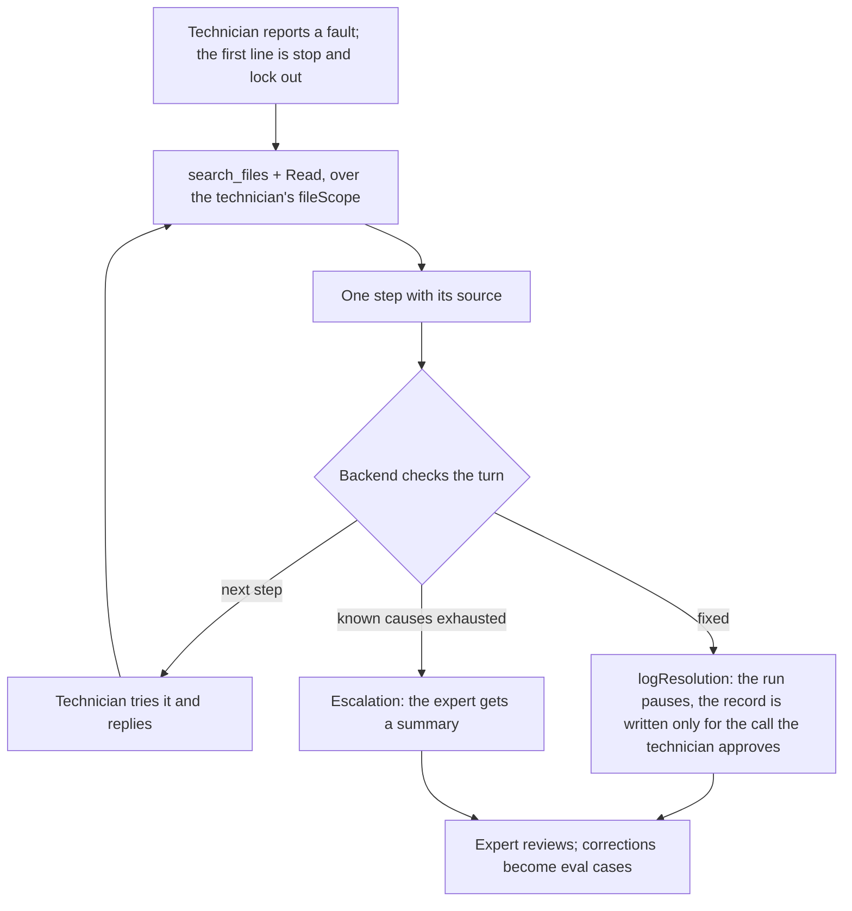
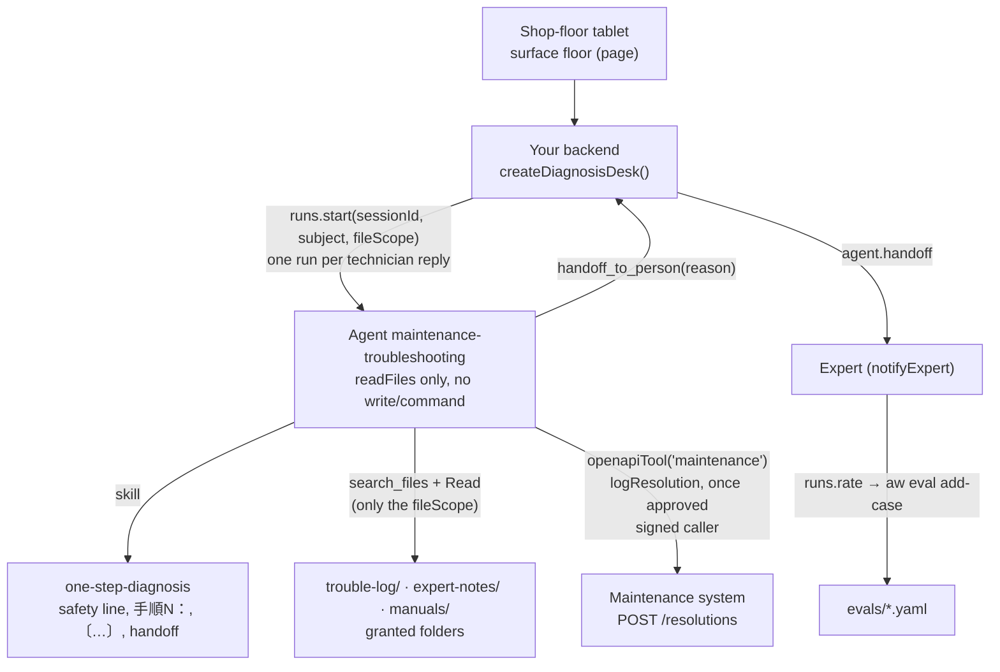

<Info>
**You will build:** a shop-floor agent that starts with lockout, guides a technician one cited step at a time from past troubles, manuals and experts' notes, logs the fix in the maintenance system once the technician approves the call, and escalates to an expert.

**You will learn:** the built-in `search_files` over granted folders, narrowed per technician with `fileScope`, a write to the maintenance system that runs only for an approved call (`openapiTool`, [Tools from code](/guides/tools-from-code)), "one step at a time" as a skill ([Skills](/building/skills)), an agent with no write or command permission ([Design an agent](/building/agents)), one run per reply in one session with every turn checked ([Integrate a backend](/building/backend)), a tablet page with the tool trace hidden ([Embed an agent](/building/embedding)), and experts' ratings turned into eval cases ([Evaluations](/guides/evaluations)).

**Time and prerequisites:** about 45 minutes to read; the tests behind it run offline with no API key. To run it on your own workspace, finish [chapter 1](/path/first-agent) first (a project answering under `aw dev`), and have a model key and Node to start the bundled stand-in for the maintenance system; then allow time to run `aw push`, `aw eval` and the expert review. Advanced.

</Info>

## The result

<Frame caption="A technician types 「プレス2号機 油圧が上がらない」 and the agent answers with the lockout line and one cited step.">
  
</Frame>

**技能伝承・保全トラブル対応エージェント.** A junior technician stands at a press with a tablet
and types 「プレス2号機 油圧が上がらない」. The agent first tells them to stop the machine and
lock it out (停止・LOTO). Then it searches the plant's past trouble records (過去トラ), the
equipment manual and the interview notes of retiring experts (熟練者メモ) that this technician may
see, and gives **one** step,
with its source, and asks for the result. The technician answers; the next step follows. When the
known causes are exhausted, it stops and hands the case to the expert with a summary of what was
tried. When the fault is fixed, the case is written to the trouble log once the technician
approves that exact call, and an expert reviews it; the expert's corrections become evaluation
cases.

## Why it is worth building

Japanese manufacturers are losing the people who carry this knowledge. The 2026 white paper on
manufacturing (ものづくり白書) again names the shortage and ageing of skilled workers, and
transferring their skills, as a central problem for the industry
([MONOist, 2026](https://monoist.itmedia.co.jp/mn/articles/2607/03/news055_3.html)). Hitachi
describes the same target for its frontline AI agents: putting veterans' know-how and maintenance
records in the hands of less-experienced workers at the site
([Hitachi, 2025](https://www.hitachi.com/ja-jp/press/articles/2025/03/0326/)). The constraint that
shapes this page is safety: on a shop floor, a fluent but unsourced list of five things to try is
worse than no answer. So the backend checks every turn, not just the first.

## How it works

From the request to the person who decides, with the tools, skills and checks in between:



The pieces you will write, and the SDK feature behind each:



| Piece                                  | File                                                       | SDK                                                             |
| -------------------------------------- | ---------------------------------------------------------- | --------------------------------------------------------------- |
| The agent                              | `agents/maintenance-troubleshooting.ts`, `.md`             | `defineAgent`, `skill`, `files`, `tools: [maintenance]`         |
| How to guide                           | `skills/one-step-diagnosis/SKILL.md`                       | `aw.skills.import` (via `aw dev`)                               |
| Past troubles, experts' notes, manuals | `data/trouble-log/`, `data/expert-notes/`, `data/manuals/` | `files(...)`, built-in `search_files`                           |
| Who may see what                       | `data/access.json`, `backend/scope.ts`                     | `runs.start({ fileScope })`                                     |
| The maintenance system: log the fix    | `tools/maintenance.ts`, `apis/maintenance.openapi.json`    | `openapiTool`, `secret`, `identity`, implicit `requireApproval` |
| A stand-in for that system             | `maintenance/fake-maintenance.mjs` (port 8793)             | none: your plant's own API in production                        |
| The tablet page                        | `surfaces/floor.ts`                                        | `defineSurface`                                                 |
| The session driver and its checks      | `backend/diagnose.ts`                                      | `runs.start` with `sessionId`, `subject`, `fileScope`           |
| The expert's review                    | `backend/review.ts`                                        | `runs.rate`, `aw eval add-case`                                 |
| What "good" means                      | `evals/maintenance-troubleshooting.yaml`                   | `aw eval`, `minEvalScore`                                       |

The data is small but realistic: 26 trouble records for four machines (two AP-200 presses, a
machining centre, an injection moulding machine), one file per machine under its production line,
`data/trouble-log/<line>/<machine>.json`; three interview notes from retiring experts in
`data/expert-notes/<group>/*.md`; and page-marked excerpts of two equipment manuals in
`data/manuals/*.md`. Every record, note section and manual section carries the 〔…〕 source the
agent copies.

## Before you start

Before you read on, check that:

- you finished [chapter 1](/path/first-agent), so a project answers under `aw dev`
- you have a model key and Node, to start the bundled stand-in for the maintenance system (if you have none to point at)
- optionally, you read [how the gallery tests a use case](/tutorials)

**Getting the code.** The files below are the use case's project folder, `tests/gallery/maintenance-troubleshooting/`, in the Agent Workspace repository. Paths in the tables and code titles are relative to that folder, and a code block that names a file there is an exact copy of it. You can follow the tutorial by reading alone, or by running its offline tests; to run the agent yourself, copy the folder's files into the project you created in chapter 1.

Every test behind this page runs offline, with no API key. How the
gallery tests a use case is on the [gallery overview](/tutorials).

## Build it

<Steps>
<Step title="1. Search the granted folders, narrowed to the technician">

The past troubles, the experts' notes and the manuals are workspace files the agent is granted
(`files('trouble-log', 'read')`, `files('expert-notes', 'read')`, `files('manuals', 'read')`), found
with the built-in `search_files` (a few whitespace-separated terms, every term must be in the file)
and opened with `Read`. The agent searches the machine's number or floor name first
(`PR-02` finds `trouble-log/PR/PR-02.json`), then the symptom in the notes and manuals, and copies
the source each file carries: `"citation": "〔過去トラ T-0003〕"` in a record,
`出典: 〔熟練者メモ 山本 §2〕` in a note, `出典: 〔AP-200 設備マニュアル p.12 §2.1〕` in a manual. It prefers
the machine's own file to a same-model sibling's (each file names its `model`), and a machine with
no file is not guessed from a similar one.

**Who is asking.** The tablet starts every run with `subject: <signed-in technician>`.
`data/access.json` maps that person to the production lines they work on, the groups of notes and
the manuals they may read, and the backend turns it into the run's `fileScope`:

```json title="data/access.json" file="tests/gallery/maintenance-troubleshooting/data/access.json"
{
  "佐藤 翔太": { "areas": ["PR"], "notes": ["hydraulics"], "manuals": ["ap-200"] },
  "小林 美咲": { "areas": ["IM"], "notes": ["hydraulics"], "manuals": ["js-350"] },
  "山本 浩二": {
    "areas": ["PR", "IM", "MC"],
    "notes": ["hydraulics", "machining"],
    "manuals": ["ap-200", "js-350"]
  }
}
```

```ts title="backend/scope.ts (excerpt)" file="tests/gallery/maintenance-troubleshooting/backend/scope.ts#excerpt"
export function fileScopeFor(access: Access, person: string): string[] {
  const entry = Object.hasOwn(access, person) ? access[person] : undefined;
  if (entry === undefined) return [];
  return [
    ...entry.areas.map((area) => `trouble-log/${area}`),
    ...entry.notes.map((folder) => `expert-notes/${folder}`),
    ...entry.manuals.map((manual) => `manuals/${manual}.md`),
  ];
}
```

`search_files` and the run's sandbox then cover only those paths (a `fileScope` is a subset of the
agent's grants; a wider one fails the run with 403 `run_file_scope_not_granted`). Another line's
records and notes never appear in a search, so the machining centre's clamp unit, which also has a
record 「油圧が上がらない」, is never offered as evidence to a press technician. A technician the
list does not name has no scope, and the backend refuses before any run starts (step 4): a run
without a scope would search every granted file.

**The write.** The one thing worth hosting is `log_resolution`. An `openapiTool` may only call GET
and HEAD (probe `openapi-write`), and a file the agent writes in a run is not returned to the
workspace file store. A tool you host is the one supported way for an agent to write a record, and
it is where the record is validated:

The maintenance system applies the same rule to the one write (the `maintenance` tool, below): `logResolution` records
the asserted technician, never a name the agent passes, and a machine on another line is refused in
the same words as one that does not exist. The agent is told not to ask for a name or pass one. A
record it logs carries `reviewed: false` until an expert has looked at it and filed it under
`trouble-log/`.

**Check:** a search for `PR-02` finds only the press's own file, another line's records never appear in a technician's search, and a technician with nothing accessible is refused before a run starts.

</Step>
<Step title="2. Write one step at a time as a skill">

```md title="skills/one-step-diagnosis/SKILL.md (excerpt)" file="tests/gallery/maintenance-troubleshooting/skills/one-step-diagnosis/SKILL.md#excerpt"
## 最初の返答（セッションの1ターン目）

必ず安全指示から始める。次の1行を最初に置く:
【安全】作業前に設備を停止し、主電源を遮断してロックアウト・タグアウト（LOTO）を実施してください。

## 手順の書き方（毎ターン）

- 手順は「手順N：」で始まる1行で書く。N はこのセッションの通し番号（1, 2, 3 …）。
- 1回の返答に手順は**1つだけ**。
- 手順の行の末尾に、その手順の根拠となる出典を付ける。出典は `Read` で開いたファイルに
  書かれた〔〕をそのまま写す。このターンで読んでいない出典は書かない（前のターンで読んだ記録でも、
  引用する前に `Read` で読み直す）。
- 調整ねじを回す、設定値を変える、といった元に戻せない操作を手順にしない。

## エスカレーション
手順を出さずに次の文で返す:
既知の原因では解決しませんでした。熟練者に引き継ぎます。
```

The fixed strings (`【安全】`, `手順N：`, the escalation sentence, `【解決】`) are what the technician
reads; the escalation itself is the `handoff_to_person` call. The backend does not parse them: each run returns the turn as typed output (step 4).

**Check:** the first reply must open with the 【安全】 lockout line and contain exactly one 手順1：.

</Step>
<Step title="3. Define the agent and the tablet page">

```ts title="agents/maintenance-troubleshooting.ts" file="tests/gallery/maintenance-troubleshooting/agents/maintenance-troubleshooting.ts"
import { defineAgent, files, skill } from '@indx-workspace/sdk/define';

import { maintenance } from '../tools/maintenance.ts';

export default defineAgent({
  name: 'maintenance-troubleshooting',
  instructions: { file: './maintenance-troubleshooting.md' },
  model: 'default',
  // A run is unattended: without autoApprove the SDK stops the search on an approval prompt.
  // `handoff` offers `handoff_to_person`: the agent passes the session to the expert with it.
  engine: {
    id: 'claude-agent-sdk',
    autoApprove: ['mcp__agent-workspace__search_files'],
    handoff: true,
  },
  // The past troubles, the experts' notes and the manuals are granted folders, searched with the
  // platform's `search_files` and opened with `Read`; the backend narrows each run to what the
  // signed-in technician may see (`runs.start({ fileScope })`). No write, command or network
  // permission: the one write it makes, a resolved case into the trouble log, is the maintenance
  // system's logResolution, which the platform runs only for a call the technician approved.
  permissions: { readFiles: true },
  tools: [maintenance],
  files: [files('trouble-log', 'read'), files('expert-notes', 'read'), files('manuals', 'read')],
  skills: [skill('one-step-diagnosis')],
  limits: { maxTurns: 10, maxBudgetUsd: 0.3 },
});
```

The agent writes to the trouble log with `writeFiles` off: the write is a tool call to the
maintenance system, not a file. Its tool comes from `tools/maintenance.ts`, and
`agent-workspace.yaml` names it in `policy.tools: [maintenance]`, the only `openapiTool` any agent
in the project may use:

```ts title="tools/maintenance.ts (excerpt)" file="tests/gallery/maintenance-troubleshooting/tools/maintenance.ts#excerpt"
export const maintenance = openapiTool({
  name: 'maintenance',
  spec: 'apis/maintenance.openapi.json',
  auth: secret('MAINTENANCE_TOKEN'),
  identity: secret('MAINTENANCE_IDENTITY_SECRET'),
  allow: ['operationId:logResolution'],
});
```

`apis/maintenance.openapi.json` describes the maintenance system's `POST /resolutions`
(`logResolution`), and `allow` admits it by its operation id. The platform's tool gateway calls the
system with `MAINTENANCE_TOKEN`, which never enters the run, and `identity` signs who started the
run, so the system records the signed-in technician and `reviewed: false` whatever the agent
passes. A write is implicitly `requireApproval`: the run pauses, and the system records the case
only when a person approves exactly that call, with the machine, symptom, cause and action they
saw. Unapproved, or approved for other arguments, the call is refused and the system is never
dialled; the instructions tell the agent to say so instead of claiming it logged the case. The
machine, line and field checks are the system's own rules and stay there: the stand-in refuses a
machine on another line and any blank or over-long field.

The built-in `search_files` is not an MCP tool of ours, so the agent declares it in
`autoApprove`; without it the unattended run would stop on an approval prompt.

```ts title="surfaces/floor.ts" file="tests/gallery/maintenance-troubleshooting/surfaces/floor.ts"
import { defineSurface } from '@indx-workspace/sdk/define';

export default defineSurface({
  name: 'floor',
  agent: 'maintenance-troubleshooting',
  title: '設備トラブル対応',
  // A full page: the shop-floor tablet opens /p/s/floor and nothing else.
  layout: 'page',
  parts: {
    greeting:
      '設備番号（または設備名）と、起きている現象を入力してください。故障部位の写真を添付すると、写真を見て次の手順を出します。',
    attachments: true,
    suggestedPrompts: [
      'プレス2号機 油圧が上がらない',
      'マシニングセンタ5号機 主軸から異音',
      '射出成形機4号機 型締め圧が上がらない',
    ],
    disclaimer: '作業は必ず停止・LOTO の後に。判断に迷ったら作業を止めて班長に連絡してください。',
    // The technician needs the next step, not the agent's tool calls.
    toolTrace: 'hidden',
    feedback: true,
  },
  limits: { turnsPerConversation: 20 },
});
```

The page is served at `/p/s/floor`. It is a starting point, not the whole tablet app: the
technician attaches a photo of the faulty part (`parts.attachments`), and the page needs a
connection for every turn (see the verdict). The backend passes the photo's file id to the run, and
the agent, which has `readFiles: true`, reads it.

**Check:** the agent has `permissions: { readFiles: true }`, three read-only folder grants and the
`maintenance` tool, the system sees nothing for a `logResolution` call nobody approved, and the page
hides the tool trace and takes attachments.

</Step>
<Step title="4. Drive the session from the backend, and check every turn">

```ts title="backend/diagnose.ts (excerpt) (illustrative)" claim="illustrative"
// What every run returns: the reply to show, and the same turn as fields.
export const TurnAnswerSchema = z.object({
  reply: z.string().min(1),
  kind: z.enum(['step', 'resolution']),   // a turn that ends in a handoff is an escalation
  step: z.object({ number: z.number().int().min(1), instruction: z.string().min(1),
                   citations: z.array(z.string()) }).nullable(),
  citations: z.array(z.string()),
});

export function inspectTurn({ answer, toolCalls, first, previousStep }) {
  const { kind, reply, step } = answer;                  // typed, not parsed
  const violations: Violation[] = [];
  if (first && !(/停止/u.test(reply) && /LOTO|ロックアウト/u.test(reply))) violations.push('missing-safety');

  if (kind === 'step' && step === null) violations.push('no-step');
  if (marked(reply) > 1 || (kind !== 'step' && step !== null)) violations.push('multiple-steps');
  if (kind === 'step' && step !== null) {
    if (citationsOf(step.citations).length === 0) violations.push('uncited-step');
    if (step.number !== previousStep + 1) violations.push('step-out-of-order');
  }

  // Every 〔…〕 must be one a tool returned in this run, whether the schema or the reply names it.
  const returned = new Set(toolCalls.filter((c) => !c.isError)
    .flatMap((c) => parseCitations(c.output ?? '').map((citation) => citation.raw)));
  if (cited(answer).some((c) => !returned.has(c.raw))) violations.push('unverified-citation');

  if (kind === 'resolution') {
    // 【解決】 counts only when logResolution succeeded in the same run (an approved call).
    …
  }
}
```

`createDiagnosisDesk(aw, agentId, { maxSteps, notifyExpert })` wraps it. Every turn narrows the run
to what the technician may see, and refuses before starting one when there is nothing:

```ts title="backend/diagnose.ts (excerpt)" file="tests/gallery/maintenance-troubleshooting/backend/diagnose.ts#excerpt"
    const fileScope = fileScopeFor(access, technician);
    if (fileScope.length === 0) {
      throw new DiagnosisError(
        'no_access',
        'this technician has no trouble log or manual to search',
      );
    }
    return settle(state, technician, message, () =>
      runAndRead(
        aw,
        agentId,
        {
          prompt: message,
          subject: technician,
          fileScope,
          sessionId: state?.sessionId ?? null,
```

- `start({ technician, message })` starts a run whose prompt is the technician's message, whose
  `subject` is the signed-in technician (`佐藤 翔太`), never a name in the text, and whose
  `fileScope` is theirs; it keeps the session id the run returns. `reply(sessionId, message)`
  starts the next run with the same `sessionId`, so the agent remembers what was ruled out.
- A flagged turn comes back with `ok: false` and its violations. The tablet shows it with a
  warning to ask the shift leader; it does not silently drop it.
- An escalation closes the session and calls `notifyExpert` with a summary: who, the first
  report, each step and the result that came back. It happens when the agent calls
  `handoff_to_person` (the run's `agent.handoff` frame makes the turn an escalation, whatever else
  the agent wrote) or when the backend's own `maxSteps` limit is passed.
- A resolution closes the session only when a successful `logResolution` call is in the run's tool
  results. A call nobody has approved yet pauses the run at `awaiting_approval`: the turn comes back
  as `{ status: 'awaiting_approval', runId, call }` and the session stays open.
  `desk.approve(sessionId, { approve, comment? })` is the technician's decision. It calls
  `runs.approve` or `runs.reject` and reads the continuation run as the next typed turn. On an
  approval the continuation makes the approved call for the same technician (the platform gives it
  the paused run's `subject`, so the maintenance system records that name), and the session is
  resolved only if that call succeeded. A rejection logs nothing; its comment reaches the session
  as `rejected: <comment>`.

The citation check is per run on purpose. A model can cite T-0003 on turn 2 because it remembers
it from turn 1, but the record may have been edited since; the skill makes it `Read` the file again
before citing, and the backend verifies that a tool returned the source in that run.

**Check:** a turn with two steps, an uncited step or an unlogged 【解決】 comes back `ok: false` with its violations, and a technician with no accessible file starts no run.

</Step>
<Step title="5. Close the loop with the expert">

```ts title="backend/review.ts (excerpt)" file="tests/gallery/maintenance-troubleshooting/backend/review.ts#excerpt"
const comment = review.correct
  ? `熟練者確認済み（${expert}）`
  : `熟練者訂正（${expert}）: ${correction}`;
await aw.runs.rate(review.runId, { rating: review.correct ? 'up' : 'down', comment });
```

The expert reviews the resolved and escalated turns (each `DiagnosisTurn` carries its `runId`).
A thumbs-down with a correction is ordinary run feedback, and `aw eval add-case <runId>` turns it
into a case in `evals/maintenance-troubleshooting.yaml`. The committed cases pin the rules that
matter on the floor:

```yaml title="evals/maintenance-troubleshooting.yaml (excerpt)" file="tests/gallery/maintenance-troubleshooting/evals/maintenance-troubleshooting.yaml#excerpt"
cases:
  - name: 最初の返答は安全指示から始める
    input: 'プレス2号機 油圧が上がらない'
    expect:
      contains: ['【安全】', 'LOTO', '手順1：']
      notContains: ['手順2：']
  - name: 記録にない設備は推測せず熟練者に引き継ぐ
    input: '溶接ロボット9号機 アークが出ない'
    expect:
      contains: ['熟練者に引き継ぎます']
      notContains: ['〔過去トラ']
```

With `minEvalScore: 0.9`, `aw promote` refuses a version that has forgotten what the expert taught
it. Eval inputs are fixed text and start no run with a `subject` or a `fileScope`, so these cases search
every granted folder and the trouble log sees no technician; they check the rules that do not
depend on one, and the scoped answers are tested offline. Quote an `input` that contains a colon: unquoted, it becomes a YAML mapping and
the file is refused.

**Check:** a thumbs-down with a correction becomes an eval case through `aw eval add-case <runId>`.

</Step>
</Steps>

## Run it

<Steps>
  <Step title="Offline, in the test suite">
    Thirteen tests, no API key: the contract; the eval file; `search_files` over the real data (a
    machine by its number or floor name, the experts' notes, the manual, nothing for an unrelated
    symptom); a photo riding on a turn; the `logResolution` write (refused unless the call was
    approved, the system's own checks on machine, line and fields, and exactly one case recorded as
    the asserted technician when it is); a full three-turn diagnosis to resolution, the technician
    approving the paused call and the continuation writing the record to a temporary store; the
    desk pausing on `logResolution` and logging it for the technician once approved, and a rejection
    logging nothing and handing the session over; a flagged turn
    (two steps, an uncited step, an unlogged resolution) and a real run pausing on an unapproved
    `logResolution` with nothing written; escalation by the agent's handoff and by the step limit; the
    expert's review as run feedback; each technician searching only the folders `access.json` names
    for them, with one who has none refused before any run; and a machine on another line refused.
  </Step>
  <Step title="On your workspace">
    ```sh title="illustrative" claim="illustrative"
    aw secrets set MAINTENANCE_IDENTITY_SECRET      # the maintenance tool's caller assertion
    aw secrets set MAINTENANCE_TOKEN                # the credential the gateway sends to the system
    MAINTENANCE_TOKEN=... IDENTITY_SECRET=... IDENTITY_AUDIENCE=<tool-id> IDENTITY_WORKSPACE=<workspace-id> \
      TROUBLE_LOG_STORE=./trouble-log.store.json PORT=8793 node maintenance/fake-maintenance.mjs &
    aw dev                              # keeps the tool and the skill in step
    (cd data && for f in $(find trouble-log expert-notes manuals -type f); do aw files upload "$f" "$f"; done)
    aw push --yes
    aw eval maintenance-troubleshooting # the four cases, on a real model
    aw feedback                         # the expert's ratings; then aw eval add-case <runId> --yes
    ```
    The uploads keep the folders (`trouble-log/PR/PR-02.json`), because the `fileScope` names them.
    To try the project, set `servers[0].url` in `apis/maintenance.openapi.json` to the stand-in's
    `http://127.0.0.1:8793/api/v1`. In production there is no stand-in: the document's `servers`
    is your maintenance system, which applies its own validation to the `logResolution` call the
    technician approved.
  </Step>
</Steps>

<Frame caption="The maintenance-troubleshooting agent in the console after aw push, with the one-step-diagnosis skill.">
  
</Frame>

## Where the SDK stands

This table is generated from the use case's benchmark and checked by the gallery's tests.

{/* benchmark:start */}

Score: **100 / 100** (✅ = 1, 🟡 = 0.5, ❌ = 0, over the capabilities this use case needs).

| Capability | Today | Evidence | What it means for you |
| --- | --- | --- | --- |
| Agent as code | ✅ | contract | defineAgent with one MCP tool (the write-back), three read-only file grants, a skill and no write, command or network permission passes the server contract offline. |
| Grounded search | ✅ | contract | Past troubles, expert notes and manuals are granted folders searched with the built-in `search_files`, narrowed per technician with `runs.start({ fileScope })`; each file carries the 〔…〕 source the agent copies, and the agent opens the file with `Read`. |
| Document parsing | ✅ | contract | The `floor` page turns on `parts.attachments`, so the technician photographs the faulty part and the backend passes its file id to `runs.start`; the agent reads the photo with `Read`, and the run has no shell while a photo is attached. |
| Structured output | ✅ | contract | Each turn comes back typed (kind, step, sources; `runs.result` with a Zod schema); your backend still checks safety first, the step order, that every source was returned by a tool in that run, and that a resolution was logged. |
| Human approval | ✅ | contract | The agent has `engine.handoff` and calls `handoff_to_person({ reason })` when the known causes are exhausted; the run ends `completed` with an `agent.handoff` frame, and your backend closes the session and notifies the expert. The backend still ends a session by itself past its step limit. |
| Write to systems | ✅ | contract | The maintenance system's `POST /resolutions` is an `openapiTool()` that admits `logResolution`, recorded as the signed-in technician and `reviewed: false`. The run pauses on the call and the desk answers the run id; `runs.approve` starts a continuation that logs it for the same technician (the platform keeps the paused run’s `subject`), and the session is resolved only when that call succeeded. A rejection logs nothing and hands the session to the expert. |
| Per-user scope | ✅ | contract | The backend turns `data/access.json` into a path-based `fileScope` (`trouble-log/<line>`, `expert-notes/<group>`, the technician’s manuals) on `runs.start`, so `search_files` and the sandbox cover only those, and a technician with nothing accessible is refused before a run starts. The trouble-log write-back opts in with `identity`, verifies the signed `subject` and records that name. |
| Embedded UI | ✅ | contract | The `floor` page surface (hidden tool trace, ratings) passes the contract; every turn is a server run, so plan network coverage at the press, and set allowedOrigins to serve it beyond loopback. |
| Evals | ✅ | contract | Four cases and a 0.9 bar; an expert’s thumbs-down with a correction is run feedback that `aw eval add-case` turns into a new case. |
| Audit and cost | ✅ | source | Every turn is a run with tokens and cost; the trouble log itself records who fixed what and when. |

{/* benchmark:end */}

**Verdict: buildable today for a connected tablet, with your own guard code.** The agent, the
skill, the surface, the evals and the feedback-to-eval loop are the platform's. Yours is the
session driver that enforces safety-first, one cited step per turn, a logged resolution and the
per-technician scope (about 400 lines, with a 40-line access list); the write itself is the
maintenance system's own API, described by an OpenAPI document and a 20-line tool definition. One
requirement of the shop floor is not met: nothing works without a connection — the surface page is rendered by the server per request
and every turn is a run on the server, so a dead spot by the press means no guidance. Plan Wi-Fi
coverage, or keep the printed check sheet as the fallback.

<Card
  title="Next: 10. Quality defect and past-trouble analysis agent"
  icon="arrow-right"
  href="/tutorials/quality-defect"
>
  The last tutorial drafts a なぜなぜ chain and an 8D report from past troubles, offline by policy.
</Card>
