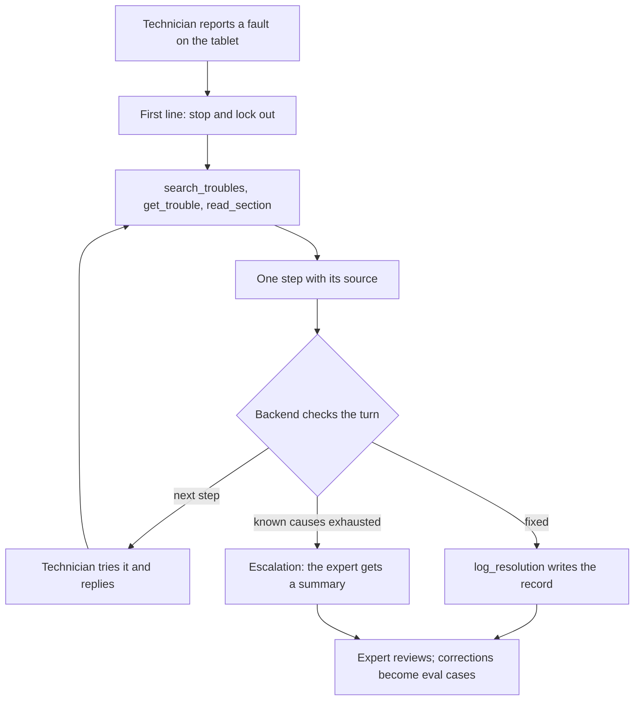
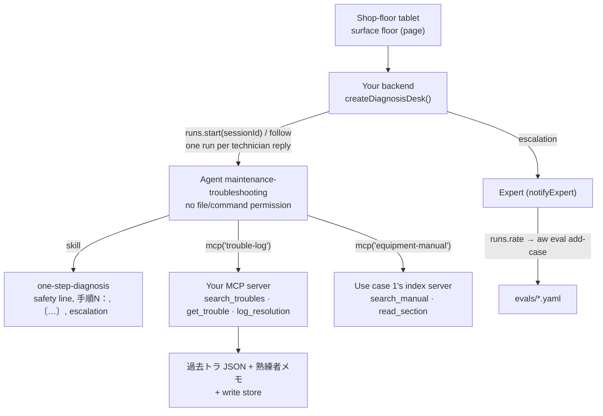

<Info>
**You will build:** a shop-floor agent that starts with lockout, guides a technician one cited step at a time from past troubles, manuals and experts' notes, logs the fix through your own MCP tool, and escalates to an expert.

**You will learn:** two MCP servers, one of which writes ([MCP servers](/building/mcp-servers)), "one step at a time" as a skill ([Skills](/building/skills)), an agent with no file or command permission ([Design an agent](/building/agents)), one run per reply in one session with every turn checked ([Integrate a backend](/building/backend)), a tablet page with the tool trace hidden ([Embed an agent](/building/embedding)), and experts' ratings turned into eval cases ([Evaluations](/guides/evaluations)).

**Time and prerequisites:** about 45 minutes to read; the tests behind it run offline with no API key. To run it on your own workspace, finish [chapter 1](/path/first-agent) first (a project answering under `aw dev`), and have a model key and Node to start two servers. Advanced; it reuses [use case 1](/tutorials/manual-search)'s index server.

</Info>

**技能伝承・保全トラブル対応エージェント.** A junior technician stands at a press with a tablet
and types 「プレス2号機 油圧が上がらない」. The agent first tells them to stop the machine and
lock it out (停止・LOTO). Then it searches the plant's past trouble records (過去トラ), the
equipment manual and the interview notes of retiring experts (熟練者メモ), and gives **one** step,
with its source, and asks for the result. The technician answers; the next step follows. When the
known causes are exhausted, it stops and hands the case to the expert with a summary of what was
tried. When the fault is fixed, the case is written to the trouble log, and an expert reviews it;
the expert's corrections become evaluation cases.

Japanese manufacturers are losing the people who carry this knowledge. The 2026 white paper on
manufacturing (ものづくり白書) again names the shortage and ageing of skilled workers, and
transferring their skills, as a central problem for the industry
([MONOist, 2026](https://monoist.itmedia.co.jp/mn/articles/2607/03/news055_3.html)). Hitachi
describes the same target for its frontline AI agents: putting veterans' know-how and maintenance
records in the hands of less-experienced workers at the site
([Hitachi, 2025](https://www.hitachi.com/ja-jp/press/articles/2025/03/0326/)). The constraint that
shapes this page is safety: on a shop floor, a fluent but unsourced list of five things to try is
worse than no answer. So the backend checks every turn, not just the first.

Every test behind this page runs offline, with no API key. How the
gallery tests a use case is on the [gallery overview](/tutorials).

## How the agent works

From the request to the person who decides, with the tools, skills and checks in between:



## What you build



| Piece | File | SDK |
| --- | --- | --- |
| The agent | `agents/maintenance-troubleshooting.ts`, `.md` | `defineAgent`, `mcp`, `skill` |
| How to guide | `skills/one-step-diagnosis/SKILL.md` | `aw.skills.import` (via `aw dev`) |
| Trouble log: search and write | `mcp/trouble-log.mjs` | an `http` connector |
| Equipment manuals | `../manual-search/mcp/manual-index.mjs` with `MANUALS_DIR=data/manuals` | an `http` connector |
| The tablet page | `surfaces/floor.ts` | `defineSurface` |
| The session driver and its checks | `backend/diagnose.ts` | `runs.start` with `sessionId`, `runs.follow` |
| The expert's review | `backend/review.ts` | `runs.rate`, `aw eval add-case` |
| What "good" means | `evals/maintenance-troubleshooting.yaml` | `aw eval`, `minEvalScore` |

The data is small but realistic: 26 trouble records for four machines (two AP-200 presses, a
machining centre, an injection moulding machine) in `data/trouble-log/*.json`, three interview
notes from retiring experts in `data/expert-notes/*.md`, and page-marked excerpts of two equipment
manuals in `data/manuals/*.md`.

## 1. Serve the trouble log as an MCP server, including the write

The platform has no built-in index (probe `built-in-index`), so search is your tool. The trouble
log is also where the fix gets recorded, and that write is the more important reason to host the
server yourself: an `openapiTool` may only call GET and HEAD (probe `openapi-write`), and a file
the agent writes in a run is not returned to the workspace file store. A tool you host is the one
supported way for an agent to write a record, and it is where the record is validated.

```js title="mcp/trouble-log.mjs (excerpt) (illustrative)" claim="illustrative"
function searchTroubles(args) {
  const symptom = text(args, 'symptom');
  const machine = args.machineId === undefined ? undefined : requireMachine(args);
  const index = createIndex(allRecords().map((r) => ({ ...r, text: `${r.symptom} ${r.cause}` })));
  // The machine's own history first; then its siblings of the same model, which share the
  // hydraulics and so the causes. A different model with a similar symptom is not evidence.
  const own = index
    .search(symptom, { limit: max, filter: (r) => r.machineId === machine.machineId })
    .map((hit) => view(hit, 'same-machine'));
  const sibling = index
    .search(symptom, { limit: max, filter: (r) => r.model === machine.model && r.machineId !== machine.machineId })
    .map((hit) => view(hit, 'same-model'));
  …
}

function logResolution(args) {
  if (STORE === undefined) refuse('this server has no TROUBLE_LOG_STORE; it cannot write records');
  const machine = requireMachine(args);           // PR-02 or プレス2号機, else refused
  const cause = field(args, 'cause', FIELD_MAX);  // non-blank, at most 300 characters
  …
  const record = { id: `T-${String(highest + 1).padStart(4, '0')}`, …, technician, reviewed: false };
  writeFileSync(temporary, `${JSON.stringify([...stored, record], null, 2)}\n`);
  renameSync(temporary, STORE);
  return { ...view({ ...record, machineName: machine.name }), logged: true };
}
```

Each record comes back with the citation to copy, `〔過去トラ T-0003〕`, and each expert-note
section with `〔熟練者メモ 山本 §2〕`. A record the agent logs is searchable at once but carries
`reviewed: false` until an expert has looked at it, and the instructions say to label it
「未レビュー」 when it is used as evidence. The machine filter matters on real data: the machining
centre's clamp unit also has a record 「油圧が上がらない」, and it must not be offered as evidence
for a press.

The equipment manuals reuse use case 1's server unchanged, pointed at this folder with
`MANUALS_DIR`. One thing the test caught: that index scores section text, not the document title,
so 「AP-200」 in a query does not rank the press manual above the moulding machine's; the agent
has to pick the hit whose `source` is the machine's model.

## 2. Write "one step at a time" as a skill

```md title="skills/one-step-diagnosis/SKILL.md (excerpt) (illustrative)" claim="illustrative"
## 最初の返答（セッションの1ターン目）
必ず安全指示から始める。次の1行を最初に置く:
【安全】作業前に設備を停止し、主電源を遮断してロックアウト・タグアウト（LOTO）を実施してください。

## 手順の書き方（毎ターン）
- 手順は「手順N：」で始まる1行で書く。N はこのセッションの通し番号（1, 2, 3 …）。
- 1回の返答に手順は**1つだけ**。
- 手順の行の末尾に、その手順の根拠となる出典を付ける。…このターンで読んでいない出典は書かない
  （前のターンで読んだ記録でも、引用する前に `get_trouble` または `read_section` で読み直す）。
- 調整ねじを回す、設定値を変える、といった元に戻せない操作を手順にしない。

## エスカレーション
既知の原因では解決しませんでした。熟練者に引き継ぎます。
```

The fixed strings (`【安全】`, `手順N：`, the escalation sentence, `【解決】`) are there for the
backend: since a run returns text, these are what it parses.

## 3. Define the agent and the tablet page

```ts title="agents/maintenance-troubleshooting.ts" file="tests/gallery/maintenance-troubleshooting/agents/maintenance-troubleshooting.ts#excerpt"
export default defineAgent({
  name: 'maintenance-troubleshooting',
  instructions: { file: './maintenance-troubleshooting.md' },
  model: 'default',
  engine: 'claude-agent-sdk',
  // No file, command or network permission: it reads and writes only through the two tools.
  permissions: {},
  tools: [mcp('trouble-log'), mcp('equipment-manual')],
  skills: [skill('one-step-diagnosis')],
  limits: { maxTurns: 10, maxBudgetUsd: 0.3 },
});
```

The agent writes to the trouble log with `writeFiles` off: the write is a tool call, and MCP tools
are approved in unattended runs, so no stored policy is needed (unlike an agent that runs a skill
script with `runCommands`).

```ts title="surfaces/floor.ts (illustrative)" claim="illustrative"
export default defineSurface({
  name: 'floor',
  agent: 'maintenance-troubleshooting',
  title: '設備トラブル対応',
  layout: 'page',
  parts: {
    greeting: '設備番号（または設備名）と、起きている現象を入力してください。1つずつ確認していきます。',
    suggestedPrompts: ['プレス2号機 油圧が上がらない', 'マシニングセンタ5号機 主軸から異音', '射出成形機4号機 型締め圧が上がらない'],
    disclaimer: '作業は必ず停止・LOTO の後に。判断に迷ったら作業を止めて班長に連絡してください。',
    toolTrace: 'hidden',   // the technician needs the next step, not the tool calls
    feedback: true,
  },
  limits: { turnsPerConversation: 20 },
});
```

The page is served at `/p/s/floor`. It is a starting point, not the whole tablet app: the
technician cannot attach a photo of the faulty part (probe `surface-attachments`), and the page
needs a connection for every turn (see the verdict).

## 4. Drive the session from the backend, and check every turn

```ts title="backend/diagnose.ts (excerpt) (illustrative)" claim="illustrative"
export function inspectTurn({ answer, toolCalls, first, previousStep, technician }) {
  const violations: Violation[] = [];
  if (first && !(/停止/u.test(answer) && /LOTO|ロックアウト/u.test(answer))) violations.push('missing-safety');

  const steps = [...answer.matchAll(STEP)];              // 手順N：
  const kind = answer.includes(RESOLUTION_MARK) ? 'resolution'
    : answer.includes(ESCALATION_PHRASE) ? 'escalation'
    : steps.length > 0 ? 'step' : null;
  if (kind === null) violations.push('no-step');
  if (steps.length > 1 || (kind !== 'step' && steps.length > 0)) violations.push('multiple-steps');
  if (kind === 'step') {
    if (parseCitations(paragraphAt(answer, steps[0].index)).length === 0) violations.push('uncited-step');
    if (step !== previousStep + 1) violations.push('step-out-of-order');
  }

  // Every 〔…〕 must be one a tool returned in this run.
  const returned = new Set(toolCalls.filter((c) => !c.isError)
    .flatMap((c) => parseCitations(c.output ?? '').map((citation) => citation.raw)));
  if (parseCitations(answer).some((c) => !returned.has(c.raw))) violations.push('unverified-citation');

  if (kind === 'resolution') {
    // 【解決】 counts only when log_resolution succeeded in the same run, for the signed-in technician.
    …
  }
}
```

`createDiagnosisDesk(aw, agentId, { maxSteps, notifyExpert })` wraps it:

- `start({ technician, message })` starts a run with `［対応者: 佐藤 翔太］プレス2号機 …` and
  keeps the session id the run returns; `reply(sessionId, message)` starts the next run with the
  same `sessionId`, so the agent remembers what was ruled out.
- A flagged turn comes back with `ok: false` and its violations. The tablet shows it with a
  warning to ask the shift leader; it does not silently drop it.
- An escalation (the agent's phrase, or the backend's own `maxSteps` limit) closes the session and
  calls `notifyExpert` with a summary: who, the first report, each step and the result that came
  back. A run cannot hand a conversation to a person (probe `run-handoff`), so this is your code.
- A resolution closes the session only when the log write is in the run's tool results.

The citation check is per run on purpose. A model can cite T-0003 on turn 2 because it remembers
it from turn 1, but the record may have been edited since; the skill makes it re-open the source
before citing, and the backend verifies that it did.

## 5. Close the loop with the expert

```ts title="backend/review.ts (excerpt)" file="tests/gallery/maintenance-troubleshooting/backend/review.ts#excerpt"
const comment = review.correct
  ? `熟練者確認済み（${expert}）`
  : `熟練者訂正（${expert}）: ${correction}`;
await aw.runs.rate(review.runId, { rating: review.correct ? 'up' : 'down', comment });
```

The expert reviews the resolved and escalated turns (each `DiagnosisTurn` carries its `runId`).
A thumbs-down with a correction is ordinary run feedback, and `aw eval add-case <runId>` turns it
into a case in `evals/maintenance-troubleshooting.yaml`. The committed cases pin the rules that
matter on the floor:

```yaml title="evals/maintenance-troubleshooting.yaml (excerpt)" file="tests/gallery/maintenance-troubleshooting/evals/maintenance-troubleshooting.yaml#excerpt"
cases:
  - name: 最初の返答は安全指示から始める
    input: '［対応者: 佐藤 翔太］プレス2号機 油圧が上がらない'
    expect:
      contains: ['【安全】', 'LOTO', '手順1：']
      notContains: ['手順2：']
  - name: 記録にない設備は推測せず熟練者に引き継ぐ
    input: '［対応者: 佐藤 翔太］溶接ロボット9号機 アークが出ない'
    expect:
      contains: ['熟練者に引き継ぎます']
      notContains: ['〔過去トラ']
```

With `minEvalScore: 0.9`, `aw promote` refuses a version that has forgotten what the expert taught
it. Quote an `input` that contains `［対応者: …］`: unquoted, the colon makes it a YAML mapping and
the file is refused.

## 6. Run it

<Steps>
  <Step title="Offline, in the test suite">
    Eight tests, no API key: the contract, the trouble-log server (search, fallback to the same
    model, refusals, validation, a read-only server that refuses to write), a full three-turn
    diagnosis to resolution with the record written to a temporary store, a flagged turn (two
    steps, an uncited step, an unlogged resolution), escalation by the agent and by the step
    limit, and the expert's review as run feedback.
  </Step>
  <Step title="On your workspace">
    ```sh title="illustrative" claim="illustrative"
    MCP_TRANSPORT=http PORT=8791 TROUBLE_LOG_STORE=./trouble-log.store.json node mcp/trouble-log.mjs &
    MCP_TRANSPORT=http PORT=8792 MANUALS_DIR=./data/manuals node ../manual-search/mcp/manual-index.mjs &
    aw dev                              # keeps the two connectors and the skill in step
    aw push --yes
    aw eval maintenance-troubleshooting # the four cases, on a real model
    aw feedback                         # the expert's ratings; then aw eval add-case <runId> --yes
    ```
    In production, `TROUBLE_LOG_STORE` is replaced by your maintenance system's API, called from
    the same `logResolution` handler after the same validation.
  </Step>
</Steps>

## Where the SDK stands

This table is generated from the use case's benchmark and checked by the gallery's tests.

{/* benchmark:start */}

Score: **50 / 100** (✅ = 1, 🟡 = 0.5, ❌ = 0, over the capabilities this use case needs).

| Capability | Today | Evidence | What it means for you |
| --- | --- | --- | --- |
| Agent as code | ✅ | contract | defineAgent with two MCP tools, a skill and no file, command or network permission passes the server contract offline. |
| Grounded search | 🟡 | contract | Past troubles and expert notes are searched by your own MCP server (same machine first, then same model); the manuals reuse use case 1’s index server. |
| Document parsing | ❌ | probe | The technician cannot photograph the faulty part: a surface takes no attachments, and `runs.start` takes none either (probe `run-attachments`). |
| Structured output | ❌ | probe | Steps, citations and the escalation come back as free text; the backend parses 手順N： and 〔…〕 on every turn and flags what breaks the rules. |
| Human approval | 🟡 | contract | No run event hands the case to a person (probe `run-handoff`): the backend detects the escalation phrase or its own step limit, closes the session and notifies the expert. |
| Write to systems | 🟡 | contract | Logging the fix takes your own MCP tool that validates and writes the record: `openapiTool` is GET-only and a file the agent writes is not returned to the store. |
| Per-user scope | 🟡 | source | Runs carry no end-user identity for tools: the backend names the signed-in technician in the prompt and checks the log records the same person. |
| Embedded UI | ❌ | source | The `floor` page surface (hidden tool trace, ratings) passes the contract, but it is rendered per request and every turn is a server run: no offline mode for dead spots on the floor. |
| Evals | ✅ | contract | Four cases and a 0.9 bar; an expert’s thumbs-down with a correction is run feedback that `aw eval add-case` turns into a new case. |
| Audit and cost | ✅ | source | Every turn is a run with tokens and cost; the trouble log itself records who fixed what and when. |

{/* benchmark:end */}

**Verdict: buildable today for a connected tablet, with your own guard code.** The agent, the
skill, the surface, the evals and the feedback-to-eval loop are the platform's. Yours are the
trouble-log server (search and the validated write, about 280 lines) and the session driver that
enforces safety-first, one cited step per turn and a logged resolution (about 350 lines). Two
requirements of the shop floor are not met: the technician cannot attach a photo of the part, and
nothing works without a connection — the surface page is rendered by the server per request
and every turn is a run on the server, so a dead spot by the press means no guidance. Plan Wi-Fi
coverage, or keep the printed check sheet as the fallback. What would remove code from this page:

- **A run that returns structured output** would make each turn a typed step with its source,
  instead of parsing `手順N：` and `〔…〕` (probe `run-output-schema`).
- **A handoff event** would let the platform route an escalated conversation to the expert
  (probe `run-handoff`).
- **Attachments on a surface and on `runs.start`** would let the technician show the part
  (probes `surface-attachments`, `run-attachments`).
- **Per-person identity on runs** would replace the `［対応者: …］` prompt prefix and the
  backend's technician check ([RF-102](/concepts/roadmap)).
