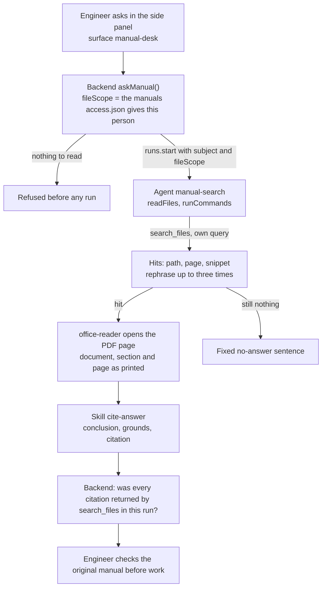

<Info>
**You will build:** a read-only agent that searches maintenance manuals with the platform's `search_files` and answers with a 〔document p.page §section〕 citation that your backend checks against what the search actually returned, for the manuals the signed-in person may read.

**You will learn:** an agent defined as code with a file grant and a policy ceiling ([Agents as code](/guides/agents-as-code)), the answer format as a skill ([Skills](/building/skills)), the built-in `search_files` narrowed per person with `fileScope` ([Caller identity](/guides/caller-identity)), a side-panel surface ([Embed an agent](/building/embedding)), evals that gate promotion ([Evaluations](/guides/evaluations)), and a backend that follows a run and checks it ([Integrate a backend](/building/backend)).

**Time and prerequisites:** about 30 minutes to read and about 30 minutes hands-on; the tests behind it run offline with no API key. Finish [chapter 1](/path/first-agent) first (a project answering under `aw dev`). The easiest tutorial in the gallery: read-only, no server of your own, no stored policy and no human step in the middle.

</Info>

## The result

<Frame caption="「油圧ユニットの定期点検の周期は？」 (How often is the hydraulic unit inspected?) answered in the portal's side panel, with its manual citation.">
  
</Frame>

**マニュアル検索エージェント** (manual search agent). A field engineer asks 「油圧ユニットの定期点検の周期は？」
(how often is the hydraulic unit inspected?) in the portal's side panel. The agent searches the
manuals, rephrases when the first search misses, reads the page it found, and answers with the
clause and its page. When nothing in the manuals answers the question, it says so instead of
guessing.

Japanese plants, railways and utilities hold this knowledge in rule books and maintenance
manuals that only veterans know how to navigate. The barrier to using AI for it is accuracy:
50.4% of companies using generative AI name it as their top concern ([Teikoku Databank,
2026](https://www.itmedia.co.jp/news/article/2605/15/1260515115/)). So the deliverable is not
"an answer", it is an answer whose every sentence points at a clause, and a backend that refuses
to call an answer sourced when it is not.

## How it works



The platform searches the manuals the agent is granted with `files('manuals')`, and
`search_files` and the run's sandbox cover only the paths the run's `fileScope` names. You run no
index server.

### What you will write

| Piece | File | SDK |
| --- | --- | --- |
| The manuals | `data/manuals/hydraulic-unit.{md,pdf}`, `safety-rules.{md,pdf}` | `aw files upload`, searched by the built-in `search_files` |
| Who may read which | `data/access.json` | read by your backend, which turns it into `fileScope` |
| How to cite | `skills/cite-answer/SKILL.md` | `aw.skills.import` (via `aw dev`) |
| The agent | `agents/manual-search.ts`, `agents/manual-search.md` | `defineAgent`, `skill`, `files` |
| The side panel | `surfaces/manual-desk.ts` | `defineSurface` |
| What "good" means | `evals/manual-search.yaml` | `aw eval`, `policy.promotion.minEvalScore` |
| The portal's call | `backend/ask.ts` | `runs.start` with `fileScope`, `runs.follow`, `toAgentEvent` |

## Before you start

- [Chapter 1](/path/first-agent) done: a project answering under `aw dev`, with a model key in your shell.
- Your manuals as files (the example uses `油圧ユニット保守マニュアル`, the hydraulic unit maintenance manual, as a PDF and a page-marked Markdown copy).

**Get the code.** The parts below are the use case's whole project, file by file, with each path
relative to the project root. The same files run in the gallery's offline test suite, with no API
key; how the gallery tests a use case, and what each tier proves, is on the
[gallery overview](/tutorials#how-the-tutorials-are-tested).

## Build it

<Steps>
  <Step title="Part 1 · Put the manuals where search can find them">

    Agent Workspace stores files and grants them to agents, and its built-in `search_files` finds
    text in the granted folders (PDF and Markdown) by words, not by meaning. The agent passes
    space-separated words and gets back only the places that hold all of them:

    ```json title="search_files result (illustrative)" claim="illustrative"
    [
      { "path": "manuals/hydraulic-unit.pdf", "page": 2, "snippet": "…定期点検は 6か月 ごと…" },
      { "path": "manuals/hydraulic-unit.md", "page": null, "snippet": "…" }
    ]
    ```

    The gallery ships each manual twice: the PDF the engineer would open, and a Markdown copy with
    `<!-- page 12 -->` markers that the test suite checks against the PDF. `search_files` returns
    a `page` for the PDF and `null` for Markdown; the agent opens the PDF page for the real text.

    Two details carry the use case:

    - **An unrelated question must return nothing.** `search_files` returns a place only when it
      holds every word, so `社員食堂 営業時間` (the cafeteria's opening hours) finds no maintenance
      manual, and the agent answers with the fixed no-answer sentence instead of guessing. The
      test pins this.
    - **The agent writes the citation from the page it opened, not from the snippet.** The
      instructions send it to `office-reader` for the PDF page, and the skill tells it to copy the
      document name, section and the printed `p.N` from there. Your backend then checks the `path`
      and `page` it reports against what `search_files` returned (Part 6).

    The platform searches the text of a PDF. A scanned PDF has no text, so neither search nor
    `office-reader` finds anything in it: run OCR, or the document-AI service your company already
    uses, once when a manual is published. This example's manuals have a text layer, so the
    gallery ships no converter.

    **Check:** after the upload in [Run it](#run-it), the agent's tool trace shows a `search_files`
    call, and its hits name `manuals/hydraulic-unit.pdf`.

  </Step>
  <Step title="Part 2 · Write the citation rules as a skill">

    The skill holds the answer format: conclusion first, then grounds, each with the citation
    read from the opened page, and one fixed sentence when nothing is found.

    ```md title="skills/cite-answer/SKILL.md (excerpt)" file="tests/gallery/manual-search/skills/cite-answer/SKILL.md#excerpt"
    ---
    name: cite-answer
    description: 社内マニュアルに基づく回答の書き方。出典の書式と「該当なし」の基準を定める。
    ---
    - 回答は結論を1〜2文で先に書き、続けて根拠を箇条書きにする。
    - 各根拠の末尾に出典を〔文書名 p.ページ §節〕で書く。例: 〔油圧ユニット保守マニュアル p.12 §3.2〕
      - 文書名・節・ページは、開いた PDF のページ先頭の文書名と節、末尾の `p.N` をそのまま使う。言い換えない。
      - 構造化出力の `citations` には、`search_files` が返した `path`（`manuals/…`）と `page` をそのまま写す。
    - 根拠が見つからないときは次の文で答える:
      「該当する記載が見つかりませんでした。設備保全課（内線 4410）にお問い合わせください。」
    ```

    A skill is managed knowledge, separate from the agent: the quality team can tighten the
    citation rule without touching the agent, and other agents (use cases
    [9](/tutorials/maintenance-troubleshooting) and [10](/tutorials/quality-defect)) reuse the
    same convention.

    **Check:** with `aw dev` running, saving the file imports the skill; it is listed under
    **Skills** in the console.

  </Step>
  <Step title="Part 3 · Define the agent">

    The agent may search and read the manuals and run the `office-reader` script, nothing else.

    ```ts title="agents/manual-search.ts" file="tests/gallery/manual-search/agents/manual-search.ts"
    import { builtinSkill, defineAgent, files, skill } from '@indx-workspace/sdk/define';

    export default defineAgent({
      name: 'manual-search',
      instructions: { file: './manual-search.md' },
      model: 'default',
      // A run is unattended: without autoApprove the SDK stops the tools' calls on an approval prompt.
      engine: {
        id: 'claude-agent-sdk',
        autoApprove: ['mcp__agent-workspace__run_skill_script', 'mcp__agent-workspace__search_files'],
      },
      // Read-only by construction: it searches the manuals with the platform's `search_files` and
      // reads the PDF through office-reader, nothing else. The portal narrows each run to the manuals
      // the signed-in person may read (`runs.start({ fileScope })`). `runCommands` is what offers
      // `run_skill_script`; no write, no network.
      permissions: { readFiles: true, runCommands: true },
      skills: [builtinSkill('office-reader'), skill('cite-answer')],
      files: [files('manuals', 'read')],
      limits: { maxTurns: 12, maxBudgetUsd: 0.5 },
    });
    ```

    The instructions (`agents/manual-search.md`) say *how to search*: write your own query,
    rephrase up to three times, open the PDF page with `office-reader` before answering, copy
    numbers with their units. There is no connector to name. The project file adds a ceiling no
    agent in the project can widen:

    ```yaml title="agent-workspace.yaml (excerpt)" file="tests/gallery/manual-search/agent-workspace.yaml#excerpt"
    policy:
      permissions:
        writeFiles: false
        runCommands: true # run_skill_script, for the office-reader skill that reads the PDFs
        unrestrictedNetwork: false
      limits:
        maxBudgetUsd: 1
      promotion:
        minEvalScore: 0.9
    ```

    **Check:** `npx aw check` passes. Until a manual is uploaded into `manuals` (in
    [Run it](#run-it)), `aw dev` may refuse the agent with
    `agent_definition_references_missing [file:manuals]`; that is expected.

  </Step>
  <Step title="Part 4 · Put it in the portal">

    A surface publishes the agent as a side panel with a greeting, suggested prompts, a
    disclaimer, a collapsed tool trace and rating buttons.

    ```ts title="surfaces/manual-desk.ts" file="tests/gallery/manual-search/surfaces/manual-desk.ts"
    import { defineSurface } from '@indx-workspace/sdk/define';

    export default defineSurface({
      name: 'manual-desk',
      agent: 'manual-search',
      title: 'マニュアル検索',
      layout: 'side',
      parts: {
        greeting: '設備マニュアルについて質問してください。出典つきで答えます。',
        suggestedPrompts: ['油圧ユニットの定期点検の周期は？', '作動油の交換基準を教えて'],
        disclaimer: '回答はマニュアルの記載に基づきます。作業前に原本を確認してください。',
        toolTrace: 'collapsed',
        feedback: true,
      },
      // Search hits render as cards. The key is the tool's bare name: a run's engine prefix is ignored.
      toolResults: { search_files: 'card' },
    });
    ```

    `aw push` saves the surface with the agent's version, and it is served at `/p/s/manual-desk`.

    <Note>
      A `toolResults` key is the tool's bare name. The widget matches it against the tool's exact name
      in the run, or against the part after the last `__`, so `search_files` also matches Claude's
      `mcp__agent-workspace__search_files`.
    </Note>

    **Check:** after `aw push`, `/p/s/manual-desk` shows the greeting and the two suggested prompts.

  </Step>
  <Step title='Part 5 · Say what "good" means'>

    Evals pin the two behaviours that matter: a cited answer, and no guess when the manuals are
    silent.

    ```yaml title="evals/manual-search.yaml" file="tests/gallery/manual-search/evals/manual-search.yaml#excerpt"
    cases:
      - name: 点検周期を出典付きで答える
        input: 油圧ユニットの定期点検の周期は？
        expect:
          contains: ['〔油圧ユニット保守マニュアル', '6か月']
      - name: マニュアルにない質問は推測しない
        input: 社員食堂の営業時間は？
        expect:
          contains: ['該当する記載が見つかりませんでした']
          notContains: ['〔']
    ```

    The full file has four cases, one of them an LLM-judged safety rubric. With
    `minEvalScore: 0.9`, `aw promote` refuses to put a version in production that fails one of
    them.

    <Warning>
      Pin citations with `contains`, not with `tool:`. A Claude run names a platform tool with the
      engine's prefix (`mcp__agent-workspace__search_files`), and an eval's `tool:` must match the
      name exactly, so a `tool:` expectation you commit holds only for the engine that names the
      tool that way.
    </Warning>

    **Check:** `aw eval manual-search` runs the four cases on a real model.

  </Step>
  <Step title="Part 6 · Call it from the backend and check the citations">

    The portal calls the agent from your backend. The backend, not the agent, decides which
    manuals the signed-in person may read: `data/access.json` maps each person to their manuals
    (`田中 一郎`: the hydraulic unit manual and the safety rules; `鈴木 花子`: the safety rules
    only), and `askManual` starts the run with those paths as `fileScope`. A person with no manual
    gets no run at all, because an empty scope is invalid and an unscoped run would see every
    manual. It then refuses to call an answer sourced unless every citation is a place
    `search_files` returned.

    ```ts title="backend/ask.ts (excerpt)" file="tests/gallery/manual-search/backend/ask.ts#excerpt"
    export function fileScopeFor(subject: string): string[] {
      return (access[subject]?.manuals ?? []).flatMap((id) => [
        `manuals/${id}.md`,
        `manuals/${id}.pdf`,
      ]);
    }
    …
      const fileScope = fileScopeFor(subject);
      if (fileScope.length === 0) throw new NoManualAccess(subject);
      const reading = await runAndRead(
        aw,
        agentId,
        { prompt: question, subject, fileScope, sessionId: sessionId ?? null },
        ManualAnswerSchema,
      );
      const found = new Set(
        reading.toolCalls
          .filter((call) => toolIs(call.name, 'search_files') && !call.isError)
          .flatMap((call) => foundIn(call.output ?? '')),
      );
      const { answer, citations } = reading.output;
      const unverified = citations.filter(
        (citation) => !found.has(keyOf(citation.source, citation.page)),
      );
    ```

    - `runAndRead` starts the run with the schema as its `outputSchema`, follows its stream with
      `aw.runs.follow` for the tool calls, and reads the answer with `aw.runs.result()`, which
      returns the typed `output` or throws when the run did not satisfy the schema.
    - `subject` is the signed-in person from the portal's own session (an API-key caller only),
      never something read from the question: a prompt that says "I am 田中" does not widen the
      `fileScope`. A `fileScope` may only narrow the agent's grants; one that widens them fails
      the run with `run_file_scope_not_granted`. See [Caller identity](/guides/caller-identity).
    - The citation check is the part to keep: a model can write a plausible citation for a page it
      never found, and `grounded` is true only when every citation is a `path` and `page` that
      `search_files` returned in this run.

    **Check:** the hydraulic unit question comes back with `grounded: true`; the cafeteria
    question comes back as the no-answer sentence, with no citation; a person `access.json` does
    not list is refused with `NoManualAccess` before any run starts.

  </Step>
</Steps>

## Run it

<Steps>
  <Step title="Offline, in the test suite">
    Loads the project through the same contract `aw check` applies, checks that the PDFs are
    written from the Markdown, reads their pages with office-reader, runs the platform's
    `search_files` over the manuals, and runs `askManual` against a scripted workspace: a person
    who may read two manuals, one who may read one, and one who may read none. Eleven tests, no
    API key.
  </Step>
  <Step title="On your workspace">
    ```sh title="illustrative" claim="illustrative"
    for f in data/manuals/*; do aw files upload "manuals/$(basename "$f")" "$f"; done
    aw push --yes
    aw eval manual-search  # the four cases, on a real model
    ```
    The grant on `manuals` resolves once a file is uploaded into it, so the folder needs no `aw files mkdir`. If `aw dev` refused the agent with `agent_definition_references_missing [file:manuals]` before the upload, `aw push --yes` syncs it, and so does saving the agent file again. The agent version names no model (`model: 'default'`), so the workspace needs a default model and runtime profile, or a run is refused with `model_connection_unresolved`.
  </Step>
</Steps>

<Frame caption="The manual-search agent in the console, with its skill and runs.">
  
</Frame>

## Where the SDK stands

This table is generated from the use case's benchmark and checked by the gallery's tests. `contract` means an offline test in the gallery's suite proves
it; `probe` means a test asserts the capability is still missing and fails the day it arrives;
`source` cites the platform's code.

{/* benchmark:start */}

Score: **100 / 100** (✅ = 1, 🟡 = 0.5, ❌ = 0, over the capabilities this use case needs).

| Capability | Today | Evidence | What it means for you |
| --- | --- | --- | --- |
| Agent as code | ✅ | contract | defineAgent, a skill, a file grant and a surface pass the server contract offline; the policy ceiling keeps the agent from writing files or reaching the network. |
| Grounded search | ✅ | contract | Search is the platform’s built-in `search_files` over the granted `manuals` folder (PDF and Markdown), narrowed per caller with `runs.start({ fileScope })`; no index server or connector of your own. |
| Document parsing | ✅ | contract | The manuals are PDF and the agent reads them with the built-in office-reader skill, then quotes the page it cites. `search_files` finds the page and the agent opens that PDF page; the page-marked Markdown copy is searchable too. |
| Structured output | ✅ | contract | The answer and its citations come back typed (`runs.result` with a Zod schema); your backend only checks each citation’s path and page against what `search_files` returned during the run. |
| Per-user scope | ✅ | contract | The portal starts each run with `subject: <signed-in person>` and a `fileScope` of the manual paths (PDF and Markdown) that person may read, taken from its own access table. `search_files` and the sandbox cover only those paths, so the PDF the agent opens is scoped too; a person with no manual is refused before any run starts. |
| Embedded UI | ✅ | contract | defineSurface publishes the side panel with suggested prompts, a collapsed tool trace and rating buttons; hits render as cards with `toolResults: { search_files: 'card' }`. |
| Evals | ✅ | contract | Four cases and a 0.9 promotion bar. Pin citations with `contains`, not `tool:`: a run names MCP tools `mcp__<connector-name>__…`, so a `tool:` pin holds only while the connector keeps that name. |
| Audit and cost | ✅ | source | Every run records tokens and cost; the audit log records who changed the agent. |

{/* benchmark:end */}

**Verdict: buildable today.** The agent, the skill and the surface are the SDK's. The parts that
are yours are the citation check and the per-person access table, about 130 lines in
`backend/ask.ts`. Nothing on this page waits on the platform: search, the PDF reader and the
per-person scope are built in.

<Card title="Next: 2. CAD drawing agent" icon="arrow-right" href="/tutorials/cad-drafting">
  Find similar past drawings and draft a DXF the designer picks and checks.
</Card>
