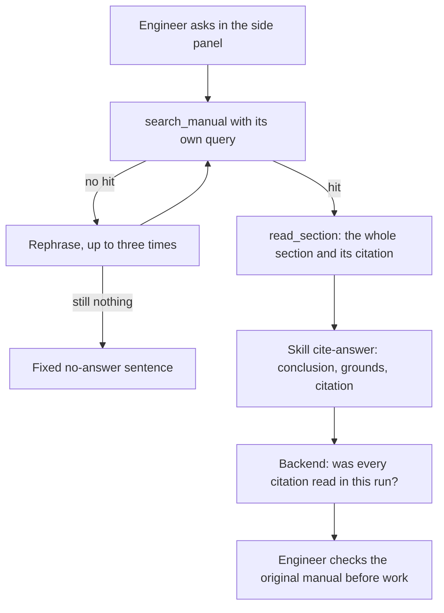
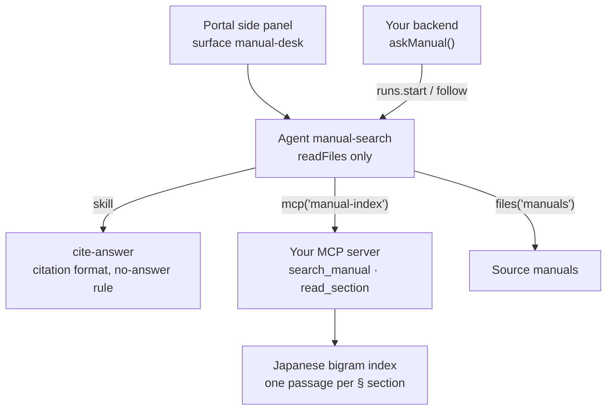

<Info>
**You will build:** a read-only agent that searches maintenance manuals through your own MCP server and answers with a 〔document p.page §section〕 citation that your backend checks against what the agent actually read.

**You will learn:** an agent defined as code with a file grant and a policy ceiling ([Agents as code](/guides/agents-as-code)), the answer format as a skill ([Skills](/building/skills)), search as your own MCP server ([MCP servers](/building/mcp-servers)), a side-panel surface ([Embed an agent](/building/embedding)), evals that gate promotion ([Evaluations](/guides/evaluations)), and a backend that follows a run and checks it ([Integrate a backend](/building/backend)).

**Time and prerequisites:** about 30 minutes to read; the tests behind it run offline with no API key. To run it on your own workspace, finish [chapter 1](/path/first-agent) first (a project answering under `aw dev`), and have a model key and Node to start the index server. The easiest tutorial in the gallery: read-only, one server, no stored policy and no human step in the middle.

</Info>

**マニュアル検索エージェント.** A field engineer asks 「油圧ユニットの定期点検の周期は？」 in the
portal's side panel. The agent searches the manuals, rephrases when the first search misses,
reads the whole section, and answers with the clause and its page. When nothing in the manuals
answers the question, it says so instead of guessing.

Japanese plants, railways and utilities hold this knowledge in rule books and maintenance
manuals that only veterans know how to navigate. The barrier to using AI for it is accuracy:
50.4% of companies using generative AI name it as their top concern ([Teikoku Databank,
2026](https://www.itmedia.co.jp/news/article/2605/15/1260515115/)). So the deliverable is not
"an answer", it is an answer whose every sentence points at a clause, and a backend that refuses
to call an answer sourced when it is not.

Every test behind this page runs offline, with no API key. How the gallery tests
a use case, and what each tier proves, is on the [gallery overview](/tutorials).

## How the agent works

From the request to the person who decides, with the tools, skills and checks in between:



## What you build



| Piece | File | SDK |
| --- | --- | --- |
| The agent | `agents/manual-search.ts`, `agents/manual-search.md` | `defineAgent`, `mcp`, `skill`, `files` |
| How to cite | `skills/cite-answer/SKILL.md` | `aw.skills.import` (via `aw dev`) |
| The search index | `mcp/manual-index.mjs` | an `http` connector in `agent-workspace.yaml` |
| The side panel | `surfaces/manual-desk.ts` | `defineSurface` |
| What "good" means | `evals/manual-search.yaml` | `aw eval`, `policy.promotion.minEvalScore` |
| The portal's call | `backend/ask.ts` | `runs.start`, `runs.follow`, `toAgentEvent` |

## 1. Index the manuals as an MCP server

Agent Workspace stores files and grants them to agents; it deliberately builds no search index,
embeddings or retrieval.
Search is therefore a tool you provide, and an MCP server is the supported way to provide one.

The index splits each manual into one passage per `## §` section, remembering the page it
starts on, and scores Japanese with overlapping character bigrams, which needs no dictionary:

```js title="mcp/manual-index.mjs (excerpt) (illustrative)" claim="illustrative"
const passages = loadPassages(MANUALS_DIR);
const index = createIndex(passages);

serveTools({
  name: 'manual-index',
  tools: [
    {
      name: 'search_manual',
      description: '社内マニュアルを全文検索する。…見つからなければ空配列。',
      inputSchema: { type: 'object', properties: { query: { type: 'string' } }, required: ['query'] },
      handler: (args) =>
        index.search(text(args, 'query')).map(({ id, source, page, section, title }) => ({ id, source, page, section, title })),
    },
    {
      name: 'read_section',
      description: 'search_manual が返した id の節を全文で読む。回答にはこの citation をそのまま使う。',
      inputSchema: { type: 'object', properties: { id: { type: 'string' } }, required: ['id'] },
      handler: (args) => {
        const passage = byId.get(text(args, 'id'));
        if (passage === undefined) refuse('no section with that id; call search_manual first');
        return { ...passage, citation: `〔${passage.source} p.${passage.page} §${passage.section}〕` };
      },
    },
  ],
});
```

Two details carry the use case:

- **An unrelated question must return nothing.** BM25 scores any overlap, so 「時間」 alone would
  match 「社員食堂の営業時間」 to a maintenance interval. The index returns a passage only when it
  holds at least a third of the query's bigrams
  (`shared/jp-search.mjs`).
  The test caught this before the agent ever did.
- **The server, not the model, writes the citation.** `read_section` returns
  `〔油圧ユニット保守マニュアル p.12 §3.2〕`, and the skill tells the agent to copy it.

Your manuals are PDFs. The platform stores them as bytes and parses nothing, so converting a PDF
to page-marked text (`<!-- page 12 -->`) is the indexer's job, done once when a manual is
published: `pdftotext -layout`, or the document-AI service your company already uses.

Run it over Streamable HTTP for `aw dev`, because a project file names only remote connectors:

```sh title="illustrative" claim="illustrative"
MCP_TRANSPORT=http PORT=8787 node mcp/manual-index.mjs
```

## 2. Write the citation rules as a skill

```md title="skills/cite-answer/SKILL.md" file="tests/gallery/manual-search/skills/cite-answer/SKILL.md#excerpt"
---
name: cite-answer
description: 社内マニュアルに基づく回答の書き方。出典の書式と「該当なし」の基準を定める。
---
- 回答は結論を1〜2文で先に書き、続けて根拠を箇条書きにする。
- 各根拠の末尾に出典を〔文書名 p.ページ §節〕で書く。
  - ページと節は `read_section` が返す `citation` をそのまま使う。言い換えない。
- 根拠が見つからないときは次の文で答える:
  「該当する記載が見つかりませんでした。設備保全課（内線 4410）にお問い合わせください。」
```

A skill is managed knowledge, separate from the agent: the quality team can tighten the citation
rule without touching the agent, and other agents (use cases [9](/tutorials/maintenance-troubleshooting)
and [10](/tutorials/quality-defect)) reuse the same convention.

## 3. Define the agent

```ts title="agents/manual-search.ts" file="tests/gallery/manual-search/agents/manual-search.ts"
import { defineAgent, files, mcp, skill } from '@indx-workspace/sdk/define';

export default defineAgent({
  name: 'manual-search',
  instructions: { file: './manual-search.md' },
  model: 'default',
  engine: 'claude-agent-sdk',
  // Read-only by construction: it can read the manuals and call the index, nothing else.
  permissions: { readFiles: true },
  tools: [mcp('manual-index')],
  skills: [skill('cite-answer')],
  files: [files('manuals', 'read')],
  limits: { maxTurns: 12, maxBudgetUsd: 0.5 },
});
```

The instructions (`agents/manual-search.md`) say *how to search*: write your own query, rephrase
up to three times, read the whole section before answering, copy numbers with their units. The
project file adds a ceiling no agent in the project can widen:

```yaml title="agent-workspace.yaml (excerpt) (illustrative)" claim="illustrative"
connectors:
  manual-index:
    url: http://127.0.0.1:8787/mcp
    transport: http
policy:
  permissions: { writeFiles: false, runCommands: false, unrestrictedNetwork: false }
  limits: { maxBudgetUsd: 1 }
  promotion: { minEvalScore: 0.9 }
```

## 4. Put it in the portal

```ts title="surfaces/manual-desk.ts" file="tests/gallery/manual-search/surfaces/manual-desk.ts"
import { defineSurface } from '@indx-workspace/sdk/define';

export default defineSurface({
  name: 'manual-desk',
  agent: 'manual-search',
  title: 'マニュアル検索',
  layout: 'side',
  parts: {
    greeting: '設備マニュアルについて質問してください。出典つきで答えます。',
    suggestedPrompts: ['油圧ユニットの定期点検の周期は？', '作動油の交換基準を教えて'],
    disclaimer: '回答はマニュアルの記載に基づきます。作業前に原本を確認してください。',
    toolTrace: 'collapsed',
    feedback: true,
  },
});
```

`aw push` saves the surface with the agent's version, and it is served at `/p/s/manual-desk`.

<Note>
  You might expect `toolResults: { search_manual: 'card' }` to show the search hits as cards. It
  cannot today: the widget matches a `toolResults` key against the tool's name in the run
  exactly, and a Claude run names an MCP tool `mcp__<connector-name>__search_manual`, or
  `mcp__connector-<uuid>__search_manual` when the name is not a usable slug, which is longer than a
  key may be and differs in every workspace (probe `surface-mcp-tool-results`).
</Note>

## 5. Say what "good" means

```yaml title="evals/manual-search.yaml" file="tests/gallery/manual-search/evals/manual-search.yaml#excerpt"
cases:
  - name: 点検周期を出典付きで答える
    input: 油圧ユニットの定期点検の周期は？
    expect:
      contains: ['〔油圧ユニット保守マニュアル', '6か月']
  - name: マニュアルにない質問は推測しない
    input: 社員食堂の営業時間は？
    expect:
      contains: ['該当する記載が見つかりませんでした']
      notContains: ['〔']
```

The full file has four cases, one of them an LLM-judged safety rubric. With
`minEvalScore: 0.9`, `aw promote` refuses to put a version in production that fails one of them.

<Warning>
  Pin citations with `contains`, not with `tool:`. A Claude run names an MCP tool
  `mcp__<connector-name>__search_manual`, where the name is the connector's name in *that*
  workspace, and an eval's `tool:` must match the name exactly. A `tool:` expectation you commit
  is therefore wrong in any workspace that names the connector differently.
</Warning>

## 6. Call it from the backend and check the citations

```ts title="backend/ask.ts (excerpt) (illustrative)" claim="illustrative"
export async function askManual(aw, agentId, question, sessionId?) {
  const reading = await runAndRead(aw, agentId, { prompt: question, sessionId: sessionId ?? null });
  const read = new Set(
    reading.toolCalls
      .filter((call) => toolIs(call.name, 'read_section') && !call.isError)
      .flatMap((call) => parseCitations(call.output ?? '').map((citation) => citation.raw)),
  );
  const citations = parseCitations(reading.answer);
  const unverified = citations.filter((citation) => !read.has(citation.raw));
  return { answer: reading.answer, citations, unverified,
           grounded: citations.length > 0 && unverified.length === 0, … };
}
```

`runAndRead`
starts the run, follows its stream with `aw.runs.follow`, and rebuilds the answer from the
neutral `agent.message` events, because a settled `RunResource` carries status, usage and cost
but no answer text. The citation check is the part to keep: a model can write a plausible 〔…〕
for a page it never opened, and `grounded` is true only when every citation is one
`read_section` returned in this run.

## 7. Run it

<Steps>
  <Step title="Offline, in the test suite">
    Loads the project through the same contract `aw check` applies, drives the real index
    server, and runs `askManual` against a scripted workspace whose tool results are the
    server's own. Six tests, no API key.
  </Step>
  <Step title="On your workspace">
    ```sh title="illustrative" claim="illustrative"
    MCP_TRANSPORT=http PORT=8787 node mcp/manual-index.mjs &
    aw dev                 # keeps the connector and the skill in step
    aw files upload manuals/油圧ユニット保守マニュアル.pdf
    aw push --yes
    aw eval manual-search  # the four cases, on a real model
    ```
    The grant on `manuals` resolves once a file is uploaded into it, so the folder needs no `aw files mkdir`. If `aw dev` refused the agent with `agent_definition_references_missing [file:manuals]` before the upload, `aw push --yes` syncs it, and so does saving the agent file again.
  </Step>
</Steps>

### What a live run has shown

On 2026-10-04 this use case ran on a real workspace: the embedded control plane, gateway and
runner on the `local` driver, the Claude Agent SDK engine, and a fake Anthropic API scripted to
follow `agents/manual-search.md` (search with the question, read the best hit, answer in the
skill's format). Everything else was real:

- `agents.create({ version })` deployed the agent from `agents/manual-search.ts` as written, and
  the server resolved its `manuals` grant, its `cite-answer` skill and its `manual-index`
  connector by name.
- The run spawned `mcp/manual-index.mjs` as a `stdio` connector and called `search_manual` and
  `read_section` on it; `askManual` returned 「定期点検は 6か月 ごと…」 with
  `〔油圧ユニット保守マニュアル p.12 §3.2〕`, `grounded: true`.
- The cafeteria question came back as the no-answer sentence, with no citation.
- `aw.agents.evaluations.create` ran the three `contains` cases as three real runs and scored
  3 / 3. The judge case was left out: the scripted model cannot grade a rubric.

What it does not show is a real model's judgement; that is what `aw eval` on your own workspace
is for. One more thing it surfaced: the agent version names no runtime profile and no model
(`model: 'default'`), so a workspace needs a default model and runtime profile, or the run is
refused with `model_connection_unresolved`.

## Where the SDK stands

This table is generated from the use case's benchmark and checked by the gallery's tests. `contract` means an offline test in the gallery's suite proves
it; `probe` means a test asserts the capability is still missing and fails the day it arrives;
`source` cites the platform's code.

{/* benchmark:start */}

Score: **69 / 100** (✅ = 1, 🟡 = 0.5, ❌ = 0, over the capabilities this use case needs).

| Capability | Today | Evidence | What it means for you |
| --- | --- | --- | --- |
| Agent as code | ✅ | contract | defineAgent, a skill, a file grant and a surface pass the server contract offline; the policy ceiling keeps the agent read-only. |
| Grounded search | 🟡 | contract | You host the index as an MCP server (about 100 lines here); the platform deliberately has no retrieval. |
| Document parsing | 🟡 | source | Files are stored as bytes; PDF to page-marked text is your indexer’s job, done once per manual. |
| Structured output | ❌ | probe | Citations come back inside free text; the backend parses 〔…〕 and checks each against what the agent read. |
| Per-user scope | 🟡 | source | Grants are per agent, not per person: split agents per department, or filter inside the index server. |
| Embedded UI | ✅ | contract | defineSurface publishes the side panel with suggested prompts, a collapsed tool trace and rating buttons; search hits cannot render as cards, because toolResults cannot name an MCP tool. |
| Evals | ✅ | contract | Four cases and a 0.9 promotion bar. Pin citations with `contains`, not `tool:`: a run names MCP tools `mcp__<connector-name>__…`, so a `tool:` pin holds only while the connector keeps that name. |
| Audit and cost | ✅ | source | Every run records tokens and cost; the audit log records who changed the agent. |

{/* benchmark:end */}

**Verdict: buildable today.** The parts that are yours are the index and the citation check,
about 150 lines between them. What would remove code from this page:

- **A run that returns structured output** would replace the 〔…〕 parsing with typed citations
  (probe `run-output-schema`).
- **Per-person data scope** would let one agent serve every department while each person sees
  only their manuals; today grants are per agent ([RF-102](/concepts/roadmap)).
