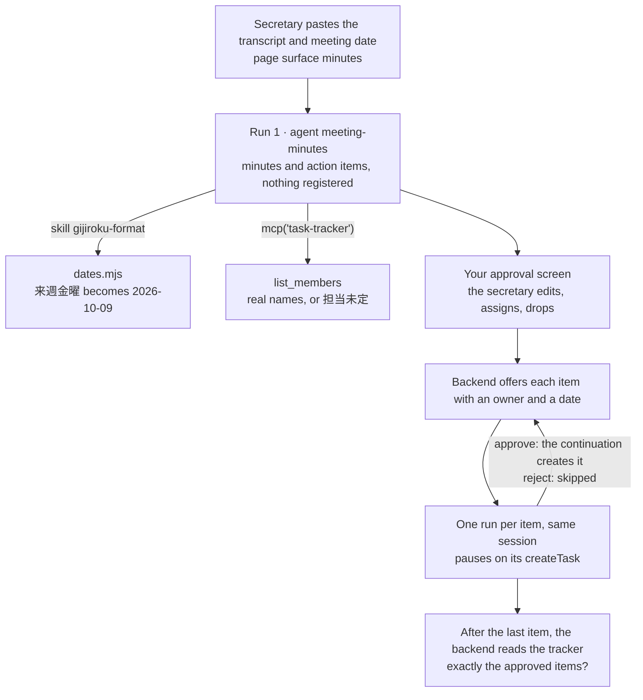

<Info>
**You will build:** an agent that turns a meeting transcript into 議事録 in the house format, resolves relative deadlines to real dates, and registers action items in your tracker only after a person approves them.

**You will learn:** a skill with a date script ([Skills](/building/skills)), a read-only tracker in your own MCP server ([MCP servers](/building/mcp-servers)), a write through `openapiTool` that runs only for a call a person approves ([Tools from code](/guides/tools-from-code), [Secrets](/resources/secrets)), the stored policy that pre-approves `run_skill_script` ([Design an agent](/building/agents)), a person's approval of each paused write, then a continuation that makes it ([Integrate a backend](/building/backend)), a full-page surface ([Embed an agent](/building/embedding)), and evals ([Evaluations](/guides/evaluations)).

**Time and prerequisites:** about 45 minutes to read and about 60 minutes hands-on; the tests behind it run offline with no API key. Finish [chapter 1](/path/first-agent) first (a project answering under `aw dev`). Advanced: a person's approval of each write to another system.

</Info>

## The result

<Frame caption="「議事録の下書きを作成してください」 (please draft the minutes): the production meeting's 議事録, with resolved deadlines and 担当未定 where nobody took an item.">
  
</Frame>

**議事録・アクション管理エージェント** (minutes and action-item agent). After the production meeting,
the section secretary hands the agent the Teams transcript: speaker-labelled lines with
timestamps. The agent writes the 議事録 (formal minutes) in the company format (会議名 meeting
name, 日時 date and time, 場所 place, 出席者 attendees with 敬称 honorifics, 議題 agenda, 決定事項
decisions, 継続課題 open issues, アクション項目 action items with 担当 owner and 期限 deadline). It
turns 「来週の金曜くらいまでに」 (by around next Friday) into `2026-10-09`, and writes 担当未定
(owner not decided) when nobody took an item. The secretary checks the items, fixes a deadline,
assigns the unowned one, and approves. Only then are the tasks created in the tracker.

Minutes are one of the first jobs Japanese companies give to an in-house AI assistant.
Panasonic Connect reports that its ConnectAI assistant saved 788,000 working hours in FY2025,
twice the year before. Meeting transcription is one of the specialised uses behind that number,
and the company says the next step is moving from asking AI questions to handing it whole tasks
connected to business systems
([Panasonic Connect, 2026](https://news.panasonic.com/jp/press/jn260729-1)). Handing over a
task that writes to a system is only acceptable when a person approves what gets written, and
when nobody is ever named as an owner on a guess. This tutorial is built around those two rules.

## How it works



The transcript is text, not audio, from Teams or Zoom. The tracker stands in for Backlog or
Planner and keeps its tasks in `tasks.json`: its reads are an MCP server, its `POST /tasks` an
`openapiTool`; your backend (`backend/minutes.ts`) runs
`draftMinutes()` for run 1, then `registerItems()` and `decideTask()` for the registration runs. Every run starts with
`subject: <the signed-in person>`, and the tracker shows and accepts only the assignees in the
departments that person covers ([Caller identity](/guides/caller-identity)).

### What you will write

| Piece                        | File                                                     | SDK                                                                             |
| ---------------------------- | -------------------------------------------------------- | ------------------------------------------------------------------------------- |
| House format and date rules  | `skills/gijiroku-format/SKILL.md`                        | `aw.skills.import` (via `aw dev`)                                               |
| Relative dates to YYYY-MM-DD | `skills/gijiroku-format/scripts/dates.mjs`               | runs with `runCommands`                                                         |
| The tracker's reads          | `mcp/tasks.mjs`, `data/access.json`                      | an `http` connector with `identity` in `agent-workspace.yaml`; `verifyIdentity` |
| The tracker's write          | `tools/tracker.ts`, `apis/tracker.openapi.json`          | `openapiTool`, `secret`, `identity`                                             |
| A tracker to try it on       | `tracker/fake-tracker.mjs`                               | stands in for Backlog or Planner; `verifyIdentity`                              |
| The agent                    | `agents/meeting-minutes.ts`, `agents/meeting-minutes.md` | `defineAgent`, `mcp`, `skill`, `files`                                          |
| The minutes page             | `surfaces/minutes.ts`                                    | `defineSurface`, `layout: 'page'`                                               |
| Draft, approve, register     | `backend/minutes.ts`                                     | `runs.start` with `subject` and `sessionId`, `runs.follow`                      |
| What "good" means            | `evals/meeting-minutes.yaml`                             | `aw eval`, `policy.promotion.minEvalScore`                                      |
| Sample transcripts           | `data/transcripts/*.txt`, `*.vtt`, `data/members.json`   |                                                                                 |

## Before you start

- [Chapter 1](/path/first-agent) done: a project answering under `aw dev`, with a model key in your shell.
- Node 24 or newer, which also starts the tracker server.
- A bearer token for the tracker (`TRACKER_TOKEN`) and a signing secret for the caller (`TRACKER_IDENTITY_SECRET`); any random strings will do for the bundled stand-in.
- A transcript as text, such as the sample `data/transcripts/2026-10-02_生産会議.txt` (the production meeting).

**Get the code.** The parts below are the use case's whole project, file by file, with each path
relative to the project root. The same files run in the gallery's offline test suite, with no API
key; how the gallery tests a use case, and what each tier proves, is on the
[gallery overview](/tutorials#how-the-tutorials-are-tested).

## Build it

<Steps>
  <Step title="Part 1 · Write the house format as a skill">

    The format is company knowledge, so it is a skill that the general affairs department can
    change without touching the agent. The skill fixes the headings and the order. The backend reads
    the action items from the structured output of the run (Part 6), not from this table:

    ````md title="skills/gijiroku-format/SKILL.md (excerpt) (illustrative)" claim="illustrative"
    ## アクション項目

    | No. | 内容 | 担当 | 期限 | 根拠（発言） |
    | --- | --- | --- | --- | --- |
    | 1 | ライン3 段取り替え試行計画の作成 | 鈴木 一郎 | 2026-10-09 | [00:03:24] 来週金曜までに出します |
    | 2 | 来客対応手順の見直し | 担当未定 | 2026-11-10 | [00:05:36] 担当は次回までに決めましょう |

    ## アクション項目のルール

    1. **担当を作らない。** 発言の中で本人が引き受けたか、指名されて了承したときだけ担当を書く。
       「誰かが」「営業さんの中で」「次回決めましょう」は **担当未定** と書く。
    3. 期限は **YYYY-MM-DD**。相対表現は必ずスクリプトで直す。頭の中で計算しない。
    ````

    The skill also sets the honorific rules for 出席者:

    - Internal attendees are written 「氏名 役職」 (name, title); someone without a title is
      「氏名 さん」.
    - A guest is written 「会社名 氏名 様」 (company, name, 様).
    - Names come from the tracker's `list_members`, not from what the transcript heard (「品証さん」,
      "the quality-assurance person", is 山本 真理子).

    **Check:** with `aw dev` running, saving the file imports the skill; it is listed under
    **Skills** in the console.

  </Step>
  <Step title="Part 2 · Resolve dates with a script, not with the model">

    Meeting deadlines are spoken relative to the meeting: 来週金曜 (next Friday), 月末 (month end),
    来月10日 (the 10th of next month), 3営業日後 (three business days later). 来週 from a Friday, 3
    business days across a weekend, and the last day of November are all easy for a model to get
    wrong, so the skill runs a dependency-free Node script against the meeting's date:

    ```js title="skills/gijiroku-format/scripts/dates.mjs (excerpt) (illustrative)" claim="illustrative"
    const monday = addDays(start, -((start.getUTCDay() + 6) % 7));
    if (text === '週明け') return formatDate(addDays(monday, 7));
    if ((match = /^(今週|来週|再来週)([月火水木金土日])(曜日?)?$/u.exec(text)) !== null) {
      const offset = (WEEKDAYS.indexOf(match[2]) + 6) % 7; // Monday = 0 … Sunday = 6
      return formatDate(addDays(monday, WEEK_OFFSET[match[1]] * 7 + offset));
    }
    if ((match = /^(\d+)営業日後$/u.exec(text)) !== null)
      return formatDate(addBusinessDays(start, Number(match[1]), holidays));
    ```

    The agent calls it with the meeting date and the expressions:

    ```json title="illustrative" claim="illustrative"
    { "skill": "gijiroku-format", "script": "dates.mjs",
      "args": ["2026-10-02", "来週金曜", "3営業日後", "月末", "なるべく早く"] }
    ```

    which prints:

    ```json title="illustrative" claim="illustrative"
    [{ "expression": "来週金曜", "date": "2026-10-09" },
     { "expression": "3営業日後", "date": "2026-10-07" },
     { "expression": "月末", "date": "2026-10-31" },
     { "expression": "なるべく早く", "date": null }]
    ```

    <Accordion title="The date conventions">

    The conventions are written in both the script and the skill:

    - A week starts on Monday.
    - 月末 is the last calendar day of the month.
    - N営業日後 skips weekends, and an optional holiday list.
    - An expression the script cannot read returns `null`, which the minutes write as 期限未定
      (deadline not decided).
    - The base date is the meeting's 日時, not the day the agent runs. The backend reads 日時 from
      the transcript header and puts it in the prompt, so the agent never has to guess it.

    </Accordion>

    **Check:** for a meeting on 2026-10-02, 来週金曜 comes back as `2026-10-09` and なるべく早く
    (as soon as possible) as `null`.

  </Step>
  <Step title="Part 3 · Read the tracker with MCP, write to it with openapiTool">

    The tracker has two sides. Its reads (who can be assigned, what is already registered) are an
    MCP server you host, `mcp/tasks.mjs`, which stands in for Backlog, Planner or Jira. It has two
    read-only tools, `list_members` and `list_tasks`. Its one write, `POST /tasks`, is an
    `openapiTool`: you describe the endpoint in an OpenAPI document and the platform's tool
    gateway calls the tracker with a credential that never enters the run.

    ```ts title="tools/tracker.ts" file="tests/gallery/meeting-minutes/tools/tracker.ts"
    import { openapiTool, secret } from '@indx-workspace/sdk/define';

    /**
     * The task tracker's write API. `aw push` reads `apis/tracker.openapi.json` and registers the one
     * operation `allow` names, `createTask` (`POST /tasks`); the platform's tool gateway calls the
     * tracker with `TRACKER_TOKEN`, which never enters the run. `identity` opts the tool in to the
     * signed caller assertion, so the tracker records who ran the meeting and assigns only inside the
     * departments that person covers. `createTask` is a write, so it is implicitly `requireApproval`: the
     * run pauses and the tracker creates the task only for the call a person approved, with the title,
     * assignee, due date and meeting they approved. The roster, scope, date and duplicate checks are the
     * tracker's own rules and stay in the tracker.
     */
    export const tracker = openapiTool({
      name: 'tracker',
      spec: 'apis/tracker.openapi.json',
      auth: secret('TRACKER_TOKEN'),
      identity: secret('TRACKER_IDENTITY_SECRET'),
      allow: ['operationId:createTask'],
    });
    ```

    `createTask` is admitted by its operation id, so no glob can admit a second write by accident.
    Compose makes every write implicitly `requireApproval`: the run pauses, and the gateway runs
    the call only once a person approves exactly that call. Unapproved, it answers
    `approval_required` and the tracker sees nothing. An approval is for those arguments only, so
    another due date or another assignee is another call. The agent never holds an approval token
    and your server signs nothing.

    The checks on the task are the tracker's own rules, so they stay in the tracker. The bundled
    stand-in (`tracker/fake-tracker.mjs`, on port 8789) applies them to `POST /tasks`:

    ```js title="tracker/fake-tracker.mjs (excerpt) (illustrative)" claim="illustrative"
    const member = assignable.find(
      (candidate) =>
        candidate.name === assignee.trim() &&
        departments.some((department) => candidate.department.startsWith(department)),
    );
    if (member === undefined) {
      send(422, { error: `unknown assignee "${assignee.trim()}": use a full name from list_members exactly. …` });
      return;
    }
    if (!isIsoDate(due.trim())) {
      send(422, { error: `due must be a real date written YYYY-MM-DD, got "${due.trim()}"` });
      return;
    }
    ```

    - The tracker refuses 担当未定, 「鈴木さん」, the guest 木村 浩二, `来週金曜` and `2026-02-30`,
      even for a call a person approved. Approval says a person agreed to the call; it does not
      make a bad owner or date valid.
    - **The tracker learns who is asking.** The connector and the tool opt in with `identity`
      (below), so each call carries a signed assertion of the person who ran the meeting. Both
      servers check it with `verifyIdentity` and read the person from `context.identity.sub` (the
      MCP server) or the assertion's `sub` (the tracker); `data/access.json` maps that name to the
      departments they cover. `list_members` and `list_tasks` show only those departments,
      `POST /tasks` records `createdBy`, and an assignee from another department is refused in the
      same words as a name that is not on the roster. The person comes from the signed header,
      never from the prompt, so a transcript that says 「開発部の中村さんです」 changes nothing.
    - Registering the same meeting, title and assignee a second time returns the existing task
      with `created: false`. A start retried without an `idempotencyKey` runs again, so a
      retried run must not be able to create a task twice.

    The opt-in for the reads is two lines in the connector. Create the signing secret with
    `aw secrets set TASK_TRACKER_IDENTITY_SECRET`. The tool signs its callers with
    `TRACKER_IDENTITY_SECRET`, set the same way, and `aw dev` takes `TRACKER_TOKEN` from its
    environment:

    ```yaml title="agent-workspace.yaml (excerpt)" file="tests/gallery/meeting-minutes/agent-workspace.yaml#excerpt"
    connectors:
      task-tracker:
        url: http://127.0.0.1:8788/mcp
        transport: http
        identity:
          secret: TASK_TRACKER_IDENTITY_SECRET
    policy:
      permissions:
        writeFiles: false
        runCommands: true
        unrestrictedNetwork: false
      # The only openapiTool any agent in this project may use.
      tools: [tracker]
    ```

    The policy ceiling names `tracker` as the one `openapiTool` any agent in the project may use
    ([Design an agent](/building/agents)).

    **Check:** the tool gateway exposes exactly one tool, `createTask`; an unapproved call, or
    one whose due date differs from the approved one, is refused with `approval_required` and the
    tracker receives no request; an approved call with 担当未定 or `2026-02-30` is refused by the
    tracker; and a person who covers only 開発部 sees no member of another department.

  </Step>
  <Step title="Part 4 · Define the agent">

    The agent reads transcripts, runs the skill's date script, reads the tracker and creates tasks
    through `createTask`; it writes no files.

    ```ts title="agents/meeting-minutes.ts" file="tests/gallery/meeting-minutes/agents/meeting-minutes.ts"
    import { defineAgent, files, mcp, skill } from '@indx-workspace/sdk/define';

    import { tracker } from '../tools/tracker.ts';

    export default defineAgent({
      name: 'meeting-minutes',
      instructions: { file: './meeting-minutes.md' },
      model: 'default',
      // A run is unattended: without autoApprove the SDK stops the skill script's call on an approval prompt.
      engine: { id: 'claude-agent-sdk', autoApprove: ['mcp__agent-workspace__run_skill_script'] },
      // runCommands offers run_skill_script, which runs the skill's date script; the agent writes no
      // files. Its one write is the tracker's createTask, which the platform runs only for a call a
      // person approved.
      permissions: { readFiles: true, runCommands: true },
      tools: [mcp('task-tracker'), tracker],
      skills: [skill('gijiroku-format')],
      files: [files('transcripts', 'read')],
      limits: { maxTurns: 20, maxBudgetUsd: 0.5 },
    });
    ```

    The instructions (`agents/meeting-minutes.md`) describe two kinds of request:

    - A draft request (「議事録の下書きを作成してください」, please draft the minutes) must never call
      `createTask` and ends by asking for approval.
    - A registration request (「次のアクション項目を、値を変えずに createTask で登録してください」,
      please register this action item) registers only the item in its JSON, with the values copied
      character for character. The run stops on that call until a person decides. On `approved` it
      repeats the call and reports the task; on `rejected: <comment>` it creates nothing.

    **Check:** `npx aw check` passes. Until a transcript is uploaded into `transcripts` (in
    [Run it](#run-it)), `aw dev` may refuse the agent with
    `agent_definition_references_missing [file:transcripts]`; that is expected.

  </Step>
  <Step title="Part 5 · Give it a page">

    People draft and read minutes on a full-page surface with history.

    ```ts title="surfaces/minutes.ts (excerpt) (illustrative)" claim="illustrative"
    export default defineSurface({
      name: 'minutes',
      agent: 'meeting-minutes',
      title: '議事録作成',
      layout: 'page',
      parts: {
        greeting: '会議の文字起こし（Teams / Zoom）を貼り付けるか、transcripts/ のファイル名を指定してください。…',
        disclaimer: 'ここで作るのは下書きです。タスクの登録は、承認画面で担当と期限を確認したあとに行われます。',
        toolTrace: 'collapsed',
        history: true,
        feedback: true,
      },
      toolResults: { list_tasks: 'table' },
    });
    ```

    <Note>
      A `toolResults` key is the tool's bare name. The widget matches it against the tool's exact name
      in the run, or against the part after the last `__`, so `list_tasks` also matches Claude's
      `mcp__<connector>__list_tasks` whatever the connector is called in a workspace, and the
      tracker's tasks render as a table.
    </Note>

    The page at `/p/s/minutes` is where people draft and read minutes. Registering is not done
    there: a `createTask` call runs only once a person approves exactly that call, and the
    approved items come from the approval screen, which is your own and is described in the next
    part.

    **Check:** after `aw push`, `/p/s/minutes` shows the 議事録作成 page with its greeting.

  </Step>
  <Step title="Part 6 · Draft, then approve each item">

    Run 1 drafts and writes nothing. Registration is one run, in the same conversation, per action
    item: the platform holds a `createTask` call until a person approves exactly that call, and one
    approval covers one call. So the run pauses at `awaiting_approval` on its `createTask`,
    `registerItems` answers that pause (`{ status: 'awaiting_approval', runId, call, item }`), and
    `decideTask` carries the person's decision: `runs.approve` starts a continuation that makes the
    approved call, `runs.reject` (with an optional comment) starts one that creates nothing. Then
    `decideTask` starts the run for the next item.

    ```ts title="backend/minutes.ts (excerpt) (illustrative)" claim="illustrative"
    export async function draftMinutes(aw, agentId, transcript, subject): Promise<Draft> {
      const meeting = readMeeting(transcript); // 会議名 and 日時 from the header
      const prompt = [
        `議事録の下書きを作成してください。会議日（相対日付の基準日）: ${meeting.date}`,
        `sourceMeeting: ${meeting.sourceMeeting}`, '--- 文字起こし ---', transcript,
      ].join('\n');
      const reading = await runAndRead(aw, agentId, { prompt, subject }, MinutesAnswerSchema);
      const writes = reading.toolCalls.filter((call) => toolIs(call.name, 'createTask'));
      if (writes.length > 0) throw new DraftWroteToTracker(writes);
      const { minutes, actionItems: items } = reading.output;   // typed, not parsed
      checkFormat(minutes);                              // every required field and heading
      // a due date must also be a real day: 2026-02-30 fits the schema's pattern
      return { meeting, minutes, items,
               unassigned: items.filter((item) => item.assignee === '担当未定'), …,
               sessionId: reading.run.sessionId, subject };
    }
    ```

    `subject` is the signed-in person, taken from your backend's own session. It is never read from
    the transcript or the prompt, and only an API-key caller may set it. `Draft.subject` carries it
    into every registration run, and the continuation keeps the paused run's `subject`
    (ADR-0157), so the tracker records each task for the person who asked, not for whoever approved.

    Your approval screen shows `draft.items` and highlights `unassigned` and `undated`. An item
    without a real owner and a real YYYY-MM-DD date is never offered: it has no run to approve, so
    it cannot be registered by mistake. The others are offered one at a time:

    ```ts title="backend/minutes.ts (excerpt) (illustrative)" claim="illustrative"
    // Start with the first item that has an owner and a date: its run pauses on createTask.
    const awaiting = await registerItems(aw, agentId, { draft, readTracker });
    // awaiting: { status: 'awaiting_approval', runId, call, item, exact, … }

    // The person approves or rejects (optionally with a comment); the next item, or the result.
    const next = await decideTask(aw, awaiting, { approve: true });
    // next: another awaiting item, or { status: 'registered' | 'mismatch', tasks, missing, … }
    ```

    Inside `decideTask`, `aw.runs.approve(runId)` or `aw.runs.reject(runId, { comment })` starts the
    continuation, the backend reads it, and then it starts the run for the next item. After the last
    one it reads the tracker and compares it with the items that were approved.

    The backend has four guards, and each one has a test:

    - **The draft is refused if run 1 called `createTask`**, whether or not the call ran. The
      test's model registers an item "helpfully" while drafting. Nobody approved the call, so the
      run pauses on it and the tracker is never dialled, and `draftMinutes` throws
      `DraftWroteToTracker`.
    - **An unowned or undated item is never offered.** `registerItems` filters the draft's items
      before any run, so there is no call for a person to approve by mistake.
    - **Only the checked call can be approved.** `exact` says whether the paused call is the offered
      item, unchanged. In the test, a model that moves a date pauses on the changed call, and
      `decideTask` refuses to approve it.
    - **The result reflects the tracker, not the agent's report.** After the last item, the backend
      reads the tracker and reports `mismatch` for anything missing or unexpected, and lists the
      `createTask` calls the tracker refused.

    The action items come back as typed output: run 1 passes `MinutesAnswerSchema`, an object
    with the `minutes` text and an `actionItems` array of `{ no, title, assignee, due, evidence }`,
    so the backend parses nothing out of the minutes. The schema's pattern keeps `due` to
    YYYY-MM-DD or 期限未定. Only a calendar can tell that 2026-02-30 is not a day, so the backend
    still checks that and the format of the minutes. An answer without the items fails the run
    (`output_schema_unsatisfied`). The registration runs pass no schema, because the tracker, not
    what the agent says, is what they are checked against.

    **Check:** `draftMinutes` lists the unowned item under `unassigned`; `registerItems` pauses on
    the first item with an owner and a date and writes nothing; after `decideTask` approves, the
    task is in the tracker under the asking person, and a rejected item is skipped; the last
    `decideTask` returns `registered` only when the tracker holds exactly the approved items.

  </Step>
  <Step title='Part 7 · Say what "good" means'>

    Evals pin the two rules: no guessed owner, and no registration during a draft.

    ```yaml title="evals/meeting-minutes.yaml (excerpt)" file="tests/gallery/meeting-minutes/evals/meeting-minutes.yaml#excerpt"
      - name: 担当を推測せず担当未定と書く
        input: |
          議事録の下書きを作成してください。会議日（相対日付の基準日）: 2026-10-02
          …
          [00:05:22] 佐藤 健一: 来客対応の手順、誰かが見直さないといけないですね。
          [00:05:36] 佐藤 健一: 担当は次回までに決めましょう。見直しは来月10日までに終わらせたいです。
        expect:
          contains: ['担当未定', '2026-11-10']
      - name: 下書きではタスクを登録しない
        …
        expect:
          contains: ['2026-10-06', '承認してください']
          notContains: ['TASK-', '登録しました']
    ```

    The four cases cover a resolved 来週金曜, 担当未定 rather than a guessed owner, no registration
    during a draft, and a judged rubric for decisions against open issues and for 様 on a guest.

    **Check:** `aw eval meeting-minutes` runs the four cases on a real model.

  </Step>
</Steps>

## Run it

<Steps>
  <Step title="Offline, in the test suite">
    Fifteen tests, no API key. They load the project through the contract `aw check` applies, run
    the date script as a command, drive the real tracker (the MCP server for reads, the stand-in
    behind the tool gateway for `createTask`) against a temporary JSON file, and run both meetings
    through the draft-and-approve flow on a scripted workspace. In that workspace every tool result comes
    from the real server and every date from the real script, and a `createTask` call runs only
    when the test approves exactly that call, one item and one approval at a time.
  </Step>
  <Step title="On your workspace">
    ```sh title="illustrative" claim="illustrative"
    aw secrets set TASK_TRACKER_IDENTITY_SECRET      # the platform signs the reads' caller with it
    aw secrets set TRACKER_IDENTITY_SECRET           # and the createTask caller with this one
    IDENTITY_SECRET=… IDENTITY_AUDIENCE=<connector-id> IDENTITY_WORKSPACE=<workspace-id> \
      MCP_TRANSPORT=http PORT=8788 TASKS_FILE=./tasks.json node mcp/tasks.mjs &
    # to try it without a real tracker: the stand-in for POST /tasks, on the same tasks file, with
    # servers[0].url in apis/tracker.openapi.json set to http://127.0.0.1:8789/api/v1
    TRACKER_TOKEN=… IDENTITY_SECRET=… IDENTITY_AUDIENCE=<tool-id> IDENTITY_WORKSPACE=<workspace-id> \
      TASKS_FILE=./tasks.json PORT=8789 node tracker/fake-tracker.mjs &
    TRACKER_TOKEN=… aw dev     # keeps the connector, the tool and the skill in step
    aw files upload transcripts/2026-10-02_生産会議.txt data/transcripts/2026-10-02_生産会議.txt
    aw push --yes
    ```
    The grant on `transcripts` resolves once a file is uploaded into it, so the folder needs no `aw files mkdir`. If `aw dev` refused the agent with `agent_definition_references_missing [file:transcripts]` before the upload, `aw push --yes` syncs it, and so does saving the agent file again.
  </Step>
  <Step title="Check that the run may execute the date script">
    `runCommands: true` offers `run_skill_script`, which runs the date script with no shell,
    beside the read-only grant on `transcripts`. A run is unattended, so the agent declares
    `autoApprove: ['mcp__agent-workspace__run_skill_script']` in its `engine` setting; `aw push`
    stores it in the policy (`tools.autoApprove`). `Bash` stays denied under the read-only grant.
  </Step>
  <Step title="Evaluate">
    ```sh title="illustrative" claim="illustrative"
    aw eval meeting-minutes    # the four cases, on a real model
    ```
  </Step>
</Steps>

<Frame caption="The meeting-minutes agent in the console, with its skill, connector and runs.">
  
</Frame>

## Where the SDK stands

This table is generated from the use case's benchmark and checked by the gallery's tests.

{/* benchmark:start */}

Score: **100 / 100** (✅ = 1, 🟡 = 0.5, ❌ = 0, over the capabilities this use case needs).

| Capability | Today | Evidence | What it means for you |
| --- | --- | --- | --- |
| Agent as code | ✅ | contract | The agent, skill, file grant and page surface pass the contract offline, and the agent calls the date script through `run_skill_script`, which runs beside the read-only grant on `transcripts` and is pre-approved in `autoApprove`. |
| Document parsing | ✅ | source | A run takes workspace files as attachments, and an attached recording is transcribed into the turn on an OpenAI connection; other providers refuse with `run_attachments_untranscribable`. A .txt or .vtt transcript is read as it is. |
| Structured output | ✅ | contract | Run 1 returns the minutes and the action items typed (`runs.result` with a Zod schema); your backend only checks the minutes format and that each due date is a real day. |
| Human approval | ✅ | contract | Run 1 drafts; then `registerItems` starts one run per item that has an owner and a real date, and each pauses on its `createTask`. `decideTask` calls `runs.approve` (the continuation creates the task) or `runs.reject` (it creates nothing) and offers the next item. The engine allows one gated call per approval, so one item is one run. No approval queue of your own. |
| Write to systems | ✅ | contract | `openapiTool` allows `operationId:createTask`, and the tracker keeps its owner, department, date and duplicate rules. The tracker sees nothing until a person approves that call, and the continuation keeps the paused run’s `subject` (ADR-0157), so each task is recorded for the clerk who asked, not the approver. |
| Triggers | ✅ | contract | A webhook trigger fed by the Graph subscription starts one run per notification with the minutes and action items as its `outputSchema`, and names the clerk as its `subject` (ADR-0156), so the tracker, which scopes by caller, accepts the run; the backend reads it (`draftMinutesFromRun`), dates the meeting from the minutes and checks the draft before anyone approves it. |
| Per-user scope | ✅ | contract | The backend starts every run with `subject: <who ran the meeting>`, the tracker connector opts in with `identity`, and your server verifies the assertion (`verifyIdentity`), lists and assigns only the departments that person covers, and records who created each task. Every write waits for approval, and the continuation acts for the same person. |
| Embedded UI | ✅ | contract | defineSurface publishes a full-page minutes screen with history that renders the tracker’s tasks as a table (`toolResults: { list_tasks: 'table' }`); the approval screen is your own, driven by `decideTask`. |
| Evals | ✅ | contract | Four cases pin resolved dates, 担当未定, no registration during a draft, and honorifics (judged), with a 0.9 promotion bar. |
| Audit and cost | ✅ | source | Both runs record tokens and cost under one session, and each createTask call is in the run’s event stream. |

{/* benchmark:end */}

**Verdict: buildable today, with your own approval step.** The agent drafts good minutes from a
transcript. Everything around the confirmation is your code: the approval screen, the per-item
registration runs, the read-back, and the tracker's read-only MCP server. That is about 420 lines here. The
write itself is not: it is an approved `openapiTool` call, and the checks on it are your
tracker's own. A webhook trigger starts a typed draft run when the transcript is ready, and its
`subject` names the clerk, so the tracker answers the run as that person; `draftMinutesFromRun`
reads and checks the draft. The text comes from the Teams or Zoom transcript. Approving a paused
`createTask` and following its continuation are the platform's (`runs.approve`, `runs.reject`), so
your code only decides which item is offered next.

<Card title="Next: 9. Maintenance troubleshooting agent" icon="arrow-right" href="/tutorials/maintenance-troubleshooting">
  Guide a technician through a fault one cited step at a time, and log the fix.
</Card>
