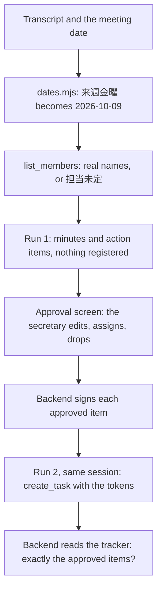
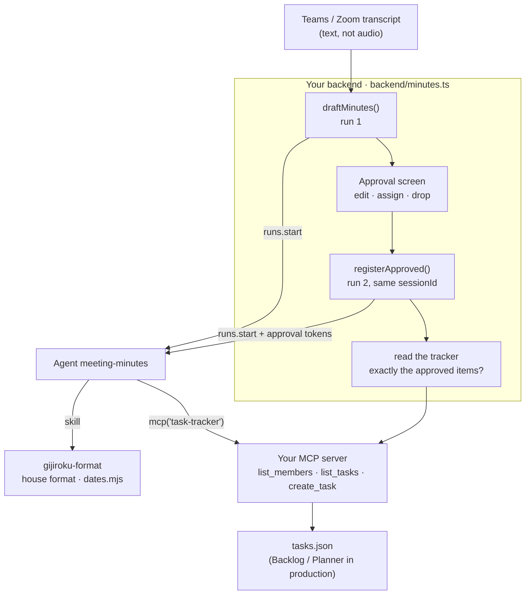

<Info>
**You will build:** an agent that turns a meeting transcript into 議事録 in the house format, resolves relative deadlines to real dates, and registers action items in your tracker only after a person approves them.

**You will learn:** a skill with a date script ([Skills](/building/skills)), a write tool in your own MCP server guarded by approval tokens ([MCP servers](/building/mcp-servers)), the stored policy that pre-approves `run_skill_script` ([Design an agent](/building/agents)), a person's approval between two runs of one session ([Integrate a backend](/building/backend)), a full-page surface ([Embed an agent](/building/embedding)), and evals ([Evaluations](/guides/evaluations)).

**Time and prerequisites:** about 45 minutes to read; the tests behind it run offline with no API key. To run it on your own workspace, finish [chapter 1](/path/first-agent) first (a project answering under `aw dev`), and have a model key and Node to start the tracker server. Advanced.

</Info>

**議事録・アクション管理エージェント.** After the production meeting, the section secretary hands the
agent the Teams transcript: speaker-labelled lines with timestamps. The agent writes the 議事録
in the company format (会議名, 日時, 場所, 出席者 with 敬称, 議題, 決定事項, 継続課題, アクション項目
with 担当 and 期限). It turns 「来週の金曜くらいまでに」 into `2026-10-09`, and writes 担当未定
when nobody took an item. The secretary checks the items, fixes a deadline, assigns the unowned
one, and approves. Only then are the tasks created in the tracker.

Minutes are one of the first jobs Japanese companies give to an in-house AI assistant.
Panasonic Connect reports that its ConnectAI assistant saved 788,000 working hours in FY2025,
twice the year before. Meeting transcription is one of the specialised uses behind that number,
and the company says the next step is moving from asking AI questions to handing it whole tasks
connected to business systems
([Panasonic Connect, 2026](https://news.panasonic.com/jp/press/jn260729-1)). Handing over a
task that writes to a system is only acceptable when a person approves what gets written, and
when nobody is ever named as an owner on a guess. This tutorial is built around those two rules.

Every test behind this page runs offline, with no API key.

## How the agent works

From the request to the person who decides, with the tools, skills and checks in between:



## What you build



| Piece | File | SDK |
| --- | --- | --- |
| The agent | `agents/meeting-minutes.ts`, `agents/meeting-minutes.md` | `defineAgent`, `mcp`, `skill`, `files` |
| House format and date rules | `skills/gijiroku-format/SKILL.md` | `aw.skills.import` (via `aw dev`) |
| Relative dates to YYYY-MM-DD | `skills/gijiroku-format/scripts/dates.mjs` | runs with `runCommands` |
| The task tracker | `mcp/tasks.mjs`, `mcp/approval.mjs` | an `http` connector in `agent-workspace.yaml` |
| The minutes page | `surfaces/minutes.ts` | `defineSurface`, `layout: 'page'` |
| What "good" means | `evals/meeting-minutes.yaml` | `aw eval`, `policy.promotion.minEvalScore` |
| Draft, approve, register | `backend/minutes.ts` | `runs.start` with `sessionId`, `runs.follow` |
| Sample transcripts | `data/transcripts/*.txt`, `*.vtt`, `data/members.json` | |

## 1. Write the house format as a skill

The format is company knowledge, so it is a skill that the general affairs department can
change without touching the agent. The skill fixes the headings and the order, and it adds a
machine-readable copy of the action items that the backend reads:

````md title="skills/gijiroku-format/SKILL.md (excerpt) (illustrative)" claim="illustrative"
## アクション項目

| No. | 内容 | 担当 | 期限 | 根拠（発言） |
| --- | --- | --- | --- | --- |
| 1 | ライン3 段取り替え試行計画の作成 | 鈴木 一郎 | 2026-10-09 | [00:03:24] 来週金曜までに出します |
| 2 | 来客対応手順の見直し | 担当未定 | 2026-11-10 | [00:05:36] 担当は次回までに決めましょう |

```json action-items
[{ "no": 1, "title": "ライン3 段取り替え試行計画の作成", "assignee": "鈴木 一郎", "due": "2026-10-09", … }]
```

## アクション項目のルール

1. **担当を作らない。** 発言の中で本人が引き受けたか、指名されて了承したときだけ担当を書く。
   「誰かが」「営業さんの中で」「次回決めましょう」は **担当未定** と書く。
3. 期限は **YYYY-MM-DD**。相対表現は必ずスクリプトで直す。頭の中で計算しない。
````

The skill also sets the honorific rules for 出席者. Internal attendees are written 「氏名 役職」,
and someone without a title is 「氏名 さん」. A guest is written 「会社名 氏名 様」. Names come
from the tracker's `list_members`, not from what the transcript heard (「品証さん」 is 山本
真理子).

## 2. Resolve dates with a script, not with the model

Meeting deadlines are spoken relative to the meeting: 来週金曜, 月末, 来月10日, 3営業日後. Working
these out takes calendar arithmetic. 来週 from a Friday, 3 business days across a weekend, and
the last day of November are all easy for a model to get wrong. The skill therefore runs a
dependency-free Node script against the meeting's date:

```js title="skills/gijiroku-format/scripts/dates.mjs (excerpt) (illustrative)" claim="illustrative"
const monday = addDays(start, -((start.getUTCDay() + 6) % 7));
if (text === '週明け') return formatDate(addDays(monday, 7));
if ((match = /^(今週|来週|再来週)([月火水木金土日])(曜日?)?$/u.exec(text)) !== null) {
  const offset = (WEEKDAYS.indexOf(match[2]) + 6) % 7; // Monday = 0 … Sunday = 6
  return formatDate(addDays(monday, WEEK_OFFSET[match[1]] * 7 + offset));
}
if ((match = /^(\d+)営業日後$/u.exec(text)) !== null)
  return formatDate(addBusinessDays(start, Number(match[1]), holidays));
```

```json title="illustrative" claim="illustrative"
{ "skill": "gijiroku-format", "script": "dates.mjs",
  "args": ["2026-10-02", "来週金曜", "3営業日後", "月末", "なるべく早く"] }
```

which prints:

```json title="illustrative" claim="illustrative"
[{ "expression": "来週金曜", "date": "2026-10-09" },
 { "expression": "3営業日後", "date": "2026-10-07" },
 { "expression": "月末", "date": "2026-10-31" },
 { "expression": "なるべく早く", "date": null }]
```

The conventions are written in both the script and the skill. A week starts on Monday. 月末 is
the last calendar day of the month. N営業日後 skips weekends, and an optional holiday list. An
expression the script cannot read returns `null`, which the minutes write as 期限未定. The base
date is the meeting's 日時, not the day the agent runs. The backend reads 日時 from the
transcript header and puts it in the prompt, so the agent never has to guess it.

## 3. Host the tracker as your own MCP server

`openapiTool()` reaches HTTP APIs with GET and HEAD only, and a write operation is refused
when the tool is defined (probe `openapi-write`). Creating a task in Backlog, Planner or Jira
therefore needs a tool you host. `mcp/tasks.mjs` stands in for one. It has three tools, and
`create_task` validates the task before it writes:

```js title="mcp/tasks.mjs (excerpt) (illustrative)" claim="illustrative"
if (!assignable.has(assignee)) {
  refuse(`unknown assignee "${assignee}": use a full name from list_members exactly. ` +
    'If the meeting named no owner, do not register the item; ask the person to assign it.');
}
if (!isIsoDate(due)) refuse(`due must be a real date written YYYY-MM-DD, got "${due}"`);
if (APPROVAL_SECRET === undefined || APPROVAL_SECRET === '') {
  refuse('this tracker accepts no writes: APPROVAL_SECRET is not configured');
}
if (!verifyApproval(APPROVAL_SECRET, { sourceMeeting, title, assignee, due }, args.approval)) {
  refuse('not approved: create_task needs the approval token the backend issued for exactly this …');
}
```

The tracker refuses 担当未定, 「鈴木さん」, the guest 木村 浩二, `来週金曜` and `2026-02-30`.
Registering the same meeting, title and assignee a second time returns the existing task with
`created: false`. `runs.start` has no idempotency key (probe `run-start-idempotency`), so a
retried run must not be able to create a task twice.

**The approval token is what makes "confirm first" enforceable.** Telling the agent "do not
call `create_task` while drafting" is an instruction, and a model can ignore an instruction. The
backend signs each approved item with an HMAC over the meeting, title, assignee and due date
(`mcp/approval.mjs`),
using a secret the tracker server also holds and the model never sees. A draft run has no
tokens, so it cannot register anything. An approved item that the model edits on its way in no
longer matches its token. The server fails closed: without `APPROVAL_SECRET` it accepts no
writes at all.

## 4. Define the agent and the page

```ts title="agents/meeting-minutes.ts" file="tests/gallery/meeting-minutes/agents/meeting-minutes.ts"
import { defineAgent, files, mcp, skill } from '@indx-workspace/sdk/define';

export default defineAgent({
  name: 'meeting-minutes',
  instructions: { file: './meeting-minutes.md' },
  model: 'default',
  // A run is unattended: without autoApprove the SDK stops the skill script's call on an approval prompt.
  engine: { id: 'claude-agent-sdk', autoApprove: ['mcp__agent-workspace__run_skill_script'] },
  // runCommands offers run_skill_script, which runs the skill's date script; the agent writes no files. It can call create_task,
  // but the tracker accepts a write only with an approval token the backend issues (mcp/approval.mjs).
  permissions: { readFiles: true, runCommands: true },
  tools: [mcp('task-tracker')],
  skills: [skill('gijiroku-format')],
  files: [files('transcripts', 'read')],
  limits: { maxTurns: 20, maxBudgetUsd: 0.5 },
});
```

The instructions (`agents/meeting-minutes.md`) describe two kinds of request. A draft request
(「議事録の下書きを作成してください」) must never call `create_task` and ends by asking for
approval. A registration request (「承認済みのアクション項目を登録してください」) registers only the
items in its JSON, with the values copied character for character.

```ts title="surfaces/minutes.ts (excerpt) (illustrative)" claim="illustrative"
export default defineSurface({
  name: 'minutes',
  agent: 'meeting-minutes',
  title: '議事録作成',
  layout: 'page',
  parts: {
    greeting: '会議の文字起こし（Teams / Zoom）を貼り付けるか、transcripts/ のファイル名を指定してください。…',
    disclaimer: 'ここで作るのは下書きです。タスクの登録は、承認画面で担当と期限を確認したあとに行われます。',
    toolTrace: 'collapsed',
    history: true,
    feedback: true,
  },
});
```

<Note>
  This surface sets no `toolResults`. The widget matches a `toolResults` key against the tool's
  name in the run exactly, and a Claude run names an MCP tool `mcp__<connector-name>__<tool>`, or
  `mcp__connector-<uuid>__<tool>` when the name is not a usable slug: the UUID form differs in every
  workspace and passes the 64 characters a key may have once the tool's own name passes 11 (probe
  `surface-mcp-tool-results`). Tool output shows in the tool trace instead.
</Note>

The page at `/p/s/minutes` is where people draft and read minutes. It cannot register tasks,
even if a visitor types 「登録して」, because the chat has no approval tokens. Registration goes
through the approval screen, which is your own and is described in the next step.

## 5. Draft, approve, register: two runs

A run cannot stop half-way for a person to approve and then carry on. There is no paused
status and no approval policy (probe `run-approval`). The confirmation therefore sits *between*
two runs of the same conversation:

```ts title="backend/minutes.ts (excerpt) (illustrative)" claim="illustrative"
export async function draftMinutes(aw, agentId, transcript): Promise<Draft> {
  const meeting = readMeeting(transcript); // 会議名 and 日時 from the header
  const prompt = [
    `議事録の下書きを作成してください。会議日（相対日付の基準日）: ${meeting.date}`,
    `sourceMeeting: ${meeting.sourceMeeting}`, '--- 文字起こし ---', transcript,
  ].join('\n');
  const reading = await runAndRead(aw, agentId, { prompt });
  const writes = reading.toolCalls.filter((call) => toolIs(call.name, 'create_task'));
  if (writes.length > 0) throw new DraftWroteToTracker(writes);
  checkFormat(reading.answer);                       // every required field and heading
  const { items, from } = parseActionItems(reading.answer);
  return { meeting, minutes: reading.answer, items, itemsFrom: from,
           unassigned: items.filter((item) => item.assignee === '担当未定'), …,
           sessionId: reading.run.sessionId };
}
```

Your approval screen shows `draft.items` and highlights `unassigned` and `undated`. The person
edits a deadline, assigns an owner, or drops an item. Then:

```ts title="backend/minutes.ts (excerpt) (illustrative)" claim="illustrative"
export async function registerApproved(aw, agentId, { draft, approved, secret, readTracker }) {
  checkApproved(approved); // no 担当未定, real YYYY-MM-DD, no repeats — before any run
  const signed = approved.map((item) => ({
    ...item, sourceMeeting, approval: approvalToken(secret, { ...item, sourceMeeting }),
  }));
  const reading = await runAndRead(aw, agentId, { prompt: …signed…, sessionId: draft.sessionId });
  const tasks = await readTracker(sourceMeeting);    // the tracker, not the agent's report
  const missing = approved.filter((item) => !held.has(keyOf(item)));
  const unexpected = tasks.filter((task) => !wanted.has(keyOf(task)));
  return { status: missing.length === 0 && unexpected.length === 0 ? 'registered' : 'mismatch', … };
}
```

The backend has three guards, and each one has a test:

- **The draft is refused if run 1 called `create_task`**, whether or not the tracker accepted
  the call. The test's model registers an item "helpfully" while drafting. The tracker refuses
  it because there is no token, and `draftMinutes` throws `DraftWroteToTracker`.
- **An unowned item cannot be approved.** `registerApproved` throws `ApprovalRejected` before
  any run starts.
- **The result reflects the tracker, not the agent's report.** In the test, a misbehaving
  second run changes a date and adds an item nobody approved. The tracker refuses both writes.
  The agent still says 「登録しました。」, and the backend reports `mismatch`, with the approved
  item listed as missing.

Action items come back inside the minutes' text, because a run has no output schema (probe
`run-output-schema`). `parseActionItems` reads the fenced `json action-items` block. When the
model leaves the block out, as the scripted model does for the development meeting, it reads
the アクション項目 table instead. When both are present they must agree on every owner and date,
because the person approves what the table shows and the backend registers what the JSON says.

## 6. Say what "good" means

```yaml title="evals/meeting-minutes.yaml (excerpt)" file="tests/gallery/meeting-minutes/evals/meeting-minutes.yaml#excerpt"
  - name: 担当を推測せず担当未定と書く
    input: |
      議事録の下書きを作成してください。会議日（相対日付の基準日）: 2026-10-02
      …
      [00:05:22] 佐藤 健一: 来客対応の手順、誰かが見直さないといけないですね。
      [00:05:36] 佐藤 健一: 担当は次回までに決めましょう。見直しは来月10日までに終わらせたいです。
    expect:
      contains: ['担当未定', '2026-11-10']
  - name: 下書きではタスクを登録しない
    …
    expect:
      contains: ['2026-10-06', '承認してください']
      notContains: ['TASK-', '登録しました']
```

The four cases cover a resolved 来週金曜, 担当未定 rather than a guessed owner, no registration
during a draft, and a judged rubric for decisions against open issues and for 様 on a guest.

## 7. Run it

<Steps>
  <Step title="Offline, in the test suite">
    Ten tests, no API key. They load the project through the contract `aw check` applies, run
    the date script as a command, drive the real tracker server against a temporary JSON
    file, and run both meetings through the two-run flow on a scripted workspace. In that
    workspace every tool result comes from the real server and every date from the real
    script.
  </Step>
  <Step title="On your workspace">
    ```sh title="illustrative" claim="illustrative"
    export APPROVAL_SECRET=$(openssl rand -hex 32)   # your backend signs with the same value
    MCP_TRANSPORT=http PORT=8788 TASKS_FILE=./tasks.json node mcp/tasks.mjs &
    aw dev                     # keeps the connector and the skill in step
    aw files upload transcripts/2026-10-02_生産会議.txt data/transcripts/2026-10-02_生産会議.txt
    aw push --yes
    ```
    The grant on `transcripts` resolves once a file is uploaded into it, so the folder needs no `aw files mkdir`. If `aw dev` refused the agent with `agent_definition_references_missing [file:transcripts]` before the upload, `aw push --yes` syncs it, and so does saving the agent file again.
  </Step>
  <Step title="Check that the run may execute the date script">
    `runCommands: true` offers `run_skill_script`, which runs the date script with no shell,
    beside the read-only grant on `transcripts`. A run is unattended, so the agent declares
    `autoApprove: ['mcp__agent-workspace__run_skill_script']` in its `engine` setting; `aw push`
    stores it in the policy (`tools.autoApprove`). `Bash` stays denied under the read-only grant.
  </Step>
  <Step title="Evaluate">
    ```sh title="illustrative" claim="illustrative"
    aw eval meeting-minutes    # the four cases, on a real model
    ```
  </Step>
</Steps>

## Where the SDK stands

This table is generated from the use case's benchmark and checked by the gallery's tests.

{/* benchmark:start */}

Score: **45 / 100** (✅ = 1, 🟡 = 0.5, ❌ = 0, over the capabilities this use case needs).

| Capability | Today | Evidence | What it means for you |
| --- | --- | --- | --- |
| Agent as code | 🟡 | contract | The agent, skill, file grant and page surface pass the contract offline, and the agent calls the date script through `run_skill_script`, which runs beside the read-only grant on `transcripts` and is pre-approved in `autoApprove`. |
| Document parsing | ❌ | probe | A run that holds a read-only file grant has no shell, so the date script runs through `run_skill_script` instead. A run also takes no audio or attachments: transcribe in Teams or Zoom and pass the text in the prompt (up to 100,000 characters) or as a granted file. |
| Structured output | ❌ | probe | Action items come back inside the minutes; the backend reads a fenced `json action-items` block, falls back to the table, and refuses the draft when the two disagree. |
| Human approval | 🟡 | contract | A run cannot pause for approval (probe `run-approval`): run 1 drafts, the person approves in your UI, run 2 in the same session registers, and an approval token makes the tracker refuse anything else. |
| Write to systems | 🟡 | contract | openapiTool is read-only (probe `openapi-write`), so the tracker is your own MCP server that validates owner, date and approval before it writes. |
| Triggers | ❌ | probe | Nothing starts a run when a meeting ends; your backend listens for the transcript (Graph or Zoom webhook) and calls runs.start. |
| Per-user scope | 🟡 | source | The tracker connector holds one credential per agent, so every task is created by the agent; record who approved it in your backend. |
| Embedded UI | 🟡 | probe | defineSurface publishes a full-page minutes screen with history; the tracker tools cannot render as tables (`toolResults` cannot name an MCP tool), and the approval screen is your own. |
| Evals | ✅ | contract | Four cases pin resolved dates, 担当未定, no registration during a draft, and honorifics (judged), with a 0.9 promotion bar. |
| Audit and cost | ✅ | source | Both runs record tokens and cost under one session, and each create_task call is in the run’s event stream. |

{/* benchmark:end */}

**Verdict: buildable today, with your own approval step.** The agent drafts good minutes from a
transcript. Everything around the confirmation is your code: the approval screen, the second
run, the approval token, the tracker server, and the read-back. That is about 300 lines here.
Nothing starts the flow when a meeting ends, and nothing takes audio. What would remove code
from this page:

- **A run that pauses for approval** (probe `run-approval`) would turn the two runs and the
  token into one run with a reviewed `create_task` call.
- **Structured output** (probe `run-output-schema`) would replace the JSON-block and table
  parsing with typed action items.
- **An approvable write tool**, such as `openapiTool` with POST behind an approval (probe
  `openapi-write`), would replace the tracker server with Backlog's own API.
- **A trigger** (probe `inbound-trigger`) would start the draft from the Teams or Zoom
  "transcript ready" event instead of from your webhook handler.
