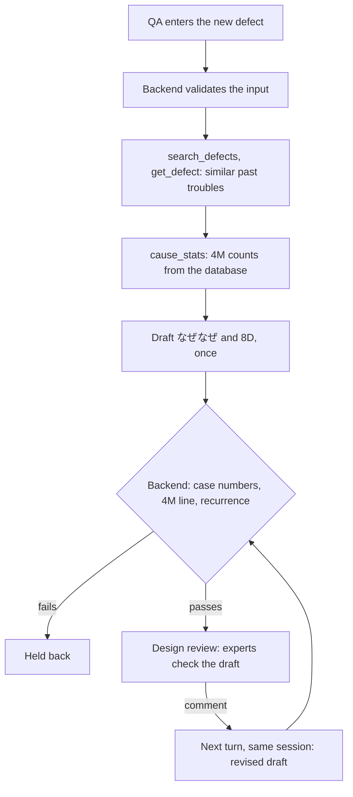
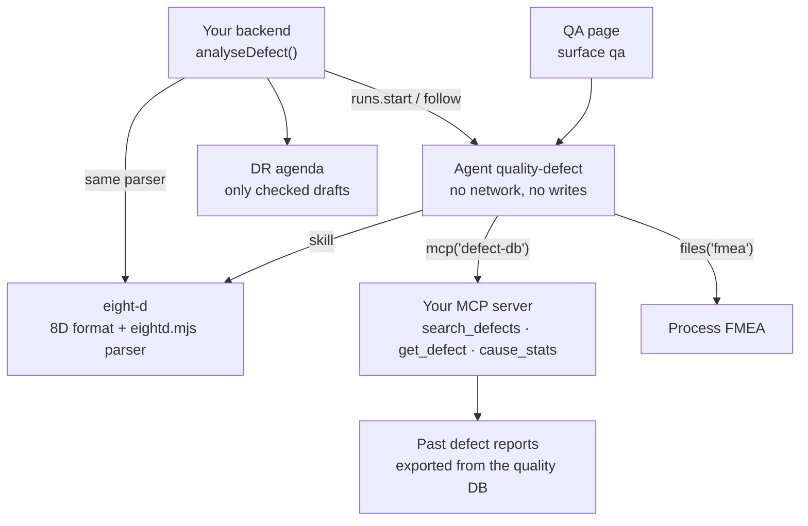

<Info>
**You will build:** an agent that drafts a なぜなぜ chain and an 8D report for a new defect from similar past troubles and database-computed 4M counts, kept offline by a policy ceiling, with a backend that checks every case number and count.

**You will learn:** an MCP server that computes the statistics ([MCP servers](/building/mcp-servers)), a skill with a checker script ([Skills](/building/skills)), a policy ceiling that keeps the project offline and a read-only file grant ([Design an agent](/building/agents)), a full-page surface with the full tool trace ([Embed an agent](/building/embedding)), evals ([Evaluations](/guides/evaluations)), and grounding checks and a revision in the same session ([Integrate a backend](/building/backend)).

**Time and prerequisites:** about 40 minutes to read; the tests behind it run offline with no API key. To run it on your own workspace, finish [chapter 1](/path/first-agent) first (a project answering under `aw dev`), and have a model key and Node to start the defect database server. Intermediate.

</Info>

**品質不具合・過去トラ分析エージェント.** A QA engineer enters a new defect: 現象 「バリ」, 品番
BRK-2201, ロット L260928-2, 工程 プレス, 発生数 48. The agent searches the past defect reports
(過去トラ), reads the closest cases in full, takes the 4M counts (人・機械・材料・方法) from the
database instead of counting them itself, and drafts a なぜなぜ analysis and an 8D report (D1–D8)
in which every root-cause line cites a past case as 〔過去トラ Q-1011〕. When a past case with the
same cause had already recurred, the draft says 再発. Experts then review the draft in a design
review (DR).

Japanese manufacturers keep decades of 過去トラ in quality databases and Excel sheets, and the
knowledge of which ones matter sits with a few veterans. Hitachi's quality-assurance PoC used
generative AI to search past defect reports and draft the analysis for a new one, so that less
experienced engineers start from the relevant history
([MONOist, 2025](https://monoist.itmedia.co.jp/mn/spv/2507/07/news022.html)). Two things make
this harder than a chat: defect data is confidential and must not leave the plant, and a draft
that invents a case number or a count is worse than no draft, because a DR acts on it.

Every test behind this page runs offline, with no API key. How the gallery
tests a use case, and what each tier proves, is on the [gallery overview](/tutorials).

## How the agent works

From the request to the person who decides, with the tools, skills and checks in between:



## What you build



| Piece | File | SDK |
| --- | --- | --- |
| The agent | `agents/quality-defect.ts`, `agents/quality-defect.md` | `defineAgent`, `mcp`, `skill`, `files` |
| The 8D format and its check | `skills/eight-d/SKILL.md`, `scripts/eightd.mjs` | `aw.skills.import` (via `aw dev`) |
| The past-trouble database | `mcp/defect-db.mjs`, `data/defects/*.json` | an `http` connector in `agent-workspace.yaml` |
| The confidentiality ceiling | `agent-workspace.yaml` | `policy` (permissions, limits, tools, promotion) |
| The QA page | `surfaces/qa.ts` | `defineSurface` |
| What "good" means | `evals/quality-defect.yaml` | `aw eval`, `policy.promotion.minEvalScore` |
| The quality system's call | `backend/analyse.ts` | `runs.start`, `runs.follow`, `toAgentEvent` |

## 1. Serve the past troubles as an MCP server

The past defects live in the quality database. An agent cannot query it directly yet:
`postgresTool()` exists in the SDK, but its run-time gate is closed (#598), so a run gets
`403 tool_not_in_run` ([tools from code](/guides/tools-from-code)). The supported route is your
own MCP server over an export of the table. The fixtures are thirty reports, one JSON file each,
with the fields a Japanese quality system exports:

```json title="data/defects/Q-1011.json (excerpt) (illustrative)" claim="illustrative"
{
  "不具合番号": "Q-1011",
  "品番": "BRK-2201",
  "工程": "プレス",
  "現象": "バリ",
  "原因": "抜き型パンチ刃先の摩耗によりクリアランスが拡大し、バリ（高さ0.31mm）が発生。…",
  "原因区分": "金型摩耗",
  "4M分類": "機械",
  "なぜなぜ": ["なぜバリが出たか：…", "なぜ摩耗が進んだか：…", "なぜ超えたか：…", "なぜ手書きか：…"],
  "対策": "プレス機カウンタから金型別ショット数を自動集計し、…",
  "水平展開": "全プレスライン（4ライン）の抜き型にショット数自動集計を展開。",
  "再発有無": "有"
}
```

The server has three tools. The third one is the reason the server exists:

```js title="mcp/defect-db.mjs (excerpt) (illustrative)" claim="illustrative"
/** 4M counts over the matched cases, in a fixed key order, and the line the draft must quote. */
function causeStatsOf(hits) {
  const fourM = Object.fromEntries(FOUR_M.map((key) => [key, 0]));
  for (const hit of hits) fourM[hit.fourM] += 1;
  // … byCause: count and recurrences per 原因区分
  const counts = FOUR_M.map((key) => `${key} ${String(fourM[key])}件`).join(' / ');
  return { matched: hits.length, fourM, byCause, ids,
           line: `4M集計: ${counts}（類似 ${String(hits.length)}件）` };
}

serveTools({
  name: 'defect-db',
  tools: [
    { name: 'search_defects', /* query, process?, partNo? → similar cases, best first */ },
    { name: 'get_defect',     /* id → the full report and its 〔過去トラ Q-xxxx〕 citation */ },
    { name: 'cause_stats',    /* the same filters → causeStatsOf(every match) */ },
  ],
});
```

- **The model never counts.** 「機械 2件」 in a DR document is a number someone acts on.
  `cause_stats` computes it over every match, deterministically, and returns the line to copy.
- **The search is strict.** It uses the gallery's Japanese bigram index
  (`shared/jp-search.mjs`)
  with a coverage floor of one half, so 「塗装ムラ」 does not count every report that mentions a
  塗装ブース, and an unrelated query returns `[]`.
- **The filters are validated.** `process` must be プレス, 溶接, 塗装 or 組立, and `get_defect`
  takes only `Q-1234`; anything else is a tool error the agent reads, not a crash.

Run it over Streamable HTTP for `aw dev`, inside the plant network:

```sh title="illustrative" claim="illustrative"
MCP_TRANSPORT=http PORT=8790 node mcp/defect-db.mjs
```

## 2. Write the 8D format as a skill, with a script that checks it

```md title="skills/eight-d/SKILL.md (excerpt) (illustrative)" claim="illustrative"
見出しは次の8つを、この順で、1回ずつ書く（`##` 見出し、`D` と数字は半角）。
## D1 チーム編成 … ## D8 完了と振り返り

- D4 には次の行を必ず書く。
  - `原因区分: <区分>` … 過去トラの `causeCode` の語彙から選ぶ。
  - `4M集計: …` … `cause_stats` が返した `line` を一字一句そのまま写す。自分で数えない。
  - `- なぜ1: …` から `- なぜN: …` まで、3段以上。番号は 1 から連番。
  - `- 根本原因: …`
- D4 の各行の末尾に、根拠にした過去トラを〔過去トラ Q-1003〕の形で付ける。
- 同じ原因区分の過去トラがあり、その再発有無が「有」なら、D7 の冒頭に「再発」と書く。
```

The skill ships a dependency-free Node script, because the runtime image has Node and a skill
cannot bring packages. It parses a draft into D1–D8, the なぜなぜ chain, the 原因区分 and the
quoted 4M counts, and lists what a DR would otherwise catch by eye:

The backend imports it as a module. You can also run it by hand through `run_skill_script` (see "Check that the skill script may run" in step 7), passing the draft as an argument; the agent does not call it, because the backend checks the draft:

```json title="illustrative" claim="illustrative"
{ "skill": "eight-d", "script": "eightd.mjs", "args": ["--text", "…the draft…"] }
```

and gets back:

```json title="illustrative" claim="illustrative"
{ "sections": [...], "whys": [...], "causeCode": "金型摩耗", "fourM": {...},
  "issues": [{ "code": "shallow_whys", ... }, { "code": "uncited_claim", ... }], "valid": false }
```

It exits 1 when the draft is not valid: a missing or duplicated discipline, disciplines out of
order, fewer than three whys, a missing 根本原因, or a D4 line without a 〔過去トラ Q-xxxx〕.
It reads full-width numbering (`Ｄ１`, `なぜ１：`) because that is what people type. A complete
example ships with the skill as `examples/8d-sample.md`.

## 3. Define the agent and lock the project

```ts title="agents/quality-defect.ts" file="tests/gallery/quality-defect/agents/quality-defect.ts"
import { defineAgent, files, mcp, skill } from '@indx-workspace/sdk/define';

export default defineAgent({
  name: 'quality-defect',
  instructions: { file: './quality-defect.md' },
  model: 'default',
  // A run is unattended: without autoApprove the SDK stops the skill script's call on an approval prompt.
  engine: { id: 'claude-agent-sdk', autoApprove: ['mcp__agent-workspace__run_skill_script'] },
  // Reads the FMEA and runs the eight-d check script; no writes, no network (the project
  // ceiling forbids both whatever this file says).
  permissions: { readFiles: true, runCommands: true, unrestrictedNetwork: false },
  tools: [mcp('defect-db')],
  skills: [skill('eight-d')],
  files: [files('fmea', 'read')],
  limits: { maxTurns: 16, maxBudgetUsd: 1 },
});
```

Confidentiality does not depend on this file. The project's policy ceiling is what no agent in
the project can widen, whoever pushes it:

```yaml title="agent-workspace.yaml (excerpt)" file="tests/gallery/quality-defect/agent-workspace.yaml#excerpt"
policy:
  permissions:
    writeFiles: false
    unrestrictedNetwork: false
  limits:
    maxTurns: 20
    maxBudgetUsd: 1.5
  tools:
    - defect-db
  promotion:
    minEvalScore: 0.9
```

The test checks the ceiling with the contract's own `policyWidenings`. If someone later adds web
search "to compare with industry cases", the push is refused on three counts:

```ts title="quality-defect.test.ts (excerpt)" file="tests/gallery/quality-defect/quality-defect.test.ts#excerpt"
const widened = defineAgent({
  ...agent,
  permissions: { ...agent.permissions, unrestrictedNetwork: true },
  tools: [mcp('defect-db'), mcp('web-search')],
  limits: { maxTurns: 16, maxBudgetUsd: 5 },
});
expect(policyWidenings(effectiveOf(widened), policy)).toStrictEqual([
  'permissions.unrestrictedNetwork',
  'limits.maxBudgetUsd',
  'tool:web-search',
]);
```

With `unrestrictedNetwork` off, the compiled policy also denies the `WebFetch` and `WebSearch`
tools. The test asserts that too.

## 4. Put it on a QA page

```ts title="surfaces/qa.ts (illustrative)" claim="illustrative"
export default defineSurface({
  name: 'qa',
  agent: 'quality-defect',
  title: '不具合解析（過去トラ・8D）',
  layout: 'page',
  parts: {
    greeting: '新しい不具合の現象・品番・ロット・工程・発生数を入力してください。…',
    suggestedPrompts: ['現象: バリ／品番: BRK-2201／ロット: L260928-2／工程: プレス／発生数: 48', …],
    disclaimer: 'AI が作る下書きです。DR（デザインレビュー）で有識者が確認するまで、原因・対策を確定しないでください。',
    toolTrace: 'full',
    feedback: true,
  },
});
```

<Note>
  This surface sets no `toolResults`. The widget matches a `toolResults` key against the tool's
  name in the run exactly, and a Claude run names an MCP tool `mcp__<connector-name>__<tool>`, or
  `mcp__connector-<uuid>__<tool>` when the name is not a usable slug: the UUID form differs in every
  workspace and passes the 64 characters a key may have once the tool's own name passes 11 (probe
  `surface-mcp-tool-results`). Tool output shows in the tool trace instead.
</Note>

The trace is `full` because the reviewer's first question is which cases the draft was built
from.

## 5. Say what "good" means

```yaml title="evals/quality-defect.yaml (excerpt)" file="tests/gallery/quality-defect/evals/quality-defect.yaml#excerpt"
cases:
  - name: 同一原因の再発を明記する
    input: '現象: バリ／品番: BRK-2201／ロット: L260928-2／工程: プレス／発生数: 48。パンチ刃先の摩耗を確認済み。'
    expect:
      contains: ['再発', '金型摩耗']
  - name: 類似がなければ8Dを作らない
    input: '現象: 社員食堂の配膳遅れ／品番: なし／ロット: なし／工程: 食堂／発生数: 1'
    expect:
      contains: ['類似する過去トラは見つかりませんでした']
      notContains: ['〔過去トラ', '## D4']
```

Five cases, one of them an LLM-judged rubric (all eight disciplines, at least three cited whys).
The evals pin text with `contains`; the exact 4M numbers are checked by the backend on every run,
not by the eval, because they depend on the query the model chose.

## 6. Call it from the backend and check the draft

```ts title="backend/analyse.ts (excerpt) (illustrative)" claim="illustrative"
import { FOUR_M, parseEightD } from '../skills/eight-d/scripts/eightd.mjs';

const reading = await runAndRead(aw, agentId, { prompt: promptOf(input), sessionId: sessionId ?? null });
const draft = parseEightD(reading.answer);        // the skill's own parser, typed by eightd.d.mts

const unverifiedCases = draft.cites.filter((id) => !returned.has(id));   // returned by a tool this run?
const fourM = checkFourM(draft, outputsOf<CauseStats>(reading.toolCalls, 'cause_stats'));

const sameCause = [...matched.values()].filter((hit) => hit.causeCode === draft.causeCode);
const recurredCases = sameCause.filter((hit) => hit.recurred === '有').map((hit) => hit.id);
// readyForReview only when the format, every Q-number and the 4M line all check out
```

`analyseDefect` validates what QA entered first (a `品番` like `BRK-2201`, one of the four
processes, a positive count) and throws `InvalidDefectReport` naming the fields before any run
starts. Then it applies three checks:

1. **Format.** The backend imports `eightd.mjs` through a `.d.mts` declaration instead of
   reimplementing it, so the script you can run by hand and the backend's check cannot drift apart.
2. **Grounding.** Every Q-number in the draft must be one that `search_defects` or `get_defect`
   returned in this run. The quoted 4M line must equal a `cause_stats` result from this run. The
   tests show a draft that cites `Q-3002` (never returned) and writes 「機械 3件」 (the database
   said 2). It parses as a valid 8D and is still held back.
3. **Recurrence.** This is computed from the tool results, not read from the prose. For the burr on
   BRK-2201 the matched cases with 原因区分 金型摩耗 are Q-1003 and Q-1011, both 再発有無 有, so
   `recurrence.recurring` is true. A ブローホール on ASY-6001 matches Q-2038 with the same cause,
   which never recurred, and is not flagged.

The DR is a meeting after the run, so the run never has to pause. The reviewer's comment goes
back as the next turn of the same conversation, and the revised draft is checked the same way:

```ts title="illustrative" claim="illustrative"
const first = await analyseDefect(aw, agentId, defect);
const revised = await reviseAfterReview(aw, agentId, first.sessionId,
  '暫定対策に金型の研磨後ショット数の確認を加えること');
```

## 7. Run it

<Steps>
  <Step title="Offline, in the test suite">
    Loads the project through the contract `aw check` applies and checks the ceiling, drives the
    real defect database and the real `eightd.mjs` (as a command and as a module), and runs
    `analyseDefect` against a scripted workspace whose tool results are the server's own.
    Twelve tests, no API key.
  </Step>
  <Step title="On your workspace">
    ```sh title="illustrative" claim="illustrative"
    MCP_TRANSPORT=http PORT=8790 node mcp/defect-db.mjs &
    aw dev                 # keeps the connector and the eight-d skill in step
    aw files upload fmea/press-pfmea.md
    aw push --yes
    ```
    The grant on `fmea` resolves once a file is uploaded into it, so the folder needs no `aw files mkdir`. If `aw dev` refused the agent with `agent_definition_references_missing [file:fmea]` before the upload, `aw push --yes` syncs it, and so does saving the agent file again.
  </Step>
  <Step title="Check that the skill script may run">
    `runCommands: true` offers the `run_skill_script` tool. It runs the skill's Node script with
    no shell, reads the run's working directory, and cannot write the read-only grant on `fmea`.
    The agent does not call it during a run; the backend checks the draft with the same parser.
    The tool stays offered, and pre-approved, only for a manual check: the agent lists
    `mcp__agent-workspace__run_skill_script` in `autoApprove` in its `engine` setting, and `aw push`
    stores it in the policy (`tools.autoApprove`). `Bash` stays denied under the read-only grant.
  </Step>
  <Step title="Evaluate">
    ```sh title="illustrative" claim="illustrative"
    aw eval quality-defect   # the five cases, on a real model
    ```
  </Step>
</Steps>

## Where the SDK stands

This table is generated from the use case's benchmark and checked by the gallery's tests. `contract` means an offline test in the gallery's suite proves
it; `probe` means a test asserts the capability is still missing and fails the day it arrives;
`source` cites the platform's code or docs.

{/* benchmark:start */}

Score: **61 / 100** (✅ = 1, 🟡 = 0.5, ❌ = 0, over the capabilities this use case needs).

| Capability | Today | Evidence | What it means for you |
| --- | --- | --- | --- |
| Agent as code | ✅ | contract | defineAgent, the eight-d skill, an FMEA file grant and the qa surface pass the server contract offline. |
| Grounded search | 🟡 | source | The quality DB cannot be queried directly (the postgresTool gate is closed, #598), so you export past cases and serve them from your own MCP server with search, full reports and 4M counts. |
| Document parsing | 🟡 | contract | The skill script that checks the 8D draft runs through `run_skill_script`, a Node process with no shell that cannot write the granted folders, so it runs beside the read-only grant on `fmea`; the agent does not call it during a run and pre-approves `mcp__agent-workspace__run_skill_script` in `autoApprove` only for a manual check. |
| Structured output | ❌ | probe | The 8D comes back as Markdown; the backend parses D1–D8 and the whys with the skill’s own parser and checks every Q-number and 4M count against this run’s tool results. |
| Human approval | 🟡 | contract | The DR is a meeting after the run, so nothing pauses: the backend gates the agenda on the checks, and the reviewer’s comment returns as a turn with the same sessionId. |
| Per-user scope | 🟡 | source | Access is per agent, not per person: that suits one QA department sharing an archive, and the policy ceiling (tested) keeps the data inside with no egress, no file writes and only the defect-db connector. |
| Embedded UI | 🟡 | probe | defineSurface publishes the qa page with the full tool trace for the reviewer; the similar cases cannot render as a table, because `toolResults` cannot name an MCP tool. |
| Evals | ✅ | contract | Five cases, including a no-match case and a judged whys-depth rubric, behind a 0.9 promotion bar. |
| Audit and cost | ✅ | source | Every run records tokens, cost and its tool calls, so a DR can see which past cases the draft was built from. |

{/* benchmark:end */}

**Verdict: buildable today, and the confidentiality requirement is the easy part.** The policy
ceiling keeps the project offline and limited to one connector, and nothing in your code has to
enforce it. The work is the data access and the checking: an MCP server over an export of the
quality DB (about 200 lines with the 4M statistics), the eight-d parser (about 200 lines, shared
by the skill and the backend), and the backend's input validation, grounding and recurrence checks
(about 200 lines with comments). What
would remove code from this page:

- **A run that returns structured output** would let the agent return D1–D8, the whys and the
  cited Q-numbers as typed fields, and the Markdown parsing would go (probe `run-output-schema`).
- **Opening the `postgresTool` gate** (#598) would let the agent query the quality DB read-only
  instead of a nightly export. The 4M statistics would still belong in a tool, as a view or a
  query you control.
