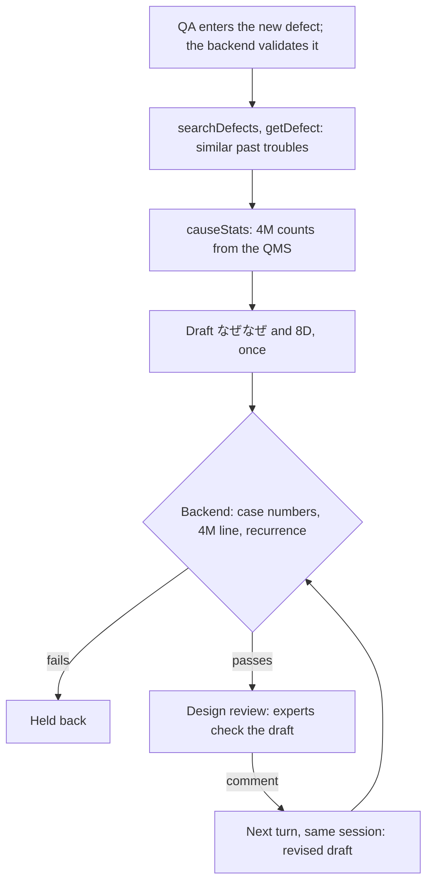
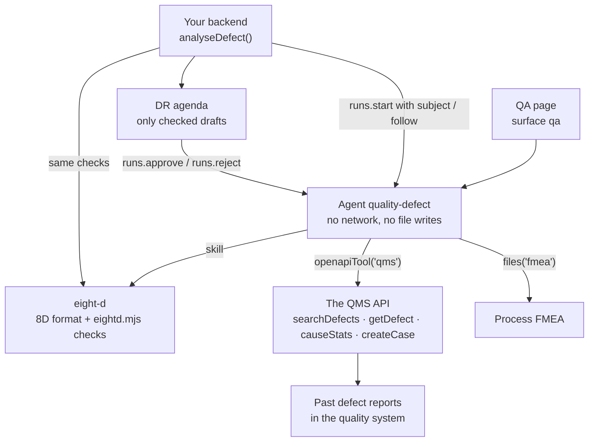

<Info>
**You will build:** an agent that drafts a なぜなぜ chain and an 8D report for a new defect from similar past troubles and database-computed 4M counts, kept offline by a policy ceiling, with a backend that checks every case number and count.

**You will learn:** reading the quality system through its API with `openapiTool()` ([Tools from code](/guides/tools-from-code)), a skill with a checker script ([Skills](/building/skills)), a policy ceiling that keeps the project offline and a read-only file grant ([Design an agent](/building/agents)), a full-page surface with the full tool trace ([Embed an agent](/building/embedding)), evals ([Evaluations](/guides/evaluations)), and grounding checks plus a DR approval that registers the case ([Integrate a backend](/building/backend)).

**Time and prerequisites:** about 40 minutes to read; the tests behind it run offline with no API key. To run it on your own workspace, finish [chapter 1](/path/first-agent) first (a project answering under `aw dev`), and have a model key and the quality system's API token (or Node, to run the bundled stand-in); then allow time to upload the FMEA file, run `aw push` and run `aw eval`. Intermediate.

</Info>

## The result

<Frame caption="The QA engineer enters 「現象: バリ／品番: BRK-2201／ロット: L260928-2／工程: プレス／発生数: 48」 and the agent drafts a cited なぜなぜ chain and 8D report."></Frame>

**品質不具合・過去トラ分析エージェント.** A QA engineer enters a new defect: 現象 「バリ」, 品番
BRK-2201, ロット L260928-2, 工程 プレス, 発生数 48. The agent searches the past defect reports
(過去トラ), reads the closest cases in full, takes the 4M counts (人・機械・材料・方法) from the
database instead of counting them itself, and drafts a なぜなぜ analysis and an 8D report (D1–D8)
in which every root-cause line cites a past case as 〔過去トラ Q-1011〕. When a past case with the
same cause had already recurred, the draft says 再発. Experts then review the draft in a design
review (DR).

## Why it is worth building

Japanese manufacturers keep decades of 過去トラ in quality databases and Excel sheets, and the
knowledge of which ones matter sits with a few veterans. Hitachi's quality-assurance PoC used
generative AI to search past defect reports and draft the analysis for a new one, so that less
experienced engineers start from the relevant history
([MONOist, 2025](https://monoist.itmedia.co.jp/mn/spv/2507/07/news022.html)). Two things make
this harder than a chat: defect data is confidential and must not leave the plant, and a draft
that invents a case number or a count is worse than no draft, because a DR acts on it.

## How it works

From the request to the person who decides, with the tools, skills and checks in between:



The DR decides the last step, and the run waits for it. The agent ends the 8D by calling
`createCase`; that call is gated, so the run pauses on it with the report in its arguments. The
design review approves, and the same session registers the case as a new 過去トラ, or rejects with
a comment, and the agent revises the draft and pauses again.

The pieces you will write, and the SDK feature behind each:



| Piece                       | File                                                           | SDK                                                                             |
| --------------------------- | -------------------------------------------------------------- | ------------------------------------------------------------------------------- |
| The agent                   | `agents/quality-defect.ts`, `agents/quality-defect.md`         | `defineAgent`, `skill`, `files`                                                 |
| The 8D format and its check | `skills/eight-d/SKILL.md`, `scripts/eightd.mjs`                | `aw.skills.import` (via `aw dev`)                                               |
| The past-trouble API        | `tools/qms.ts`, `apis/qms.openapi.json`                        | `openapiTool` with `identity`                                                   |
| A stand-in QMS for the tests | `qms/fake-qms.mjs`, `data/defects/*.json`, `data/access.json` | `verifyIdentity`                                                                |
| The confidentiality ceiling | `agent-workspace.yaml`                                         | `policy` (permissions, limits, tools, promotion)                                |
| The QA page                 | `surfaces/qa.ts`                                               | `defineSurface`                                                                 |
| What "good" means           | `evals/quality-defect.yaml`                                    | `aw eval`, `policy.promotion.minEvalScore`                                      |
| The quality system's call   | `backend/analyse.ts`                                           | `runs.start` with `subject`, `runs.approve`, `runs.reject`                      |

## Before you start

Before you read on, check that:

- you finished [chapter 1](/path/first-agent), so a project answers under `aw dev`
- you have a model key and the quality system's API token (or Node, to run the bundled stand-in)
- you know the defect data is confidential: the project has no network access, and the steps keep it that way
- optionally, you read [how the gallery tests a use case](/tutorials)

**Getting the code.** The files below are the use case's project folder, `tests/gallery/quality-defect/`, in the Agent Workspace repository. Paths in the tables and code titles are relative to that folder, and a code block that names a file there is an exact copy of it. You can follow the tutorial by reading alone, or by running its offline tests; to run the agent yourself, copy the folder's files into the project you created in chapter 1.


Every test behind this page runs offline, with no API key. How the gallery
tests a use case, and what each tier proves, is on the [gallery overview](/tutorials).

## Build it

<Steps>
<Step title="1. Read the past troubles through the QMS API">

The past defects live in the company's quality management system (QMS), which exposes them over a
REST API described by an OpenAPI document. The agent does not need a server of your own: with
`openapiTool()` the platform's tool gateway reads the document and exposes the operations you allow
([tools from code](/guides/tools-from-code)). The document (`apis/qms.openapi.json`) has four
operations: `GET /defects` (`searchDefects`, query `q` with optional `process` and `partNo`),
`GET /defects/stats` (`causeStats`, the same filters and `groupBy=4m`), `GET /defects/{qNo}`
(`getDefect`) and `POST /defects` (`createCase`, the one write). The QMS holds thirty reports, one
record each, with the fields a Japanese quality system exports:

```json title="data/defects/Q-1011.json (excerpt) (illustrative)" claim="illustrative"
{
  "不具合番号": "Q-1011",
  "品番": "BRK-2201",
  "工程": "プレス",
  "現象": "バリ",
  "原因": "抜き型パンチ刃先の摩耗によりクリアランスが拡大し、バリ（高さ0.31mm）が発生。…",
  "原因区分": "金型摩耗",
  "4M分類": "機械",
  "なぜなぜ": ["なぜバリが出たか：…", "なぜ摩耗が進んだか：…", "なぜ超えたか：…", "なぜ手書きか：…"],
  "対策": "プレス機カウンタから金型別ショット数を自動集計し、…",
  "水平展開": "全プレスライン（4ライン）の抜き型にショット数自動集計を展開。",
  "再発有無": "有"
}
```

```ts title="tools/qms.ts (excerpt)" file="tests/gallery/quality-defect/tools/qms.ts#excerpt"
import { openapiTool, secret } from '@indx-workspace/sdk/define';
…
export const qms = openapiTool({
  name: 'qms',
  spec: 'apis/qms.openapi.json',
  auth: secret('QMS_TOKEN'),
  identity: secret('QMS_IDENTITY_SECRET'),
  allow: ['GET /defects', 'GET /defects/*', 'operationId:createCase'],
});
```

`auth` is the agent's credential for the QMS; the gateway adds it to each call, so the token never
enters the run. `allow` admits the two reads and, by its operation id, the one write. A glob `*` is
exactly one path segment, so `GET /defects/*` covers both `/defects/stats` and `/defects/{qNo}`.
Each admitted operation becomes a tool named by its `operationId`.

- **The model never counts.** 「機械 2件」 in a DR document is a number someone acts on.
  `causeStats` computes it over every match, deterministically, and returns the line to copy.
- **The search is strict.** The stand-in QMS uses the gallery's Japanese bigram index
  (`shared/jp-search.mjs`) with a coverage floor of one half, so 「塗装ムラ」 does not count every
  report that mentions a 塗装ブース, and an unrelated query returns `noMatch: true` with the
  sentence to paste.
- **The filters are validated.** `process` must be プレス, 溶接, 塗装 or 組立, and `getDefect`
  takes only `Q-1234`; anything else is an error the agent reads, not a crash.
- **The QMS knows who is asking.** The tool opts in with `identity`, so each call carries a signed
  assertion of the person who entered the defect ([Caller identity](/guides/caller-identity)). The
  QMS verifies it with `verifyIdentity`, and `data/access.json` maps that person to the 工程 whose
  cases they may see. Another 工程's cases are not searched, not counted in `causeStats` and not
  returned by `getDefect`, which refuses them in the same words as a case that does not exist.
  So the 4M counts a draft quotes are over what that person may see, and a case number typed into
  the prompt opens nothing.

The tests cannot reach the company's QMS, so they start a stand-in with the same contract
(`qms/fake-qms.mjs`). It checks the bearer token first, then the assertion:

```js title="qms/fake-qms.mjs (excerpt)" file="tests/gallery/quality-defect/qms/fake-qms.mjs#excerpt"
if (request.headers.authorization !== `Bearer ${token}`) {
…
const caller = await verifyIdentity(
  request.headers[IDENTITY_ASSERTION_HEADER] ?? '',
  identity.key,
…
if (!caller.ok) {
  send(401, { code: caller.code });
…
const { processes } = access[caller.payload.sub];
```

On your workspace, create the signing secret with `aw secrets set QMS_IDENTITY_SECRET` and start
`aw dev` with the API token (see Run it). The project has no MCP connector and ships no MCP server.

**Check:** `searchDefects`, `getDefect` and `causeStats` run against the thirty fixtures through the tool gateway, `causeStats` returns the `4M集計:` line to copy, and a person who may see only プレス gets no case of another 工程.

</Step>
<Step title="2. Write the 8D format as a skill with a checker">

```md title="skills/eight-d/SKILL.md (excerpt) (illustrative)" claim="illustrative"
見出しは次の8つを、この順で、1回ずつ書く（`##` 見出し、`D` と数字は半角）。
## D1 チーム編成 … ## D8 完了と振り返り

- D4 には次の行を必ず書く。
  - `原因区分: <区分>` … 過去トラの `causeCode` の語彙から選ぶ。
  - `4M集計: …` … `causeStats` が返した `line` を一字一句そのまま写す。自分で数えない。
  - `- なぜ1: …` から `- なぜN: …` まで、3段以上。番号は 1 から連番。
  - `- 根本原因: …`
- D4 の各行の末尾に、根拠にした過去トラを〔過去トラ Q-1003〕の形で付ける。
- 同じ原因区分の過去トラがあり、その再発有無が「有」なら、D7 の冒頭に「再発」と書く。
```

The skill ships a dependency-free Node script, because the runtime image has Node and a skill
cannot bring packages. It reads a draft into D1–D8, the なぜなぜ chain, the 原因区分 and the
quoted 4M counts (`parseEightD`), and lists what a DR would otherwise catch by eye (`checkEightD`,
which `parseEightD` ends with):

The backend imports `checkEightD` as a module and runs it on the structure a run returns. You can also run it by hand through `run_skill_script` (see "Check that the skill script may run" in the Run it section), passing the draft as an argument; the agent does not call it, because the backend checks the draft:

```json title="illustrative" claim="illustrative"
{ "skill": "eight-d", "script": "eightd.mjs", "args": ["--text", "…the draft…"] }
```

and gets back:

```json title="illustrative" claim="illustrative"
{ "sections": [...], "whys": [...], "causeCode": "金型摩耗", "fourM": {...},
  "issues": [{ "code": "shallow_whys", ... }, { "code": "uncited_claim", ... }], "valid": false }
```

It exits 1 when the draft is not valid: a missing or duplicated discipline, disciplines out of
order, fewer than three whys, a missing 根本原因, or a D4 line without a 〔過去トラ Q-xxxx〕.
It reads full-width numbering (`Ｄ１`, `なぜ１：`) because that is what people type. A complete
example ships with the skill as `examples/8d-sample.md`.

**Check:** `eightd.mjs` exits 1 for a draft with a missing discipline, fewer than three whys or a D4 line without a 〔過去トラ Q-xxxx〕.

</Step>
<Step title="3. Define the agent and lock the project">

```ts title="agents/quality-defect.ts" file="tests/gallery/quality-defect/agents/quality-defect.ts"
import { builtinSkill, defineAgent, files, skill } from '@indx-workspace/sdk/define';

import { qms } from '../tools/qms.ts';

export default defineAgent({
  name: 'quality-defect',
  instructions: { file: './quality-defect.md' },
  model: 'default',
  // A run is unattended: the agent runs office-reader on the FMEA workbook without a prompt. It
  // does not run the eight-d check script itself; that is the backend's, and a manual check only.
  // The 8D ends (D8) by registering the case as a 過去トラ, and the DR decides that: `createCase` is
  // the QMS tool's one write, so it is implicitly gated (ADR-0145) and the run waits there for an
  // approval; nothing is registered before. Every other tool is a read.
  engine: {
    id: 'claude-agent-sdk',
    autoApprove: ['mcp__agent-workspace__run_skill_script'],
  },
  // Reads the FMEA workbook (.xlsx) with office-reader; runCommands offers run_skill_script for
  // that. No file writes, no network (the project ceiling forbids both whatever this file says);
  // `createCase` is a QMS write, not a file write.
  permissions: { readFiles: true, runCommands: true, unrestrictedNetwork: false },
  tools: [qms],
  skills: [builtinSkill('office-reader'), skill('eight-d')],
  files: [files('fmea', 'read')],
  limits: { maxTurns: 16, maxBudgetUsd: 1 },
});
```

Confidentiality does not depend on this file. The project's policy ceiling is what no agent in
the project can widen, whoever pushes it:

```yaml title="agent-workspace.yaml (excerpt)" file="tests/gallery/quality-defect/agent-workspace.yaml#excerpt"
policy:
  permissions:
    writeFiles: false
    unrestrictedNetwork: false
  limits:
    maxTurns: 20
    maxBudgetUsd: 1.5
  tools: [qms]
  promotion:
    minEvalScore: 0.9
```

The test checks the ceiling with the contract's own `policyWidenings`. If someone later adds web
search "to compare with industry cases", the push is refused on three counts:

```ts title="quality-defect.test.ts (excerpt)" file="tests/gallery/quality-defect/quality-defect.test.ts#excerpt"
const widened = defineAgent({
  ...agent,
  permissions: { ...agent.permissions, unrestrictedNetwork: true },
  tools: [qmsTool, mcp('web-search')],
  limits: { maxTurns: 16, maxBudgetUsd: 5 },
});
expect(policyWidenings(effectiveOf(widened), policy)).toStrictEqual([
  'permissions.unrestrictedNetwork',
  'limits.maxBudgetUsd',
  'tool:web-search',
]);
```

With `unrestrictedNetwork` off, the compiled policy also denies the `WebFetch` and `WebSearch`
tools. The test asserts that too. The agent still has no file write (`writeFiles` is off); its one
write is `createCase`, which the QMS tool admits by its operation id and so gates by itself
(a write admitted by `operationId:` is implicitly `requireApproval`): the test asserts the
compiled policy gates exactly that call.

**Check:** widening the network, the budget and the tools makes `policyWidenings` list `permissions.unrestrictedNetwork`, `limits.maxBudgetUsd` and `tool:web-search`.

</Step>
<Step title="4. Put it on a QA page">

```ts title="surfaces/qa.ts (illustrative)" claim="illustrative"
export default defineSurface({
  name: 'qa',
  agent: 'quality-defect',
  title: '不具合解析（過去トラ・8D）',
  layout: 'page',
  parts: {
    greeting: '新しい不具合の現象・品番・ロット・工程・発生数を入力してください。…',
    suggestedPrompts: ['現象: バリ／品番: BRK-2201／ロット: L260928-2／工程: プレス／発生数: 48', …],
    disclaimer: 'AI が作る下書きです。DR（デザインレビュー）で有識者が確認するまで、原因・対策を確定しないでください。',
    toolTrace: 'full',
    feedback: true,
  },
  toolResults: { searchDefects: 'table' },
});
```

<Note>
  A `toolResults` key is the tool's bare name. The widget matches it against the tool's exact name
  in the run, or against the part after the last `__`, so `searchDefects` also matches Claude's
  `mcp__qms__searchDefects` whatever the tool is called in a workspace, and the
  similar cases render as a table.
</Note>

The trace is `full` because the reviewer's first question is which cases the draft was built
from.

**Check:** the surface shows the full tool trace, and the page carries the DR disclaimer.

</Step>
<Step title="5. Call it from the backend and check the draft">

```ts title="backend/analyse.ts (excerpt) (illustrative)" claim="illustrative"
import { checkEightD, FOUR_M } from '../skills/eight-d/scripts/eightd.mjs';

// { report, draft }: the draft is the 8D already split into D1–D8, whys, claims and the 4M line
const reading = await runAndRead(
  aw,
  agentId,
  { prompt: promptOf(input), subject, sessionId: sessionId ?? null },
  EightDAnswerSchema,
);
const draft = reading.output.draft === null ? null : checkEightD(reading.output.draft); // the skill's own checks

const unverifiedCases = (draft?.cites ?? []).filter((id) => !returned.has(id)); // returned by a tool this run?
const fourM =
  draft === null
    ? { status: 'missing' }
    : checkFourM(draft, outputsOf<CauseStats>(reading.toolCalls, 'causeStats'));

const sameCause = [...matched.values()].filter((hit) => hit.causeCode === draft?.causeCode);
const recurredCases = sameCause.filter((hit) => hit.recurred === '有').map((hit) => hit.id);
// readyForReview only when the format, every Q-number and the 4M line all check out
```

`analyseDefect(aw, agentId, input, subject, sessionId?)` validates what QA entered first (a
`品番` like `BRK-2201`, one of the four processes, a positive count) and throws
`InvalidDefectReport` naming the fields before any run starts. `subject` is the signed-in person
from the QA page's own session, passed to `runs.start`; it is never read from the report text.
Then it applies three checks:

1. **Format.** The backend imports `checkEightD` from `eightd.mjs` through a `.d.mts` declaration
   instead of reimplementing it, so the script you can run by hand and the backend's check cannot
   drift apart. The run returns the draft as typed fields (`EightDAnswerSchema`), so nothing is
   parsed out of the report's text; a similar-case search with no hit returns `draft: null` and the
   backend reports that no draft was written.
2. **Grounding.** Every Q-number in the draft must be one that `searchDefects` or `getDefect`
   returned in this run. The quoted 4M line must equal a `causeStats` result from this run. The
   tests show a draft that cites `Q-3002` (never returned) and writes 「機械 3件」 (the QMS
   said 2). It is a valid 8D and is still held back.
3. **Recurrence.** This is computed from the tool results, not read from the prose. For the burr on
   BRK-2201 the matched cases with 原因区分 金型摩耗 are Q-1003 and Q-1011, both 再発有無 有, so
   `recurrence.recurring` is true. A ブローホール on ASY-6001 matches Q-2038 with the same cause,
   which never recurred, and is not flagged.

The agent ends the 8D (D8) by calling `createCase` with the report, and that call is gated, so
the run pauses on it and nothing is registered. `analyseDefect` answers with the pause
(`status: 'awaiting_approval'`): it reads the report out of the paused call, runs the three checks
on it and returns the draft for the DR. A run that finds no similar case never registers anything,
so it ends with `status: 'ended'` and no draft. The DR then decides with `decideCase`:

```ts title="illustrative" claim="illustrative"
const awaiting = await analyseDefect(aw, agentId, defect, subject);
if (awaiting.status !== 'awaiting_approval') return;

// Approved: the continuation, in the same session and for the same person, registers the case.
const done = await decideCase(aw, awaiting, { approve: true });
// done.status === 'registered', done.caseId === 'Q-…'

// Rejected with the DR's comment: the agent revises the 8D, and it pauses again to be checked.
const revised = await decideCase(aw, awaiting, {
  approve: false,
  comment: '暫定対策に金型の研磨後ショット数の確認を加えること',
});
```

Approving a draft whose checks failed throws `DraftNotReady` with the findings, and a rejection
needs a comment (`InvalidDefectReport`). Both continuations run under the `subject` of the paused
run, so the registration is made as the person who entered the defect and the QMS checks that
person's 工程 again. `createCase` is scoped like the read tools: the press engineer cannot
register a 塗装 case. A decision is made once; deciding the same run again fails with `409
run_not_awaiting_approval`.

An approval request expires after 24 hours and then ends the run. A DR meeting that is a week
away does not fit that: keep the draft and decision on your side, and run the analysis again when
the meeting has decided (or have the DR approve in a channel that answers within a day).

**Check:** a draft that cites `Q-3002` or writes 「機械 3件」 where the QMS said 2 is held back even though it is a valid 8D.

</Step>
<Step title="6. Say what good means with evals">

```yaml title="evals/quality-defect.yaml (excerpt)" file="tests/gallery/quality-defect/evals/quality-defect.yaml#excerpt"
cases:
  - name: 同一原因の再発を明記する
    input: '現象: バリ／品番: BRK-2201／ロット: L260928-2／工程: プレス／発生数: 48。パンチ刃先の摩耗を確認済み。'
    expect:
      contains: ['再発', '金型摩耗']
  - name: 類似がなければ8Dを作らない
    input: '現象: 社員食堂の配膳遅れ／品番: なし／ロット: なし／工程: 食堂／発生数: 1'
    expect:
      contains: ['類似する過去トラは見つかりませんでした']
      notContains: ['〔過去トラ', '## D4']
```

Five cases, one of them an LLM-judged rubric (all eight disciplines, at least three cited whys).
The evals pin text with `contains`; the exact 4M numbers are checked by the backend on every run,
not by the eval, because they depend on the query the model chose.

**Check:** `aw eval quality-defect` runs five cases, including the no-match case that must not produce an 8D.

</Step>
</Steps>

## Run it

<Steps>
  <Step title="Offline, in the test suite">
    Loads the project through the contract `aw check` applies and checks the ceiling, drives the
    QMS tool through the tool gateway against a stand-in QMS and the real `eightd.mjs` (as a command
    and as a module), and runs `analyseDefect` against a scripted workspace whose tool results are
    the gateway's own. Twenty-five tests, no API key.
  </Step>
  <Step title="On your workspace">
    ```sh title="illustrative" claim="illustrative"
    aw secrets set QMS_IDENTITY_SECRET           # the platform signs the caller with it
    QMS_TOKEN=… aw dev     # keeps the QMS tool and the eight-d skill in step
    aw files upload fmea/press-pfmea.xlsx
    aw push --yes
    ```
    The grant on `fmea` resolves once a file is uploaded into it, so the folder needs no `aw files mkdir`. If `aw dev` refused the agent with `agent_definition_references_missing [file:fmea]` before the upload, `aw push --yes` syncs it, and so does saving the agent file again.
  </Step>
  <Step title="Check that the skill script may run">
    `runCommands: true` offers the `run_skill_script` tool. It runs the skill's Node script with
    no shell, reads the run's working directory, and cannot write the read-only grant on `fmea`.
    During a run the agent calls it for one thing: the built-in `office-reader` skill's
    `ooxml.mjs xlsx`, which turns `fmea/press-pfmea.xlsx` into rows. The eight-d check is not the
    agent's; the backend checks the draft with the same parser. The tool is pre-approved because
    a run is unattended: the agent lists `mcp__agent-workspace__run_skill_script` in `autoApprove`
    in its `engine` setting, and `aw push` stores it in the policy (`tools.autoApprove`). `Bash`
    stays denied under the read-only grant.
  </Step>
  <Step title="Evaluate">
    ```sh title="illustrative" claim="illustrative"
    aw eval quality-defect   # the five cases, on a real model
    ```
  </Step>
</Steps>

<Frame caption="The quality-defect agent in the console after aw push, with the eight-d skill, the qms tool and the read-only fmea grant."></Frame>

## Where the SDK stands


This table is generated from the use case's benchmark and checked by the gallery's tests. `contract` means an offline test in the gallery's suite proves
it; `probe` means a test asserts the capability is still missing and fails the day it arrives;
`source` cites the platform's code or docs.

{/* benchmark:start */}

Score: **100 / 100** (✅ = 1, 🟡 = 0.5, ❌ = 0, over the capabilities this use case needs).

| Capability | Today | Evidence | What it means for you |
| --- | --- | --- | --- |
| Agent as code | ✅ | contract | defineAgent, the eight-d skill, an FMEA file grant and the qa surface pass the server contract offline. |
| Grounded search | ✅ | contract | The cases live in the quality system, which the built-in `search_files` (files only) does not reach. The company QMS API is an `openapiTool()` (`tools/qms.ts`): `searchDefects`, `getDefect` and `causeStats` are reads scoped by the asserted subject, and `createCase` is the one write. The project ships no MCP server. |
| Document parsing | ✅ | contract | The press FMEA is the Excel sheet a quality department keeps, and the agent reads it with the built-in office-reader skill (`ooxml.mjs xlsx`) through `run_skill_script`, which the read-only grant on `fmea` allows. |
| Structured output | ✅ | contract | The 8D comes back with its D1–D8, whys and cited Q-numbers as typed fields (`runs.result` with a Zod schema); your backend runs the skill’s own checks on them and still checks every Q-number and 4M count against this run’s tool results. |
| Human approval | ✅ | contract | The DR decides the one write, `createCase`, which is implicitly gated (a write admitted by `operationId:`), so the run pauses on it with the 8D in its arguments and `analyseDefect` answers with the draft after its checks. Approving continues the same session under the same `subject` and registers the case; rejecting with the DR’s comment sends it back and the revised 8D pauses again. An approval request expires after 24 hours and then ends the run, so a DR that decides later means running the analysis again. |
| Per-user scope | ✅ | contract | The QA page starts each run with `subject: <who entered the defect>`, the QMS tool opts in with `identity`, and the QMS verifies the assertion (`verifyIdentity`) and searches, counts and reads only the processes that person may see, so the 4M counts in a draft are over what they may see. The policy ceiling (tested) still keeps the data inside with no egress, no file writes and only the `qms` tool. |
| Embedded UI | ✅ | contract | defineSurface publishes the qa page with the full tool trace for the reviewer, and the similar cases render as a table with `toolResults: { searchDefects: 'table' }`. |
| Evals | ✅ | contract | Five cases, including a no-match case and a judged whys-depth rubric, behind a 0.9 promotion bar. |
| Audit and cost | ✅ | source | Every run records tokens, cost and its tool calls, so a DR can see which past cases the draft was built from. |

{/* benchmark:end */}

**Verdict: buildable today, and the confidentiality requirement is the easy part.** The policy
ceiling keeps the project offline and limited to one connector, and nothing in your code has to
enforce it. Who sees which cases is a per-person rule the QMS applies: the platform signs
the person who entered the defect, the QMS verifies it and filters by 工程. The work is the
checking and the API: a four-operation OpenAPI document and a ten-line tool, the eight-d script
(about 200 lines, shared by the skill and the backend), and the backend's input validation,
grounding and recurrence checks (about 200 lines with comments). The 4M statistics are an
operation of the QMS API here; if yours has none, they still belong in a tool or a view you
control, never in the model.

<Card title="Back to the gallery" icon="arrow-right" href="/tutorials">
  That was the last tutorial. Pick another from the gallery, or compare where each one leaves the SDK.
</Card>
