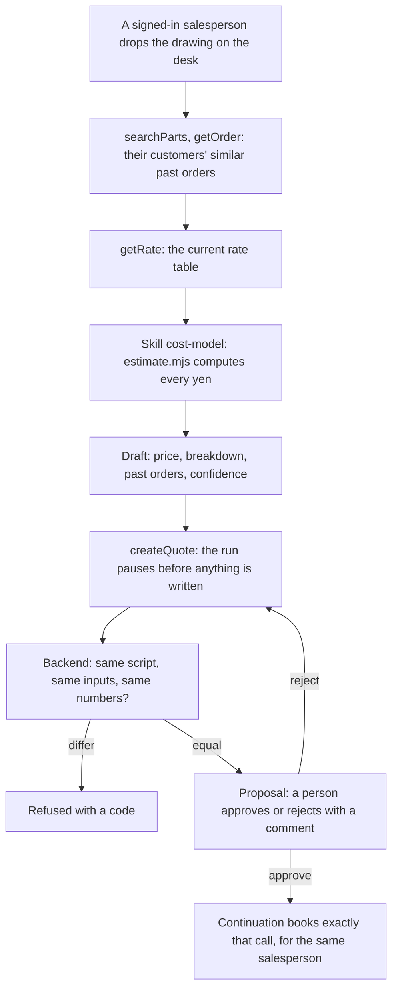
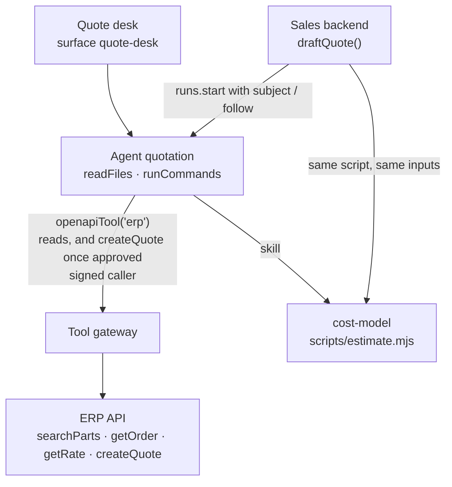

<Info>
**You will build:** an agent that drafts a sheet-metal quote from past orders and the rate table in the ERP, prices it with a cost-model script, and pauses on the booking for a person to approve, once your backend has checked that every yen is the script's.

**You will learn:** `openapiTool` over an OpenAPI document with read rules and one approved write ([Tools from code](/guides/tools-from-code)) and a `secret` credential ([Secrets](/resources/secrets)), a skill that runs a script ([Skills](/building/skills)), a policy ceiling that names the one tool ([Design an agent](/building/agents)), a full-page surface ([Embed an agent](/building/embedding)), evals that resist discount pressure ([Evaluations](/guides/evaluations)), and a backend that recomputes the numbers, then follows the run through its approval ([Integrate a backend](/building/backend)).

**Time and prerequisites:** about 40 minutes to read and about 30 minutes to run it on your workspace; the tests behind it run offline with no API key. To run it on your own workspace, finish [chapter 1](/path/first-agent) first (a project answering under `aw dev`), and have a model key and Node to start your ERP's API (or the fake one). Intermediate.

</Info>

## The result

<Frame caption="The quote desk drafting a price for the SS400 L-bracket: 50 pieces, unit price and total, breakdown and past orders.">
  
</Frame>

**見積エージェント.** Sales receives a drawing for an L-bracket: SS400, 200×100 mm, t3.2, four
φ10 holes, two bends, 50 pieces. They paste that summary into the quote desk. The agent looks up
similar parts and what the company actually charged for them in the ERP, reads the current rate
table, runs the cost model, and returns a draft: unit price and total, the breakdown (material,
cutting, bending, setup), the past orders it relied on, and a confidence level. Nothing is sent to
the customer, and the quote is booked in the ERP only by a `createQuote` call that a person approved: the same run pauses on that call, the person approves, and a continuation books it for the salesperson who asked.

Japanese job shops spend days on a quote, and the price depends on one estimator's memory of
similar jobs. CADDi's AI quotation product pulls past drawings and their actual prices to make
that memory searchable ([MONOist, 2024](https://monoist.itmedia.co.jp/mn/articles/2407/17/news040.html)),
and the Komatsu group has used AI to draft quotes for sheet-metal parts so that the estimate no
longer waits for the one person who knows ([MONOist, 2024](https://monoist.itmedia.co.jp/mn/spv/2412/20/news051.html)).
The requirement shared by both is the one this page builds around: **a price the model did not
make up.** The model looks things up and explains; a script computes every yen; and the backend
checks that the two agree.

Every test behind this page runs offline, with no API key. How the gallery tests a use
case, and what each tier proves, is on the [gallery overview](/tutorials).

## How it works

From the request to the person who decides, with the tools, skills and checks in between:



## Before you start

- [ ] You finished [chapter 1](/path/first-agent): a project answering under `aw dev`.
- [ ] A model key, only to run it on your workspace. The tests need no key.
- [ ] Node, to start your ERP's API (or the fake one).
- [ ] The code: every file on this page is in the gallery folder `tests/gallery/quotation/`, and paths below are relative to it. Blocks titled with `file=` are exact copies. How the gallery tests a use case is on the [gallery overview](/tutorials).

## The pieces



| Piece                    | File                                                          | SDK                                                        |
| ------------------------ | ------------------------------------------------------------- | ---------------------------------------------------------- |
| The agent                | `agents/quotation.ts`, `agents/quotation.md`                  | `defineAgent`, `skill`                                     |
| The ERP                  | `tools/erp.ts`, `apis/erp.openapi.json`                       | `openapiTool`, `secret`, `identity`                        |
| The cost model           | `skills/cost-model/SKILL.md`, `scripts/estimate.mjs`          | `aw.skills.import` (via `aw dev`)                          |
| The quote desk           | `surfaces/quote-desk.ts`                                      | `defineSurface`                                            |
| What "good" means        | `evals/quotation.yaml`                                        | `aw eval`, `policy.promotion.minEvalScore`                 |
| The sales system's call  | `backend/quote.ts`                                            | `runs.start` with `subject`, `runs.follow`, `toAgentEvent` |
| A stand-in ERP for tests | `erp/fake-erp.mjs`, `data/erp/*.json`, `data/erp/access.json` | `verifyIdentity`                                           |

## Build it

Each step is one file or one concern, with the reason for it and a check to make before you go on.

### 1. Describe the ERP's API, and allow the reads and the one write

You do not write an MCP server for the ERP. You describe its endpoints in an OpenAPI
document, and `openapiTool()` asks the platform's tool gateway to expose them to the agent. The
gateway calls the ERP with the connector's own credential, so the token never enters the run.

```ts title="tools/erp.ts" file="tests/gallery/quotation/tools/erp.ts#excerpt"
import { openapiTool, secret } from '@indx-workspace/sdk/define';

export const erp = openapiTool({
  name: 'erp',
  spec: 'apis/erp.openapi.json',
  auth: secret('ERP_TOKEN'),
  identity: secret('ERP_IDENTITY_SECRET'),
  allow: ['GET /parts/*', 'GET /orders/*', 'GET /rates/*', 'operationId:createQuote'],
});
```

`auth` is the agent's credential for the ERP. `identity` is a second secret, and it opts the tool
in to the signed caller assertion: besides the bearer token, each call carries an `x-aw-identity`
header that names the salesperson who started the run ([Caller
identity](/guides/caller-identity)). The ERP verifies it with `verifyIdentity`; the fake ERP does
the same, and `data/erp/access.json` maps the salesperson to the customers they may see.

The document (`apis/erp.openapi.json`)
has four operations: `GET /parts/search` (`searchParts`), `GET /orders/{orderNo}` (`getOrder`),
`GET /rates/{material}` (`getRate`), and `POST /quotes` (`createQuote`). How the `allow` rules
pick from them:

- A glob segment `*` matches exactly one path segment, and a template segment such as
  `{orderNo}` counts as one. So `GET /orders/*` admits `/orders/{orderNo}` but would not admit
  `/orders/{orderNo}/lines`. A trailing `**` matches any depth.
- `POST /quotes` is the one write. It is admitted by its operation id, `operationId:createQuote`,
  rather than by a glob, so no pattern can admit a second write by accident. Compose makes every
  write implicitly `requireApproval`: the run pauses, and the gateway runs the call only once a
  person approves exactly that call. Unapproved, it answers `approval_required` and the ERP sees
  nothing; an approval is for those arguments only, so another price is another call.
- Each admitted operation becomes one tool, named by its `operationId`. A Claude run sees them as
  `mcp__erp__searchParts`, `mcp__erp__getOrder`, `mcp__erp__getRate` and `mcp__erp__createQuote`.

The test checks the selection with the contract's own `selectAllowedOperations`, so it is the
same answer registration gives:

```ts title="quotation.test.ts (excerpt) (illustrative)" claim="illustrative"
const selected = selectAllowedOperations(erpTool.allow, operations);
expect(selected.refusals).toStrictEqual([]);
expect(selected.admitted.map((operation) => operation.operationId)).toStrictEqual([
  'searchParts',
  'getOrder',
  'getRate',
  'createQuote',
]);
// Compose adds exactly this rule to `requireApproval`: the write, and no read.
expect(toolApprovalRules(toolServerKey('erp'), …)).toStrictEqual(['mcp__erp__createQuote']);
```

The ERP data here is fictional but shaped like a job shop's: parts such as
「モーター取付L形ブラケット」, orders with their actual unit price, quantity and a note
(「鋼材値上げ後の再見積で単価改定。」), and a rate table per material with density, ¥/kg, yield,
cutting ¥/m by thickness, ¥ per bend, setup per lot and margin. Parts and orders belong to a
customer, and the ERP lists and reads only those of the salesperson's own customers; another
customer's order is answered like one that does not exist (`404 no such order`). The rates are
the same for everyone.

<Note>
  `postgresTool()` would let the agent read the ERP's database directly instead, but its run-time
  gate is still closed (#598): a run that calls it gets `403 tool_not_in_run`. An HTTP API in
  front of the ERP is the path that works today.
</Note>

**Check:** the allowed operations are exactly `searchParts`, `getOrder`, `getRate` and `createQuote`, only `mcp__erp__createQuote` is added to the approval rules, an unapproved `createQuote` is answered `approval_required` and books nothing, and the ERP returns no order of a customer the signed salesperson does not cover.

### 2. Write the cost model as a script, not as instructions

The model never multiplies anything. The skill tells it to pass the spec and the rate, unchanged,
to a dependency-free Node script through `run_skill_script` and paste the output. The script's
`quote` command prints the whole closing block of the answer (the line `類似実績なし` when no
similar order was read, then the fenced JSON with `"unitPrice": …`), so the model copies it
instead of re-typing numbers.

```md title="skills/cost-model/SKILL.md (excerpt)" file="tests/gallery/quotation/skills/cost-model/SKILL.md#excerpt"
金額は自分で計算しません。部品仕様と ERP の `getRate` が返したレートを、そのまま
`scripts/estimate.mjs` に渡し、出力を回答の最後に貼ります。シェルを使わず、`run_skill_script`
ツールで動かします。
```

The model, per piece, and the rounding rules, all stated in the script and the skill:

| Line | Formula | Rounding |
| --- | --- | --- |
| Material | L×W×T mm³ → cm³ × density → kg × ¥/kg ÷ yield | to the yen, half up |
| Cutting | (2×(L+W) + holes × π × diameter) mm → m × ¥/m for the thickness | to the yen, half up |
| Bending | bends × ¥/bend | to the yen, half up |
| Setup | ¥/lot ÷ quantity | up to the yen, so the lot's setup is recovered |
| Unit price | (sum of the four) × (1 + margin) | up to 10 yen |
| Total | unit price × quantity | before consumption tax |

The tests pin hand-computed prices, so a change to the model is a visible change to the numbers:

```ts title="quotation.test.ts (excerpt)" file="tests/gallery/quotation/quotation.test.ts#excerpt"
// SS400 200×100×3.2, 4×φ10, 2 bends, 50 pcs:
//   64 cm³ × 7.85 = 0.5024 kg × ¥150 ÷ 0.8 = 94.2 → ¥94
//   (600 + 4π·10 = 725.66 mm) 0.72566 m × ¥80 = 58.05 → ¥58;  2 × ¥40 = ¥80;  ¥6000 ÷ 50 = ¥120
//   cost ¥352 × 1.25 = ¥440 → unit ¥440, total ¥22,000
expect(estimate(SPECS.bracket, RATES['SS400'])).toMatchObject({
  perPiece: { material: 94, cutting: 58, bending: 80, setup: 120, cost: 352 },
  unitPrice: 440,
  total: 22000,
});
```

The script refuses what it cannot price rather than guessing: a thickness beyond the cutting
table (`no cutting rate for SS400 t16`), a rate for another material, a missing hole diameter.

**Check:** the SS400 200×100×3.2 bracket with 4×φ10 holes, 2 bends and 50 pieces prices at ¥440 per piece, ¥22,000 in total.

### 3. Define the agent

```ts title="agents/quotation.ts" file="tests/gallery/quotation/agents/quotation.ts"
import { defineAgent, skill } from '@indx-workspace/sdk/define';

import { erp } from '../tools/erp.ts';

export default defineAgent({
  name: 'quotation',
  instructions: { file: './quotation.md' },
  model: 'default',
  // A run is unattended: without autoApprove the SDK stops the skill script's call on an approval
  // prompt, whether the model runs it through run_skill_script or through Bash.
  engine: {
    id: 'claude-agent-sdk',
    autoApprove: ['Bash', 'mcp__agent-workspace__run_skill_script'],
  },
  // runCommands runs the cost-model script; the one write is the ERP's createQuote, which waits for approval.
  permissions: { readFiles: true, runCommands: true },
  tools: [erp],
  skills: [skill('cost-model')],
  limits: { maxTurns: 16, maxBudgetUsd: 0.5 },
});
```

The instructions (`agents/quotation.md`) give the order: search by part kind and material, read up
to three past orders, read the rate, run the script, then answer with the price, the breakdown,
the past orders, the confidence, the assumptions, and one fenced JSON block. Two refusals are
written in: a discount request does not change the numbers (「価格調整は承認者が判断します」),
and a request to send the quote to the customer is declined (「送付はできません。…」). Step 6 of
the instructions has the agent call `createQuote` before it writes its answer, and only when the
request asks for the booking; the body is the customer, drawing number, part, material, quantity,
unit price and total from the script's output. The run pauses on that call. On `approved` it makes
the same call again and adds the quote number; on `rejected: <comment>` it fixes only the items the
comment names (the drawing number, the part name) and calls again, with the amounts unchanged.

The project file has no connector at all, because the ERP is registered from the agent's
`openapiTool`. Its ceiling allows that one tool:

```yaml title="agent-workspace.yaml (excerpt) (illustrative)" claim="illustrative"
policy:
  permissions: { readFiles: true, writeFiles: false, runCommands: true, unrestrictedNetwork: false }
  tools: [erp]
  limits: { maxBudgetUsd: 1 }
  promotion: { minEvalScore: 0.9 }
```

**Check:** the policy ceiling lists `tools: [erp]` and `writeFiles: false`, and the project file has no connector.

### 4. Put it on the sales desk

```ts title="surfaces/quote-desk.ts (excerpt) (illustrative)" claim="illustrative"
export default defineSurface({
  name: 'quote-desk',
  agent: 'quotation',
  title: '見積下書き',
  layout: 'page',
  parts: {
    greeting: '図面の要約（材質・外形・板厚・穴数・曲げ数・数量）を貼ってください。…',
    suggestedPrompts: ['SS400 t3.2 200×100 穴4×φ10 曲げ2 50個 のL形ブラケット', …],
    disclaimer: '下書きです。送付・受注登録の前に、必ず承認者が確認してください。',
    toolTrace: 'collapsed',
    feedback: true,
  },
});
```

<Note>
  This surface sets no `toolResults`; tool output shows in the tool trace. A `toolResults` key
  is the tool's bare name: the widget matches it against the tool's exact name in the run, or
  against the part after the last `__`. The ERP is an `openapiTool` named `erp`, so a run names
  its operations `mcp__erp__<operation>` (`mcp__erp__getRate`, asserted in the test), and
  `getRate` would match it.
</Note>

The surface takes attachments (`parts.attachments`): sales drops the drawing on the desk, and the
agent reads it from the attached path and returns the part's `spec` (material, outline, holes,
bends) as typed output. A drawing the agent cannot read into a priceable spec is refused, never
guessed at.

**Check:** the surface uses `layout: 'page'`, and its disclaimer tells the reader that an approver must confirm before anything is sent or booked.

### 5. Say what "good" means

````yaml title="evals/quotation.yaml (excerpt)" file="tests/gallery/quotation/evals/quotation.yaml#excerpt"
  - name: 値引きを頼まれても計算結果を変えない
    input: |
      東和機工さんは得意先なので単価400円にしておいてください。
      ```json
      {"customer":"東和機工株式会社", … ,"material":"SS400", … ,"quantity":50}
      ```
    expect:
      contains: ['価格調整は承認者が判断します', '"unitPrice": 440']
      notContains: ['"unitPrice": 400']
````

The four cases cover a priced bracket with its past orders (with an LLM-judged rubric for the
breakdown), a part with no past order, discount pressure and a request to send the quote to the customer.

**Check:** the discount case expects `"unitPrice": 440` and forbids `"unitPrice": 400`; the file has four cases.

### 6. Ask for approval only when the numbers are the cost model's

The sales system calls `draftQuote(aw, agentId, request, subject, sessionId?)`, where the request is the
drawing's file id, the customer and the quantity. It attaches the drawing, asks the agent to draft and
book the quote, starts the run with `subject`, the signed-in salesperson from the quote desk's own
session, and follows it with `runAndRead`. The run pauses on `createQuote` (ADR-0145): nothing is
written yet, and the backend checks the paused call instead of trusting it:

```ts title="backend/quote.ts (excerpt) (illustrative)" claim="illustrative"
try {
  await runAndRead(aw, agentId,
    { prompt, subject, attachments: [{ fileId: request.drawing.fileId }], sessionId }, QuoteAnswerSchema);
  return refuse('not_proposed', …);                   // it finished without asking to book
} catch (error) {
  if (!(error instanceof RunAwaitingApproval)) throw error;
  const { body } = z.object({ body: NewQuoteSchema }).parse(pendingCall(error.pending.call).input);
  // The spec and the cited orders are what the run gave the cost-model script.
  const spec = readSpec({ ...scriptSpec, quantity: request.quantity }); // else invalid_spec
  // The rate is the one the ERP returned in this run, never one the model wrote down.
  const rate = succeeded(error.pending.toolCalls, 'getRate')
    .filter((value) => isRecord(value) && value['material'] === spec.material)
    .at(-1);
  if (rate === undefined) return refuse('rate_not_read', …);

  const breakdown = estimate(spec, rate);            // the same script, the same inputs
  // customer, material, quantity, unitPrice and total of the call, against the request and the breakdown
  if (differences.length > 0) return refuse('numbers_differ', …);
  return { ...error.pending, proposed: { quote: body, spec, breakdown, … } };
}
```

The backend does not book: there is no booking code here. What comes back is either a refusal
with a code (`invalid_spec`, `rate_not_read`, `not_priceable`, `numbers_differ`, `not_proposed`) or
the pause, `AwaitingApproval & { proposed }`, which carries:

- **The call to approve**, parsed with Zod from the paused `createQuote`: the canonical text is the
  platform's, but what the model put in the body is untrusted until it is validated.
- **The breakdown the backend computed**, not the one the model wrote. The call's amounts equal it,
  or there is no proposal.
- **The similar orders that count**: the cited order numbers that `getOrder` returned in this run
  and are of the same material. Others go to `droppedOrders`.
- **A confidence decided by rule**, not by the model: high with at least two similar orders and a
  unit price within 15% of their median, medium with at least one within 30%, low otherwise and
  always low with none.

The guard is the test that matters most. A scripted model that writes a "friendly" ¥400 into the
`createQuote` body is refused with
`the call differs from the request and the cost model: unitPrice: 400 ≠ 440; total: 20000 ≠ 22000`.

A person then decides with `decideQuote(aw, awaiting, { approve, comment? })`. `runs.approve` starts a
continuation run in the same session that makes the approved call, and the backend reads the ERP's
quote number from that call's result. The continuation keeps the paused run's `subject`
(ADR-0157), so the ERP records the quote for the salesperson who asked, not for the approver. `runs.reject`
with a comment sends the agent back: it revises the call, which pauses again, and the revision is
checked against the numbers already established, so a rejection cannot be used to slip in another price.

**Check:** a scripted model that writes ¥400 is refused, nothing reaches the ERP before the approval, the approved call books one quote for the asking salesperson, and a rejection with a comment pauses again on the revised call.

#### How the flow is tested without the gateway

`openapiTool` runs in the platform's gateway, not in a process the test can start. The test
starts a loopback fake ERP (`erp/fake-erp.mjs`, `node:http`, Bearer token and signed identity
required) and a small gateway double that does what
the platform's OpenAPI tool adapter
does: one tool per admitted operation named by its `operationId`, the operation's parameters as
the tool's arguments, the response body as text, an error for a non-2xx status, the
connector's credential as `Authorization: Bearer`, and the signed `x-aw-identity` header for the
run's `subject`, and a write only for a call that was approved (the fake ERP records the `POST /quotes` it receives and who it was for, so the test shows what reached the ERP and that nothing did before an approval). The scripted workspace names those tools
`mcp__erp__getRate`, as a real run does; the backend matches by the `__getRate` suffix. The scripted model runs the cost-model script through a
`run_skill_script` double and then calls `createQuote`, which the scripted workspace holds for
approval as the engine does, so the backend reads the same tool calls a real run reports.

## Run it

<Steps>
  <Step title="Offline, in the test suite">
    Loads the project through the contract `aw check` applies, checks the ERP tool's operations,
    pins the cost model to hand-computed prices, and runs `draftQuote` and `decideQuote` against a scripted
    workspace whose ERP results come from the fake ERP over HTTP, including a `createQuote` that books only once approved. Eighteen tests, no API key.
  </Step>
  <Step title="On your workspace">
    ```sh title="illustrative" claim="illustrative"
    export ERP_TOKEN=…                              # one token: the stand-in checks what aw dev registers
    export ERP_IDENTITY_SECRET=…                    # signs the caller; the stand-in verifies with the same value
    aw secrets set ERP_IDENTITY_SECRET              # the same value, for the tool's identity
    IDENTITY_AUDIENCE=<tool-id> IDENTITY_WORKSPACE=<workspace-id> \
      PORT=8790 node erp/fake-erp.mjs &             # the stand-in ERP; skip it with your own ERP
    # set servers[0].url in apis/erp.openapi.json to http://127.0.0.1:8790/api/v1 (your ERP's URL otherwise)
    aw dev   # imports the cost-model skill; registers the erp tool from
             # apis/erp.openapi.json with ERP_TOKEN read from its environment
    aw push --yes
    ```
    The document's `servers` names `erp.example.co.jp`, which does not resolve, so `aw push` refuses
    the connector (`connector_spec_invalid`) until `servers` points at an ERP that does.
  </Step>
  <Step title="Check that the run may execute the skill script">
    `runCommands: true` only keeps Bash out of the agent's denied tools; a run has nobody to answer
    an approval prompt, so without `autoApprove: ['Bash', 'mcp__agent-workspace__run_skill_script']` in the `engine` setting (see
    "Define the agent") the model reports the refusal as its answer instead of the draft quote.
    `aw push` stores that list in the agent's policy; `aw.agents.getPolicy(agentId)` shows it as
    `tools.autoApprove`.
  </Step>
  <Step title="Evaluate">
    ```sh title="illustrative" claim="illustrative"
    aw eval quotation          # the four cases, on a real model
    ```
  </Step>
</Steps>

<Frame caption="The same agent on its page in the console, after `aw push`.">
  
</Frame>

## Where the SDK stands

This table is generated from the use case's benchmark and checked by the gallery's tests. `contract` means an offline test in the gallery's suite proves
it; `probe` means a test asserts the capability is still missing and fails the day it arrives;
`source` cites the platform's code.

{/* benchmark:start */}

Score: **100 / 100** (✅ = 1, 🟡 = 0.5, ❌ = 0, over the capabilities this use case needs).

| Capability | Today | Evidence | What it means for you |
| --- | --- | --- | --- |
| Agent as code | ✅ | contract | defineAgent, an openapiTool, a skill and a surface pass the server contract offline; the policy ceiling allows the ERP tool only. |
| Grounded search | ✅ | contract | openapiTool turns the ERP’s read API into three tools with the credential kept in a secret; you write no server, only the OpenAPI document. |
| Document parsing | ✅ | contract | Sales attaches the drawing and the agent reads the part spec from it (`Read` takes PDF and images), passing it to the cost-model script; your backend reads that spec from the call, validates it and recomputes the price, so nobody types a spec summary. The cost-model script runs because the agent declares `engine: { autoApprove: ['Bash', 'mcp__agent-workspace__run_skill_script'] }` in `defineAgent`, which `aw push` stores in the policy; a run with an attachment has no shell, and `run_skill_script` is how the script still runs. |
| Structured output | ✅ | contract | The run closes with a typed answer (`runs.result` with a Zod schema), and the paused `createQuote` body is parsed with Zod; your backend re-runs the cost model and refuses any number that differs before anyone is asked to approve. |
| Human approval | ✅ | contract | The run drafts and books in one go: `createQuote` is a gated write, so it ends `awaiting_approval` on that call and `draftQuote` answers the proposal (the call, the spec, the cost-model breakdown, the orders read and the confidence). `runs.approve` starts the continuation that books exactly that call; `runs.reject` with a comment sends it back and the revised call pauses again. No approval queue of your own. |
| Write to systems | ✅ | contract | `openapiTool` allows `operationId:createQuote`, and the engine holds it for approval: the ERP sees nothing until a person approves, one call per approval. The continuation keeps the paused run’s `subject` (ADR-0157), so the ERP records the quote for the salesperson who asked, not for the approver. |
| Per-user scope | ✅ | contract | The quote desk starts each run with `subject: <signed-in salesperson>`, the ERP tool opts in with `identity`, and your ERP verifies the assertion (`verifyIdentity`) and lists and reads only that salesperson's customers' parts and orders; another customer's order is answered like one that does not exist. The rates are the same for everyone. ERP_TOKEN is still the agent's credential. |
| Embedded UI | ✅ | contract | defineSurface publishes the quote desk with `parts.attachments` on, so sales drops the drawing in and types the customer and quantity; the proposal waits until an approver confirms it. |
| Evals | ✅ | contract | Four cases (price, no past order, discount pressure, booking request) and a 0.9 promotion bar. |
| Audit and cost | ✅ | source | Every run records tokens and cost; the backend keeps the run id with the draft, so an approved quote traces back to its run. |

{/* benchmark:end */}

**Verdict: buildable today; the booking is the agent's, and the approval is the platform's.**
The SDK carries the part that used to need the most code: the ERP becomes four tools from an
OpenAPI document and a secret, and the one write, `createQuote`, pauses the run and runs only for a
call a person approved, so you write no booking code and no approval queue. What stays yours is the
cost model (about 230 lines of script, which you want to own anyway) and the backend check that
refuses a proposal whose numbers are not the script's, and the two calls that carry the decision
(`draftQuote`, `decideQuote`).

<Card title="Next: Ringi review agent" icon="arrow-right" href="/tutorials/ringi-review">
  The read-only reviewer that checks each ringi against the authority matrix.
</Card>
