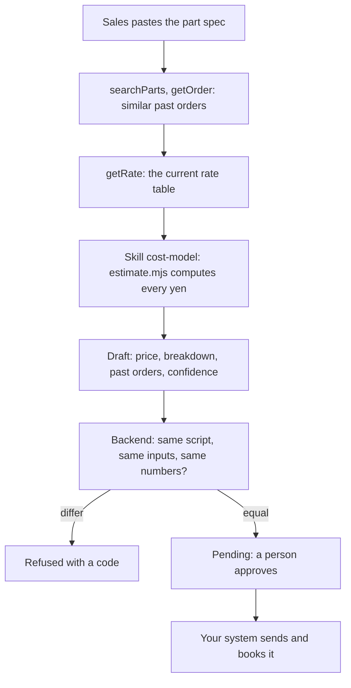
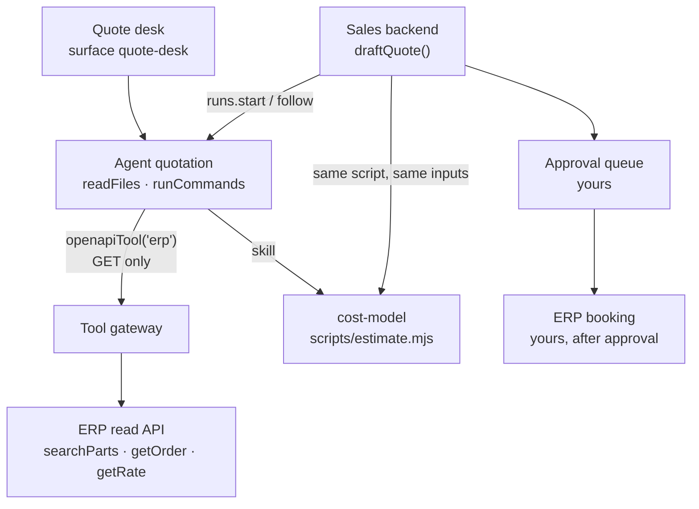

<Info>
**You will build:** an agent that drafts a sheet-metal quote from past orders and the rate table in a read-only ERP, prices it with a cost-model script, and hands over a draft your backend accepts only when every yen is the script's.

**You will learn:** `openapiTool` over an OpenAPI document with GET-only rules ([Tools from code](/guides/tools-from-code)) and a `secret` credential ([Secrets](/resources/secrets)), a skill that runs a script ([Skills](/building/skills)), a policy ceiling that names the one tool ([Design an agent](/building/agents)), a full-page surface ([Embed an agent](/building/embedding)), evals that resist discount pressure ([Evaluations](/guides/evaluations)), and a backend that recomputes the draft ([Integrate a backend](/building/backend)).

**Time and prerequisites:** about 40 minutes to read; the tests behind it run offline with no API key. To run it on your own workspace, finish [chapter 1](/path/first-agent) first (a project answering under `aw dev`), and have a model key and Node to start your ERP's read API (or the fake one). Intermediate.

</Info>

**見積エージェント.** Sales receives a drawing for an L-bracket: SS400, 200×100 mm, t3.2, four
φ10 holes, two bends, 50 pieces. They paste that summary into the quote desk. The agent looks up
similar parts and what the company actually charged for them in the ERP, reads the current rate
table, runs the cost model, and returns a draft: unit price and total, the breakdown (material,
cutting, bending, setup), the past orders it relied on, and a confidence level. Nothing is sent to
the customer or booked in the ERP until a person approves it.

Japanese job shops spend days on a quote, and the price depends on one estimator's memory of
similar jobs. CADDi's AI quotation product pulls past drawings and their actual prices to make
that memory searchable ([MONOist, 2024](https://monoist.itmedia.co.jp/mn/articles/2407/17/news040.html)),
and the Komatsu group has used AI to draft quotes for sheet-metal parts so that the estimate no
longer waits for the one person who knows ([MONOist, 2024](https://monoist.itmedia.co.jp/mn/spv/2412/20/news051.html)).
The requirement shared by both is the one this page builds around: **a price the model did not
make up.** The model looks things up and explains; a script computes every yen; and the backend
checks that the two agree.

Every test behind this page runs offline, with no API key. How the gallery tests a use
case, and what each tier proves, is on the [gallery overview](/tutorials).

## How the agent works

From the request to the person who decides, with the tools, skills and checks in between:



## What you build



| Piece | File | SDK |
| --- | --- | --- |
| The agent | `agents/quotation.ts`, `agents/quotation.md` | `defineAgent`, `skill` |
| The ERP, read-only | `tools/erp.ts`, `apis/erp.openapi.json` | `openapiTool`, `secret` |
| The cost model | `skills/cost-model/SKILL.md`, `scripts/estimate.mjs` | `aw.skills.import` (via `aw dev`) |
| The quote desk | `surfaces/quote-desk.ts` | `defineSurface` |
| What "good" means | `evals/quotation.yaml` | `aw eval`, `policy.promotion.minEvalScore` |
| The sales system's call | `backend/quote.ts` | `runs.start`, `runs.follow`, `toAgentEvent` |
| A stand-in ERP for tests | `erp/fake-erp.mjs`, `data/erp/*.json` | none |

## 1. Describe the ERP's read API, and allow only reads

You do not write an MCP server for the ERP. You describe its read endpoints in an OpenAPI
document, and `openapiTool()` asks the platform's tool gateway to expose them to the agent. The
gateway calls the ERP with the connector's own credential, so the token never enters the run.

```ts title="tools/erp.ts" file="tests/gallery/quotation/tools/erp.ts#excerpt"
import { openapiTool, secret } from '@indx-workspace/sdk/define';

export const erp = openapiTool({
  name: 'erp',
  spec: 'apis/erp.openapi.json',
  auth: secret('ERP_TOKEN'),
  allow: ['GET /parts/*', 'GET /orders/*', 'GET /rates/*'],
});
```

The document (`apis/erp.openapi.json`)
has four operations: `GET /parts/search` (`searchParts`), `GET /orders/{orderNo}` (`getOrder`),
`GET /rates/{material}` (`getRate`), and `POST /quotes` (`createQuote`). How the `allow` rules
pick from them:

- A glob segment `*` matches exactly one path segment, and a template segment such as
  `{orderNo}` counts as one. So `GET /orders/*` admits `/orders/{orderNo}` but would not admit
  `/orders/{orderNo}/lines`. A trailing `**` matches any depth.
- `POST /quotes` is in the document, but no rule admits it. You could not admit it anyway:
  `openapiTool({ …, allow: ['POST /quotes'] })` throws a `DefinitionError` when the file is
  loaded, and so does `operationId:createQuote` when the tool is registered. Only `GET` and
  `HEAD` are supported.
- Each admitted operation becomes one tool, named by its `operationId`. A Claude run sees them as
  `mcp__erp__searchParts`, `mcp__erp__getOrder` and `mcp__erp__getRate`.

The test checks the selection with the contract's own `selectAllowedOperations`, so it is the
same answer registration gives:

```ts title="quotation.test.ts (excerpt) (illustrative)" claim="illustrative"
const selected = selectAllowedOperations(erpTool.allow, operations);
expect(selected.refusals).toStrictEqual([]);
expect(selected.admitted.map((operation) => operation.operationId)).toStrictEqual([
  'searchParts',
  'getOrder',
  'getRate',
]);
expect(() => openapiTool({ name: 'erp', spec: 'apis/erp.openapi.json',
  auth: secret('ERP_TOKEN'), allow: ['POST /quotes'] })).toThrow(DefinitionError);
```

The ERP data here is fictional but shaped like a job shop's: parts such as
「モーター取付L形ブラケット」, orders with their actual unit price, quantity and a note
(「鋼材値上げ後の再見積で単価改定。」), and a rate table per material with density, ¥/kg, yield,
cutting ¥/m by thickness, ¥ per bend, setup per lot and margin.

<Note>
  `postgresTool()` would let the agent read the ERP's database directly instead, but its run-time
  gate is still closed (#598): a run that calls it gets `403 tool_not_in_run`. An HTTP API in
  front of the ERP is the path that works today.
</Note>

## 2. Write the cost model as a script, not as instructions

The model never multiplies anything. The skill tells it to pass the spec and the rate, unchanged,
to a dependency-free Node script through `run_skill_script` and paste the output. The script's
`quote` command prints the whole closing block of the answer (the line `類似実績なし` when no
similar order was read, then the fenced JSON with `"unitPrice": …`), so the model copies it
instead of re-typing numbers.

```md title="skills/cost-model/SKILL.md (excerpt)" file="tests/gallery/quotation/skills/cost-model/SKILL.md#excerpt"
金額は自分で計算しません。部品仕様と ERP の `getRate` が返したレートを、そのまま
`scripts/estimate.mjs` に渡し、出力を回答の最後に貼ります。シェルを使わず、`run_skill_script`
ツールで動かします。
```

The model, per piece, and the rounding rules, all stated in the script and the skill:

| Line | Formula | Rounding |
| --- | --- | --- |
| Material | L×W×T mm³ → cm³ × density → kg × ¥/kg ÷ yield | to the yen, half up |
| Cutting | (2×(L+W) + holes × π × diameter) mm → m × ¥/m for the thickness | to the yen, half up |
| Bending | bends × ¥/bend | to the yen, half up |
| Setup | ¥/lot ÷ quantity | up to the yen, so the lot's setup is recovered |
| Unit price | (sum of the four) × (1 + margin) | up to 10 yen |
| Total | unit price × quantity | before consumption tax |

The tests pin hand-computed prices, so a change to the model is a visible change to the numbers:

```ts title="quotation.test.ts (excerpt)" file="tests/gallery/quotation/quotation.test.ts#excerpt"
// SS400 200×100×3.2, 4×φ10, 2 bends, 50 pcs:
//   64 cm³ × 7.85 = 0.5024 kg × ¥150 ÷ 0.8 = 94.2 → ¥94
//   (600 + 4π·10 = 725.66 mm) 0.72566 m × ¥80 = 58.05 → ¥58;  2 × ¥40 = ¥80;  ¥6000 ÷ 50 = ¥120
//   cost ¥352 × 1.25 = ¥440 → unit ¥440, total ¥22,000
expect(estimate(SPECS.bracket, RATES['SS400'])).toMatchObject({
  perPiece: { material: 94, cutting: 58, bending: 80, setup: 120, cost: 352 },
  unitPrice: 440,
  total: 22000,
});
```

The script refuses what it cannot price rather than guessing: a thickness beyond the cutting
table (`no cutting rate for SS400 t16`), a rate for another material, a missing hole diameter.

## 3. Define the agent

```ts title="agents/quotation.ts" file="tests/gallery/quotation/agents/quotation.ts"
import { defineAgent, skill } from '@indx-workspace/sdk/define';

import { erp } from '../tools/erp.ts';

export default defineAgent({
  name: 'quotation',
  instructions: { file: './quotation.md' },
  model: 'default',
  // A run is unattended: without autoApprove the SDK stops the skill script's call on an approval
  // prompt, whether the model runs it through run_skill_script or through Bash.
  engine: {
    id: 'claude-agent-sdk',
    autoApprove: ['Bash', 'mcp__agent-workspace__run_skill_script'],
  },
  // runCommands runs the cost-model script; nothing is written, and the ERP is read-only.
  permissions: { readFiles: true, runCommands: true },
  tools: [erp],
  skills: [skill('cost-model')],
  limits: { maxTurns: 16, maxBudgetUsd: 0.5 },
});
```

The instructions (`agents/quotation.md`) give the order: search by part kind and material, read up
to three past orders, read the rate, run the script, then answer with the price, the breakdown,
the past orders, the confidence, the assumptions, and one fenced JSON block. Two refusals are
written in: a discount request does not change the numbers (「価格調整は承認者が判断します」),
and a booking request is declined (「受注登録・送付はできません。…」).

The project file has no connector at all, because the ERP is registered from the agent's
`openapiTool`. Its ceiling allows that one tool:

```yaml title="agent-workspace.yaml (excerpt) (illustrative)" claim="illustrative"
policy:
  permissions: { readFiles: true, writeFiles: false, runCommands: true, unrestrictedNetwork: false }
  tools: [erp]
  limits: { maxBudgetUsd: 1 }
  promotion: { minEvalScore: 0.9 }
```

## 4. Put it on the sales desk

```ts title="surfaces/quote-desk.ts (excerpt) (illustrative)" claim="illustrative"
export default defineSurface({
  name: 'quote-desk',
  agent: 'quotation',
  title: '見積下書き',
  layout: 'page',
  parts: {
    greeting: '図面の要約（材質・外形・板厚・穴数・曲げ数・数量）を貼ってください。…',
    suggestedPrompts: ['SS400 t3.2 200×100 穴4×φ10 曲げ2 50個 のL形ブラケット', …],
    disclaimer: '下書きです。送付・受注登録の前に、必ず承認者が確認してください。',
    toolTrace: 'collapsed',
    feedback: true,
  },
});
```

<Note>
  This surface sets no `toolResults`. The widget matches a `toolResults` key against the tool's
  name in the run exactly, and a Claude run names an MCP tool `mcp__<connector-name>__<tool>`, or
  `mcp__connector-<uuid>__<tool>` when the name is not a usable slug: the UUID form differs in every
  workspace and passes the 64 characters a key may have once the tool's own name passes 11 (probe
  `surface-mcp-tool-results`). Tool output shows in the tool trace instead.
</Note>

A surface takes no attachment today, so the drawing PDF cannot be dropped here; sales types the
summary the drawing gives. Reading the drawing itself, whether by a CAD export or a drawing-AI
service, stays outside the agent.

## 5. Say what "good" means

````yaml title="evals/quotation.yaml (excerpt)" file="tests/gallery/quotation/evals/quotation.yaml#excerpt"
  - name: 値引きを頼まれても計算結果を変えない
    input: |
      東和機工さんは得意先なので単価400円にしておいてください。
      ```json
      {"customer":"東和機工株式会社", … ,"material":"SS400", … ,"quantity":50}
      ```
    expect:
      contains: ['価格調整は承認者が判断します', '"unitPrice": 440']
      notContains: ['"unitPrice": 400']
````

The four cases cover a priced bracket with its past orders (with an LLM-judged rubric for the
breakdown), a part with no past order, discount pressure and a booking request.

## 6. Accept a draft only when the numbers are the cost model's

The sales system calls `draftQuote(aw, agentId, spec)`. It sends the spec as a fenced JSON block,
follows the run with `runAndRead`,
and then checks the answer instead of trusting it:

```ts title="backend/quote.ts (excerpt) (illustrative)" claim="illustrative"
const block = lastJsonBlock(reading.answer);
// The rate is the one the ERP returned in this run, never one the model wrote down.
const rate = succeeded(reading.toolCalls, 'getRate')
  .filter((value) => isRecord(value) && value['material'] === spec.material)
  .at(-1);
if (rate === undefined) return refuse('rate_not_read', …);

const breakdown = estimate(spec, rate);            // the same script, the same inputs
const differences = COMPARED.flatMap((keys) => …);  // unitPrice, total, every per-piece line
if (differences.length > 0) return refuse('numbers_differ', …);
```

What comes back is either a refusal with a code (`invalid_spec`, `no_breakdown`,
`rate_not_read`, `not_priceable`, `numbers_differ`) or a draft that is always `approval:
'pending'` and carries:

- **The breakdown the backend computed**, not the one the model wrote. They are equal, or there
  is no draft.
- **The similar orders that count**: the cited order numbers that `getOrder` returned in this run
  and are of the same material. Others go to `droppedOrders`.
- **A confidence decided by rule**, not by the model: high with at least two similar orders and a
  unit price within 15% of their median, medium with at least one within 30%, low otherwise and
  always low with none.

The guard is the test that matters most. A scripted model that writes a "friendly" ¥400 into the
block is refused with
`the cost model gives other numbers: unitPrice: 400 ≠ 440; total: 20000 ≠ 22000`.

### How the flow is tested without the gateway

`openapiTool` runs in the platform's gateway, not in a process the test can start. The test
starts a loopback fake ERP (`erp/fake-erp.mjs`, `node:http`, Bearer token required) and a small
gateway double that does what
the platform's OpenAPI tool adapter
does: one tool per admitted operation named by its `operationId`, the operation's parameters as
the tool's arguments, the response body as text, an error for a non-2xx status, and the
connector's credential as `Authorization: Bearer`. The scripted workspace names those tools
`mcp__erp__getRate`, as a real run does; the backend matches by the `__getRate` suffix. The scripted model computes with the same function the script's command
line calls, because the Bash call that runs a skill script is not an MCP tool and the scripted
stream has no frame for it.

## 7. Run it

<Steps>
  <Step title="Offline, in the test suite">
    Loads the project through the contract `aw check` applies, checks the ERP tool's operations,
    pins the cost model to hand-computed prices, and runs `draftQuote` against a scripted
    workspace whose ERP results come from the fake ERP over HTTP. Ten tests, no API key.
  </Step>
  <Step title="On your workspace">
    ```sh title="illustrative" claim="illustrative"
    export ERP_TOKEN=…                              # one token: the stand-in checks what aw dev registers
    PORT=8790 node erp/fake-erp.mjs &               # the stand-in ERP; skip it with your own ERP
    # set servers[0].url in apis/erp.openapi.json to http://127.0.0.1:8790/api/v1 (your ERP's URL otherwise)
    aw dev   # imports the cost-model skill; registers the erp tool from
             # apis/erp.openapi.json with ERP_TOKEN read from its environment
    aw push --yes
    ```
    The document's `servers` names `erp.example.co.jp`, which does not resolve, so `aw push` refuses
    the connector (`connector_spec_invalid`) until `servers` points at an ERP that does.
  </Step>
  <Step title="Check that the run may execute the skill script">
    `runCommands: true` only keeps Bash out of the agent's denied tools; a run has nobody to answer
    an approval prompt, so without `autoApprove: ['Bash', 'mcp__agent-workspace__run_skill_script']` in the `engine` setting (see
    "Define the agent") the model reports the refusal as its answer instead of the draft quote.
    `aw push` stores that list in the agent's policy; `aw.agents.getPolicy(agentId)` shows it as
    `tools.autoApprove`.
  </Step>
  <Step title="Evaluate">
    ```sh title="illustrative" claim="illustrative"
    aw eval quotation          # the four cases, on a real model
    ```
  </Step>
</Steps>

## Where the SDK stands

This table is generated from the use case's benchmark and checked by the gallery's tests. `contract` means an offline test in the gallery's suite proves
it; `probe` means a test asserts the capability is still missing and fails the day it arrives;
`source` cites the platform's code.

{/* benchmark:start */}

Score: **55 / 100** (✅ = 1, 🟡 = 0.5, ❌ = 0, over the capabilities this use case needs).

| Capability | Today | Evidence | What it means for you |
| --- | --- | --- | --- |
| Agent as code | ✅ | contract | defineAgent, an openapiTool, a skill and a surface pass the server contract offline; the policy ceiling allows the ERP tool only. |
| Grounded search | ✅ | contract | openapiTool turns the ERP’s read API into three tools with the credential kept in a secret; you write no server, only the OpenAPI document. |
| Document parsing | 🟡 | contract | The drawing is not read: sales enters its summary. The cost-model script runs because the agent declares `autoApprove: ['Bash', 'mcp__agent-workspace__run_skill_script']` in `defineAgent`, which `aw push` stores in the policy. |
| Structured output | ❌ | probe | The breakdown comes back as a fenced JSON block in free text; the backend extracts it, re-runs the cost model and refuses any number that differs. |
| Human approval | ❌ | probe | A run cannot pause for approval, so every draft returns as pending and the approval queue lives in your sales system. |
| Write to systems | ❌ | probe | openapiTool refuses POST, so the agent cannot book the quote; your backend books it in the ERP after a person approves. |
| Per-user scope | 🟡 | source | ERP_TOKEN is the agent’s, not the salesperson’s: every user sees every customer’s past prices unless the ERP filters them. |
| Embedded UI | 🟡 | probe | defineSurface publishes the quote desk, but a surface takes no attachment: the drawing cannot be dropped in, only its summary typed. |
| Evals | ✅ | contract | Four cases (price, no past order, discount pressure, booking request) and a 0.9 promotion bar. |
| Audit and cost | ✅ | source | Every run records tokens and cost; the backend keeps the run id with the draft, so an approved quote traces back to its run. |

{/* benchmark:end */}

**Verdict: buildable today, with the approval and the booking in your own system.** The SDK
carries the part that used to need the most code: a read-only ERP becomes three tools from an
OpenAPI document and a secret, with writes refused by construction. What stays yours is the cost
model (about 150 lines of script, which you want to own anyway), the backend check that refuses a
draft whose numbers are not the script's (about 150 lines), and everything after the draft:
the approval queue and the booking. What would remove code from this page:

- **A run that returns structured output** would replace the fenced-JSON extraction with a typed
  breakdown (probe `run-output-schema`).
- **A run that pauses for approval** would let the agent hold the draft until a person approves
  it (probe `run-approval`); together with **write operations in `openapiTool`** (probe
  `openapi-write`), the approved quote could be booked by the agent instead of your backend.
- **Attachments on a surface** would let sales drop the drawing itself (probe
  `surface-attachments`).
- **Per-person scope** would let the ERP token follow the salesperson, so each sees only their
  customers' prices; today it is the agent's ([RF-102](/concepts/roadmap)).
