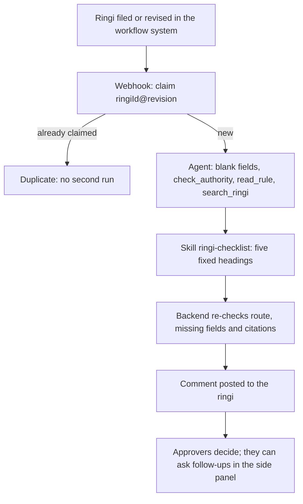
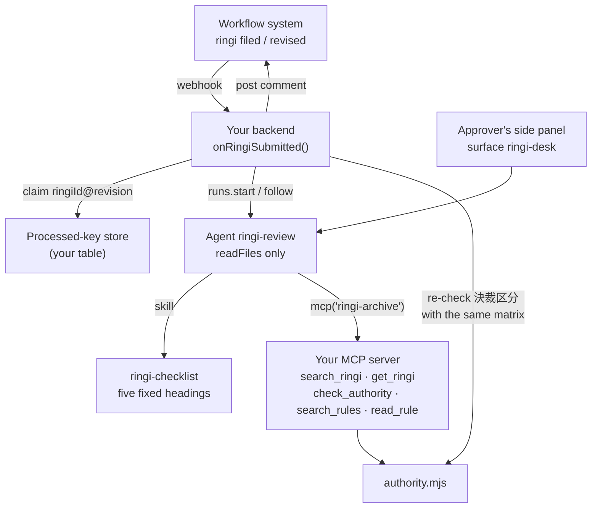

<Info>
**You will build:** a read-only reviewer your workflow system starts once per ringi revision; it writes a review sheet with a clause for every finding, and your backend re-checks the approval route before posting the sheet as a comment.

**You will learn:** five read-only tools in your own MCP server ([MCP servers](/building/mcp-servers)), a skill that fixes the sheet's format ([Skills](/building/skills)), a reviewer that cannot approve, under a policy ceiling ([Design an agent](/building/agents)), starting runs from a webhook exactly once per revision ([Integrate a backend](/building/backend)), a side panel for approvers' follow-up questions ([Embed an agent](/building/embedding)), and evals ([Evaluations](/guides/evaluations)).

**Time and prerequisites:** about 45 minutes to read; the tests behind it run offline with no API key. To run it on your own workspace, finish [chapter 1](/path/first-agent) first (a project answering under `aw dev`), and have a model key and Node to start the archive server. Advanced: most of the code is the backend around the agent.

</Info>

**稟議書レビューエージェント.** A department files a ringi in the company's existing workflow
system: 「第3工場 搬送コンベヤの更新」, 設備投資, 4,500万円. The workflow system calls your backend,
which starts the agent. The agent checks the ringi against the 職務権限規程 (who may approve what
amount in each category), the required fields of the 稟議規程 and the other internal rules, and
looks up similar past ringi, including the ones that were sent back or rejected. It writes a
review sheet: missing items, possible rule breaches with the clause cited, the correct approval
route (決裁区分) and the precedents. The backend posts the sheet to the ringi as a comment.

The agent never approves. It is read-only by construction: it holds no tool that writes, and the
project's policy forbids writing files, running commands and open network access.

## How the agent works

From the request to the person who decides, with the tools, skills and checks in between:



## Why Japanese enterprises want it

A ringi passes through several reviewers before it reaches its approver, and much of their time
goes to the same mechanical checks: is every required field filled in, is the route right for the
amount, did someone attach two quotes, was this sent back before. Banks were first to put AI on
this path, for loan ringi, where the documents are long and the rules are strict:

- Bank of Yokohama and IBM built generative AI into the drafting and review of loan ringi
  ([IT Leaders, Impress](https://it.impress.co.jp/articles/-/27069)).
- Kyoto Bank and NTT DATA are applying generative AI to loan ringi preparation and checks
  ([NTT DATA](https://www.nttdata.com/global/ja/news/topics/2026/022500)).

Be clear about what that evidence covers: the public cases are lending ringi at banks. This page
applies the same pattern to general corporate ringi (capital expenditure, outsourcing, donations),
where the checks are simpler and the authority matrix is a table. We found no public case of
that yet, so treat the business case as an extrapolation.

Every test behind this page runs offline, with no API key. How the gallery tests a
use case, and what each tier proves, is on the [gallery overview](/tutorials).

## What you build



| Piece | File | SDK |
| --- | --- | --- |
| The rules and the archive | `data/rules/*.md`, `data/ringi/*.json` | — |
| The authority matrix as code | `mcp/authority.mjs` | — |
| Precedent and rule search | `mcp/ringi-archive.mjs` | an `http` connector in `agent-workspace.yaml` |
| The sheet format | `skills/ringi-checklist/SKILL.md` | `aw.skills.import` (via `aw dev`) |
| The agent | `agents/ringi-review.ts`, `agents/ringi-review.md` | `defineAgent`, `mcp`, `skill`, `files` |
| Follow-up questions | `surfaces/ringi-desk.ts` | `defineSurface` |
| What "good" means | `evals/ringi-review.yaml` | `aw eval`, `policy.promotion.minEvalScore` |
| The webhook | `backend/on-ringi-submitted.ts`, `backend/review-sheet.ts` | `runs.start`, `runs.follow` |

## 1. Keep the authority matrix as text, and apply it as code

The 職務権限規程 is a document people read, and its tables decide who approves. The fixture keeps
it as Markdown, one section per category:

```md title="data/rules/authority-matrix.md (excerpt)" file="tests/gallery/ringi-review/data/rules/authority-matrix.md#excerpt"
## §3.1 設備投資

| 金額（税抜） | 決裁者 |
| --- | --- |
| 300万円以下 | 部長 |
| 3,000万円以下 | 本部長 |
| 3,000万円超 | 取締役会 |

## §3.4 寄付

| 金額（税抜） | 決裁者 |
| --- | --- |
| 100万円以下 | 社長 |
| 100万円超 | 取締役会 |

合議: 総務部長
```

`mcp/authority.mjs`
parses that same text into tiers, so the table a person reads and the table code applies cannot
drift apart. Which approver a ringi needs is a lookup, not a judgement, so it is never left to
the model:

```js title="mcp/authority.mjs (excerpt) (illustrative)" claim="illustrative"
export function requiredApprover(matrix, category, amountYen) {
  if (!Number.isSafeInteger(amountYen) || amountYen < 0) {
    throw new Error('amountYen must be a non-negative integer number of yen');
  }
  const entry = matrix.categories.find((candidate) => candidate.category === category);
  if (entry === undefined) return null;
  const tier = entry.tiers.find((candidate) => candidate.maxYen === null || amountYen <= candidate.maxYen);
  return {
    category, amountYen,
    approver: tier.approver,
    route: `${tier.approver}決裁`,
    coReview: entry.coReview,
    clause: `〔${matrix.source} §${entry.section}〕`,
  };
}
```

The other rules (`ringi-rules.md` for required fields, quotes, starting work before approval and
budget; `donation-rules.md` for forbidden recipients) are plain clauses. The archive holds 18 past
ringi with their outcome and the reason: 承認, 差戻し or 否決.

```json title="data/ringi/2025.json (one record)" file="tests/gallery/ringi-review/data/ringi/2025.json#excerpt"
{
  "id": "R-2025-0133",
  "件名": "物流倉庫 フォークリフト2台の追加購入",
  "区分": "設備投資",
  "金額": 2400000,
  "起案部門": "物流部",
  "結果": "差戻し",
  "理由": "R-2025-0127 と同一目的・同一の相手先で3か月以内の起案。合算すると480万円となり本部長決裁であるため差戻し（職務権限規程 §2.3 分割起案の禁止）。"
}
```

## 2. Serve the archive and the rules as an MCP server

Agent Workspace builds no search index (a gap probe asserts it),
so the archive is your server. Five tools, all read-only:

```js title="mcp/ringi-archive.mjs (excerpt) (illustrative)" claim="illustrative"
{
  name: 'search_ringi',
  description: '過去の稟議（先例）を件名・理由で全文検索する。差戻し・否決の先例も含む。…',
  inputSchema: {
    type: 'object',
    properties: {
      query: { type: 'string' },
      category: { type: 'string', enum: CATEGORIES },
      result: { type: 'string', enum: RESULTS },
      limit: { type: 'integer', minimum: 1, maximum: 10 },
    },
    required: ['query'],
  },
  handler: (args) => {
    const category = oneOf(args, 'category', CATEGORIES);
    const result = oneOf(args, 'result', RESULTS);
    return ringiIndex.search(text(args, 'query'), {
      filter: (record) =>
        (category === undefined || record.区分 === category) &&
        (result === undefined || record.結果 === result),
    }) /* … */;
  },
},
{
  name: 'check_authority',
  description: '職務権限規程の別表で、区分と金額（税抜・円）から決裁者と決裁区分を判定する。…決裁区分は必ずこの結果を写す。',
  handler: (args) => {
    const decision = requiredApprover(matrix, text(args, 'category'), args.amountYen);
    if (decision === null) refuse(`別表に定めのない区分です。…〔${matrix.source} §1.1〕`);
    return decision;
  },
},
```

Two choices carry the use case:

- **Precedents are indexed by their reason, not only their subject.** A reviewer asks "was
  anything sent back for splitting a purchase", and 「分割起案」 with `result: '差戻し'` finds
  R-2025-0133 because the reason says so.
- **Every tool returns the citation to copy.** `read_rule` returns `〔稟議規程 §4.2〕`,
  `get_ringi` returns `〔稟議 R-2025-0133〕` and `check_authority` returns `〔職務権限規程 §3.1〕`,
  so the backend can later check each citation on the sheet against what the tools returned.

```sh title="illustrative" claim="illustrative"
MCP_TRANSPORT=http PORT=8790 node mcp/ringi-archive.mjs
```

## 3. Fix the sheet's format in a skill

The run returns free text (there is no output schema), so the format is the contract between the
agent and your backend. The skill fixes five headings, in order, all always present:

```md title="skills/ringi-checklist/SKILL.md (excerpt)" file="tests/gallery/ringi-review/skills/ringi-checklist/SKILL.md#excerpt"
最初の行に `# 稟議レビュー <稟議ID> rev.<改訂番号>` を書き、次の5つの見出しをこの順で、
すべて書く。該当する指摘がない見出しには `- なし` とだけ書く。見出しの文言を変えない。

## 記載漏れ
## 規程との照合
- 「違反である」と断定せず「抵触のおそれ」「確認が必要」と書く。判断するのは決裁者である。
## 決裁区分
- 1行目は必ず `- 決裁区分: <route>〔職務権限規程 §節〕` とし、`check_authority` の
  `route` と `clause` をそのまま写す。
## 類似案件
## 総合所見
- 決裁者が確認すべき点を2〜3文でまとめる。承認・否決の推奨は書かない。
```

`- なし` matters: it lets the parser tell "the agent checked and found nothing" from "the agent
dropped the heading".

## 4. Define a reviewer that cannot approve

```ts title="agents/ringi-review.ts" file="tests/gallery/ringi-review/agents/ringi-review.ts#excerpt"
import { defineAgent, files, mcp, skill } from '@indx-workspace/sdk/define';

export default defineAgent({
  name: 'ringi-review',
  instructions: { file: './ringi-review.md' },
  model: 'default',
  engine: 'claude-agent-sdk',
  // Read-only by construction: it reads the rules and the archive and writes nothing.
  permissions: { readFiles: true },
  tools: [mcp('ringi-archive')],
  skills: [skill('ringi-checklist')],
  files: [files('rules', 'read')],
  limits: { maxTurns: 16, maxBudgetUsd: 0.5 },
});
```

The instructions (`agents/ringi-review.md`) open with the rule that matters most:
「あなたは稟議を承認も否決もしません」. They then give the order of work: list the blank fields,
call `check_authority` and copy its `route`, read the clauses that apply before citing them,
search precedents (rephrasing when a subject matches nothing), and write the sheet in the skill's
format. The project file adds a ceiling no agent in the project can widen:

```yaml title="agent-workspace.yaml (excerpt) (illustrative)" claim="illustrative"
connectors:
  ringi-archive:
    url: http://127.0.0.1:8790/mcp
    transport: http
policy:
  permissions: { writeFiles: false, runCommands: false, unrestrictedNetwork: false }
  limits: { maxBudgetUsd: 1 }
  promotion: { minEvalScore: 0.9 }
```

Approval stays in your workflow system, with the people the 職務権限規程 names. The agent has no
tool that could change a ringi's status, and an `openapiTool` could not give it one, because an
`openapiTool` may only call GET and HEAD operations (probe `openapi-write`).

## 5. Start it from the workflow system, once per revision

Agent Workspace has no inbound trigger or webhook route (probe `inbound-trigger`), so the
workflow system calls your endpoint. And `runs.start` takes no idempotency key (probe
`run-start-idempotency`): workflow systems retry webhooks on timeouts, and every retry would
start a second, billed run and post a second comment. The hook therefore claims
`ringiId@revision` before it starts anything:

```ts title="backend/on-ringi-submitted.ts (excerpt) (illustrative)" claim="illustrative"
export async function onRingiSubmitted(body: unknown, deps: HookDependencies): Promise<HookResult> {
  const ringi = parseSubmission(body); // throws InvalidSubmission naming the bad fields
  const key = `${ringi.ringiId}@${String(ringi.revision)}`;
  const claimed = await deps.store.claim(key);
  if (claimed.state === 'in-progress') return { status: 'duplicate', key };
  if (claimed.state === 'reviewed') {
    if (claimed.posted) return { status: 'duplicate', key };
    await deps.postComment(ringi.ringiId, ringi.revision, claimed.comment);
    await deps.store.markPosted(key);
    return { status: 'reposted', key, comment: claimed.comment };
  }

  const reading = await runAndRead(deps.aw, deps.agentId, { prompt: promptFor(ringi) }).catch(
    async (error: unknown) => {
      await deps.store.release(key); // a failed run may be retried
      throw error;
    },
  );
  // … parse, re-check, compose …
  await deps.store.saveReview(key, comment); // kept before posting
  await deps.postComment(ringi.ringiId, ringi.revision, comment);
  await deps.store.markPosted(key);
  return { status: 'reviewed', key, review, comment };
}
```

`ProcessedKeyStore` is an interface; in production it is a table with a unique key, where an
insert that fails on conflict is the claim. Give the `in-progress` state an expiry in production
so that a process that dies mid-run does not block the ringi forever. The test sends the same
webhook twice at once and once more later, and asserts one run and one comment; a revision 2 of
the same ringi is reviewed again.

The comment is posted by this code, not by the agent: the workflow system's API is called with
your credentials, from the place where you already control who may write.

## 6. Check what the agent wrote

`backend/review-sheet.ts`
reads the sheet into typed findings by section, each with its parsed citations, and lists any
heading the sheet is missing. Then the hook checks three things a model must not be trusted with
alone:

```ts title="backend/on-ringi-submitted.ts (excerpt) (illustrative)" claim="illustrative"
const sheet = parseReviewSheet(reading.answer);
const expected = requiredApprover(deps.matrix, ringi.category, ringi.amountYen);
const authority = {
  expected,
  written: sheet.approver,
  matches: expected !== null && sheet.approver === expected.approver,
  toolCalled: reading.toolCalls.some((call) => toolIs(call.name, 'check_authority')),
};
const missingFields = REQUIRED.filter(([field]) => blank(ringi[field])).map(([, label]) => label);
const missedByAgent = missingFields.filter((label) => !omissions.includes(label));
const unverified = findings.flatMap((f) => f.citations).filter((c) => !returned.has(c.raw));
```

- **The route.** The backend runs the same `requiredApprover` on the submitted category and
  amount. A sheet that says 本部長決裁 for a 4,500万円 capital expenditure gets a warning at the top
  of the comment: 「⚠ 決裁区分の不一致: レビューシートは「本部長」、職務権限規程の判定は「取締役会決裁」〔職務権限規程 §3.1〕です。」
  A wrong route sends the ringi to the wrong approver, so this is the check to keep.
- **Missing fields.** Which required fields are blank is known without a model; any the sheet
  does not mention are added to the comment.
- **Citations.** Every 〔…〕 on the sheet must be one that `read_rule`, `check_authority` or
  `get_ringi` returned in this run.

The note on the route check: the deterministic answer uses the submitted amount. When the agent
argues for a higher route because of 分割起案 (§2.3, related ringi within three months), the two
will differ and the comment flags it; that is a case for the reviewer to read, not an error.

## 7. Let approvers ask follow-up questions

```ts title="surfaces/ringi-desk.ts (illustrative)" claim="illustrative"
export default defineSurface({
  name: 'ringi-desk',
  agent: 'ringi-review',
  title: '稟議レビュー（決裁者向け）',
  layout: 'side',
  parts: {
    greeting: 'レビューシートについて質問できます。規程の条文や過去の稟議を出典つきで示します。可否の判断はしません。',
    suggestedPrompts: ['設備投資 4,500万円の決裁区分は？', '相見積が1社のときに必要な記載は？', 'フォークリフト購入で差し戻された先例はある？'],
    disclaimer: 'AIによる参考情報です。決裁は職務権限規程に定める決裁者が行います。',
    toolTrace: 'collapsed',
    history: true,
    feedback: true,
  },
});
```

<Note>
  The surface sets no `toolResults`. A surface matches a tool by its exact name in the run, and a
  Claude run names this server's tools `mcp__<connector-name>__search_ringi`, or
  `mcp__connector-<uuid>__search_ringi` (65 characters, past the 64-character limit on a
  `toolResults` key, and different in every workspace) when the name is not a usable slug. Precedent
  results therefore render as text in the collapsed tool trace.
</Note>

## 8. Say what "good" means

```yaml title="evals/ringi-review.yaml (excerpt) (illustrative)" claim="illustrative"
cases:
  - name: 設備投資の決裁区分を別表から判定する
    input: >
      稟議ID R-2026-0101 rev.1 / 件名: 第3工場 搬送コンベヤの更新 / 区分: 設備投資 /
      金額（税抜）: 45,000,000円 / … / 期待効果: （未記載） / … / 見積社数: 1
    expect:
      contains: ['## 決裁区分', '取締役会決裁', '〔職務権限規程 §3.1〕']
  - name: 承認や否決を推奨しない
    input: > …
    expect:
      contains: ['部長決裁', '〔職務権限規程 §3.2〕']
      notContains: ['承認を推奨', '否決を推奨', '承認してよい']
      judge: >
        レビューシートが5つの見出しをこの順ですべて含み、承認・否決の判断や推奨を書いていないこと。
```

Four cases: the route, the missing-field and quote findings with their clauses, a political
donation that must surface the rejected precedent R-2025-0170 and 〔寄付金取扱基準 §2.2〕, and a
routine renewal that must not recommend approval. Pin with `contains`, never `tool:`, because the
MCP tool name carries the connector's id.

## 9. Run it

<Steps>
  <Step title="Offline, in the test suite">
    Loads the project through the contract `aw check` applies, drives the real archive server
    (including every boundary of the 設備投資 table), and runs `onRingiSubmitted` against a
    scripted workspace whose tool results are the server's own: the happy path, a duplicate and
    concurrent webhook, a wrong route, a failed post, and an invalid body. Ten tests, no API key.
  </Step>
  <Step title="On your workspace">
    ```sh title="illustrative" claim="illustrative"
    MCP_TRANSPORT=http PORT=8790 node mcp/ringi-archive.mjs &
    aw dev                  # keeps the connector and the skill in step
    aw files mkdir rules
    aw push --yes
    aw eval ringi-review    # the four cases, on a real model
    ```
    Nothing is uploaded into `rules` here, so it is created with `aw files mkdir`, which does nothing when the folder already exists. A folder with a file uploaded into it needs no `aw files mkdir`.
    Then mount `onRingiSubmitted` behind an HTTP route in your backend, give it a
    `ProcessedKeyStore` backed by your database and a `postComment` that calls your workflow
    system, and register that route as the workflow system's "ringi filed" webhook.
  </Step>
</Steps>

## Where the SDK stands

This table is generated from the use case's benchmark and checked by the gallery's tests. `contract` means an offline test in the gallery's suite proves
it; `probe` means a test asserts the capability is still missing and fails the day it arrives;
`source` cites the platform's code.

{/* benchmark:start */}

Score: **50 / 100** (✅ = 1, 🟡 = 0.5, ❌ = 0, over the capabilities this use case needs).

| Capability | Today | Evidence | What it means for you |
| --- | --- | --- | --- |
| Agent as code | ✅ | contract | defineAgent, a skill, a rules grant and a surface pass the contract; the policy ceiling makes the reviewer read-only by construction, so it cannot approve anything. |
| Grounded search | 🟡 | contract | Precedents, rule clauses and the authority matrix are your own MCP server; check_authority is a deterministic table lookup the model copies rather than computes. |
| Document parsing | ❌ | probe | The quotes (見積書) attached to a ringi cannot be handed to a run; this example reviews the fields the workflow sends and leaves the quotes to a person. |
| Structured output | ❌ | probe | The review sheet comes back as Markdown; the backend parses the five fixed headings into typed findings and reports a dropped heading. |
| Write to systems | 🟡 | probe | An openapiTool may only read, so your backend, not the agent, posts the comment to the workflow system and keeps it for a retry if the post fails. |
| Triggers | ❌ | probe | No inbound trigger and no idempotency key on runs.start (probe `run-start-idempotency`): you host the webhook and dedupe by ringi id and revision yourself. |
| Per-user scope | ❌ | source | Grants are per agent, not per approver: every approver sees every department’s precedents unless you split agents or archives by department. |
| Embedded UI | ✅ | contract | A side-panel surface lets approvers ask follow-up questions; `toolResults` cannot target this server’s tools, whose run names exceed 64 characters. |
| Evals | ✅ | contract | Four cases pin the route, the clauses, a rejected precedent and that the sheet never recommends approval, with a 0.9 promotion bar. |
| Audit and cost | ✅ | source | Every review run records tokens and cost, and the audit log records who changed the agent or its rules skill. |

{/* benchmark:end */}

**Verdict: buildable today, with a backend that does real work.** The agent itself is the easy
part: a definition, a skill and a read-only policy. What is yours is the plumbing around it: a
webhook endpoint, an idempotency store, a sheet parser, the route re-check and the comment post,
about 390 lines with their comments, plus the 270-line archive server. What would remove code from this page:

- **An inbound trigger with an idempotency key** would replace the endpoint and the
  processed-key store (probes `inbound-trigger`, `run-start-idempotency`).
- **A run that returns structured output** would replace the heading parser with typed findings
  (probe `run-output-schema`).
- **Attachments on a run** would let the agent read the quotes attached to the ringi, which this
  example leaves to a person (probe `run-attachments`).
- **Per-person data scope** would let one agent serve every department while each approver sees
  only their own department's precedents; today grants are per agent ([RF-102](/concepts/roadmap)).
