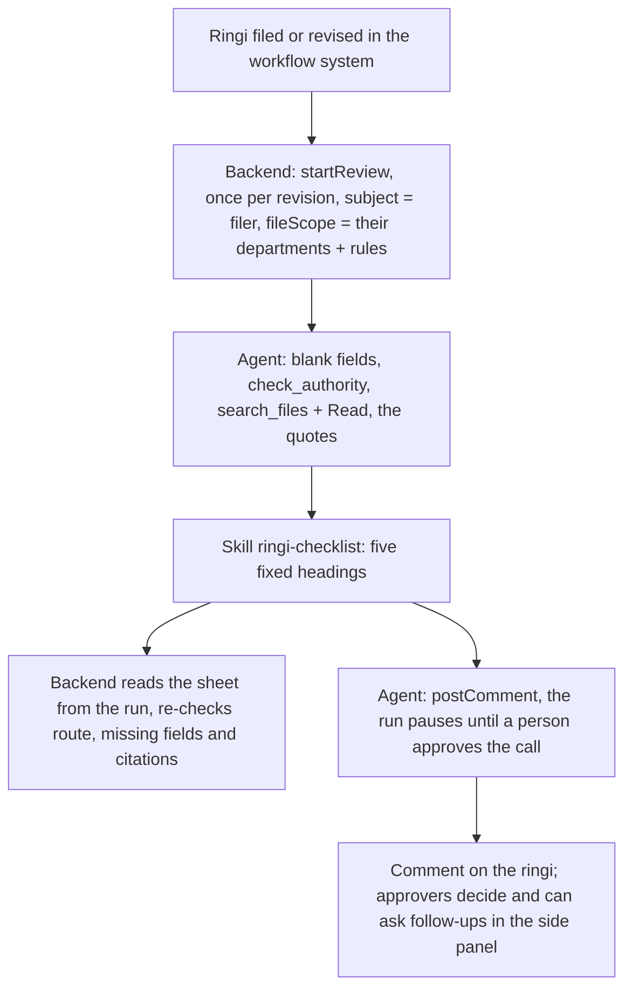
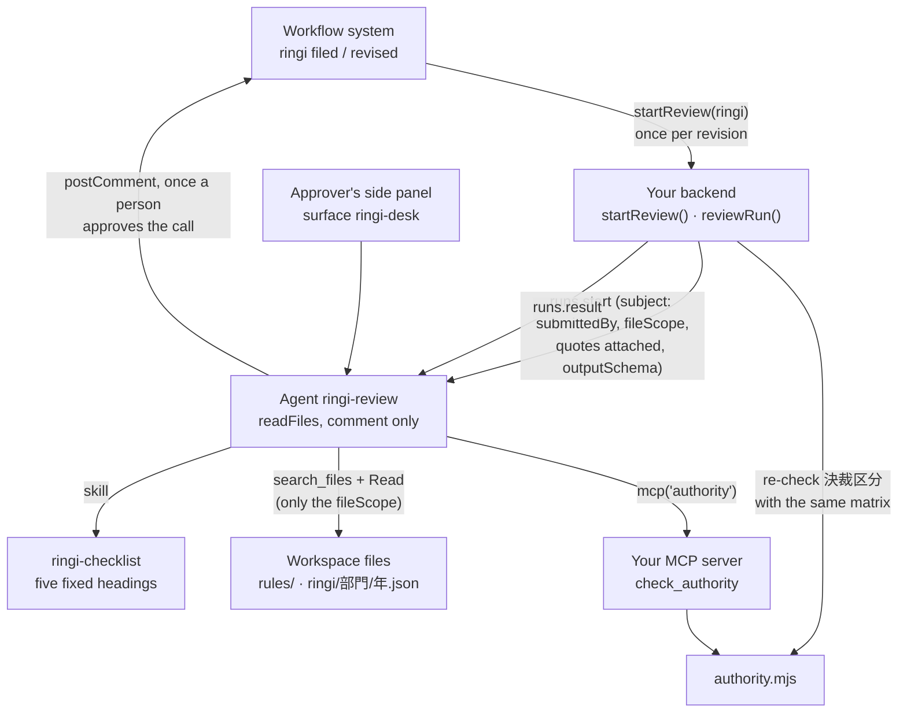

<Info>
**You will build:** a reviewer your backend starts once per ringi revision, for the person who filed it; it writes a review sheet with a clause for every finding, your backend re-checks the approval route, and the agent posts the sheet as a comment on the ringi once a person approves that call.

**You will learn:** the built-in `search_files` over the rule book and the archive, narrowed per caller with `fileScope`, and one read-only tool in your own MCP server ([MCP servers](/building/mcp-servers)), a skill that fixes the sheet's format ([Skills](/building/skills)), a reviewer that can comment but cannot approve, under a policy ceiling ([Design an agent](/building/agents)), a comment posted through an `openapiTool` call a person approves ([Tools from code](/guides/tools-from-code), [Secrets](/resources/secrets)), a typed run your backend starts for the filer with the quotes attached ([Integrate a backend](/building/backend)), a side panel for approvers' follow-up questions ([Embed an agent](/building/embedding)), and evals ([Evaluations](/guides/evaluations)).

**Time and prerequisites:** about 45 minutes to read and about 30 minutes to run it on your workspace; the tests behind it run offline with no API key. To run it on your own workspace, finish [chapter 1](/path/first-agent) first (a project answering under `aw dev`), and have a model key and Node to start the authority server. Advanced: most of the code is the backend around the agent.

</Info>

## The result

<Frame caption="The review sheet for 「第3工場 搬送コンベヤの更新」 (設備投資, 4,500万円): missing items, the approval route and precedents, each with its clause.">
  
</Frame>

**稟議書レビューエージェント.** A department files a ringi in the company's existing workflow
system: 「第3工場 搬送コンベヤの更新」, 設備投資, 4,500万円. Your backend starts a run of the agent
for the person who filed it, with the quotes attached. The agent checks the ringi against the 職務権限規程 (who may approve what
amount in each category), the required fields of the 稟議規程 and the other internal rules, and
searches similar past ringi, including the ones that were sent back or rejected, among the
departments the filer may read. It writes a
review sheet: missing items, possible rule breaches with the clause cited, the correct approval
route (決裁区分) and the precedents. Your backend reads the sheet from the run and re-checks it;
a second run posts the checked sheet, with your warnings, to the ringi as a comment once a person
approves that call.

The agent never approves or rejects. Its one write is the comment: `postComment` is an
`openapiTool` operation, so the run pauses until a person approves that exact call. The workflow
system's approve and reject endpoints are in the API document but not admitted, so no tool the agent
holds can decide; its one MCP tool, `check_authority`, is a table lookup. The project's policy
forbids writing files, running commands and open network access.

## Why Japanese enterprises want it

A ringi passes through several reviewers before it reaches its approver, and much of their time
goes to the same mechanical checks: is every required field filled in, is the route right for the
amount, did someone attach two quotes, was this sent back before. Banks were first to put AI on
this path, for loan ringi, where the documents are long and the rules are strict:

- Bank of Yokohama and IBM built generative AI into the drafting and review of loan ringi
  ([IT Leaders, Impress](https://it.impress.co.jp/articles/-/27069)).
- Kyoto Bank and NTT DATA are applying generative AI to loan ringi preparation and checks
  ([NTT DATA](https://www.nttdata.com/global/ja/news/topics/2026/022500)).

Be clear about what that evidence covers: the public cases are lending ringi at banks. This page
applies the same pattern to general corporate ringi (capital expenditure, outsourcing, donations),
where the checks are simpler and the authority matrix is a table. We found no public case of
that yet, so treat the business case as an extrapolation.

Every test behind this page runs offline, with no API key. How the gallery tests a
use case, and what each tier proves, is on the [gallery overview](/tutorials).

## How it works

From the request to the person who decides, with the tools, skills and checks in between:



## Before you start

- [ ] You finished [chapter 1](/path/first-agent): a project answering under `aw dev`.
- [ ] A model key, only to run it on your workspace. The tests need no key.
- [ ] Node, to start the authority server.
- [ ] The code: every file on this page is in the gallery folder `tests/gallery/ringi-review/`, and paths below are relative to it. Blocks titled with `file=` are exact copies. How the gallery tests a use case is on the [gallery overview](/tutorials).

## The pieces



| Piece                                        | File                                               | SDK                                                             |
| -------------------------------------------- | -------------------------------------------------- | --------------------------------------------------------------- |
| The rules and the archive                    | `data/rules/*.md`, `data/ringi/<部門>/<year>.json` | `files('rules', 'read')`, `files('ringi', 'read')`              |
| Who may read which departments               | `data/access.json`                                 | `runs.start({ fileScope })`                                     |
| The authority matrix as code                 | `mcp/authority.mjs`                                | —                                                               |
| The authority lookup                         | `mcp/authority-server.mjs`                         | an `http` connector in `agent-workspace.yaml`                   |
| The sheet format                             | `skills/ringi-checklist/SKILL.md`                  | `aw.skills.import` (via `aw dev`)                               |
| The workflow system's comment API            | `tools/workflow.ts`, `apis/workflow.openapi.json`  | `openapiTool`                                                   |
| A stand-in workflow system to try it against | `workflow/fake-workflow.mjs`                       | —                                                               |
| The agent                                    | `agents/ringi-review.ts`, `agents/ringi-review.md` | `defineAgent`, `mcp`, `skill`, `files`, built-in `search_files` |
| Follow-up questions                          | `surfaces/ringi-desk.ts`                           | `defineSurface`                                                 |
| What "good" means                            | `evals/ringi-review.yaml`                          | `aw eval`, `policy.promotion.minEvalScore`                      |
| The start and the check                      | `backend/review-run.ts`, `backend/review-sheet.ts` | `runs.start`, `runs.result`                                     |

## Build it

Each step is one file or one concern, with the reason for it and a check to make before you go on.

### 1. Keep the authority matrix as text, and apply it as code

The 職務権限規程 is a document people read, and its tables decide who approves. The fixture keeps
it as Markdown, one section per category, each opening with its own `出典:` line:

```md title="data/rules/authority-matrix.md (excerpt)" file="tests/gallery/ringi-review/data/rules/authority-matrix.md#excerpt"
## §3.1 設備投資

出典: 〔職務権限規程 §3.1〕

| 金額（税抜）  | 決裁者   |
| ------------- | -------- |
| 300万円以下   | 部長     |
| 3,000万円以下 | 本部長   |
| 3,000万円超   | 取締役会 |

## §3.4 寄付

出典: 〔職務権限規程 §3.4〕

| 金額（税抜） | 決裁者   |
| ------------ | -------- |
| 100万円以下  | 社長     |
| 100万円超    | 取締役会 |

合議: 総務部長
```

`mcp/authority.mjs`
parses that same text into tiers, so the table a person reads and the table code applies cannot
drift apart. Which approver a ringi needs is a lookup, not a judgement, so it is never left to
the model:

```js title="mcp/authority.mjs (excerpt)" file="tests/gallery/ringi-review/mcp/authority.mjs#excerpt"
export function requiredApprover(matrix, category, amountYen) {
  …
  const entry = matrix.categories.find((candidate) => candidate.category === category);
  if (entry === undefined) return null;
  const tier = entry.tiers.find(
    (candidate) => candidate.maxYen === null || amountYen <= candidate.maxYen,
  );
  …
  return {
    category,
    amountYen,
    approver: tier.approver,
    route: `${tier.approver}決裁`,
    …
    coReview: entry.coReview,
    clause: `〔${matrix.source} §${entry.section}〕`,
  };
}
```

The other rules (`ringi-rules.md` for required fields, quotes, starting work before approval and
budget; `donation-rules.md` for forbidden recipients) are plain clauses in the same shape. The
archive holds 18 past ringi with their outcome and the reason: 承認, 差戻し or 否決. They are kept
one file per department and year, `ringi/<部門>/<year>.json`, and each record carries its own `出典`:

```json title="data/ringi/物流部/2025.json (one record)" file="tests/gallery/ringi-review/data/ringi/物流部/2025.json#excerpt"
{
  "id": "R-2025-0133",
  "出典": "〔稟議 R-2025-0133〕",
  "件名": "物流倉庫 フォークリフト2台の追加購入",
  "区分": "設備投資",
  "金額": 2400000,
  "起案部門": "物流部",
  "結果": "差戻し",
  "理由": "R-2025-0127 と同一目的・同一の相手先で3か月以内の起案。合算すると480万円となり本部長決裁であるため差戻し（職務権限規程 §2.3 分割起案の禁止）。"
}
```

**Check:** a 設備投資 of 4,500万円 falls in the 「3,000万円超」 row of §3.1, so the required approver is 取締役会.

### 2. Search the rules and the archive with `search_files`, narrowed to the filer

Agent Workspace has no per-caller index of its own, and you do not need to host one. The rule book and
the archive are workspace files the agent is granted (`files('rules', 'read')`,
`files('ringi', 'read')`), and the built-in `search_files` finds them: a query is a few
whitespace-separated terms, only a file that has every term is returned, and a hit is
`{ path, page, snippet }`. The snippet is a fragment, so the agent opens the file it names with
`Read` before it cites it.

- **Precedents are found by their reason, not only their subject.** A reviewer asks "was anything
  sent back for splitting a purchase", and `分割起案 差戻し` finds `ringi/物流部/2025.json` because
  R-2025-0133's reason says so.
- **Precedents are scoped to the person who filed the ringi.** `data/access.json` maps each person
  to the departments whose past ringi they may read:

  ```json title="data/access.json" file="tests/gallery/ringi-review/data/access.json"
  {
    "山本 健": {
      "departments": ["製造本部", "物流部", "営業本部", "技術本部", "情報システム部", "総務部"]
    },
    "高木 理恵": { "departments": ["人事部"] }
  }
  ```

  The backend turns that into a `fileScope`, the folders `search_files` and the run's sandbox may
  reach, and starts the run with it:

  ```ts title="backend/review-run.ts (excerpt)" file="tests/gallery/ringi-review/backend/review-run.ts#excerpt"
  export function fileScopeFor(subject: string, access: AccessList): string[] {
    const departments = access[subject]?.departments ?? [];
    if (departments.length === 0) {
      throw new Error(`${subject} may read no department's ringi, so no review was started`);
    }
    return [...departments.map((department) => `ringi/${department}`), 'rules'];
  }
  ```

  A `fileScope` is a subset of the agent's file grants; a scope that widens them fails the run
  with 403 `run_file_scope_not_granted`. Under it, 人事部's personnel precedents never reach a
  製造本部 approver: a search finds nothing there and `Read` of such a path is an error. A filer who
  may read no department is refused before any run starts, because a run without a scope would
  search every granted file. The rule book is the same for everyone. See
  [Caller identity](/guides/caller-identity).

- **Every file carries the citation to copy.** A rule clause opens with `出典: 〔稟議規程 §4.2〕`, a
  precedent has `"出典": "〔稟議 R-2025-0133〕"`, and `check_authority` returns
  `〔職務権限規程 §3.1〕`, so the backend can later check each citation on the sheet against what
  the tools returned.

The one tool of ours left is the authority lookup (`mcp/authority-server.mjs`). It is read-only,
holds no index and needs no caller identity: the table is the same for everyone, so the connector
has no `identity` and the server runs as it is.

```sh title="illustrative" claim="illustrative"
MCP_TRANSPORT=http PORT=8790 node mcp/authority-server.mjs
```

**Check:** the server offers one tool, `check_authority`, and it writes nothing; a filer of 人事部 finds only 人事部's precedents, and a filer with no department gets no run.

### 3. Fix the sheet's format in a skill

The skill fixes the format a person reads: five headings, in order, all always present. The
backend asks the run for the same five sections as typed output (step 6), so the headings are
for the reader and the schema is the contract with your code:

```md title="skills/ringi-checklist/SKILL.md (excerpt)" file="tests/gallery/ringi-review/skills/ringi-checklist/SKILL.md#excerpt"
最初の行に `# 稟議レビュー <稟議ID> rev.<改訂番号>` を書き、次の5つの見出しをこの順で、
すべて書く。該当する指摘がない見出しには `- なし` とだけ書く。見出しの文言を変えない。

## 記載漏れ

## 規程との照合

- 「違反である」と断定せず「抵触のおそれ」「確認が必要」と書く。判断するのは決裁者である。

## 決裁区分

- 1行目は必ず `- 決裁区分: <route>〔職務権限規程 §節〕` とし、`check_authority` の
  `route` と `clause` をそのまま写す。

## 類似案件

## 総合所見

- 決裁者が確認すべき点を2〜3文でまとめる。承認・否決の推奨は書かない。

出典は、`check_authority` が返した citation と、`Read` で読んだ規程の条・稟議の「出典」の行だけを使う。
```

`- なし` matters: it lets the parser tell "the agent checked and found nothing" from "the agent
dropped the heading".

**Check:** a sheet starts with `# 稟議レビュー <稟議ID> rev.<改訂番号>`, has the five headings in order, and an empty one reads `- なし`.

### 4. Define a reviewer that can comment but cannot decide

The workflow system is an `openapiTool`, described the way the [quotation agent](/tutorials/quotation)
describes its ERP. The API document declares three operations, `postComment`, `approveRequest` and
`rejectRequest`, and the `allow` rule admits only the first:

```ts title="tools/workflow.ts" file="tests/gallery/ringi-review/tools/workflow.ts#excerpt"
import { openapiTool, secret } from '@indx-workspace/sdk/define';

export const workflow = openapiTool({
  name: 'workflow',
  spec: 'apis/workflow.openapi.json',
  auth: secret('WORKFLOW_TOKEN'),
  identity: secret('WORKFLOW_IDENTITY_SECRET'),
  allow: ['operationId:postComment'],
});
```

`postComment` is a `POST`, so it is a write, and compose makes every write implicitly
`requireApproval`: the run pauses, and the call runs only once a person approves exactly that call.
The approve and reject endpoints are in the document but not admitted, so the agent has no tool
that could decide a ringi. The agent takes the tool as a value:

```ts title="agents/ringi-review.ts" file="tests/gallery/ringi-review/agents/ringi-review.ts"
import { defineAgent, files, mcp, skill } from '@indx-workspace/sdk/define';

import { workflow } from '../tools/workflow.ts';

export default defineAgent({
  name: 'ringi-review',
  instructions: { file: './ringi-review.md' },
  model: 'default',
  // A run is unattended: without autoApprove the SDK stops the file search on an approval prompt.
  engine: { id: 'claude-agent-sdk', autoApprove: ['mcp__agent-workspace__search_files'] },
  // It reads the rules and the archive, and its one write is a comment on the ringi (postComment,
  // which waits for approval). It cannot approve or reject a ringi because no tool it holds can,
  // and the project's policy ceiling forbids writing files, running commands and open network
  // access for every agent in the project. The rules and the past ringi are found with the
  // built-in `search_files`; the backend narrows a run to the departments' folders the filer may
  // read (`runs.start({ fileScope })`).
  permissions: { readFiles: true },
  tools: [mcp('authority'), workflow],
  skills: [skill('ringi-checklist')],
  files: [files('rules', 'read'), files('ringi', 'read')],
  limits: { maxTurns: 16, maxBudgetUsd: 0.5 },
});
```

The instructions (`agents/ringi-review.md`) open with the rule that matters most:
「あなたは稟議を承認も否決もしません」. They then give the order of work: list the blank fields
(reading the required fields from the 稟議規程 with `search_files` and `Read`), call
`check_authority` and copy its `route`, search the clauses that apply and open them before citing
them, search precedents at most three times in one turn (once for similar subjects, once each for
`差戻し` and `否決`; a search that finds nothing is not rephrased), read the attached quotes, write
the sheet in the skill's format, and not post it in that run: the post is a separate request that
passes the given `requestId` and `body` to `postComment` unchanged. The project file names the
authority connector and the workflow system, takes the workflow token from the environment, and
adds a ceiling no agent in the project can widen:

```yaml title="agent-workspace.yaml (excerpt)" file="tests/gallery/ringi-review/agent-workspace.yaml#excerpt"
connectors:
  authority:
    url: http://127.0.0.1:8790/mcp
    transport: http
#   WORKFLOW_TOKEN=... aw dev
policy:
  # The ceiling no agent in this project can widen: the reviewer writes no files and runs nothing.
  permissions:
    writeFiles: false
    runCommands: false
    unrestrictedNetwork: false
  # The only openapiTool any agent in this project may use.
  tools: [workflow]
  limits:
    maxBudgetUsd: 1
  promotion:
    minEvalScore: 0.9
```

Approval stays in your workflow system, with the people the 職務権限規程 names. The agent has no
tool that could change a ringi's status: the one operation admitted is `postComment`. The
document's `servers` is the company's workflow system; to try the project, run the bundled stand-in
(`workflow/fake-workflow.mjs`, port 8791) and set `servers[0].url` to `http://127.0.0.1:8791/api/v1`.

**Check:** without an approval the workflow system is never called, `approveRequest` and
`rejectRequest` are not tools at all, and an approved `postComment` posts exactly one comment.

### 5. Why the backend starts each review, once per revision

Each review needs three inputs that differ per filing: the filer as `subject` (ADR-0142 D2), a
`fileScope` narrowing the precedents to the filer's departments (ADR-0147), and the quotes as
`attachments` (ADR-0146). A webhook trigger (ADR-0144) cannot carry them: the prompt is its only
per-firing input (ADR-0144 D1), and ADR-0156 rejects "a `subject` per firing" because anyone
holding the fire URL could then assert any caller. So your backend starts the run itself with
`runs.start`, which is a platform feature, and this use case needs no trigger.

The review prompt is written once, as the shared template `RINGI_TRIGGER` with the review sheet as
its `outputSchema` (ADR-0154). It is still a valid webhook trigger for a deployment with one fixed
caller; here `startReview` only reuses its prompt. The ringi is untrusted text that is put into the
prompt and never parsed:

```ts title="backend/review-run.ts (excerpt)" file="tests/gallery/ringi-review/backend/review-run.ts#excerpt"
export const RINGI_TRIGGER = {
  kind: 'webhook',
  name: 'ringi-review',
  prompt: [
    '次の稟議をレビューし、ringi-checklist の書式でレビューシートを書いてください。',
    'ワークフローが送った稟議（JSON。区分と金額はそのまま職務権限の判定に使う）:',
    '{{body}}',
  ].join('\n'),
  outputSchema: ReviewSheetSchema,
} as const;
```

`startReview` starts the run with the same prompt, for the person who filed the ringi, narrowed to
their departments' precedents, with the quotes attached and the sheet as its `outputSchema`
(ADR-0143):

```ts title="backend/review-run.ts (excerpt)" file="tests/gallery/ringi-review/backend/review-run.ts#excerpt"
export async function startReview(
  ringi: RingiSubmission,
  deps: ReviewDependencies,
): Promise<string> {
  const fileScope = fileScopeFor(ringi.submittedBy, deps.access);
  const { run } = await deps.aw.runs.start(deps.agentId, {
    prompt: RINGI_TRIGGER.prompt.replace('{{body}}', () => JSON.stringify(ringi)),
    subject: ringi.submittedBy,
    fileScope,
    outputSchema: ReviewSheetSchema,
    ...(ringi.quotes === undefined
      ? {}
      : { attachments: ringi.quotes.map(({ fileId }) => ({ fileId })) }),
  });
  return run.id;
}
```

`submittedBy` is a required field of the ringi: the workflow system's signed-in user who filed it,
which the run carries as `subject`. It is separate from `applicant` (the form's 起案者 text, where
blank is a finding), and the `fileScope` is computed from `submittedBy` alone, never from anything
in the prompt. A filer with no department makes `startReview` throw before any run starts. The
quotes (見積書) ride on the run by file id, so the agent reads them and compares vendor, amount
and count with the ringi; a ringi with no quotes sends no `attachments` key at all.

Call `startReview` once per revision and keep the run id with the ringi. It sends
`ringiId@revision` as the `Idempotency-Key` (`idempotencyKey` in the SDK, ADR-0151), which gives
the dedupe a trigger would: a retried filing, even at the same moment, answers the run already
started instead of starting a second review.

Your code does not call the workflow system. The agent calls `postComment` itself, and the run
pauses for the person who approves that call. The platform's tool gateway then calls the workflow
system with `WORKFLOW_TOKEN`, which never enters the run, and with the signed caller assertion
(`identity`), so the system refuses a comment on another department's ringi exactly as it refuses
one that does not exist.

**Check:** the review run carries the filer as `subject`, their departments as `fileScope` and the quotes as attachments, and filing the same revision again starts no second run.

### 6. Check what the agent wrote

`backend/review-sheet.ts`
holds `ReviewSheetSchema`, the five sections as typed findings with their citations, and
`renderReviewSheet`, which writes them back as the Markdown the comment shows. A section the agent
drops is a missing key, so the run fails instead of reading as "no findings". Then
`reviewRun(runId, ringi, deps)` in `backend/review-run.ts` reads the settled run `startReview`
started (`runs.result`; it starts nothing) and checks three things a model must not be trusted with
alone:

```ts title="backend/review-run.ts (excerpt) (illustrative)" claim="illustrative"
const reading = await readRun(deps.aw, runId, ReviewSheetSchema);
const sheet = reading.output; // ReviewSheetSchema, typed
const expected = requiredApprover(deps.matrix, ringi.category, ringi.amountYen);
const authority = {
  expected,
  written: sheet.決裁区分.approver,
  matches: expected !== null && sheet.決裁区分.approver === expected.approver,
  toolCalled: reading.toolCalls.some((call) => toolIs(call.name, 'check_authority')),
};
const missingFields = REQUIRED.filter(([field]) => blank(ringi[field])).map(([, label]) => label);
const missedByAgent = missingFields.filter((label) => !omissions.includes(label));
const unverified = cited.filter((citation) => !returned.has(citation));
```

- **The route.** The backend runs the same `requiredApprover` on the submitted category and
  amount. A sheet that says 本部長決裁 for a 4,500万円 capital expenditure gets a warning at the top
  of the comment: 「⚠ 決裁区分の不一致: レビューシートは「本部長」、職務権限規程の判定は「取締役会決裁」〔職務権限規程 §3.1〕です。」
  A wrong route sends the ringi to the wrong approver, so this is the check to keep.
- **Missing fields.** Which required fields are blank is known without a model; any the sheet
  does not mention are added to the comment.
- **Citations.** Every citation on the sheet must be one that `check_authority` returned, or that
  `search_files` or `Read` showed from a rule clause or a precedent in this run.

`reviewRun` answers the checked review and `comment`, which is the sheet with these warnings. It
posts nothing. `postReview(ringi, { review, comment }, deps)` starts a second run in the same
session, for the filer, that is told to pass exactly that comment to `postComment`. The call is a
write, so the run pauses at `awaiting_approval`, and `postReview` answers the pause: the run id,
the call, and `exact`, whether the paused call is your comment unchanged.

The person's decision is `decidePost(aw, paused, { approve, comment? })`. It refuses to approve a
call that is not your comment unchanged (`exact` is false). Otherwise it calls `runs.approve` or
`runs.reject`, follows the continuation run that starts in the same session with `readRun`, and
answers `posted` only when a `postComment` call succeeded in it. The continuation acts for the
filer, because the platform gives it the paused run's `subject` ([Caller identity](/guides/caller-identity));
the approver cannot name another. A rejection posts nothing.

The note on the route check: the deterministic answer uses the submitted amount. When the agent
argues for a higher route because of 分割起案 (§2.3, related ringi within three months), the two
will differ and the comment flags it; that is a case for the reviewer to read, not an error.

**Check:** a route that differs from `requiredApprover`, a blank required field the sheet missed, or a citation no tool returned is flagged in the comment `reviewRun` answers.

### 7. Let approvers ask follow-up questions

```ts title="surfaces/ringi-desk.ts" file="tests/gallery/ringi-review/surfaces/ringi-desk.ts"
import { defineSurface } from '@indx-workspace/sdk/define';

export default defineSurface({
  name: 'ringi-desk',
  agent: 'ringi-review',
  title: '稟議レビュー（決裁者向け）',
  layout: 'side',
  parts: {
    greeting:
      'レビューシートについて質問できます。規程の条文や過去の稟議を出典つきで示します。可否の判断はしません。',
    suggestedPrompts: [
      '設備投資 4,500万円の決裁区分は？',
      '相見積が1社のときに必要な記載は？',
      'フォークリフト購入で差し戻された先例はある？',
    ],
    disclaimer: 'AIによる参考情報です。決裁は職務権限規程に定める決裁者が行います。',
    toolTrace: 'collapsed',
    history: true,
    feedback: true,
  },
  // Hits render as cards. The key is the tool's bare name: a run's engine prefix is ignored.
  toolResults: { search_files: 'card' },
});
```

<Note>
  A `toolResults` key is the tool's bare name. A surface matches it against the tool's exact name in
  the run, or against the part after the last `__`, so `search_files` also matches the engine's
  `mcp__agent-workspace__search_files`, and hits render as cards.
</Note>

**Check:** the surface is a side panel (`layout: 'side'`) on the same agent, and its disclaimer says the decision stays with the approver.

### 8. Say what "good" means

```yaml title="evals/ringi-review.yaml (excerpt)" file="tests/gallery/ringi-review/evals/ringi-review.yaml#excerpt"
cases:
  - name: 設備投資の決裁区分を別表から判定する
    input: >
      稟議ID R-2026-0101 rev.1 / 件名: 第3工場 搬送コンベヤの更新 / 区分: 設備投資 /
      金額（税抜）: 45,000,000円 / … / 期待効果: （未記載） / … / 見積社数: 1 / …
    expect:
      contains: ['## 決裁区分', '取締役会決裁', '〔職務権限規程 §3.1〕']
  - name: 承認や否決を推奨しない
    input: >
      …
    expect:
      contains: ['部長決裁', '〔職務権限規程 §3.2〕']
      notContains: ['承認を推奨', '否決を推奨', '承認してよい']
      judge: >
        レビューシートが「記載漏れ」「規程との照合」「決裁区分」「類似案件」「総合所見」の
        5つの見出しをこの順ですべて含み、承認・否決の判断や推奨を書いていないこと。
```

Four cases: the route, the missing-field and quote findings with their clauses, a political
donation that must surface the rejected precedent R-2025-0170 and 〔寄付金取扱基準 §2.2〕, and a
routine renewal that must not recommend approval. Eval inputs start no run with a `subject` or a
`fileScope`, so these cases search every granted folder; the scoping by department is tested
offline.

**Check:** the file holds four cases, and the donation case surfaces the rejected precedent R-2025-0170.

## Run it

<Steps>
  <Step title="Offline, in the test suite">
    Loads the project through the contract `aw check` applies, calls the real authority server
    (including every boundary of the 設備投資 table), searches the rule book and the archive with
    `search_files` (rejected precedents included), checks that a filer's `fileScope` hides the other
    departments' precedents and that a filer with none gets no run, fires the ringi trigger and runs
    `reviewRun` against a scripted workspace: the happy path, a repeated `Idempotency-Key`, a wrong
    secret, a wrong route and a failed start. `postReview`'s run pauses on exactly the checked
    comment and nothing is posted; `decidePost` approves it, and the continuation posts that
    comment for the filer; a rejection posts nothing. The tool gateway runs against the bundled stand-in workflow system: approve and
    reject are not tools, and another department's ringi is refused by the asserted subject. No API
    key.
  </Step>
  <Step title="On your workspace">
    ```sh title="illustrative" claim="illustrative"
    MCP_TRANSPORT=http PORT=8790 node mcp/authority-server.mjs &
    aw dev                  # keeps the connector and the skill in step
    (cd data && for f in rules/*.md ringi/*/*.json; do aw files upload "$f" "$f"; done)
    aw push --yes
    aw eval ringi-review    # the four cases, on a real model
    ```
    A grant on a folder resolves once a file is uploaded into it, so neither `rules` nor `ringi` needs an `aw files mkdir`; the uploads keep the `ringi/<部門>/` folders, because the `fileScope` names them. If `aw dev` refused the agent with `agent_definition_references_missing [file:ringi]` before the upload, `aw push --yes` syncs it, and so does saving the agent file again.
    Set `WORKFLOW_TOKEN` in the environment of `aw dev`, and point `servers[0].url` in
    `apis/workflow.openapi.json` at your workflow system (or at the stand-in,
    `PORT=8791 node workflow/fake-workflow.mjs`). Then call `startReview` when the workflow system
    files a ringi revision, keep the run id with the ringi, call `reviewRun` with it to check
    the sheet, and `postReview` to ask for the post. When a person approves the paused call, call
    `decidePost`; the comment is posted by the continuation run.
  </Step>
</Steps>

<Frame caption="The same agent on its page in the console, after `aw push`.">
  
</Frame>

## Where the SDK stands

This table is generated from the use case's benchmark and checked by the gallery's tests. `contract` means an offline test in the gallery's suite proves
it; `probe` means a test asserts the capability is still missing and fails the day it arrives;
`source` cites the platform's code.

{/* benchmark:start */}

Score: **100 / 100** (✅ = 1, 🟡 = 0.5, ❌ = 0, over the capabilities this use case needs).

| Capability | Today | Evidence | What it means for you |
| --- | --- | --- | --- |
| Agent as code | ✅ | contract | defineAgent, a skill, a rules grant and a surface pass the contract; the reviewer’s only write is a comment, and no tool it holds can approve or reject. |
| Grounded search | ✅ | contract | Rule clauses and past ringi are files found with the built-in `search_files`, narrowed per caller with `runs.start({ fileScope })`; the model then opens the file it names. The one tool of ours left is `check_authority`, a deterministic table lookup the model copies rather than computes. |
| Document parsing | ✅ | contract | The quotes (見積書) are attached to the review run by file id and the agent reads each one, so no person transcribes a quote and no count field is kept. |
| Structured output | ✅ | contract | The sheet comes back typed (`runs.result` with a Zod schema), so a dropped heading fails the run instead of reading as no findings; your backend only checks the route and every citation against what the tools returned. |
| Write to systems | ✅ | contract | `openapiTool` allows `operationId:postComment` only, so the agent can comment but not approve or reject. `postReview` starts a second run that posts exactly the checked comment with your warnings; it pauses for approval and answers the run id. `runs.approve` starts a continuation that posts that comment for the same filer (the platform keeps the paused run’s `subject`), and `runs.reject` posts nothing. |
| Per-user scope | ✅ | contract | Precedents are stored as `ringi/<部門>/<year>.json`, so what a person may see is a set of paths. `startReview` computes `fileScope` from `data/access.json` (the permitted `ringi/<部門>` folders plus `rules`) and starts the run with it; `search_files` and the sandbox then hold nothing else (人事部 precedents stay with 人事部), and a filer who may read no department is refused before any run starts. |
| Embedded UI | ✅ | contract | A side-panel surface lets approvers ask follow-up questions; search hits render as cards with `toolResults: { search_files: 'card' }`. |
| Evals | ✅ | contract | Four cases pin the route, the clauses, a rejected precedent and that the sheet never recommends approval, with a 0.9 promotion bar. |
| Audit and cost | ✅ | source | Every review run records tokens and cost, and the audit log records who changed the agent or its rules skill. |

{/* benchmark:end */}

**Verdict: buildable today, with a backend that does real work.** The agent itself is the easy
part: a definition, a skill, one approved write and a policy. What is yours is the check around it:
the route re-check, the missing fields and the citations, about 200 lines with their comments,
plus a 50-line authority server. The comment post is not code of yours: it is an approved
`openapiTool` call. The platform types the sheet (`outputSchema`), carries the filer (`subject`),
the precedents they may read (`fileScope`) and the quotes (`attachments`). That your backend starts
each run, rather than a trigger, is by design (ADR-0156). `data/access.json` stays yours; the
platform does not know which departments a person may read.

<Card title="Next: 5. Customer inquiry agent" icon="arrow-right" href="/tutorials/customer-inquiry">
  The chat agent that answers one signed-in customer from their own history, in keigo.
</Card>
