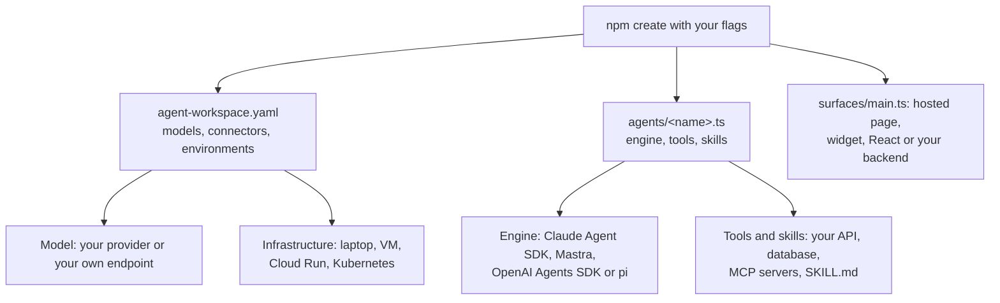

<Info>
**You will build:** one agent, created with one command, whose engine, model, tools, frontend and
infrastructure you then change one layer at a time.

**You will learn:** the generator's flags and the files it writes
([Agents as code](/guides/agents-as-code)), what each engine can honour
([Design an agent](/building/agents)), how to switch the model
([Models and runtimes](/building/models-and-runtimes)), how to add an OpenAPI or PostgreSQL tool,
an MCP server and a skill ([Tools from code](/guides/tools-from-code),
[MCP servers](/building/mcp-servers), [Skills](/building/skills)), the ways into your frontend
([Embed an agent](/building/embedding)), and how to deploy ([Deploy](/guides/deploy)).

**Time and prerequisites:** about 20 minutes, reading and hands-on together (part 7 also needs a
server to deploy to). Finish [chapter 1](/path/first-agent) first: Node 24 or newer and a key for
the model provider you pick. Docker is not needed.

</Info>

**Tutorial 0.** Agent Workspace does not ask you to adopt its agent model. You keep the parts you
already chose: the agent framework, the model provider, your own APIs and database, your frontend,
and the servers it all runs on. This tutorial builds one agent and changes each of those layers in
turn, so you can see that each change touches one flag or one line.

## The result

<Frame caption="Where you start: a generated agent answering on its try page (here the quickstart project, with a refund question). Each part below changes one layer under it.">
  
</Frame>

## How it works



## The six layers

| Layer | What you choose | Where the choice lives |
| --- | --- | --- |
| Engine | `claude-agent-sdk`, `mastra`, `openai-agents`, `pi` | `--engine`, then `engine:` in `agents/<name>.ts` |
| Model | `anthropic`, `openai`, `azure-openai`, `openai-compatible` (vLLM, Ollama, your gateway), `anthropic-compatible` | `--provider` and `--model-base-url`, then `models:` in `agent-workspace.yaml` |
| Skills | A starter (`support`, `knowledge`, `automation`, `review`, `copilot`, `blank`), then your own `skills/<name>/SKILL.md` | `--theme`, then `skills:` in the agent |
| Tools | Your REST API through its OpenAPI document, your PostgreSQL database read-only, your MCP servers | `--tools openapi,postgres`, then `tools/` and `connectors:` |
| Frontend | The hosted chat page, a `<script>` widget, React `<Chat/>`, or your backend calling the API | `surfaces/main.ts`, then your own app |
| Infrastructure | A laptop, a VM in your data centre, Google Cloud Run, your Kubernetes | `environments:` in `agent-workspace.yaml`, or the Helm chart |

## Before you start

- [Chapter 1](/path/first-agent) done, or at least Node 24 or newer installed.
- A key for the model provider you pick (the example uses OpenAI, as `OPENAI_API_KEY`).
- Docker is not needed.

**Get the code.** There is nothing to download: the generator writes every file. The interactive
version of this page is the builder at the top of
[lp.agentworkspace.indx.jp](https://lp.agentworkspace.indx.jp/#stack-cmd): click a chip and it
prints the same commands and files as this page.

## Build it

<Steps>
  <Step title="Part 1 · Create the project with your choices">

    Each setup question of the generator is also a flag. This one asks for an agent on Mastra that
    answers from your documents with an OpenAI model and can call your REST API:

    ```sh claim="run"
    npm create @indx-workspace@latest my-agent -- --yes \
        --engine mastra \
        --provider openai \
        --theme knowledge \
        --tools openapi \
        --openapi https://erp.acme.internal/openapi.json
    ```

    `--yes` takes the default for every question no flag answers and asks nothing, so a coding agent
    or CI can run it. Without `--yes`, on a terminal, the same questions are arrow-key menus. Run
    `npm create @indx-workspace@latest -- --help` for every flag and the values it accepts.

    The generator writes the project file, which holds no secret and is meant to be committed:

    ```yaml title="agent-workspace.yaml (illustrative)" claim="illustrative"
    apiVersion: agentworkspace.dev/v2
    kind: Project
    name: my-agent
    models:
      default:
        provider: openai
        credential:
          secret: OPENAI_API_KEY
    environments:
      local:
        cloud: local
        identity:
          bootstrapAdmin: admin@localhost.test
    ```

    It also writes the agent, as TypeScript:

    ```ts title="agents/knowledge.ts (illustrative)" claim="illustrative"
    import { defineAgent, skill } from '@indx-workspace/sdk/define';

    import openapiTool from '../tools/openapi';

    export default defineAgent({
      name: 'knowledge',
      instructions: 'You answer questions from the knowledge you have been given. ...',
      engine: 'mastra',
      model: 'default',
      tools: [openapiTool],
      skills: [skill('cite-sources')],
    });
    ```

    Beside them are `skills/cite-sources/SKILL.md`, `tools/openapi.ts`, `surfaces/main.ts` and an
    eval file. Every one of them is a plain file in your repository.

    **Check:** `my-agent/` holds `agent-workspace.yaml`, `agents/knowledge.ts`,
    `skills/cite-sources/SKILL.md`, `tools/openapi.ts`, `surfaces/main.ts` and an eval file.

  </Step>
  <Step title="Part 2 · Run it on your machine">

    ```sh title="illustrative" claim="illustrative"
    export OPENAI_API_KEY=...
    cd my-agent && npm run dev
    ```

    `npm run dev` runs `aw dev`: one Node process with an embedded PostgreSQL that serves the chat,
    the admin screens and the API on `http://127.0.0.1:3000`. The key stays in your shell; `aw dev`
    hands it to the model gateway, and the agent's own process only ever sees a token for one run.
    Talk to it with `npx aw chat -p "hi"`, or open the try URL the ready screen prints.

    **Check:** `npx aw chat -p "hi"` prints the agent's answer, and the try URL opens the chat.

  </Step>
  <Step title="Part 3 · Change the engine">

    The engine is one line of the agent. Change `engine: 'mastra'` to `'claude-agent-sdk'`,
    `'openai-agents'` or `'pi'` and save; `aw dev` watches `agents/` and applies it. The skills,
    the limits and the permissions travel with the agent. What each engine can honour is fixed by
    its adapter, and an agent that asks for more is refused when it is saved rather than run
    without it:

| | Claude Agent SDK | Mastra | OpenAI Agents SDK | pi |
| --- | --- | --- | --- | --- |
| MCP connectors | ✓ | ✓ | ✓ | — |
| Skills | ✓ | ✓ | — | ✓ |
| Resume a session | ✓ | ✓ | ✓ | ✓ |
| Fork a session | — | — | — | ✓ |
| Model dialects | Anthropic Messages | Anthropic Messages, OpenAI Responses, Chat Completions | OpenAI Responses, Chat Completions, Anthropic Messages | Anthropic Messages |

    So the agent above, which has a skill, cannot move to the OpenAI Agents SDK as it is. pi
    reaches any model connection through the gateway's Anthropic Messages ingress, which the gateway
    translates for an OpenAI-family connection. `npx aw engines list` prints the engines your deployment
    has installed. The table is generated from the adapters themselves; see the
    [engine matrix](/resources/engines) and [Runtime neutrality](/concepts/runtime-neutrality) for
    what each engine's tools are and how a policy is carried from one engine to another.

    **Check:** after you save, `aw dev` applies the new engine and the agent still answers
    `npx aw chat -p "hi"`; an engine that cannot honour the agent refuses it on save.

  </Step>
  <Step title="Part 4 · Change the model">

    Change `provider:` in `agent-workspace.yaml` and the variable the key is read from. A model you
    run yourself is an `openai-compatible` connection with its endpoint:

    ```yaml title="agent-workspace.yaml (illustrative)" claim="illustrative"
    models:
      default:
        provider: openai-compatible
        credential:
          secret: OPENAI_API_KEY
        baseUrl: http://gpu-01.internal:8000/v1
    ```

    Saving the file while `aw dev` runs applies its `models` at once. Azure OpenAI needs the
    deployment and API version beside the endpoint; see
    [Models and runtimes](/building/models-and-runtimes).

    **Check:** the next `npx aw chat -p "hi"` is answered through the new connection.

  </Step>
  <Step title="Part 5 · Add your tools and skills">

    - **Your API.** `--tools openapi` wrote `tools/openapi.ts`, an `openapiTool()` over your OpenAPI
      document, with `GET` only allowed until you widen it. See
      [Tools from code](/guides/tools-from-code).
    - **Your database.** `--tools postgres` writes a read-only `postgresTool()` with one placeholder
      table to replace.
    - **Your MCP servers.** Name them under `connectors:` in the project file and assign them with
      `mcp('<name>')`. See [MCP servers](/building/mcp-servers).
    - **Your know-how.** A skill is a folder with a `SKILL.md`. Copy the starter's, write your
      procedure in it and list it with `skill('<name>')`. See [Skills](/building/skills).

    **Check:** `npx aw check` passes after each addition.

  </Step>
  <Step title="Part 6 · Put it in your frontend">

    The project's surface, `surfaces/main.ts`, is already a hosted chat page. To use it elsewhere:

    <CodeGroup>
    ```html title="Widget (illustrative)" claim="illustrative"
    <script src="https://agents.acme.example/p/s/main/widget.js" async></script>
    ```

    ```tsx React claim="compile"
    // npm install @indx-workspace/react @indx-workspace/sdk
    import { Chat } from '@indx-workspace/react';

    export const Help = () => <Chat surface="main" baseUrl="https://agents.acme.example" />;
    ```

    ```ts title="Backend (illustrative)" claim="illustrative"
    // npm install @indx-workspace/sdk
    const run = await aw.runs.start({ agentId, prompt });
    ```
    </CodeGroup>

    Add your site's origin to the surface's `allowedOrigins`. [Build a frontend](/building/frontend)
    and the [embedding guide](/building/embedding) cover each option.

    **Check:** the chat opens on your page, served from your site's origin.

  </Step>
  <Step title="Part 7 · Deploy it on your infrastructure">

    Name production in the same project file, then plan and apply:

    ```yaml title="agent-workspace.yaml (illustrative)" claim="illustrative"
    environments:
      production:
        target: single-vm # or gcp-cloudrun
        url: https://agents.acme.example
    ```

    ```sh title="illustrative" claim="illustrative"
    npx aw deploy production --plan
    npx aw deploy production --yes
    export AGENT_WORKSPACE_URL=https://agents.acme.example AGENT_WORKSPACE_API_KEY=<key>
    npx aw push --yes && npx aw promote --yes
    ```

    `<key>` is a workspace API key minted in **Administration → API Keys** (see
    [Connect to a control plane](/cli/overview#connect-to-a-control-plane)): `aw push` refuses the
    user token `aw login` stores.

| Where | How, today |
| --- | --- |
| A VM in your data centre or VPC | `target: single-vm`: Docker Compose behind your TLS proxy |
| Google Cloud Run | `target: gcp-cloudrun`: Terraform from the repository's `infra/` |
| Your Kubernetes (EKS, GKE, AKS, OpenShift) | The Helm chart in `infra/helm/agent-workspace`, applied with `helm upgrade --install` |
| Amazon Bedrock AgentCore, Azure Container Apps sessions, GKE Agent Sandbox | Roadmap: the runtime drivers are named in the contract; see [D-4](/concepts/roadmap#d-4-a-verified-managed-cloud-sandbox-per-cloud) |

    [Deploy](/guides/deploy) lists every prerequisite `aw deploy` checks, and
    [Self-hosting](/building/self-hosting) says which runtime drivers are real today.

    **Check:** `npx aw deploy production --plan` shows the plan and changes nothing; after
    `aw promote`, the agent answers at your production URL.

  </Step>
</Steps>

## What is not there yet

- The generator has no flag for the frontend, the production target or an MCP server; you
  edit the files above for those.
- `aw deploy` takes a VM or Cloud Run. Kubernetes is the Helm chart, and AWS and Azure have no
  recipe yet.
- A tool written with `defineTool()` runs under `aw dev` but cannot be promoted yet.

Everything `defineAgent` and `defineSurface` take is in [Agents as code](/guides/agents-as-code).

<Card title="Next: 1. Manual search agent" icon="arrow-right" href="/tutorials/manual-search">
  The first gallery tutorial: a read-only agent that answers from manuals with checked citations.
</Card>
